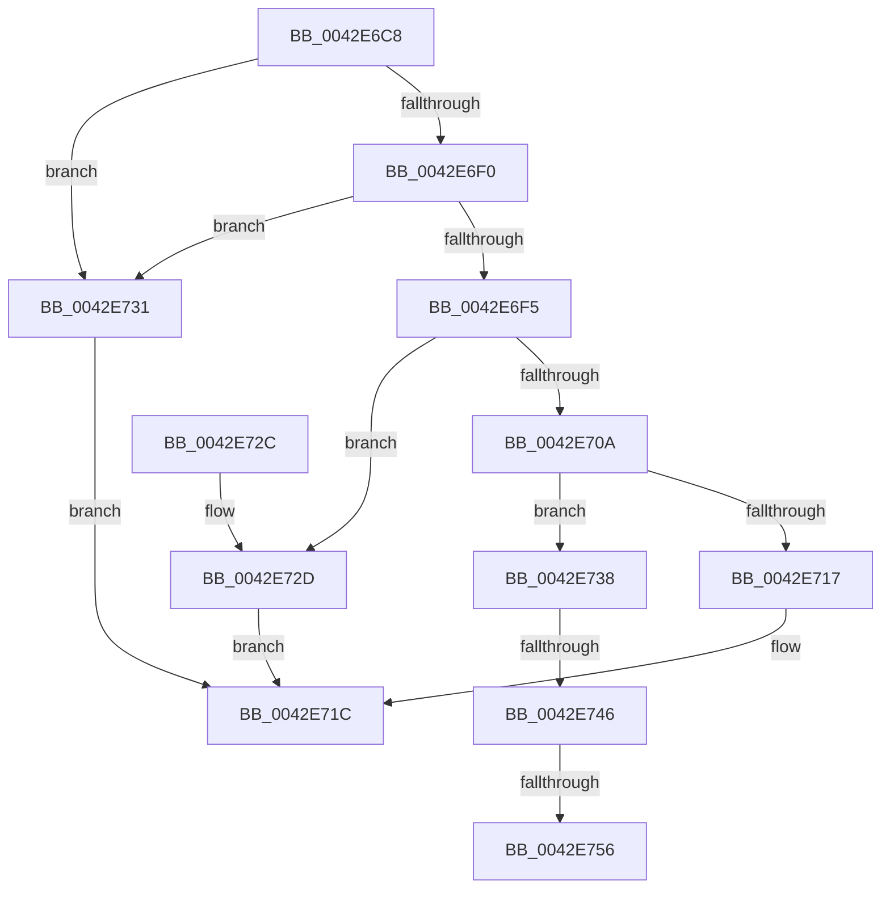

# RtlpTimeFieldsToTime

- RVA: `0x0042E6C8`–`0x0042E761` (길이 `153` bytes)
- VA: `0x000000014042E6C8`
- 실행 섹션: `.text`
- PDB 이름 있음: `예`; PDB Function 태그: `예`
- unwind 정보 RVA: `0x000A1C08`
- 디코드: `43`개 명령, `153/153` bytes 표시
- 미해석 바이트: `0` (있으면 어셈블리에 `.byte`로 보존)

> 이 문서는 커널 이미지의 기계어와 PDB 기호를 분석해 생성했습니다. 4번과 5번은 함수 원형과 자료형을 바이너리 사용 방식에서 추정한 C 해석이며 원본 소스 복구 결과는 아닙니다.

## 1. Dependencies

- 직접 호출 지점: **2**; 고유 호출 대상: **1**
- 직접 호출자로 확인된 함수: **10**
- RIP 상대 이미지 참조: **1**

### Outgoing calls
- `0x0042E701` → [RtlpTimeFieldsToTimeNoLeapSeconds](RtlpTimeFieldsToTimeNoLeapSeconds_function_0042E768.md) (function, `0x0042E768`)
- `0x0042E731` → [RtlpTimeFieldsToTimeNoLeapSeconds](RtlpTimeFieldsToTimeNoLeapSeconds_function_0042E768.md) (function, `0x0042E768`)

### Direct callers
- [HalSetRealTimeClock](HalSetRealTimeClock_function_0042D310.md) at `0x0042D346`
- [HalQueryRealTimeClock](HalQueryRealTimeClock_function_0042D810.md) at `0x0042D87B`
- [RtlTimeFieldsToTime](RtlTimeFieldsToTime_function_0042E6B0.md) at `0x0042E6B4`
- [HalEfiGetTime](../54/HalEfiGetTime_function_0054DC6C.md) at `0x0054DD65`
- [HalpCheckWakeupTimeAndAdjust](../55/HalpCheckWakeupTimeAndAdjust_function_0055BB14.md) at `0x0055BB62`
- [HalpCheckWakeupTimeAndAdjust](../55/HalpCheckWakeupTimeAndAdjust_function_0055BB14.md) at `0x0055BB72`
- [GetBootSystemTime](../../init/C1/GetBootSystemTime_function_00C1AFCC.md) at `0x00C1B11A`
- [Phase1InitializationDiscard](../../init/C1/Phase1InitializationDiscard_function_00C1C728.md) at `0x00C1CE29`
- [SeMakeAnonymousLogonToken](../../init/C4/SeMakeAnonymousLogonToken_function_00C4A8D8.md) at `0x00C4A942`
- [SeMakeAnonymousLogonTokenNoEveryone](../../init/C4/SeMakeAnonymousLogonTokenNoEveryone_function_00C4AB5C.md) at `0x00C4ABC6`
- [SeMakeSystemToken](../../init/C4/SeMakeSystemToken_function_00C4ADBC.md) at `0x00C4AE26`

### Static image references
- `0x0042E6E4` → RVA `0x00EFEE38` (`.data`; read)

## 2. Other-region calls and transfers

- 다른 실행 섹션으로 향하는 call: **0**
- call이 아닌 외부 분기/꼬리 이동: **3**
  - `0x0042E740` → [sub_006EE6CA + 0x11](../6E/Unknown_function_006EE6CA.md) (`tail-transfer`)
  - `0x0042E750` → [sub_006EE6CA](../6E/Unknown_function_006EE6CA.md) (`tail-transfer`)
  - `0x0042E75C` → [sub_006EE6CA + 0x30](../6E/Unknown_function_006EE6CA.md) (`tail-transfer`)

## 3. Assembly (complete function range)

```asm
0042E6C8  48 8B C4                        mov rax, rsp
0042E6CB  48 89 58 08                     mov qword ptr [rax + 8], rbx
0042E6CF  48 89 70 10                     mov qword ptr [rax + 0x10], rsi
0042E6D3  4C 89 40 18                     mov qword ptr [rax + 0x18], r8
0042E6D7  57                              push rdi
0042E6D8  48 83 EC 20                     sub rsp, 0x20
0042E6DC  48 83 60 18 00                  and qword ptr [rax + 0x18], 0
0042E6E1  48 8B FA                        mov rdi, rdx
0042E6E4  48 8B 1D 4D 07 AD 00            mov rbx, qword ptr [rip + 0xad074d]
0042E6EB  48 85 DB                        test rbx, rbx
0042E6EE  74 41                           je 0x14042e731
0042E6F0  80 3B 00                        cmp byte ptr [rbx], 0
0042E6F3  74 3C                           je 0x14042e731
0042E6F5  8B 73 04                        mov esi, dword ptr [rbx + 4]
0042E6F8  F0 83 0C 24 00                  lock or dword ptr [rsp], 0
0042E6FD  48 8D 50 18                     lea rdx, [rax + 0x18]
0042E701  E8 62 00 00 00                  call 0x14042e768
0042E706  84 C0                           test al, al
0042E708  74 23                           je 0x14042e72d
0042E70A  48 8B 44 24 40                  mov rax, qword ptr [rsp + 0x40]
0042E70F  45 33 C0                        xor r8d, r8d
0042E712  44 3B C6                        cmp r8d, esi
0042E715  72 21                           jb 0x14042e738
0042E717  48 89 07                        mov qword ptr [rdi], rax
0042E71A  B0 01                           mov al, 1
0042E71C  48 8B 5C 24 30                  mov rbx, qword ptr [rsp + 0x30]
0042E721  48 8B 74 24 38                  mov rsi, qword ptr [rsp + 0x38]
0042E726  48 83 C4 20                     add rsp, 0x20
0042E72A  5F                              pop rdi
0042E72B  C3                              ret
0042E72C  CC                              int3
0042E72D  32 C0                           xor al, al
0042E72F  EB EB                           jmp 0x14042e71c
0042E731  E8 32 00 00 00                  call 0x14042e768
0042E736  EB E4                           jmp 0x14042e71c
0042E738  4A 8B 54 C3 08                  mov rdx, qword ptr [rbx + r8*8 + 8]
0042E73D  48 85 D2                        test rdx, rdx
0042E740  0F 88 95 FF 2B 00               js 0x1406ee6db
0042E746  48 8D 8A 80 96 98 00            lea rcx, [rdx + 0x989680]
0042E74D  48 3B C1                        cmp rax, rcx
0042E750  0F 8C 74 FF 2B 00               jl 0x1406ee6ca
0042E756  48 05 80 96 98 00               add rax, 0x989680
0042E75C  E9 99 FF 2B 00                  jmp 0x1406ee6fa
```

## 4. C-style interpretation (structured pseudocode)

```c
__int64 __fastcall RtlpTimeFieldsToTime(__int64 a1, __int64 a2, __int64 a3)
{
    __int64 result;
    __int64 v_rsp;
    unsigned int v_stack_m28;
    unsigned __int64 v_stack_p10;
    unsigned __int64 v_stack_p18;
    unsigned __int64 v_stack_p8;

    *(unsigned __int64 *)(v_rsp + 8) = v_rbx;
    *(unsigned __int64 *)(v_rsp + 16) = v_rsi;
    *(unsigned __int64 *)(v_rsp + 24) = a3;
    v_rsp = (v_rsp) - (32);
    if (*(unsigned __int64 *)(v_rip + 11339597) == 0) goto loc_0042E731;
    if ((*(unsigned __int8 *)(*(unsigned __int64 *)(v_rip + 11339597))) == 0) goto loc_0042E731;
    result = RtlpTimeFieldsToTimeNoLeapSeconds(a1, v_rsp + 24, a3, a4);
    if ((unsigned __int8)(result) == 0) goto loc_0042E72D;
    a3 = 0;
    if (0 < ((unsigned int)((unsigned int)(*(unsigned int *)(*(unsigned __int64 *)(v_rip + 11339597) + 4))))) goto loc_0042E738;
    *(unsigned __int64 *)(a2) = v_stack_p18;
loc_0042E71C:
    v_rsp = (v_rsp) + (32);
    return 1;
loc_0042E72D:
    result = 0;
    goto loc_0042E71C;
loc_0042E731:
    result = RtlpTimeFieldsToTimeNoLeapSeconds(a1, v_rsp + 24, a3, a4);
    goto loc_0042E71C;
loc_0042E738:
    result = (result) + (0x989680ULL);
}
```

## 5. (Beta) C Style

```c
int64_t RtlpTimeFieldsToTime(int64_t Arg1, void *Arg2, int64_t Arg3)
{
    uint8_t *arg2 = (uint8_t *)Arg2;

    int64_t result;
    int64_t local_rsp;
    uint32_t v_stack_m28;
    uint64_t v_stack_p10;
    uint64_t v_stack_p18;
    uint64_t v_stack_p8;

    *(uint64_t *)(local_rsp + 0x8) = local_rbx;
    *(uint64_t *)(local_rsp + 0x10) = local_rsi;
    *(uint64_t *)(local_rsp + 0x18) = Arg3;
    local_rsp = (local_rsp) - (32);
    if (*(uint64_t *)(v_rip + 0xAD074D) == 0) goto loc_0042E731;
    if ((*(uint8_t *)(*(uint64_t *)(v_rip + 0xAD074D))) == 0) goto loc_0042E731;
    result = RtlpTimeFieldsToTimeNoLeapSeconds(Arg1, local_rsp + 24, Arg3, a4);
    if ((uint8_t)(result) == 0) goto loc_0042E72D;
    Arg3 = 0;
    if (0 < ((uint32_t)((uint32_t)(*(uint32_t *)(*(uint64_t *)(v_rip + 0xAD074D) + 0x4))))) goto loc_0042E738;
    *(uint64_t *)(arg2) = v_stack_p18;
loc_0042E71C:
    local_rsp = (local_rsp) + (32);
    return 1;
loc_0042E72D:
    result = 0;
    goto loc_0042E71C;
loc_0042E731:
    result = RtlpTimeFieldsToTimeNoLeapSeconds(Arg1, local_rsp + 24, Arg3, a4);
    goto loc_0042E71C;
loc_0042E738:
    result = (result) + (0x989680ULL);
}
```

### 관측된 메모리 오프셋

구조체 형식이 확인되지 않은 접근은 인자 기준의 오프셋으로만 기록했습니다.

| 기준 인자 | 오프셋 표현 | 폭 (bit) | 접근 |
|---|---:|---:|---|
| `Arg2` | `+ 0x0` | `64` | `W` |

## 6. Execution-region graph

[열기: 2D/3D 그래프와 함수 탐색 컨트롤 패널](../../../control-panel.html?section=text&rva=0x0042E6C8&view=graph)

- 2D 그래프는 위에서 아래로 흐르고, 3D 그래프는 빈 공간을 드래그해 회전합니다. Shift+드래그는 이동, 휠은 확대·축소, 함수 노드 선택은 대상 보고서 이동입니다.

### Static fallback


