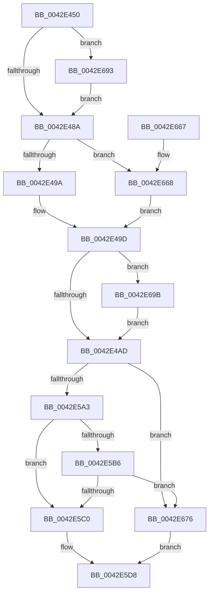

# RtlpTimeToTimeFieldsNoLeapSeconds

- RVA: `0x0042E450`–`0x0042E6A2` (길이 `594` bytes)
- VA: `0x000000014042E450`
- 실행 섹션: `.text`
- PDB 이름 있음: `예`; PDB Function 태그: `아니요`
- unwind 정보 RVA: `0x000A1BF8`
- 디코드: `152`개 명령, `594/594` bytes 표시
- 미해석 바이트: `0` (있으면 어셈블리에 `.byte`로 보존)

> 이 문서는 커널 이미지의 기계어와 PDB 기호를 분석해 생성했습니다. 4번과 5번은 함수 원형과 자료형을 바이너리 사용 방식에서 추정한 C 해석이며 원본 소스 복구 결과는 아닙니다.

## 1. Dependencies

- 직접 호출 지점: **0**; 고유 호출 대상: **0**
- 직접 호출자로 확인된 함수: **1**
- RIP 상대 이미지 참조: **3**

### Outgoing calls
- 직접 디코드된 call 명령이 없습니다.

### Direct callers
- [sub_0042E3B4](Unknown_function_0042E3B4.md) at `0x0042E3B4`

### Static image references
- `0x0042E470` → RVA `0x00014570` (`.rdata`; read)
- `0x0042E48A` → RVA `0x00014568` (`.rdata`; read)
- `0x0042E5C0` → RVA `0x00000000` (`image boundary/outside`; read)

## 2. Other-region calls and transfers

- 다른 실행 섹션으로 향하는 call: **0**
- 별도 외부 분기/꼬리 이동을 확인하지 못했습니다.

## 3. Assembly (complete function range)

```asm
0042E450  48 89 5C 24 08                  mov qword ptr [rsp + 8], rbx
0042E455  48 89 7C 24 10                  mov qword ptr [rsp + 0x10], rdi
0042E45A  48 8B 09                        mov rcx, qword ptr [rcx]
0042E45D  48 8B FA                        mov rdi, rdx
0042E460  48 8B C1                        mov rax, rcx
0042E463  4C 8B C1                        mov r8, rcx
0042E466  48 F7 D8                        neg rax
0042E469  48 85 C9                        test rcx, rcx
0042E46C  4C 0F 48 C0                     cmovs r8, rax
0042E470  48 8B 05 F9 60 BE FF            mov rax, qword ptr [rip - 0x419f07]
0042E477  49 F7 E0                        mul r8
0042E47A  4C 8B C2                        mov r8, rdx
0042E47D  49 C1 E8 0D                     shr r8, 0xd
0042E481  48 85 C9                        test rcx, rcx
0042E484  0F 88 09 02 00 00               js 0x14042e693
0042E48A  48 8B 05 D7 60 BE FF            mov rax, qword ptr [rip - 0x419f29]
0042E491  4D 85 C0                        test r8, r8
0042E494  0F 88 CE 01 00 00               js 0x14042e668
0042E49A  49 F7 E0                        mul r8
0042E49D  48 8B CA                        mov rcx, rdx
0042E4A0  48 C1 E9 1A                     shr rcx, 0x1a
0042E4A4  4D 85 C0                        test r8, r8
0042E4A7  0F 88 EE 01 00 00               js 0x14042e69b
0042E4AD  69 C1 00 5C 26 05               imul eax, ecx, 0x5265c00
0042E4B3  44 8D 49 01                     lea r9d, [rcx + 1]
0042E4B7  44 2B C0                        sub r8d, eax
0042E4BA  B8 25 49 92 24                  mov eax, 0x24924925
0042E4BF  41 F7 E1                        mul r9d
0042E4C2  41 8B C1                        mov eax, r9d
0042E4C5  2B C2                           sub eax, edx
0042E4C7  D1 E8                           shr eax, 1
0042E4C9  03 C2                           add eax, edx
0042E4CB  C1 E8 02                        shr eax, 2
0042E4CE  6B C0 07                        imul eax, eax, 7
0042E4D1  44 2B C8                        sub r9d, eax
0042E4D4  B8 BD 06 6B 39                  mov eax, 0x396b06bd
0042E4D9  F7 E1                           mul ecx
0042E4DB  66 44 89 4F 0E                  mov word ptr [rdi + 0xe], r9w
0042E4E0  44 8B C9                        mov r9d, ecx
0042E4E3  8B DA                           mov ebx, edx
0042E4E5  C1 EB 0F                        shr ebx, 0xf
0042E4E8  69 C3 B1 3A 02 00               imul eax, ebx, 0x23ab1
0042E4EE  44 2B C8                        sub r9d, eax
0042E4F1  B8 C7 03 FB 25                  mov eax, 0x25fb03c7
0042E4F6  45 6B D9 64                     imul r11d, r9d, 0x64
0042E4FA  41 83 C3 4B                     add r11d, 0x4b
0042E4FE  41 F7 E3                        mul r11d
0042E501  44 2B DA                        sub r11d, edx
0042E504  41 D1 EB                        shr r11d, 1
0042E507  44 03 DA                        add r11d, edx
0042E50A  41 C1 EB 15                     shr r11d, 0x15
0042E50E  41 69 C3 54 71 FF FF            imul eax, r11d, 0xffff7154
0042E515  44 03 C8                        add r9d, eax
0042E518  B8 73 B0 6D 16                  mov eax, 0x166db073
0042E51D  41 F7 E1                        mul r9d
0042E520  44 8B D2                        mov r10d, edx
0042E523  41 C1 EA 07                     shr r10d, 7
0042E527  41 69 C2 B5 05 00 00            imul eax, r10d, 0x5b5
0042E52E  44 2B C8                        sub r9d, eax
0042E531  B8 E1 E5 AA E5                  mov eax, 0xe5aae5e1
0042E536  45 6B C9 64                     imul r9d, r9d, 0x64
0042E53A  41 83 C1 4B                     add r9d, 0x4b
0042E53E  41 F7 E1                        mul r9d
0042E541  41 8D 04 9B                     lea eax, [r11 + rbx*4]
0042E545  44 6B C8 19                     imul r9d, eax, 0x19
0042E549  B8 1F 85 EB 51                  mov eax, 0x51eb851f
0042E54E  C1 EA 0F                        shr edx, 0xf
0042E551  45 03 CA                        add r9d, r10d
0042E554  42 8D 1C 8A                     lea ebx, [rdx + r9*4]
0042E558  F7 E3                           mul ebx
0042E55A  44 69 D3 93 FE FF FF            imul r10d, ebx, 0xfffffe93
0042E561  44 8D 5B 01                     lea r11d, [rbx + 1]
0042E565  8B C3                           mov eax, ebx
0042E567  C1 E8 02                        shr eax, 2
0042E56A  C1 EA 07                        shr edx, 7
0042E56D  44 2B D2                        sub r10d, edx
0042E570  44 2B D0                        sub r10d, eax
0042E573  B8 1F 85 EB 51                  mov eax, 0x51eb851f
0042E578  F7 E3                           mul ebx
0042E57A  42 8D 04 11                     lea eax, [rcx + r10]
0042E57E  44 8B CA                        mov r9d, edx
0042E581  41 C1 E9 05                     shr r9d, 5
0042E585  44 03 C8                        add r9d, eax
0042E588  B8 1F 85 EB 51                  mov eax, 0x51eb851f
0042E58D  41 F7 E3                        mul r11d
0042E590  C1 EA 07                        shr edx, 7
0042E593  44 69 D2 90 01 00 00            imul r10d, edx, 0x190
0042E59A  45 3B DA                        cmp r11d, r10d
0042E59D  0F 84 D3 00 00 00               je 0x14042e676
0042E5A3  B8 1F 85 EB 51                  mov eax, 0x51eb851f
0042E5A8  41 F7 E3                        mul r11d
0042E5AB  C1 EA 05                        shr edx, 5
0042E5AE  6B CA 64                        imul ecx, edx, 0x64
0042E5B1  44 3B D9                        cmp r11d, ecx
0042E5B4  74 0A                           je 0x14042e5c0
0042E5B6  41 F6 C3 03                     test r11b, 3
0042E5BA  0F 84 B6 00 00 00               je 0x14042e676
0042E5C0  48 8D 15 39 1A BD FF            lea rdx, [rip - 0x42e5c7]
0042E5C7  41 0F B6 8C 11 00 C6 02 00      movzx ecx, byte ptr [r9 + rdx + 0x2c600]
0042E5D0  0F BF 84 4A E0 C5 02 00         movsx eax, word ptr [rdx + rcx*2 + 0x2c5e0]
0042E5D8  44 2B C8                        sub r9d, eax
0042E5DB  66 FF C1                        inc cx
0042E5DE  66 89 4F 02                     mov word ptr [rdi + 2], cx
0042E5E2  B8 D3 4D 62 10                  mov eax, 0x10624dd3
0042E5E7  41 F7 E0                        mul r8d
0042E5EA  B8 89 88 88 88                  mov eax, 0x88888889
0042E5EF  66 41 FF C1                     inc r9w
0042E5F3  44 8B DA                        mov r11d, edx
0042E5F6  66 44 89 4F 04                  mov word ptr [rdi + 4], r9w
0042E5FB  41 C1 EB 06                     shr r11d, 6
0042E5FF  41 F7 E3                        mul r11d
0042E602  B8 89 88 88 88                  mov eax, 0x88888889
0042E607  44 8B D2                        mov r10d, edx
0042E60A  BA 41 06 00 00                  mov edx, 0x641
0042E60F  66 03 DA                        add bx, dx
0042E612  41 C1 EA 05                     shr r10d, 5
0042E616  41 F7 E2                        mul r10d
0042E619  66 89 1F                        mov word ptr [rdi], bx
0042E61C  48 8B 5C 24 08                  mov rbx, qword ptr [rsp + 8]
0042E621  C1 EA 05                        shr edx, 5
0042E624  0F BF C2                        movsx eax, dx
0042E627  6B C8 3C                        imul ecx, eax, 0x3c
0042E62A  41 0F B7 C2                     movzx eax, r10w
0042E62E  66 89 57 06                     mov word ptr [rdi + 6], dx
0042E632  66 2B C1                        sub ax, cx
0042E635  66 89 47 08                     mov word ptr [rdi + 8], ax
0042E639  41 0F BF C2                     movsx eax, r10w
0042E63D  6B C8 3C                        imul ecx, eax, 0x3c
0042E640  41 0F B7 C3                     movzx eax, r11w
0042E644  66 2B C1                        sub ax, cx
0042E647  41 0F BF CB                     movsx ecx, r11w
0042E64B  66 89 47 0A                     mov word ptr [rdi + 0xa], ax
0042E64F  B8 E8 03 00 00                  mov eax, 0x3e8
0042E654  98                              cwde
0042E655  0F AF C8                        imul ecx, eax
0042E658  66 44 2B C1                     sub r8w, cx
0042E65C  66 44 89 47 0C                  mov word ptr [rdi + 0xc], r8w
0042E661  48 8B 7C 24 10                  mov rdi, qword ptr [rsp + 0x10]
0042E666  C3                              ret
0042E667  CC                              int3
0042E668  49 8B C8                        mov rcx, r8
0042E66B  48 F7 D9                        neg rcx
0042E66E  48 F7 E1                        mul rcx
0042E671  E9 27 FE FF FF                  jmp 0x14042e49d
0042E676  48 8D 15 83 19 BD FF            lea rdx, [rip - 0x42e67d]
0042E67D  41 0F B6 8C 11 70 C4 02 00      movzx ecx, byte ptr [r9 + rdx + 0x2c470]
0042E686  0F BF 84 4A 70 C7 02 00         movsx eax, word ptr [rdx + rcx*2 + 0x2c770]
0042E68E  E9 45 FF FF FF                  jmp 0x14042e5d8
0042E693  49 F7 D8                        neg r8
0042E696  E9 EF FD FF FF                  jmp 0x14042e48a
0042E69B  F7 D9                           neg ecx
0042E69D  E9 0B FE FF FF                  jmp 0x14042e4ad
```

## 4. C-style interpretation (structured pseudocode)

```c
__int64 __fastcall RtlpTimeToTimeFieldsNoLeapSeconds(__int64 a1, __int64 a2)
{
    __int64 result;
    __int64 v_r10;
    __int64 v_r11;
    __int64 v_rbx;
    unsigned __int64 v_stack_p10;
    unsigned __int64 v_stack_p8;

    v_stack_p8 = v_rbx;
    v_stack_p10 = v_rdi;
    result = -(*(unsigned __int64 *)(a1));
    a3 = *(unsigned __int64 *)(a1);
    if (sign_flag) { a3 = result; }
    a3 = (a2) >> (13);
    if (sign_flag) goto loc_0042E693;
loc_0042E48A:
    if (sign_flag) goto loc_0042E668;
loc_0042E49D:
    a1 = (a2) >> (26);
    if (sign_flag) goto loc_0042E69B;
loc_0042E4AD:
    result = (unsigned int)((*(unsigned __int64 *)(v_rip - 4300585)) * ((unsigned int)(a1)));
    a3 = (unsigned int)((a3) - ((unsigned int)(result)));
    result = (unsigned int)(((unsigned int)((unsigned int)(a1 + 1))) - ((unsigned int)(a2)));
    result = (unsigned int)((result) >> (1));
    result = (unsigned int)((result) + ((unsigned int)(a2)));
    result = (unsigned int)((result) >> (2));
    result = (unsigned int)((result) * ((unsigned int)(result)));
    a4 = (unsigned int)((a1 + 1) - ((unsigned int)(result)));
    *(unsigned __int16 *)(a2 + 14) = (unsigned __int16)(a4);
    v_rbx = (unsigned int)(((unsigned int)((unsigned int)(a2))) >> (15));
    result = (unsigned int)(((unsigned int)(0x396B06BDULL)) * ((unsigned int)(v_rbx)));
    a4 = (unsigned int)(((unsigned int)((unsigned int)(a1))) - ((unsigned int)(result)));
    v_r11 = (unsigned int)((v_r11) * ((unsigned int)(a4)));
    v_r11 = (unsigned int)((v_r11) + (75));
    v_r11 = (unsigned int)((v_r11) - ((unsigned int)(a2)));
    v_r11 = (unsigned int)((v_r11) >> (1));
    v_r11 = (unsigned int)((v_r11) + ((unsigned int)(a2)));
    v_r11 = (unsigned int)((v_r11) >> (21));
    result = (unsigned int)(((unsigned int)(0x25FB03C7ULL)) * ((unsigned int)(v_r11)));
    a4 = (unsigned int)((a4) + ((unsigned int)(result)));
    v_r10 = (unsigned int)(((unsigned int)((unsigned int)(a2))) >> (7));
    result = (unsigned int)(((unsigned int)(0x166DB073ULL)) * ((unsigned int)(v_r10)));
    a4 = (unsigned int)((a4) - ((unsigned int)(result)));
    a4 = (unsigned int)((a4) * ((unsigned int)(a4)));
    a4 = (unsigned int)((a4) + (75));
    a4 = (unsigned int)((a4) * ((unsigned int)(v_r11 + v_rbx * 4)));
    a2 = (unsigned int)((a2) >> (15));
    a4 = (unsigned int)((a4) + ((unsigned int)(v_r10)));
    v_r10 = (unsigned int)((v_r10) * ((unsigned int)(a2 + a4 * 4)));
    result = (unsigned int)(((unsigned int)((unsigned int)(a2 + a4 * 4))) >> (2));
    a2 = (unsigned int)((a2) >> (7));
    v_r10 = (unsigned int)((v_r10) - ((unsigned int)(a2)));
    v_r10 = (unsigned int)((v_r10) - ((unsigned int)(result)));
    a4 = (unsigned int)(((unsigned int)((unsigned int)(a2))) >> (5));
    a4 = (unsigned int)((a4) + ((unsigned int)(a1 + v_r10 * 1)));
    a2 = (unsigned int)((a2) >> (7));
    v_r10 = (unsigned int)((v_r10) * ((unsigned int)(a2)));
    if (((unsigned int)(a2 + a4 * 4 + 1)) == ((unsigned int)(v_r10))) goto loc_0042E676;
    a2 = (unsigned int)((a2) >> (5));
    a1 = (unsigned int)((a1) * ((unsigned int)(a2)));
    if (((unsigned int)(a2 + a4 * 4 + 1)) == ((unsigned int)(a1))) goto loc_0042E5C0;
    if ((((unsigned __int8)(a2 + a4 * 4 + 1)) & (3)) == 0) goto loc_0042E676;
loc_0042E5C0:
loc_0042E5D8:
    a4 = (unsigned int)((a4) - ((unsigned int)((__int16)(*(unsigned __int16 *)(v_rip - 4384199 + *(unsigned __int8 *)(a4 + v_rip - 4384199 * 1 + 181760) * 2 + 181728)))));
    a1 = (unsigned __int16)((*(unsigned __int8 *)(a4 + v_rip - 4384199 * 1 + 181760)) + 1);
    *(unsigned __int16 *)(a2 + 2) = (unsigned __int16)(a1);
    a4 = (unsigned __int16)((a4) + 1);
    *(unsigned __int16 *)(a2 + 4) = (unsigned __int16)(a4);
    v_r11 = (unsigned int)(((unsigned int)((unsigned int)(v_rip - 4384199))) >> (6));
    v_rbx = (unsigned __int16)((a2 + a4 * 4) + ((unsigned __int16)((unsigned int)(0x641ULL))));
    v_r10 = (unsigned int)(((unsigned int)((unsigned int)(v_rip - 4384199))) >> (5));
    *(unsigned __int16 *)(a2) = (unsigned __int16)(v_rbx);
    a2 = (unsigned int)(((unsigned int)(0x641ULL)) >> (5));
    a1 = (unsigned int)((a1) * ((unsigned int)((__int16)((unsigned __int16)(a2)))));
    *(unsigned __int16 *)(a2 + 6) = (unsigned __int16)(a2);
    result = (unsigned __int16)(((unsigned __int16)(v_r10)) - ((unsigned __int16)(a1)));
    *(unsigned __int16 *)(a2 + 8) = (unsigned __int16)(result);
    a1 = (unsigned int)((a1) * ((unsigned int)((__int16)((unsigned __int16)(v_r10)))));
    result = (unsigned __int16)(((unsigned __int16)(v_r11)) - ((unsigned __int16)(a1)));
    *(unsigned __int16 *)(a2 + 10) = (unsigned __int16)(result);
    a1 = (unsigned int)(((__int16)((unsigned __int16)(v_r11))) * (1000));
    a3 = (unsigned __int16)((a3) - ((unsigned __int16)(a1)));
    *(unsigned __int16 *)(a2 + 12) = (unsigned __int16)(a3);
    return 1000;
loc_0042E668:
    a1 = -(a3);
    goto loc_0042E49D;
loc_0042E676:
    goto loc_0042E5D8;
loc_0042E693:
    a3 = -(a3);
    goto loc_0042E48A;
loc_0042E69B:
    a1 = (unsigned int)(-(*(unsigned __int8 *)(a4 + v_rip - 4384381 * 1 + 181360)));
    goto loc_0042E4AD;
}
```

## 5. (Beta) C Style

```c
int64_t RtlpTimeToTimeFieldsNoLeapSeconds(void *Arg1, void *Arg2)
{
    uint8_t *arg1 = (uint8_t *)Arg1;
    uint8_t *arg2 = (uint8_t *)Arg2;

    int64_t result;
    int64_t local_r10;
    int64_t local_r11;
    int64_t local_rbx;
    uint64_t v_stack_p10;
    uint64_t v_stack_p8;

    v_stack_p8 = local_rbx;
    v_stack_p10 = local_rdi;
    result = -(*(uint64_t *)(arg1));
    a3 = *(uint64_t *)(arg1);
    if (sign_flag) { a3 = result; }
    a3 = (Arg2) >> (13);
    if (sign_flag) goto loc_0042E693;
loc_0042E48A:
    if (sign_flag) goto loc_0042E668;
loc_0042E49D:
    Arg1 = (Arg2) >> (26);
    if (sign_flag) goto loc_0042E69B;
loc_0042E4AD:
    result = (uint32_t)((*(uint64_t *)(v_rip - 0x419F29)) * ((uint32_t)(Arg1)));
    a3 = (uint32_t)((a3) - ((uint32_t)(result)));
    result = (uint32_t)(((uint32_t)((uint32_t)(Arg1 + 1))) - ((uint32_t)(Arg2)));
    result = (uint32_t)((result) >> (1));
    result = (uint32_t)((result) + ((uint32_t)(Arg2)));
    result = (uint32_t)((result) >> (2));
    result = (uint32_t)((result) * ((uint32_t)(result)));
    a4 = (uint32_t)((Arg1 + 1) - ((uint32_t)(result)));
    *(uint16_t *)(arg2 + 0xE) = (uint16_t)(a4);
    local_rbx = (uint32_t)(((uint32_t)((uint32_t)(Arg2))) >> (15));
    result = (uint32_t)(((uint32_t)(0x396B06BDULL)) * ((uint32_t)(local_rbx)));
    a4 = (uint32_t)(((uint32_t)((uint32_t)(Arg1))) - ((uint32_t)(result)));
    local_r11 = (uint32_t)((local_r11) * ((uint32_t)(a4)));
    local_r11 = (uint32_t)((local_r11) + (75));
    local_r11 = (uint32_t)((local_r11) - ((uint32_t)(Arg2)));
    local_r11 = (uint32_t)((local_r11) >> (1));
    local_r11 = (uint32_t)((local_r11) + ((uint32_t)(Arg2)));
    local_r11 = (uint32_t)((local_r11) >> (21));
    result = (uint32_t)(((uint32_t)(0x25FB03C7ULL)) * ((uint32_t)(local_r11)));
    a4 = (uint32_t)((a4) + ((uint32_t)(result)));
    local_r10 = (uint32_t)(((uint32_t)((uint32_t)(Arg2))) >> (7));
    result = (uint32_t)(((uint32_t)(0x166DB073ULL)) * ((uint32_t)(local_r10)));
    a4 = (uint32_t)((a4) - ((uint32_t)(result)));
    a4 = (uint32_t)((a4) * ((uint32_t)(a4)));
    a4 = (uint32_t)((a4) + (75));
    a4 = (uint32_t)((a4) * ((uint32_t)(local_r11 + local_rbx * 4)));
    Arg2 = (uint32_t)((Arg2) >> (15));
    a4 = (uint32_t)((a4) + ((uint32_t)(local_r10)));
    local_r10 = (uint32_t)((local_r10) * ((uint32_t)(Arg2 + a4 * 4)));
    result = (uint32_t)(((uint32_t)((uint32_t)(Arg2 + a4 * 4))) >> (2));
    Arg2 = (uint32_t)((Arg2) >> (7));
    local_r10 = (uint32_t)((local_r10) - ((uint32_t)(Arg2)));
    local_r10 = (uint32_t)((local_r10) - ((uint32_t)(result)));
    a4 = (uint32_t)(((uint32_t)((uint32_t)(Arg2))) >> (5));
    a4 = (uint32_t)((a4) + ((uint32_t)(Arg1 + local_r10 * 1)));
    Arg2 = (uint32_t)((Arg2) >> (7));
    local_r10 = (uint32_t)((local_r10) * ((uint32_t)(Arg2)));
    if (((uint32_t)(Arg2 + a4 * 4 + 1)) == ((uint32_t)(local_r10))) goto loc_0042E676;
    Arg2 = (uint32_t)((Arg2) >> (5));
    Arg1 = (uint32_t)((Arg1) * ((uint32_t)(Arg2)));
    if (((uint32_t)(Arg2 + a4 * 4 + 1)) == ((uint32_t)(Arg1))) goto loc_0042E5C0;
    if ((((uint8_t)(Arg2 + a4 * 4 + 1)) & (3)) == 0) goto loc_0042E676;
loc_0042E5C0:
loc_0042E5D8:
    a4 = (uint32_t)((a4) - ((uint32_t)((int16_t)(*(uint16_t *)(v_rip - 0x42E5C7 + *(uint8_t *)(a4 + v_rip - 0x42E5C7 * 1 + 0x2C600) * 2 + 0x2C5E0)))));
    Arg1 = (uint16_t)((*(uint8_t *)(a4 + v_rip - 0x42E5C7 * 1 + 0x2C600)) + 1);
    *(uint16_t *)(arg2 + 0x2) = (uint16_t)(Arg1);
    a4 = (uint16_t)((a4) + 1);
    *(uint16_t *)(arg2 + 0x4) = (uint16_t)(a4);
    local_r11 = (uint32_t)(((uint32_t)((uint32_t)(v_rip - 4384199))) >> (6));
    local_rbx = (uint16_t)((Arg2 + a4 * 4) + ((uint16_t)((uint32_t)(0x641ULL))));
    local_r10 = (uint32_t)(((uint32_t)((uint32_t)(v_rip - 4384199))) >> (5));
    *(uint16_t *)(arg2) = (uint16_t)(local_rbx);
    Arg2 = (uint32_t)(((uint32_t)(0x641ULL)) >> (5));
    Arg1 = (uint32_t)((Arg1) * ((uint32_t)((int16_t)((uint16_t)(Arg2)))));
    *(uint16_t *)(arg2 + 0x6) = (uint16_t)(Arg2);
    result = (uint16_t)(((uint16_t)(local_r10)) - ((uint16_t)(Arg1)));
    *(uint16_t *)(arg2 + 0x8) = (uint16_t)(result);
    Arg1 = (uint32_t)((Arg1) * ((uint32_t)((int16_t)((uint16_t)(local_r10)))));
    result = (uint16_t)(((uint16_t)(local_r11)) - ((uint16_t)(Arg1)));
    *(uint16_t *)(arg2 + 0xA) = (uint16_t)(result);
    Arg1 = (uint32_t)(((int16_t)((uint16_t)(local_r11))) * (1000));
    a3 = (uint16_t)((a3) - ((uint16_t)(Arg1)));
    *(uint16_t *)(arg2 + 0xC) = (uint16_t)(a3);
    return 1000;
loc_0042E668:
    Arg1 = -(a3);
    goto loc_0042E49D;
loc_0042E676:
    goto loc_0042E5D8;
loc_0042E693:
    a3 = -(a3);
    goto loc_0042E48A;
loc_0042E69B:
    Arg1 = (uint32_t)(-(*(uint8_t *)(a4 + v_rip - 0x42E67D * 1 + 0x2C470)));
    goto loc_0042E4AD;
}
```

### 관측된 메모리 오프셋

구조체 형식이 확인되지 않은 접근은 인자 기준의 오프셋으로만 기록했습니다.

| 기준 인자 | 오프셋 표현 | 폭 (bit) | 접근 |
|---|---:|---:|---|
| `Arg1` | `+ 0x0` | `64` | `R` |
| `Arg2` | `+ 0x0` | `16` | `W` |
| `Arg2` | `+ 0x2` | `16` | `W` |
| `Arg2` | `+ 0x4` | `16` | `W` |
| `Arg2` | `+ 0x6` | `16` | `W` |
| `Arg2` | `+ 0x8` | `16` | `W` |
| `Arg2` | `+ 0xA` | `16` | `W` |
| `Arg2` | `+ 0xC` | `16` | `W` |
| `Arg2` | `+ 0xE` | `16` | `W` |

## 6. Execution-region graph

[열기: 2D/3D 그래프와 함수 탐색 컨트롤 패널](../../../control-panel.html?section=text&rva=0x0042E450&view=graph)

- 2D 그래프는 위에서 아래로 흐르고, 3D 그래프는 빈 공간을 드래그해 회전합니다. Shift+드래그는 이동, 휠은 확대·축소, 함수 노드 선택은 대상 보고서 이동입니다.

### Static fallback


