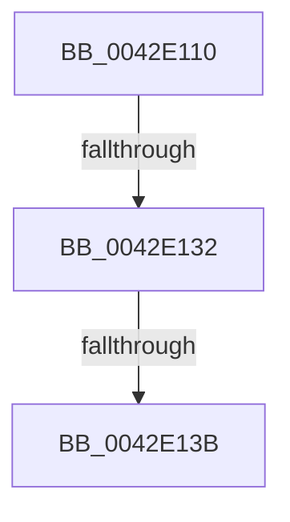

# RtlpTimeToTimeFields

- RVA: `0x0042E110`–`0x0042E13E` (길이 `46` bytes)
- VA: `0x000000014042E110`
- 실행 섹션: `.text`
- PDB 이름 있음: `예`; PDB Function 태그: `예`
- unwind 정보 RVA: `0x000A1B04`
- 디코드: `11`개 명령, `46/46` bytes 표시
- 미해석 바이트: `0` (있으면 어셈블리에 `.byte`로 보존)

> 이 문서는 커널 이미지의 기계어와 PDB 기호를 분석해 생성했습니다. 4번과 5번은 함수 원형과 자료형을 바이너리 사용 방식에서 추정한 C 해석이며 원본 소스 복구 결과는 아닙니다.

## 1. Dependencies

- 직접 호출 지점: **0**; 고유 호출 대상: **0**
- 직접 호출자로 확인된 함수: **10**
- RIP 상대 이미지 참조: **1**

### Outgoing calls
- 직접 디코드된 call 명령이 없습니다.

### Direct callers
- [HalSetRealTimeClock](HalSetRealTimeClock_function_0042D310.md) at `0x0042D427`
- [HalQueryRealTimeClock](HalQueryRealTimeClock_function_0042D810.md) at `0x0042D8F6`
- [HalpSetVirtualRtc](HalpSetVirtualRtc_function_0042DF30.md) at `0x0042DF70`
- [WheapGetTimestamp](WheapGetTimestamp_function_0042E05C.md) at `0x0042E089`
- [RtlTimeToTimeFields](RtlTimeToTimeFields_function_0042E0F0.md) at `0x0042E0F4`
- [HalpQueryVirtualRtc](../54/HalpQueryVirtualRtc_function_0054C4D0.md) at `0x0054C534`
- [HalEfiSetTime](../54/HalEfiSetTime_function_0054DE84.md) at `0x0054DF82`
- [HalpCheckWakeupTimeAndAdjust](../55/HalpCheckWakeupTimeAndAdjust_function_0055BB14.md) at `0x0055BB93`
- [GetBootSystemTime](../../init/C1/GetBootSystemTime_function_00C1AFCC.md) at `0x00C1B0DB`
- [Phase1InitializationDiscard](../../init/C1/Phase1InitializationDiscard_function_00C1C728.md) at `0x00C1CE17`

### Static image references
- `0x0042E116` → RVA `0x00EFEE38` (`.data`; read)

## 2. Other-region calls and transfers

- 다른 실행 섹션으로 향하는 call: **0**
- call이 아닌 외부 분기/꼬리 이동: **2**
  - `0x0042E12C` → [sub_0042E3B4](Unknown_function_0042E3B4.md) (`tail-transfer`)
  - `0x0042E135` → [sub_0042E3B4](Unknown_function_0042E3B4.md) (`tail-transfer`)

## 3. Assembly (complete function range)

```asm
0042E110  40 56                           push rsi
0042E112  48 83 EC 30                     sub rsp, 0x30
0042E116  48 8B 05 1B 0D AD 00            mov rax, qword ptr [rip + 0xad0d1b]
0042E11D  45 33 D2                        xor r10d, r10d
0042E120  66 44 89 54 24 2C               mov word ptr [rsp + 0x2c], r10w
0042E126  48 8B F2                        mov rsi, rdx
0042E129  48 85 C0                        test rax, rax
0042E12C  0F 84 82 02 00 00               je 0x14042e3b4
0042E132  44 38 10                        cmp byte ptr [rax], r10b
0042E135  0F 84 79 02 00 00               je 0x14042e3b4
0042E13B  8B 50 04                        mov edx, dword ptr [rax + 4]
```

## 4. C-style interpretation (structured pseudocode)

```c
__int64 __fastcall RtlpTimeToTimeFields(__int64 a1, __int64 a2)
{
    __int64 v_r10;
    __int64 v_rsp;
    unsigned __int16 v_stack_mC;

    v_rsp = (v_rsp) - (48);
    v_r10 = 0;
    v_stack_mC = 0;
    return *(unsigned __int64 *)(v_rip + 11341083);
}
```

## 5. (Beta) C Style

```c
int64_t RtlpTimeToTimeFields(int64_t Arg1, int64_t Arg2)
{
    int64_t local_r10;
    int64_t local_rsp;
    uint16_t v_stack_mC;

    local_rsp = (local_rsp) - (48);
    local_r10 = 0;
    v_stack_mC = 0;
    return *(uint64_t *)(v_rip + 0xAD0D1B);
}
```

## 6. Execution-region graph

[열기: 2D/3D 그래프와 함수 탐색 컨트롤 패널](../../../control-panel.html?section=text&rva=0x0042E110&view=graph)

- 2D 그래프는 위에서 아래로 흐르고, 3D 그래프는 빈 공간을 드래그해 회전합니다. Shift+드래그는 이동, 휠은 확대·축소, 함수 노드 선택은 대상 보고서 이동입니다.

### Static fallback


