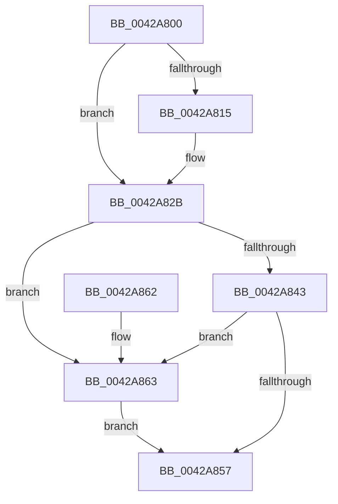

# SeAuditingAnyFileEventsWithContextEx

- RVA: `0x0042A800`–`0x0042A867` (길이 `103` bytes)
- VA: `0x000000014042A800`
- 실행 섹션: `.text`
- PDB 이름 있음: `예`; PDB Function 태그: `아니요`
- unwind 정보 RVA: `0x00065BB8`
- 디코드: `33`개 명령, `103/103` bytes 표시
- 미해석 바이트: `0` (있으면 어셈블리에 `.byte`로 보존)

> 이 문서는 커널 이미지의 기계어와 PDB 기호를 분석해 생성했습니다. 4번과 5번은 함수 원형과 자료형을 바이너리 사용 방식에서 추정한 C 해석이며 원본 소스 복구 결과는 아닙니다.

## 1. Dependencies

- 직접 호출 지점: **3**; 고유 호출 대상: **2**
- 직접 호출자로 확인된 함수: **1**
- RIP 상대 이미지 참조: **0**

### Outgoing calls
- `0x0042A824` → [SepAdtAuditThisEventWithContext](../../page/87/SepAdtAuditThisEventWithContext_function_00870AC0.md) (function, `0x00870AC0`)
- `0x0042A83A` → [SepAdtAuditThisEventWithContext](../../page/87/SepAdtAuditThisEventWithContext_function_00870AC0.md) (function, `0x00870AC0`)
- `0x0042A84E` → [SepAdtAuditThisEventByCategoryWithContext](../../page/9A/SepAdtAuditThisEventByCategoryWithContext_function_009A2910.md) (function, `0x009A2910`)

### Direct callers
- [SeAuditingAnyFileEventsWithContext](../../page/79/SeAuditingAnyFileEventsWithContext_function_0079FA50.md) at `0x0079FA57`

### Static image references
- 디코드된 RIP-relative 메모리 참조가 없습니다.

## 2. Other-region calls and transfers

- 다른 실행 섹션으로 향하는 call: **3**
  - `0x0042A824` → [SepAdtAuditThisEventWithContext](../../page/87/SepAdtAuditThisEventWithContext_function_00870AC0.md) (`.text` → `PAGE`)
  - `0x0042A83A` → [SepAdtAuditThisEventWithContext](../../page/87/SepAdtAuditThisEventWithContext_function_00870AC0.md) (`.text` → `PAGE`)
  - `0x0042A84E` → [SepAdtAuditThisEventByCategoryWithContext](../../page/9A/SepAdtAuditThisEventByCategoryWithContext_function_009A2910.md) (`.text` → `PAGE`)
- 별도 외부 분기/꼬리 이동을 확인하지 못했습니다.

## 3. Assembly (complete function range)

```asm
0042A800  48 89 5C 24 08                  mov qword ptr [rsp + 8], rbx
0042A805  57                              push rdi
0042A806  48 83 EC 20                     sub rsp, 0x20
0042A80A  49 8B F8                        mov rdi, r8
0042A80D  48 8B DA                        mov rbx, rdx
0042A810  4D 85 C0                        test r8, r8
0042A813  74 16                           je 0x14042a82b
0042A815  41 B0 01                        mov r8b, 1
0042A818  4C 8B CA                        mov r9, rdx
0042A81B  41 0F B6 D0                     movzx edx, r8b
0042A81F  B9 82 00 00 00                  mov ecx, 0x82
0042A824  E8 97 62 44 00                  call 0x140870ac0
0042A829  88 07                           mov byte ptr [rdi], al
0042A82B  41 B0 01                        mov r8b, 1
0042A82E  4C 8B CB                        mov r9, rbx
0042A831  41 0F B6 D0                     movzx edx, r8b
0042A835  B9 75 00 00 00                  mov ecx, 0x75
0042A83A  E8 81 62 44 00                  call 0x140870ac0
0042A83F  84 C0                           test al, al
0042A841  75 20                           jne 0x14042a863
0042A843  BA 33 00 00 00                  mov edx, 0x33
0042A848  4C 8B C3                        mov r8, rbx
0042A84B  8D 4A D0                        lea ecx, [rdx - 0x30]
0042A84E  E8 BD 80 57 00                  call 0x1409a2910
0042A853  84 C0                           test al, al
0042A855  75 0C                           jne 0x14042a863
0042A857  48 8B 5C 24 30                  mov rbx, qword ptr [rsp + 0x30]
0042A85C  48 83 C4 20                     add rsp, 0x20
0042A860  5F                              pop rdi
0042A861  C3                              ret
0042A862  CC                              int3
0042A863  B0 01                           mov al, 1
0042A865  EB F0                           jmp 0x14042a857
```

## 4. C-style interpretation (structured pseudocode)

```c
__int64 __fastcall SeAuditingAnyFileEventsWithContextEx(__int64 a1, __int64 a2, __int64 a3)
{
    __int64 result;
    __int64 v_rsp;
    unsigned __int64 v_stack_p8;

    v_stack_p8 = v_rbx;
    v_rsp = (v_rsp) - (32);
    if (a3 != 0) {
        a3 = 1;
        a4 = a2;
        a2 = (unsigned __int8)(a3);
        a1 = 130;
        result = SepAdtAuditThisEventWithContext(a1, a2, a3, a4);
        *(unsigned __int8 *)(a3) = (unsigned __int8)(result);
    }
    result = SepAdtAuditThisEventWithContext(117, 1, 1, a2);
    if ((unsigned __int8)(result) != 0) goto loc_0042A863;
    result = SepAdtAuditThisEventByCategoryWithContext(51 - 48, 51, a2, a2);
    if ((unsigned __int8)(result) != 0) goto loc_0042A863;
loc_0042A857:
    v_rsp = (v_rsp) + (32);
    return result;
loc_0042A863:
    goto loc_0042A857;
}
```

## 5. (Beta) C Style

```c
int64_t SeAuditingAnyFileEventsWithContextEx(int64_t Arg1, int64_t Arg2, void *Arg3)
{
    uint8_t *arg3 = (uint8_t *)Arg3;

    int64_t result;
    int64_t local_rsp;
    uint64_t v_stack_p8;

    v_stack_p8 = local_rbx;
    local_rsp = (local_rsp) - (32);
    if (Arg3 != NULL) {
        Arg3 = 1;
        a4 = Arg2;
        Arg2 = (uint8_t)(Arg3);
        Arg1 = 130;
        result = SepAdtAuditThisEventWithContext(Arg1, Arg2, Arg3, a4);
        *(uint8_t *)(arg3) = (uint8_t)(result);
    }
    result = SepAdtAuditThisEventWithContext(117, 1, 1, Arg2);
    if ((uint8_t)(result) != 0) goto loc_0042A863;
    result = SepAdtAuditThisEventByCategoryWithContext(51 - 48, 51, Arg2, Arg2);
    if ((uint8_t)(result) != 0) goto loc_0042A863;
loc_0042A857:
    local_rsp = (local_rsp) + (32);
    return result;
loc_0042A863:
    goto loc_0042A857;
}
```

### 관측된 메모리 오프셋

구조체 형식이 확인되지 않은 접근은 인자 기준의 오프셋으로만 기록했습니다.

| 기준 인자 | 오프셋 표현 | 폭 (bit) | 접근 |
|---|---:|---:|---|
| `Arg3` | `+ 0x0` | `8` | `W` |

## 6. Execution-region graph

[열기: 2D/3D 그래프와 함수 탐색 컨트롤 패널](../../../control-panel.html?section=text&rva=0x0042A800&view=graph)

- 2D 그래프는 위에서 아래로 흐르고, 3D 그래프는 빈 공간을 드래그해 회전합니다. Shift+드래그는 이동, 휠은 확대·축소, 함수 노드 선택은 대상 보고서 이동입니다.

### Static fallback


