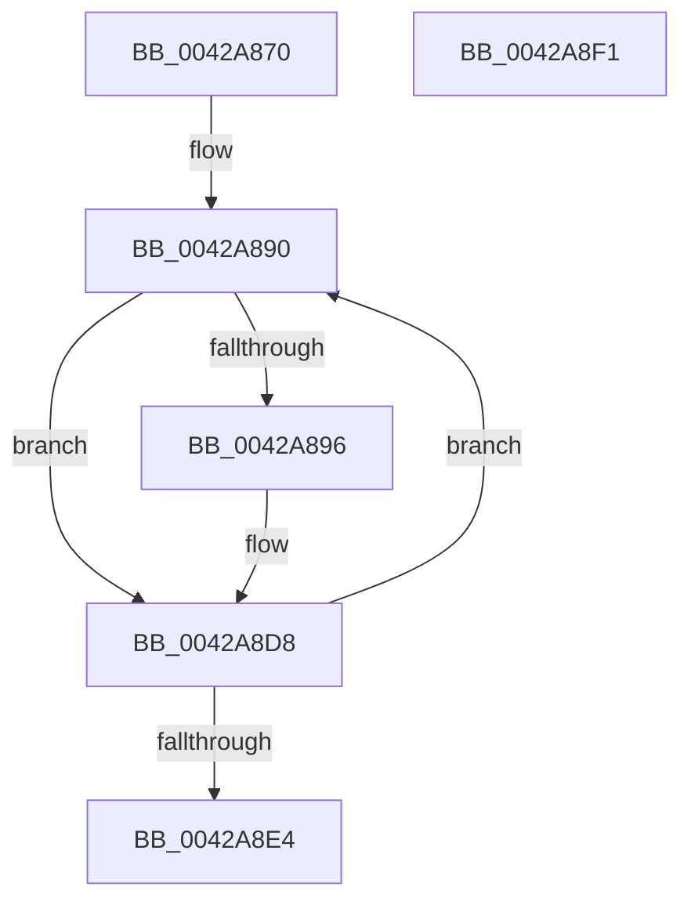

# SepConvertTokenPrivilegesToLuidAndAttributes

- RVA: `0x0042A870`–`0x0042A8F2` (길이 `130` bytes)
- VA: `0x000000014042A870`
- 실행 섹션: `.text`
- PDB 이름 있음: `예`; PDB Function 태그: `아니요`
- unwind 정보 RVA: `0x000950EC`
- 디코드: `38`개 명령, `130/130` bytes 표시
- 미해석 바이트: `0` (있으면 어셈블리에 `.byte`로 보존)

> 이 문서는 커널 이미지의 기계어와 PDB 기호를 분석해 생성했습니다. 4번과 5번은 함수 원형과 자료형을 바이너리 사용 방식에서 추정한 C 해석이며 원본 소스 복구 결과는 아닙니다.

## 1. Dependencies

- 직접 호출 지점: **0**; 고유 호출 대상: **0**
- 직접 호출자로 확인된 함수: **3**
- RIP 상대 이미지 참조: **0**

### Outgoing calls
- 직접 디코드된 call 명령이 없습니다.

### Direct callers
- [SeQueryInformationToken](../../page/8B/SeQueryInformationToken_function_008B5090.md) at `0x008B5AB9`
- [SepCopyTokenAccessInformation](../../page/9E/SepCopyTokenAccessInformation_function_009E9C0C.md) at `0x009EA225`
- [NtQueryInformationToken](../../page/AE/NtQueryInformationToken_function_00AECDD0.md) at `0x00AEE469`

### Static image references
- 디코드된 RIP-relative 메모리 참조가 없습니다.

## 2. Other-region calls and transfers

- 다른 실행 섹션으로 향하는 call: **0**
- 별도 외부 분기/꼬리 이동을 확인하지 못했습니다.

## 3. Assembly (complete function range)

```asm
0042A870  48 89 5C 24 08                  mov qword ptr [rsp + 8], rbx
0042A875  48 89 7C 24 10                  mov qword ptr [rsp + 0x10], rdi
0042A87A  33 DB                           xor ebx, ebx
0042A87C  48 8B FA                        mov rdi, rdx
0042A87F  45 33 D2                        xor r10d, r10d
0042A882  4C 8B D9                        mov r11, rcx
0042A885  41 B8 01 00 00 00               mov r8d, 1
0042A88B  0F 1F 44 00 00                  nop dword ptr [rax + rax]
0042A890  4D 85 43 40                     test qword ptr [r11 + 0x40], r8
0042A894  74 42                           je 0x14042a8d8
0042A896  48 8D 0C 5B                     lea rcx, [rbx + rbx*2]
0042A89A  49 63 C2                        movsxd rax, r10d
0042A89D  89 44 24 18                     mov dword ptr [rsp + 0x18], eax
0042A8A1  4C 8D 0C 8F                     lea r9, [rdi + rcx*4]
0042A8A5  48 C1 E8 20                     shr rax, 0x20
0042A8A9  BA 00 00 00 00                  mov edx, 0
0042A8AE  89 44 24 1C                     mov dword ptr [rsp + 0x1c], eax
0042A8B2  48 8B 44 24 18                  mov rax, qword ptr [rsp + 0x18]
0042A8B7  49 89 01                        mov qword ptr [r9], rax
0042A8BA  4D 85 43 50                     test qword ptr [r11 + 0x50], r8
0042A8BE  49 8B 43 48                     mov rax, qword ptr [r11 + 0x48]
0042A8C2  0F 95 C2                        setne dl
0042A8C5  49 23 C0                        and rax, r8
0042A8C8  48 F7 D8                        neg rax
0042A8CB  1B C9                           sbb ecx, ecx
0042A8CD  83 E1 02                        and ecx, 2
0042A8D0  0B D1                           or edx, ecx
0042A8D2  41 89 51 08                     mov dword ptr [r9 + 8], edx
0042A8D6  FF C3                           inc ebx
0042A8D8  41 FF C2                        inc r10d
0042A8DB  49 D1 C0                        rol r8, 1
0042A8DE  41 83 FA 24                     cmp r10d, 0x24
0042A8E2  76 AC                           jbe 0x14042a890
0042A8E4  48 8B 7C 24 10                  mov rdi, qword ptr [rsp + 0x10]
0042A8E9  8B C3                           mov eax, ebx
0042A8EB  48 8B 5C 24 08                  mov rbx, qword ptr [rsp + 8]
0042A8F0  C3                              ret
0042A8F1  CC                              int3
```

## 4. C-style interpretation (structured pseudocode)

```c
__int64 __fastcall SepConvertTokenPrivilegesToLuidAndAttributes(__int64 a1, __int64 a2)
{
    __int64 result;
    __int64 v_r10;
    __int64 v_rbx;
    unsigned __int64 v_stack_p10;
    unsigned int v_stack_p18;
    unsigned int v_stack_p1C;
    unsigned __int64 v_stack_p8;

    v_stack_p8 = v_rbx;
    v_stack_p10 = v_rdi;
    v_rbx = 0;
    v_r10 = 0;
loc_0042A890:
    if (((*(unsigned __int64 *)(a1 + 64)) & (1)) != 0) {
        a1 = v_rbx + v_rbx * 2;
        result = (int)(0);
        v_stack_p18 = (unsigned int)(result);
        a4 = a2 + a1 * 4;
        result = (result) >> (32);
        a2 = 0;
        v_stack_p1C = (unsigned int)(result);
        result = v_stack_p18;
        *(unsigned __int64 *)(a4) = result;
        result = *(unsigned __int64 *)(a1 + 72);
        a2 = (((*(unsigned __int64 *)(a1 + 80)) & (1)) != 0) ? 1 : 0;
        result = (result) & (1);
        result = -(result);
        a1 = (unsigned int)((a1) & (2));
        a2 = (unsigned int)((a2) | ((unsigned int)(a1)));
        *(unsigned int *)(a4 + 8) = (unsigned int)(a2);
        v_rbx = (unsigned int)((v_rbx) + 1);
    }
    v_r10 = (unsigned int)((v_r10) + 1);
    if (((unsigned int)(v_r10)) <= 36) goto loc_0042A890;
    return (unsigned int)((unsigned int)(v_rbx));
}
```

## 5. (Beta) C Style

```c
int64_t SepConvertTokenPrivilegesToLuidAndAttributes(void *Arg1, void *Arg2)
{
    uint8_t *arg1 = (uint8_t *)Arg1;
    uint8_t *arg2 = (uint8_t *)Arg2;

    int64_t result;
    int64_t local_r10;
    int64_t local_rbx;
    uint64_t v_stack_p10;
    uint32_t v_stack_p18;
    uint32_t v_stack_p1C;
    uint64_t v_stack_p8;

    v_stack_p8 = local_rbx;
    v_stack_p10 = local_rdi;
    local_rbx = 0;
    local_r10 = 0;
loc_0042A890:
    if (((*(uint64_t *)(arg1 + 0x40)) & (1)) != 0) {
        Arg1 = local_rbx + local_rbx * 2;
        result = (int32_t)(0);
        v_stack_p18 = (uint32_t)(result);
        a4 = Arg2 + Arg1 * 4;
        result = (result) >> (32);
        Arg2 = 0;
        v_stack_p1C = (uint32_t)(result);
        result = v_stack_p18;
        *(uint64_t *)(a4) = result;
        result = *(uint64_t *)(arg1 + 0x48);
        Arg2 = (((*(uint64_t *)(arg1 + 0x50)) & (1)) != 0) ? 1 : 0;
        result = (result) & (1);
        result = -(result);
        Arg1 = (uint32_t)((Arg1) & (2));
        Arg2 = (uint32_t)((Arg2) | ((uint32_t)(Arg1)));
        *(uint32_t *)(a4 + 0x8) = (uint32_t)(Arg2);
        local_rbx = (uint32_t)((local_rbx) + 1);
    }
    local_r10 = (uint32_t)((local_r10) + 1);
    if (((uint32_t)(local_r10)) <= 36) goto loc_0042A890;
    return (uint32_t)((uint32_t)(local_rbx));
}
```

### 관측된 메모리 오프셋

구조체 형식이 확인되지 않은 접근은 인자 기준의 오프셋으로만 기록했습니다.

| 기준 인자 | 오프셋 표현 | 폭 (bit) | 접근 |
|---|---:|---:|---|
| `Arg1` | `+ 0x40` | `64` | `R` |
| `Arg1` | `+ 0x48` | `64` | `R` |
| `Arg1` | `+ 0x50` | `64` | `R` |
| `Arg2` | `+ 0x0` | `64` | `W` |
| `Arg2` | `+ 0x0 + rcx*4` | `64` | `R` |
| `Arg2` | `+ 0x8` | `32` | `W` |

## 6. Execution-region graph

[열기: 2D/3D 그래프와 함수 탐색 컨트롤 패널](../../../control-panel.html?section=text&rva=0x0042A870&view=graph)

- 2D 그래프는 위에서 아래로 흐르고, 3D 그래프는 빈 공간을 드래그해 회전합니다. Shift+드래그는 이동, 휠은 확대·축소, 함수 노드 선택은 대상 보고서 이동입니다.

### Static fallback


