# sub_004201AA

- RVA: `0x004201AA`–`0x00420595` (길이 `1,003` bytes)
- VA: `0x00000001404201AA`
- 실행 섹션: `.text`
- PDB 이름 있음: `아니요`; PDB Function 태그: `아니요`
- unwind 정보 RVA: `0x000A0148`
- 디코드: `247`개 명령, `1,003/1,003` bytes 표시
- 미해석 바이트: `0` (있으면 어셈블리에 `.byte`로 보존)

> 이 문서는 커널 이미지의 기계어와 PDB 기호를 분석해 생성했습니다. 4번과 5번은 함수 원형과 자료형을 바이너리 사용 방식에서 추정한 C 해석이며 원본 소스 복구 결과는 아닙니다.

## 1. Dependencies

- 직접 호출 지점: **14**; 고유 호출 대상: **12**
- 직접 호출자로 확인된 함수: **0**
- RIP 상대 이미지 참조: **3**

### Outgoing calls
- `0x00420229` → [StLockAcquireShared](../34/StLockAcquireShared_function_0034C728.md) (function, `0x0034C728`)
- `0x00420258` → [ExfReleasePushLockShared](../26/ExfReleasePushLockShared_function_00263440.md) (function, `0x00263440`)
- `0x00420264` → [KeAbPostRelease](../2E/KeAbPostRelease_function_002E1600.md) (function, `0x002E1600`)
- `0x00420289` → [KiCheckForKernelApcDelivery](../2E/KiCheckForKernelApcDelivery_function_002E2C80.md) (function, `0x002E2C80`)
- `0x0042029C` → [StLockAcquireShared](../34/StLockAcquireShared_function_0034C728.md) (function, `0x0034C728`)
- `0x004202B2` → [StLockAcquireShared](../34/StLockAcquireShared_function_0034C728.md) (function, `0x0034C728`)
- `0x004202C5` → [ST_STORE<SM_TRAITS>::StDmpSinglePageLookup](../3A/ST_STORE_SM_TRAITS_StDmpSinglePageLookup_function_003ABFF0.md) (function, `0x003ABFF0`)
- `0x004203C8` → [SMKM_STORE<SM_TRAITS>::SmStMapVirtualRegion](../34/SMKM_STORE_SM_TRAITS_SmStMapVirtualRegion_function_0034D770.md) (function, `0x0034D770`)
- `0x00420433` → [MmMapLockedPagesSpecifyCache](../31/MmMapLockedPagesSpecifyCache_function_00318800.md) (function, `0x00318800`)
- `0x00420492` → [KeWaitForSingleObject](../20/KeWaitForSingleObject_function_0020E6B0.md) (function, `0x0020E6B0`)
- `0x004204AB` → [ExAcquireSpinLockExclusive](../24/ExAcquireSpinLockExclusive_function_00248690.md) (function, `0x00248690`)
- `0x004204FB` → [ExpReleaseSpinLockExclusiveFromDpcLevelInstrumented](../2C/ExpReleaseSpinLockExclusiveFromDpcLevelInstrumented_function_002C0F44.md) (function, `0x002C0F44`)
- `0x00420517` → [KiLowerIrqlProcessIrqlFlags](../4F/KiLowerIrqlProcessIrqlFlags_function_004F5698.md) (function, `0x004F5698`)
- `0x0042053C` → [MmMapLockedPagesWithReservedMapping](../3E/MmMapLockedPagesWithReservedMapping_function_003E8910.md) (function, `0x003E8910`)

### Direct callers
- 이 함수 시작 RVA로 연결되는 직접 call은 확인되지 않았습니다. 간접 호출은 완전히 역산할 수 없습니다.

### Static image references
- `0x004204DD` → RVA `0x00FC6B06` (`ALMOSTRO`; reference)
- `0x004204E6` → RVA `0x00F0DE58` (`.data`; read)
- `0x00420506` → RVA `0x00FC6D20` (`ALMOSTRO`; read)

## 2. Other-region calls and transfers

- 다른 실행 섹션으로 향하는 call: **0**
- call이 아닌 외부 분기/꼬리 이동: **4**
  - `0x0042038C` → [sub_0042067D + 0x13](Unknown_function_0042067D.md) (`tail-transfer`)
  - `0x004203F2` → [sub_0042067D](Unknown_function_0042067D.md) (`tail-transfer`)
  - `0x00420569` → [sub_0042067D + 0x9](Unknown_function_0042067D.md) (`tail-transfer`)
  - `0x00420593` → [sub_00420595 + 0x54](Unknown_function_00420595.md) (`tail-transfer`)

## 3. Assembly (complete function range)

```asm
004201AA  4C 89 68 C0                     mov qword ptr [rax - 0x40], r13
004201AE  41 8B CB                        mov ecx, r11d
004201B1  4C 8B AA A0 01 00 00            mov r13, qword ptr [rdx + 0x1a0]
004201B8  0F 94 C1                        sete cl
004201BB  4C 89 58 A0                     mov qword ptr [rax - 0x60], r11
004201BF  4C 8B FA                        mov r15, rdx
004201C2  41 8B C0                        mov eax, r8d
004201C5  4C 89 6C 24 58                  mov qword ptr [rsp + 0x58], r13
004201CA  83 E0 02                        and eax, 2
004201CD  4D 8B F1                        mov r14, r9
004201D0  8B D0                           mov edx, eax
004201D2  4D 8B E0                        mov r12, r8
004201D5  83 CA 01                        or edx, 1
004201D8  8B D9                           mov ebx, ecx
004201DA  89 54 24 44                     mov dword ptr [rsp + 0x44], edx
004201DE  85 C0                           test eax, eax
004201E0  74 0E                           je 0x1404201f0
004201E2  49 8B 55 10                     mov rdx, qword ptr [r13 + 0x10]
004201E6  48 89 54 24 48                  mov qword ptr [rsp + 0x48], rdx
004201EB  E9 EC 00 00 00                  jmp 0x1404202dc
004201F0  F6 85 EA 08 00 00 01            test byte ptr [rbp + 0x8ea], 1
004201F7  74 0A                           je 0x140420203
004201F9  BF E2 04 00 C0                  mov edi, 0xc00004e2
004201FE  E9 88 03 00 00                  jmp 0x14042058b
00420203  41 0F BA E2 11                  bt r10d, 0x11
00420208  0F 83 A9 00 00 00               jae 0x1404202b7
0042020E  8B 85 C0 05 00 00               mov eax, dword ptr [rbp + 0x5c0]
00420214  85 C0                           test eax, eax
00420216  75 76                           jne 0x14042028e
00420218  48 8B 8D 20 03 00 00            mov rcx, qword ptr [rbp + 0x320]
0042021F  83 CB 04                        or ebx, 4
00420222  48 81 C1 B0 1A 00 00            add rcx, 0x1ab0
00420229  E8 FA C4 F2 FF                  call 0x14034c728
0042022E  8B 85 C0 05 00 00               mov eax, dword ptr [rbp + 0x5c0]
00420234  85 C0                           test eax, eax
00420236  74 7F                           je 0x1404202b7
00420238  48 8B BD 20 03 00 00            mov rdi, qword ptr [rbp + 0x320]
0042023F  B8 11 00 00 00                  mov eax, 0x11
00420244  33 C9                           xor ecx, ecx
00420246  F0 48 0F B1 8F B0 1A 00 00      lock cmpxchg qword ptr [rdi + 0x1ab0], rcx
0042024F  74 0C                           je 0x14042025d
00420251  48 8D 8F B0 1A 00 00            lea rcx, [rdi + 0x1ab0]
00420258  E8 E3 31 E4 FF                  call 0x140263440
0042025D  48 8D 8F B0 1A 00 00            lea rcx, [rdi + 0x1ab0]
00420264  E8 97 13 EC FF                  call 0x1402e1600
00420269  65 48 8B 04 25 88 01 00 00      mov rax, qword ptr gs:[0x188]
00420272  90                              nop
00420273  66 83 80 E6 01 00 00 01         add word ptr [rax + 0x1e6], 1
0042027B  75 11                           jne 0x14042028e
0042027D  48 05 98 00 00 00               add rax, 0x98
00420283  90                              nop
00420284  48 39 00                        cmp qword ptr [rax], rax
00420287  74 05                           je 0x14042028e
00420289  E8 F2 29 EC FF                  call 0x1402e2c80
0042028E  48 8B 8D 20 03 00 00            mov rcx, qword ptr [rbp + 0x320]
00420295  48 81 C1 98 1A 00 00            add rcx, 0x1a98
0042029C  E8 87 C4 F2 FF                  call 0x14034c728
004202A1  48 8B 8D 20 03 00 00            mov rcx, qword ptr [rbp + 0x320]
004202A8  83 CB 06                        or ebx, 6
004202AB  48 81 C1 B0 1A 00 00            add rcx, 0x1ab0
004202B2  E8 71 C4 F2 FF                  call 0x14034c728
004202B7  4C 8D 4C 24 48                  lea r9, [rsp + 0x48]
004202BC  4D 8B C5                        mov r8, r13
004202BF  49 8B D7                        mov rdx, r15
004202C2  48 8B CD                        mov rcx, rbp
004202C5  E8 26 BD F8 FF                  call 0x1403abff0
004202CA  45 33 DB                        xor r11d, r11d
004202CD  8B F8                           mov edi, eax
004202CF  85 C0                           test eax, eax
004202D1  0F 88 B4 02 00 00               js 0x14042058b
004202D7  48 8B 54 24 48                  mov rdx, qword ptr [rsp + 0x48]
004202DC  8B 02                           mov eax, dword ptr [rdx]
004202DE  4C 8D 85 08 03 00 00            lea r8, [rbp + 0x308]
004202E5  8B 8D 2C 03 00 00               mov ecx, dword ptr [rbp + 0x32c]
004202EB  44 8B C8                        mov r9d, eax
004202EE  44 8B A5 28 03 00 00            mov r12d, dword ptr [rbp + 0x328]
004202F5  41 89 06                        mov dword ptr [r14], eax
004202F8  44 23 E0                        and r12d, eax
004202FB  41 D3 E9                        shr r9d, cl
004202FE  B8 00 10 00 00                  mov eax, 0x1000
00420303  8B 4A 04                        mov ecx, dword ptr [rdx + 4]
00420306  81 E1 FF 0F 00 00               and ecx, 0xfff
0042030C  0F 47 C1                        cmova eax, ecx
0042030F  B9 FF 00 00 00                  mov ecx, 0xff
00420314  66 41 89 46 04                  mov word ptr [r14 + 4], ax
00420319  41 0F B7 45 00                  movzx eax, word ptr [r13]
0042031E  66 23 C1                        and ax, cx
00420321  66 41 89 46 06                  mov word ptr [r14 + 6], ax
00420326  80 BD 08 03 00 00 00            cmp byte ptr [rbp + 0x308], 0
0042032D  75 0E                           jne 0x14042033d
0042032F  8B 42 08                        mov eax, dword ptr [rdx + 8]
00420332  4C 8D 85 08 03 00 00            lea r8, [rbp + 0x308]
00420339  41 89 46 10                     mov dword ptr [r14 + 0x10], eax
0042033D  41 8B 00                        mov eax, dword ptr [r8]
00420340  0F BA E0 11                     bt eax, 0x11
00420344  72 4B                           jb 0x140420391
00420346  84 C0                           test al, al
00420348  75 11                           jne 0x14042035b
0042034A  48 8B 85 78 05 00 00            mov rax, qword ptr [rbp + 0x578]
00420351  42 0F B7 14 48                  movzx edx, word ptr [rax + r9*2]
00420356  C1 EA 0D                        shr edx, 0xd
00420359  EB 03                           jmp 0x14042035e
0042035B  41 8B D3                        mov edx, r11d
0042035E  8B C2                           mov eax, edx
00420360  B9 08 00 00 00                  mov ecx, 8
00420365  48 03 C0                        add rax, rax
00420368  44 3B 8C C5 58 06 00 00         cmp r9d, dword ptr [rbp + rax*8 + 0x658]
00420370  0F 45 D1                        cmovne edx, ecx
00420373  3B D1                           cmp edx, ecx
00420375  74 1A                           je 0x140420391
00420377  41 C1 E4 04                     shl r12d, 4
0042037B  8B C2                           mov eax, edx
0042037D  48 83 C0 66                     add rax, 0x66
00420381  41 8B F4                        mov esi, r12d
00420384  48 03 C0                        add rax, rax
00420387  48 03 74 C5 00                  add rsi, qword ptr [rbp + rax*8]
0042038C  E9 FF 02 00 00                  jmp 0x140420690
00420391  48 8B BD 20 03 00 00            mov rdi, qword ptr [rbp + 0x320]
00420398  49 8B 4E 08                     mov rcx, qword ptr [r14 + 8]
0042039C  41 C1 E4 04                     shl r12d, 4
004203A0  F6 87 95 1A 00 00 04            test byte ptr [rdi + 0x1a95], 4
004203A7  74 2C                           je 0x1404203d5
004203A9  41 BD 01 00 00 00               mov r13d, 1
004203AF  B8 81 00 00 00                  mov eax, 0x81
004203B4  49 3B CD                        cmp rcx, r13
004203B7  45 8B C4                        mov r8d, r12d
004203BA  41 8B D1                        mov edx, r9d
004203BD  48 8B CF                        mov rcx, rdi
004203C0  41 0F 45 C5                     cmovne eax, r13d
004203C4  89 44 24 20                     mov dword ptr [rsp + 0x20], eax
004203C8  E8 A3 D3 F2 FF                  call 0x14034d770
004203CD  48 8B F0                        mov rsi, rax
004203D0  E9 90 01 00 00                  jmp 0x140420565
004203D5  48 8B 87 68 1B 00 00            mov rax, qword ptr [rdi + 0x1b68]
004203DC  4A 8D 0C C8                     lea rcx, [rax + r9*8]
004203E0  4A 8B 04 C8                     mov rax, qword ptr [rax + r9*8]
004203E4  4C 8B F8                        mov r15, rax
004203E7  48 89 4C 24 50                  mov qword ptr [rsp + 0x50], rcx
004203EC  49 83 E7 F8                     and r15, 0xfffffffffffffff8
004203F0  A8 03                           test al, 3
004203F2  0F 85 85 02 00 00               jne 0x14042067d
004203F8  65 4C 8B 34 25 88 01 00 00      mov r14, qword ptr gs:[0x188]
00420401  48 81 C7 18 1D 00 00            add rdi, 0x1d18
00420408  41 F6 47 0A 05                  test byte ptr [r15 + 0xa], 5
0042040D  41 BD 01 00 00 00               mov r13d, 1
00420413  74 06                           je 0x14042041b
00420415  49 8B 77 18                     mov rsi, qword ptr [r15 + 0x18]
00420419  EB 20                           jmp 0x14042043b
0042041B  C7 44 24 28 10 00 00 40         mov dword ptr [rsp + 0x28], 0x40000010
00420423  45 33 C9                        xor r9d, r9d
00420426  45 8B C5                        mov r8d, r13d
00420429  44 89 5C 24 20                  mov dword ptr [rsp + 0x20], r11d
0042042E  33 D2                           xor edx, edx
00420430  49 8B CF                        mov rcx, r15
00420433  E8 C8 83 EF FF                  call 0x140318800
00420438  48 8B F0                        mov rsi, rax
0042043B  48 85 F6                        test rsi, rsi
0042043E  0F 85 02 01 00 00               jne 0x140420546
00420444  4D 85 F6                        test r14, r14
00420447  75 10                           jne 0x140420459
00420449  65 4C 8B 34 25 88 01 00 00      mov r14, qword ptr gs:[0x188]
00420452  44 89 6C 24 40                  mov dword ptr [rsp + 0x40], r13d
00420457  EB 06                           jmp 0x14042045f
00420459  33 C9                           xor ecx, ecx
0042045B  89 4C 24 40                     mov dword ptr [rsp + 0x40], ecx
0042045F  48 8B 47 70                     mov rax, qword ptr [rdi + 0x70]
00420463  4C 3B F0                        cmp r14, rax
00420466  74 40                           je 0x1404204a8
00420468  33 ED                           xor ebp, ebp
0042046A  66 0F 1F 44 00 00               nop word ptr [rax + rax]
00420470  48 8B 47 70                     mov rax, qword ptr [rdi + 0x70]
00420474  48 85 C0                        test rax, rax
00420477  75 08                           jne 0x140420481
00420479  F0 4C 0F B1 77 70               lock cmpxchg qword ptr [rdi + 0x70], r14
0042047F  74 1F                           je 0x1404204a0
00420481  48 8D 4F 08                     lea rcx, [rdi + 8]
00420485  48 89 6C 24 20                  mov qword ptr [rsp + 0x20], rbp
0042048A  45 33 C9                        xor r9d, r9d
0042048D  45 33 C0                        xor r8d, r8d
00420490  33 D2                           xor edx, edx
00420492  E8 19 E2 DE FF                  call 0x14020e6b0
00420497  48 8B 47 70                     mov rax, qword ptr [rdi + 0x70]
0042049B  4C 3B F0                        cmp r14, rax
0042049E  75 D0                           jne 0x140420470
004204A0  48 8B AC 24 B0 00 00 00         mov rbp, qword ptr [rsp + 0xb0]
004204A8  48 8B CF                        mov rcx, rdi
004204AB  E8 E0 81 E2 FF                  call 0x140248690
004204B0  48 8B 4F 50                     mov rcx, qword ptr [rdi + 0x50]
004204B4  44 0F B6 F0                     movzx r14d, al
004204B8  8B 41 08                        mov eax, dword ptr [rcx + 8]
004204BB  41 84 C5                        test r13b, al
004204BE  74 0B                           je 0x1404204cb
004204C0  48 8B 09                        mov rcx, qword ptr [rcx]
004204C3  8B 41 08                        mov eax, dword ptr [rcx + 8]
004204C6  41 84 C5                        test r13b, al
004204C9  75 F5                           jne 0x1404204c0
004204CB  48 8B 71 08                     mov rsi, qword ptr [rcx + 8]
004204CF  8B C6                           mov eax, esi
004204D1  41 0B C5                        or eax, r13d
004204D4  89 41 08                        mov dword ptr [rcx + 8], eax
004204D7  FE 47 5D                        inc byte ptr [rdi + 0x5d]
004204DA  FE 47 5E                        inc byte ptr [rdi + 0x5e]
004204DD  44 84 2D 22 66 BA 00            test byte ptr [rip + 0xba6622], r13b
004204E4  74 1C                           je 0x140420502
004204E6  8B 05 6C D9 AE 00               mov eax, dword ptr [rip + 0xaed96c]
004204EC  85 C0                           test eax, eax
004204EE  75 12                           jne 0x140420502
004204F0  48 8B 94 24 A8 00 00 00         mov rdx, qword ptr [rsp + 0xa8]
004204F8  48 8B CF                        mov rcx, rdi
004204FB  E8 44 0A EA FF                  call 0x1402c0f44
00420500  EB 04                           jmp 0x140420506
00420502  33 C0                           xor eax, eax
00420504  89 07                           mov dword ptr [rdi], eax
00420506  83 3D 13 68 BA 00 00            cmp dword ptr [rip + 0xba6813], 0
0042050D  74 0D                           je 0x14042051c
0042050F  44 0F 20 C1                     mov rcx, cr8
00420513  41 0F B6 D6                     movzx edx, r14b
00420517  E8 7C 51 0D 00                  call 0x1404f5698
0042051C  45 0F 22 C6                     mov cr8, r14
00420520  83 7C 24 40 00                  cmp dword ptr [rsp + 0x40], 0
00420525  74 07                           je 0x14042052e
00420527  48 8B C6                        mov rax, rsi
0042052A  48 87 47 70                     xchg qword ptr [rdi + 0x70], rax
0042052E  45 8B CD                        mov r9d, r13d
00420531  4D 8B C7                        mov r8, r15
00420534  BA 73 6D 52 6D                  mov edx, 0x6d526d73
00420539  48 8B CE                        mov rcx, rsi
0042053C  E8 CF 83 FC FF                  call 0x1403e8910
00420541  48 85 F6                        test rsi, rsi
00420544  74 0F                           je 0x140420555
00420546  48 8B 4C 24 50                  mov rcx, qword ptr [rsp + 0x50]
0042054B  48 83 09 01                     or qword ptr [rcx], 1
0042054F  41 8B C4                        mov eax, r12d
00420552  48 03 F0                        add rsi, rax
00420555  4C 8B B4 24 C8 00 00 00         mov r14, qword ptr [rsp + 0xc8]
0042055D  4C 8B BC 24 B8 00 00 00         mov r15, qword ptr [rsp + 0xb8]
00420565  48 83 FE 04                     cmp rsi, 4
00420569  0F 87 17 01 00 00               ja 0x140420686
0042056F  4C 8B A4 24 C0 00 00 00         mov r12, qword ptr [rsp + 0xc0]
00420577  48 83 FE 01                     cmp rsi, 1
0042057B  BF 0E 00 00 80                  mov edi, 0x8000000e
00420580  B8 12 01 00 C0                  mov eax, 0xc0000112
00420585  0F 45 F8                        cmovne edi, eax
00420588  45 33 DB                        xor r11d, r11d
0042058B  4C 8B 6C 24 68                  mov r13, qword ptr [rsp + 0x68]
00420590  83 FB 04                        cmp ebx, 4
00420593  72 54                           jb 0x1404205e9
```

## 4. C-style interpretation (structured pseudocode)

```c
__int64 __fastcall sub_004201AA(__int64 a1, __int64 a2, __int64 a3, __int64 a4, __int64 a5, __int64 a6, __int64 a7, unsigned int a8, __int64 a9, __int64 a10, __int64 a11, __int64 a12, __int64 a13, __int64 a14, __int64 a15, __int64 a16, __int64 a17, __int64 a18, __int64 a19, __int64 a20, __int64 a21, __int64 a22, __int64 a23, __int64 a24, __int64 a25)
{
    __int64 result;
    __int64 v_r11;
    __int64 v_r12;
    __int64 v_r15;
    __int64 v_rbp;
    __int64 v_rbx;
    __int64 v_rdi;
    __int64 v_rsi;
    unsigned int v_stack_p20;
    unsigned int v_stack_p28;
    unsigned int v_stack_p40;
    unsigned int v_stack_p44;
    unsigned __int64 v_stack_p48;
    unsigned __int64 v_stack_p50;
    unsigned __int64 v_stack_p58;

    *(unsigned __int64 *)(result - 64) = v_r13;
    a1 = (condition_is_equal) ? 1 : 0;
    *(unsigned __int64 *)(result - 96) = v_r11;
    v_stack_p58 = *(unsigned __int64 *)(a2 + 416);
    result = (unsigned int)(((unsigned int)((unsigned int)(a3))) & (2));
    a2 = (unsigned int)(((unsigned int)((unsigned int)(result))) | (1));
    v_stack_p44 = (unsigned int)(a2);
    if ((unsigned int)(result) == 0) goto loc_004201F0;
    v_stack_p48 = *(unsigned __int64 *)(*(unsigned __int64 *)(a2 + 416) + 16);
    goto loc_004202DC;
loc_004201F0:
    if (((*(unsigned __int8 *)(v_rbp + 2282)) & (1)) == 0) goto loc_00420203;
    goto loc_0042058B;
loc_00420203:
    if (condition_is_above_or_equal) goto loc_004202B7;
    if ((unsigned int)((unsigned int)(*(unsigned int *)(v_rbp + 1472))) != 0) goto loc_0042028E;
    v_rbx = (unsigned int)(((unsigned int)((unsigned int)(a1))) | (4));
    a1 = (*(unsigned __int64 *)(v_rbp + 800)) + (0x1AB0ULL);
    result = StLockAcquireShared(a1, *(unsigned __int64 *)(*(unsigned __int64 *)(a2 + 416) + 16), a3, a4);
    if ((unsigned int)((unsigned int)(*(unsigned int *)(v_rbp + 1472))) == 0) goto loc_004202B7;
    a1 = 0;
    result = 17;
    if (!(condition_is_equal)) {
        a1 = *(unsigned __int64 *)(v_rbp + 800) + 6832;
        result = ExfReleasePushLockShared(a1, *(unsigned __int64 *)(*(unsigned __int64 *)(a2 + 416) + 16), a3, a4);
    }
    result = KeAbPostRelease(*(unsigned __int64 *)(v_rbp + 800) + 6832, *(unsigned __int64 *)(*(unsigned __int64 *)(a2 + 416) + 16), a3, a4);
    if (condition_is_not_equal) goto loc_0042028E;
    result = (*(unsigned __int64 *)(gs_base + (0 + 392))) + (152);
    if ((*(unsigned __int64 *)(result)) != result) {
        result = KiCheckForKernelApcDelivery(*(unsigned __int64 *)(v_rbp + 800) + 6832, *(unsigned __int64 *)(*(unsigned __int64 *)(a2 + 416) + 16), a3, a4);
    }
    a1 = (*(unsigned __int64 *)(v_rbp + 800)) + (0x1A98ULL);
    result = StLockAcquireShared(a1, *(unsigned __int64 *)(*(unsigned __int64 *)(a2 + 416) + 16), a3, a4);
    v_rbx = (unsigned int)((v_rbx) | (6));
    a1 = (*(unsigned __int64 *)(v_rbp + 800)) + (0x1AB0ULL);
    result = StLockAcquireShared(a1, *(unsigned __int64 *)(*(unsigned __int64 *)(a2 + 416) + 16), a3, a4);
loc_004202B7:
    result = ST_STORE_SM_TRAITS___StDmpSinglePageLookup(v_rbp, a2, *(unsigned __int64 *)(a2 + 416), a9);
    v_r11 = 0;
    if (sign_flag) goto loc_0042058B;
loc_004202DC:
    *(unsigned int *)(a4) = (unsigned int)((unsigned int)(*(unsigned int *)(a9)));
    v_r12 = (unsigned int)(((unsigned int)(*(unsigned int *)(v_rbp + 808))) & ((unsigned int)((unsigned int)(*(unsigned int *)(a9)))));
    a4 = (unsigned int)(((unsigned int)((unsigned int)((unsigned int)(*(unsigned int *)(a9))))) >> ((unsigned __int8)((unsigned int)(*(unsigned int *)(v_rbp + 812)))));
    a1 = (unsigned int)(((unsigned int)(*(unsigned int *)(a9 + 4))) & (0xFFFULL));
    result = (unsigned int)(0x1000ULL);
    if (condition_is_above) { result = (unsigned int)(a1); }
    *(unsigned __int16 *)(a4 + 4) = (unsigned __int16)(result);
    result = (unsigned __int16)((*(unsigned __int16 *)(*(unsigned __int64 *)(a2 + 416))) & (255));
    *(unsigned __int16 *)(a4 + 6) = (unsigned __int16)(result);
    if ((*(unsigned __int8 *)(v_rbp + 776)) == 0) {
        result = *(unsigned int *)(a9 + 8);
        a3 = v_rbp + 776;
        *(unsigned int *)(a4 + 16) = (unsigned int)(result);
    }
    if ((*(unsigned __int8 *)(v_rbp + 776)) < 0) goto loc_00420391;
    if ((unsigned __int8)((unsigned int)(*(unsigned int *)(a3))) != 0) goto loc_0042035B;
    a2 = (unsigned int)((*(unsigned __int16 *)(*(unsigned __int64 *)(v_rbp + 1400) + a4 * 2)) >> (13));
    goto loc_0042035E;
loc_0042035B:
loc_0042035E:
    result = (0) + (0);
    a2 = 0;
    if (((unsigned int)(a4)) != (*(unsigned int *)(v_rbp + result * 8 + 1624))) { a2 = 8; }
    if (((unsigned int)(a2)) == 8) goto loc_00420391;
    v_r12 = (unsigned int)((v_r12) << (4));
    result = ((unsigned int)((unsigned int)(a2))) + (102);
    result = (result) + (result);
    v_rsi = ((unsigned int)((unsigned int)(v_r12))) + (*(unsigned __int64 *)(v_rbp + result * 8));
loc_00420391:
    v_r12 = (unsigned int)((v_r12) << (4));
    if (((*(unsigned __int8 *)(*(unsigned __int64 *)(v_rbp + 800) + 6805)) & (4)) == 0) goto loc_004203D5;
    result = 129;
    if ((*(unsigned __int64 *)(a4 + 8)) != 1) { result = 1; }
    v_stack_p20 = (unsigned int)(result);
    result = SMKM_STORE_SM_TRAITS___SmStMapVirtualRegion(*(unsigned __int64 *)(v_rbp + 800), (unsigned int)((unsigned int)(a4)), (unsigned int)((unsigned int)(v_r12)), a4);
    goto loc_00420565;
loc_004203D5:
    v_stack_p50 = *(unsigned __int64 *)(*(unsigned __int64 *)(v_rbp + 800) + 7016) + a4 * 8;
    v_r15 = (*(unsigned __int64 *)(*(unsigned __int64 *)(*(unsigned __int64 *)(v_rbp + 800) + 7016) + a4 * 8)) & (-8);
    v_rdi = (*(unsigned __int64 *)(v_rbp + 800)) + (0x1D18ULL);
    if (((*(unsigned __int8 *)(v_r15 + 10)) & (5)) == 0) goto loc_0042041B;
    goto loc_0042043B;
loc_0042041B:
    v_stack_p28 = 0x40000010ULL;
    a4 = 0;
    v_stack_p20 = 0;
    a2 = 0;
    result = MmMapLockedPagesSpecifyCache(v_r15, a2, 1, a4);
loc_0042043B:
    if (result != 0) goto loc_00420546;
    if (*(unsigned __int64 *)(gs_base + (0 + 392)) != 0) goto loc_00420459;
    v_stack_p40 = 1;
    goto loc_0042045F;
loc_00420459:
    a1 = 0;
    v_stack_p40 = 0;
loc_0042045F:
    if ((*(unsigned __int64 *)(gs_base + (0 + 392))) == (*(unsigned __int64 *)(v_rdi + 112))) goto loc_004204A8;
    v_rbp = 0;
loc_00420470:
    if (*(unsigned __int64 *)(v_rdi + 112) != 0) goto loc_00420481;
    if (*(unsigned __int64 *)(v_rdi + 112) == 0) goto loc_004204A0;
loc_00420481:
    v_stack_p20 = 0;
    a4 = 0;
    a3 = 0;
    a2 = 0;
    result = KeWaitForSingleObject(v_rdi + 8, a2, a3, a4);
    if ((*(unsigned __int64 *)(gs_base + (0 + 392))) != (*(unsigned __int64 *)(v_rdi + 112))) goto loc_00420470;
loc_004204A0:
loc_004204A8:
    result = ExAcquireSpinLockExclusive(v_rdi, a2, a3, a4);
    if (((1) & ((unsigned __int8)((unsigned int)(*(unsigned int *)(*(unsigned __int64 *)(v_rdi + 80) + 8))))) == 0) goto loc_004204CB;
loc_004204C0:
    if (((1) & ((unsigned __int8)((unsigned int)(*(unsigned int *)(*(unsigned __int64 *)(*(unsigned __int64 *)(v_rdi + 80)) + 8))))) != 0) goto loc_004204C0;
loc_004204CB:
    result = (unsigned int)(((unsigned int)((unsigned int)(*(unsigned __int64 *)(*(unsigned __int64 *)(*(unsigned __int64 *)(v_rdi + 80)) + 8)))) | (1));
    *(unsigned int *)(*(unsigned __int64 *)(*(unsigned __int64 *)(v_rdi + 80)) + 8) = (unsigned int)(result);
    if (((*(unsigned __int8 *)(v_rip + 12215842)) & (1)) == 0) goto loc_00420502;
    if ((unsigned int)((unsigned int)(*(unsigned int *)(v_rip + 11458924))) != 0) goto loc_00420502;
    result = ExpReleaseSpinLockExclusiveFromDpcLevelInstrumented(v_rdi, a21, a3, a4);
    goto loc_00420506;
loc_00420502:
    result = 0;
    *(unsigned int *)(v_rdi) = 0;
loc_00420506:
    if ((*(unsigned int *)(v_rip + 12216339)) != 0) {
        a1 = v_cr8;
        a2 = (unsigned __int8)((unsigned __int8)(result));
        result = KiLowerIrqlProcessIrqlFlags(a1, a2, a3, a4);
    }
    if (a8 != 0) {
        result = *(unsigned __int64 *)(*(unsigned __int64 *)(*(unsigned __int64 *)(v_rdi + 80)) + 8);
    }
    result = MmMapLockedPagesWithReservedMapping(*(unsigned __int64 *)(*(unsigned __int64 *)(*(unsigned __int64 *)(v_rdi + 80)) + 8), (unsigned int)(0x6D526D73ULL), v_r15, 1);
    v_rsi = *(unsigned __int64 *)(*(unsigned __int64 *)(*(unsigned __int64 *)(v_rdi + 80)) + 8);
    if (*(unsigned __int64 *)(*(unsigned __int64 *)(*(unsigned __int64 *)(v_rdi + 80)) + 8) != 0) {
        a1 = a10;
        result = (unsigned int)(v_r12);
        v_rsi = (*(unsigned __int64 *)(*(unsigned __int64 *)(*(unsigned __int64 *)(v_rdi + 80)) + 8)) + (result);
    }
loc_00420565:
    v_rdi = (unsigned int)(0x8000000EULL);
    if (v_rsi != 1) { v_rdi = (unsigned int)((unsigned int)(0xC0000112ULL)); }
    v_r11 = 0;
loc_0042058B:
}
```

## 5. (Beta) C Style

```c
int64_t sub_004201AA(int64_t Arg1, void *Arg2, int64_t Arg3, void *Arg4, uint64_t Arg5, uint64_t Arg6, uint64_t Arg7, uint32_t Arg8, int64_t Arg9, void *Arg10, uint64_t Arg11, uint64_t Arg12, int64_t Arg13, uint64_t Arg14, uint64_t Arg15, uint64_t Arg16, uint64_t Arg17, uint64_t Arg18, uint64_t Arg19, uint64_t Arg20, int64_t Arg21, int64_t Arg22, int64_t Arg23, int64_t Arg24, int64_t Arg25)
{
    uint8_t *arg2 = (uint8_t *)Arg2;
    uint8_t *arg4 = (uint8_t *)Arg4;
    uint8_t *arg10 = (uint8_t *)Arg10;

    int64_t result;
    int64_t local_r11;
    int64_t local_r12;
    int64_t local_r15;
    int64_t local_rbp;
    int64_t local_rbx;
    int64_t local_rdi;
    int64_t local_rsi;
    uint32_t v_stack_p20;
    uint32_t v_stack_p28;
    uint32_t v_stack_p40;
    uint32_t v_stack_p44;
    uint64_t v_stack_p48;
    uint64_t v_stack_p50;
    uint64_t v_stack_p58;

    *(uint64_t *)(result - 0x40) = local_r13;
    Arg1 = (condition_is_equal) ? 1 : 0;
    *(uint64_t *)(result - 0x60) = local_r11;
    v_stack_p58 = *(uint64_t *)(arg2 + 0x1A0);
    result = (uint32_t)(((uint32_t)((uint32_t)(Arg3))) & (2));
    Arg2 = (uint32_t)(((uint32_t)((uint32_t)(result))) | (1));
    v_stack_p44 = (uint32_t)(Arg2);
    if ((uint32_t)(result) == 0) goto loc_004201F0;
    v_stack_p48 = *(uint64_t *)(*(uint64_t *)(arg2 + 0x1A0) + 0x10);
    goto loc_004202DC;
loc_004201F0:
    if (((*(uint8_t *)(local_rbp + 0x8EA)) & (1)) == 0) goto loc_00420203;
    goto loc_0042058B;
loc_00420203:
    if (condition_is_above_or_equal) goto loc_004202B7;
    if ((uint32_t)((uint32_t)(*(uint32_t *)(local_rbp + 0x5C0))) != 0) goto loc_0042028E;
    local_rbx = (uint32_t)(((uint32_t)((uint32_t)(Arg1))) | (4));
    Arg1 = (*(uint64_t *)(local_rbp + 0x320)) + (0x1AB0ULL);
    result = StLockAcquireShared(Arg1, *(uint64_t *)(*(uint64_t *)(arg2 + 0x1A0) + 0x10), Arg3, Arg4);
    if ((uint32_t)((uint32_t)(*(uint32_t *)(local_rbp + 0x5C0))) == 0) goto loc_004202B7;
    Arg1 = 0;
    result = 17;
    if (!(condition_is_equal)) {
        Arg1 = *(uint64_t *)(local_rbp + 0x320) + 6832;
        result = ExfReleasePushLockShared(Arg1, *(uint64_t *)(*(uint64_t *)(arg2 + 0x1A0) + 0x10), Arg3, Arg4);
    }
    result = KeAbPostRelease(*(uint64_t *)(local_rbp + 0x320) + 6832, *(uint64_t *)(*(uint64_t *)(arg2 + 0x1A0) + 0x10), Arg3, Arg4);
    if (condition_is_not_equal) goto loc_0042028E;
    result = (*(uint64_t *)(gs_base + (0 + 0x188))) + (152);
    if ((*(uint64_t *)(result)) != result) {
        result = KiCheckForKernelApcDelivery(*(uint64_t *)(local_rbp + 0x320) + 6832, *(uint64_t *)(*(uint64_t *)(arg2 + 0x1A0) + 0x10), Arg3, Arg4);
    }
    Arg1 = (*(uint64_t *)(local_rbp + 0x320)) + (0x1A98ULL);
    result = StLockAcquireShared(Arg1, *(uint64_t *)(*(uint64_t *)(arg2 + 0x1A0) + 0x10), Arg3, Arg4);
    local_rbx = (uint32_t)((local_rbx) | (6));
    Arg1 = (*(uint64_t *)(local_rbp + 0x320)) + (0x1AB0ULL);
    result = StLockAcquireShared(Arg1, *(uint64_t *)(*(uint64_t *)(arg2 + 0x1A0) + 0x10), Arg3, Arg4);
loc_004202B7:
    result = ST_STORE_SM_TRAITS___StDmpSinglePageLookup(local_rbp, Arg2, *(uint64_t *)(arg2 + 0x1A0), Arg9);
    local_r11 = 0;
    if (sign_flag) goto loc_0042058B;
loc_004202DC:
    *(uint32_t *)(arg4) = (uint32_t)((uint32_t)(*(uint32_t *)(Arg9)));
    local_r12 = (uint32_t)(((uint32_t)(*(uint32_t *)(local_rbp + 0x328))) & ((uint32_t)((uint32_t)(*(uint32_t *)(Arg9)))));
    Arg4 = (uint32_t)(((uint32_t)((uint32_t)((uint32_t)(*(uint32_t *)(Arg9))))) >> ((uint8_t)((uint32_t)(*(uint32_t *)(local_rbp + 0x32C)))));
    Arg1 = (uint32_t)(((uint32_t)(*(uint32_t *)(Arg9 + 0x4))) & (0xFFFULL));
    result = (uint32_t)(0x1000ULL);
    if (condition_is_above) { result = (uint32_t)(Arg1); }
    *(uint16_t *)(arg4 + 0x4) = (uint16_t)(result);
    result = (uint16_t)((*(uint16_t *)(*(uint64_t *)(arg2 + 0x1A0))) & (255));
    *(uint16_t *)(arg4 + 0x6) = (uint16_t)(result);
    if ((*(uint8_t *)(local_rbp + 0x308)) == 0) {
        result = *(uint32_t *)(Arg9 + 0x8);
        Arg3 = local_rbp + 776;
        *(uint32_t *)(arg4 + 0x10) = (uint32_t)(result);
    }
    if ((*(uint8_t *)(local_rbp + 0x308)) < 0) goto loc_00420391;
    if ((uint8_t)((uint32_t)(*(uint32_t *)(Arg3))) != 0) goto loc_0042035B;
    Arg2 = (uint32_t)((*(uint16_t *)(*(uint64_t *)(local_rbp + 0x578) + arg4 * 2)) >> (13));
    goto loc_0042035E;
loc_0042035B:
loc_0042035E:
    result = (0) + (0);
    Arg2 = 0;
    if (((uint32_t)(Arg4)) != (*(uint32_t *)(local_rbp + result * 8 + 0x658))) { Arg2 = 8; }
    if (((uint32_t)(Arg2)) == 8) goto loc_00420391;
    local_r12 = (uint32_t)((local_r12) << (4));
    result = ((uint32_t)((uint32_t)(Arg2))) + (102);
    result = (result) + (result);
    local_rsi = ((uint32_t)((uint32_t)(local_r12))) + (*(uint64_t *)(local_rbp + result * 8));
loc_00420391:
    local_r12 = (uint32_t)((local_r12) << (4));
    if (((*(uint8_t *)(*(uint64_t *)(local_rbp + 0x320) + 0x1A95)) & (4)) == 0) goto loc_004203D5;
    result = 129;
    if ((*(uint64_t *)(arg4 + 0x8)) != 1) { result = 1; }
    v_stack_p20 = (uint32_t)(result);
    result = SMKM_STORE_SM_TRAITS___SmStMapVirtualRegion(*(uint64_t *)(local_rbp + 0x320), (uint32_t)((uint32_t)(Arg4)), (uint32_t)((uint32_t)(local_r12)), Arg4);
    goto loc_00420565;
loc_004203D5:
    v_stack_p50 = *(uint64_t *)(*(uint64_t *)(local_rbp + 0x320) + 0x1B68) + Arg4 * 8;
    local_r15 = (*(uint64_t *)(*(uint64_t *)(*(uint64_t *)(local_rbp + 0x320) + 0x1B68) + arg4 * 8)) & (-8);
    local_rdi = (*(uint64_t *)(local_rbp + 0x320)) + (0x1D18ULL);
    if (((*(uint8_t *)(local_r15 + 0xA)) & (5)) == 0) goto loc_0042041B;
    goto loc_0042043B;
loc_0042041B:
    v_stack_p28 = 0x40000010ULL;
    Arg4 = 0;
    v_stack_p20 = 0;
    Arg2 = 0;
    result = MmMapLockedPagesSpecifyCache(local_r15, Arg2, 1, Arg4);
loc_0042043B:
    if (result != 0) goto loc_00420546;
    if (*(uint64_t *)(gs_base + (0 + 0x188)) != 0) goto loc_00420459;
    v_stack_p40 = 1;
    goto loc_0042045F;
loc_00420459:
    Arg1 = 0;
    v_stack_p40 = 0;
loc_0042045F:
    if ((*(uint64_t *)(gs_base + (0 + 0x188))) == (*(uint64_t *)(local_rdi + 0x70))) goto loc_004204A8;
    local_rbp = 0;
loc_00420470:
    if (*(uint64_t *)(local_rdi + 0x70) != 0) goto loc_00420481;
    if (*(uint64_t *)(local_rdi + 0x70) == 0) goto loc_004204A0;
loc_00420481:
    v_stack_p20 = 0;
    Arg4 = 0;
    Arg3 = 0;
    Arg2 = 0;
    result = KeWaitForSingleObject(local_rdi + 8, Arg2, Arg3, Arg4);
    if ((*(uint64_t *)(gs_base + (0 + 0x188))) != (*(uint64_t *)(local_rdi + 0x70))) goto loc_00420470;
loc_004204A0:
loc_004204A8:
    result = ExAcquireSpinLockExclusive(local_rdi, Arg2, Arg3, Arg4);
    if (((1) & ((uint8_t)((uint32_t)(*(uint32_t *)(*(uint64_t *)(local_rdi + 0x50) + 0x8))))) == 0) goto loc_004204CB;
loc_004204C0:
    if (((1) & ((uint8_t)((uint32_t)(*(uint32_t *)(*(uint64_t *)(*(uint64_t *)(local_rdi + 0x50)) + 0x8))))) != 0) goto loc_004204C0;
loc_004204CB:
    result = (uint32_t)(((uint32_t)((uint32_t)(*(uint64_t *)(*(uint64_t *)(*(uint64_t *)(local_rdi + 0x50)) + 0x8)))) | (1));
    *(uint32_t *)(*(uint64_t *)(*(uint64_t *)(local_rdi + 0x50)) + 0x8) = (uint32_t)(result);
    if (((*(uint8_t *)(v_rip + 0xBA6622)) & (1)) == 0) goto loc_00420502;
    if ((uint32_t)((uint32_t)(*(uint32_t *)(v_rip + 0xAED96C))) != 0) goto loc_00420502;
    result = ExpReleaseSpinLockExclusiveFromDpcLevelInstrumented(local_rdi, Arg21, Arg3, Arg4);
    goto loc_00420506;
loc_00420502:
    result = 0;
    *(uint32_t *)(local_rdi) = 0;
loc_00420506:
    if ((*(uint32_t *)(v_rip + 0xBA6813)) != 0) {
        Arg1 = v_cr8;
        Arg2 = (uint8_t)((uint8_t)(result));
        result = KiLowerIrqlProcessIrqlFlags(Arg1, Arg2, Arg3, Arg4);
    }
    if (Arg8 != 0) {
        result = *(uint64_t *)(*(uint64_t *)(*(uint64_t *)(local_rdi + 0x50)) + 0x8);
    }
    result = MmMapLockedPagesWithReservedMapping(*(uint64_t *)(*(uint64_t *)(*(uint64_t *)(local_rdi + 0x50)) + 0x8), (uint32_t)(0x6D526D73ULL), local_r15, 1);
    local_rsi = *(uint64_t *)(*(uint64_t *)(*(uint64_t *)(local_rdi + 0x50)) + 0x8);
    if (*(uint64_t *)(*(uint64_t *)(*(uint64_t *)(local_rdi + 0x50)) + 0x8) != 0) {
        Arg1 = Arg10;
        result = (uint32_t)(local_r12);
        local_rsi = (*(uint64_t *)(*(uint64_t *)(*(uint64_t *)(local_rdi + 0x50)) + 0x8)) + (result);
    }
loc_00420565:
    local_rdi = (uint32_t)(0x8000000EULL);
    if (local_rsi != 1) { local_rdi = (uint32_t)((uint32_t)(0xC0000112ULL)); }
    local_r11 = 0;
loc_0042058B:
}
```

### 관측된 메모리 오프셋

구조체 형식이 확인되지 않은 접근은 인자 기준의 오프셋으로만 기록했습니다.

| 기준 인자 | 오프셋 표현 | 폭 (bit) | 접근 |
|---|---:|---:|---|
| `Arg2` | `+ 0x1A0` | `64` | `R` |
| `Arg4` | `+ 0x0` | `32` | `W` |
| `Arg4` | `+ 0x4` | `16` | `W` |
| `Arg4` | `+ 0x6` | `16` | `W` |
| `Arg4` | `+ 0x8` | `64` | `R` |
| `Arg4` | `+ 0x10` | `32` | `W` |
| `Arg10` | `+ 0x0` | `64` | `R/W` |

## 6. Execution-region graph

[열기: 2D/3D 그래프와 함수 탐색 컨트롤 패널](../../../control-panel.html?section=text&rva=0x004201AA&view=graph)

- 2D 그래프는 위에서 아래로 흐르고, 3D 그래프는 빈 공간을 드래그해 회전합니다. Shift+드래그는 이동, 휠은 확대·축소, 함수 노드 선택은 대상 보고서 이동입니다.

### Static fallback

```mermaid
flowchart TD
  bb_004201AA[BB_004201AA]
  bb_004201E2[BB_004201E2]
  bb_004201F0[BB_004201F0]
  bb_004201F9[BB_004201F9]
  bb_00420203[BB_00420203]
  bb_0042020E[BB_0042020E]
  bb_00420218[BB_00420218]
  bb_00420238[BB_00420238]
  bb_00420251[BB_00420251]
  bb_0042025D[BB_0042025D]
  bb_0042027D[BB_0042027D]
  bb_00420289[BB_00420289]
  bb_0042028E[BB_0042028E]
  bb_004202B7[BB_004202B7]
  bb_004202D7[BB_004202D7]
  bb_004202DC[BB_004202DC]
  bb_0042032F[BB_0042032F]
  bb_0042033D[BB_0042033D]
  bb_00420346[BB_00420346]
  bb_0042034A[BB_0042034A]
  bb_0042035B[BB_0042035B]
  bb_0042035E[BB_0042035E]
  bb_00420377[BB_00420377]
  bb_00420391[BB_00420391]
  bb_004203A9[BB_004203A9]
  bb_004203D5[BB_004203D5]
  bb_004203F8[BB_004203F8]
  bb_00420415[BB_00420415]
  bb_0042041B[BB_0042041B]
  bb_0042043B[BB_0042043B]
  bb_00420444[BB_00420444]
  bb_00420449[BB_00420449]
  bb_00420459[BB_00420459]
  bb_0042045F[BB_0042045F]
  bb_00420468[BB_00420468]
  bb_00420470[BB_00420470]
  bb_00420479[BB_00420479]
  bb_00420481[BB_00420481]
  bb_004204A0[BB_004204A0]
  bb_004204A8[BB_004204A8]
  bb_004204C0[BB_004204C0]
  bb_004204CB[BB_004204CB]
  bb_004204E6[BB_004204E6]
  bb_004204F0[BB_004204F0]
  bb_00420502[BB_00420502]
  bb_00420506[BB_00420506]
  bb_0042050F[BB_0042050F]
  bb_0042051C[BB_0042051C]
  bb_00420527[BB_00420527]
  bb_0042052E[BB_0042052E]
  bb_00420546[BB_00420546]
  bb_00420555[BB_00420555]
  bb_00420565[BB_00420565]
  bb_0042056F[BB_0042056F]
  bb_0042058B[BB_0042058B]
  bb_004201AA -->|branch| bb_004201F0
  bb_004201AA -->|fallthrough| bb_004201E2
  bb_004201E2 -->|branch| bb_004202DC
  bb_004201F0 -->|branch| bb_00420203
  bb_004201F0 -->|fallthrough| bb_004201F9
  bb_004201F9 -->|branch| bb_0042058B
  bb_00420203 -->|branch| bb_004202B7
  bb_00420203 -->|fallthrough| bb_0042020E
  bb_0042020E -->|branch| bb_0042028E
  bb_0042020E -->|fallthrough| bb_00420218
  bb_00420218 -->|branch| bb_004202B7
  bb_00420218 -->|fallthrough| bb_00420238
  bb_00420238 -->|branch| bb_0042025D
  bb_00420238 -->|fallthrough| bb_00420251
  bb_00420251 -->|flow| bb_0042025D
  bb_0042025D -->|branch| bb_0042028E
  bb_0042025D -->|fallthrough| bb_0042027D
  bb_0042027D -->|branch| bb_0042028E
  bb_0042027D -->|fallthrough| bb_00420289
  bb_00420289 -->|flow| bb_0042028E
  bb_0042028E -->|flow| bb_004202B7
  bb_004202B7 -->|branch| bb_0042058B
  bb_004202B7 -->|fallthrough| bb_004202D7
  bb_004202D7 -->|flow| bb_004202DC
  bb_004202DC -->|branch| bb_0042033D
  bb_004202DC -->|fallthrough| bb_0042032F
  bb_0042032F -->|flow| bb_0042033D
  bb_0042033D -->|branch| bb_00420391
  bb_0042033D -->|fallthrough| bb_00420346
  bb_00420346 -->|branch| bb_0042035B
  bb_00420346 -->|fallthrough| bb_0042034A
  bb_0042034A -->|branch| bb_0042035E
  bb_0042035B -->|flow| bb_0042035E
  bb_0042035E -->|branch| bb_00420391
  bb_0042035E -->|fallthrough| bb_00420377
  bb_00420391 -->|branch| bb_004203D5
  bb_00420391 -->|fallthrough| bb_004203A9
  bb_004203A9 -->|branch| bb_00420565
  bb_004203D5 -->|fallthrough| bb_004203F8
  bb_004203F8 -->|branch| bb_0042041B
  bb_004203F8 -->|fallthrough| bb_00420415
  bb_00420415 -->|branch| bb_0042043B
  bb_0042041B -->|flow| bb_0042043B
  bb_0042043B -->|branch| bb_00420546
  bb_0042043B -->|fallthrough| bb_00420444
  bb_00420444 -->|branch| bb_00420459
  bb_00420444 -->|fallthrough| bb_00420449
  bb_00420449 -->|branch| bb_0042045F
  bb_00420459 -->|flow| bb_0042045F
  bb_0042045F -->|branch| bb_004204A8
  bb_0042045F -->|fallthrough| bb_00420468
  bb_00420468 -->|flow| bb_00420470
  bb_00420470 -->|branch| bb_00420481
  bb_00420470 -->|fallthrough| bb_00420479
  bb_00420479 -->|branch| bb_004204A0
  bb_00420479 -->|fallthrough| bb_00420481
  bb_00420481 -->|branch| bb_00420470
  bb_00420481 -->|fallthrough| bb_004204A0
  bb_004204A0 -->|flow| bb_004204A8
  bb_004204A8 -->|branch| bb_004204CB
  bb_004204A8 -->|fallthrough| bb_004204C0
  bb_004204C0 -->|branch| bb_004204C0
  bb_004204C0 -->|fallthrough| bb_004204CB
  bb_004204CB -->|branch| bb_00420502
  bb_004204CB -->|fallthrough| bb_004204E6
  bb_004204E6 -->|branch| bb_00420502
  bb_004204E6 -->|fallthrough| bb_004204F0
  bb_004204F0 -->|branch| bb_00420506
  bb_00420502 -->|flow| bb_00420506
  bb_00420506 -->|branch| bb_0042051C
  bb_00420506 -->|fallthrough| bb_0042050F
  bb_0042050F -->|flow| bb_0042051C
  bb_0042051C -->|branch| bb_0042052E
  bb_0042051C -->|fallthrough| bb_00420527
  bb_00420527 -->|flow| bb_0042052E
  bb_0042052E -->|branch| bb_00420555
  bb_0042052E -->|fallthrough| bb_00420546
  bb_00420546 -->|flow| bb_00420555
  bb_00420555 -->|flow| bb_00420565
  bb_00420565 -->|fallthrough| bb_0042056F
  bb_0042056F -->|flow| bb_0042058B
```


