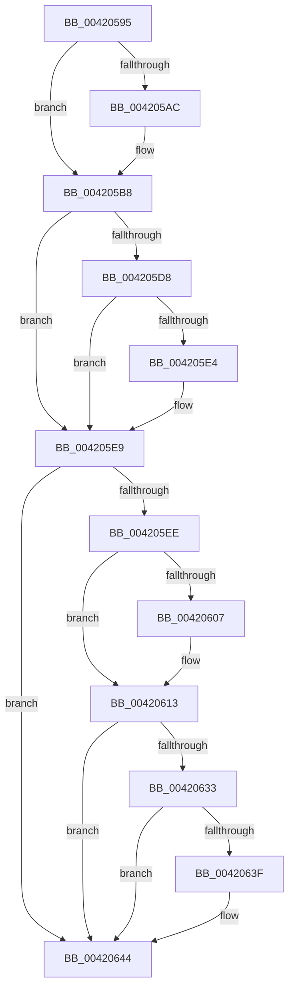

# sub_00420595

- RVA: `0x00420595`–`0x00420657` (길이 `194` bytes)
- VA: `0x0000000140420595`
- 실행 섹션: `.text`
- PDB 이름 있음: `아니요`; PDB Function 태그: `아니요`
- unwind 정보 RVA: `0x000A015C`
- 디코드: `41`개 명령, `194/194` bytes 표시
- 미해석 바이트: `0` (있으면 어셈블리에 `.byte`로 보존)

> 이 문서는 커널 이미지의 기계어와 PDB 기호를 분석해 생성했습니다. 4번과 5번은 함수 원형과 자료형을 바이너리 사용 방식에서 추정한 C 해석이며 원본 소스 복구 결과는 아닙니다.

## 1. Dependencies

- 직접 호출 지점: **6**; 고유 호출 대상: **3**
- 직접 호출자로 확인된 함수: **0**
- RIP 상대 이미지 참조: **0**

### Outgoing calls
- `0x004205B3` → [ExfReleasePushLockShared](../26/ExfReleasePushLockShared_function_00263440.md) (function, `0x00263440`)
- `0x004205BF` → [KeAbPostRelease](../2E/KeAbPostRelease_function_002E1600.md) (function, `0x002E1600`)
- `0x004205E4` → [KiCheckForKernelApcDelivery](../2E/KiCheckForKernelApcDelivery_function_002E2C80.md) (function, `0x002E2C80`)
- `0x0042060E` → [ExfReleasePushLockShared](../26/ExfReleasePushLockShared_function_00263440.md) (function, `0x00263440`)
- `0x0042061A` → [KeAbPostRelease](../2E/KeAbPostRelease_function_002E1600.md) (function, `0x002E1600`)
- `0x0042063F` → [KiCheckForKernelApcDelivery](../2E/KiCheckForKernelApcDelivery_function_002E2C80.md) (function, `0x002E2C80`)

### Direct callers
- 이 함수 시작 RVA로 연결되는 직접 call은 확인되지 않았습니다. 간접 호출은 완전히 역산할 수 없습니다.

### Static image references
- 디코드된 RIP-relative 메모리 참조가 없습니다.

## 2. Other-region calls and transfers

- 다른 실행 섹션으로 향하는 call: **0**
- call이 아닌 외부 분기/꼬리 이동: **1**
  - `0x00420651` → [sub_004207A1](Unknown_function_004207A1.md) (`tail-transfer`)

## 3. Assembly (complete function range)

```asm
00420595  48 8B B5 20 03 00 00            mov rsi, qword ptr [rbp + 0x320]
0042059C  B8 11 00 00 00                  mov eax, 0x11
004205A1  F0 4C 0F B1 9E B0 1A 00 00      lock cmpxchg qword ptr [rsi + 0x1ab0], r11
004205AA  74 0C                           je 0x1404205b8
004205AC  48 8D 8E B0 1A 00 00            lea rcx, [rsi + 0x1ab0]
004205B3  E8 88 2E E4 FF                  call 0x140263440
004205B8  48 8D 8E B0 1A 00 00            lea rcx, [rsi + 0x1ab0]
004205BF  E8 3C 10 EC FF                  call 0x1402e1600
004205C4  65 48 8B 04 25 88 01 00 00      mov rax, qword ptr gs:[0x188]
004205CD  90                              nop
004205CE  66 83 80 E6 01 00 00 01         add word ptr [rax + 0x1e6], 1
004205D6  75 11                           jne 0x1404205e9
004205D8  48 05 98 00 00 00               add rax, 0x98
004205DE  90                              nop
004205DF  48 39 00                        cmp qword ptr [rax], rax
004205E2  74 05                           je 0x1404205e9
004205E4  E8 97 26 EC FF                  call 0x1402e2c80
004205E9  F6 C3 02                        test bl, 2
004205EC  74 56                           je 0x140420644
004205EE  48 8B B5 20 03 00 00            mov rsi, qword ptr [rbp + 0x320]
004205F5  B8 11 00 00 00                  mov eax, 0x11
004205FA  33 C9                           xor ecx, ecx
004205FC  F0 48 0F B1 8E 98 1A 00 00      lock cmpxchg qword ptr [rsi + 0x1a98], rcx
00420605  74 0C                           je 0x140420613
00420607  48 8D 8E 98 1A 00 00            lea rcx, [rsi + 0x1a98]
0042060E  E8 2D 2E E4 FF                  call 0x140263440
00420613  48 8D 8E 98 1A 00 00            lea rcx, [rsi + 0x1a98]
0042061A  E8 E1 0F EC FF                  call 0x1402e1600
0042061F  65 48 8B 04 25 88 01 00 00      mov rax, qword ptr gs:[0x188]
00420628  90                              nop
00420629  66 83 80 E6 01 00 00 01         add word ptr [rax + 0x1e6], 1
00420631  75 11                           jne 0x140420644
00420633  48 05 98 00 00 00               add rax, 0x98
00420639  90                              nop
0042063A  48 39 00                        cmp qword ptr [rax], rax
0042063D  74 05                           je 0x140420644
0042063F  E8 3C 26 EC FF                  call 0x1402e2c80
00420644  48 8B 74 24 70                  mov rsi, qword ptr [rsp + 0x70]
00420649  F6 C3 01                        test bl, 1
0042064C  48 8B 5C 24 78                  mov rbx, qword ptr [rsp + 0x78]
00420651  0F 84 4A 01 00 00               je 0x1404207a1
```

## 4. C-style interpretation (structured pseudocode)

```c
__int64 __fastcall sub_00420595(__int64 a1, __int64 a2, __int64 a3, __int64 a4, __int64 a5, __int64 a6, __int64 a7, __int64 a8, __int64 a9, __int64 a10, __int64 a11, __int64 a12, __int64 a13, __int64 a14, __int64 a15)
{
    __int64 result;

    result = 17;
    if (!(condition_is_equal)) {
        a1 = *(unsigned __int64 *)(v_rbp + 800) + 6832;
        result = ExfReleasePushLockShared(a1, a2, a3, a4);
    }
    result = KeAbPostRelease(*(unsigned __int64 *)(v_rbp + 800) + 6832, a2, a3, a4);
    if (condition_is_not_equal) goto loc_004205E9;
    result = (*(unsigned __int64 *)(gs_base + (0 + 392))) + (152);
    if ((*(unsigned __int64 *)(result)) != result) {
        result = KiCheckForKernelApcDelivery(*(unsigned __int64 *)(v_rbp + 800) + 6832, a2, a3, a4);
    }
    if ((((unsigned __int8)(v_rbx)) & (2)) == 0) goto loc_00420644;
    a1 = 0;
    result = 17;
    if (!(condition_is_equal)) {
        a1 = *(unsigned __int64 *)(v_rbp + 800) + 6808;
        result = ExfReleasePushLockShared(a1, a2, a3, a4);
    }
    result = KeAbPostRelease(*(unsigned __int64 *)(v_rbp + 800) + 6808, a2, a3, a4);
    if (condition_is_not_equal) goto loc_00420644;
    result = (*(unsigned __int64 *)(gs_base + (0 + 392))) + (152);
    if ((*(unsigned __int64 *)(result)) != result) {
        result = KiCheckForKernelApcDelivery(*(unsigned __int64 *)(v_rbp + 800) + 6808, a2, a3, a4);
    }
}
```

## 5. (Beta) C Style

```c
int64_t sub_00420595(int64_t Arg1, int64_t Arg2, int64_t Arg3, int64_t Arg4, uint64_t Arg5, uint64_t Arg6, uint64_t Arg7, uint64_t Arg8, uint64_t Arg9, uint64_t Arg10, uint64_t Arg11, uint64_t Arg12, uint64_t Arg13, int64_t Arg14, int64_t Arg15)
{
    int64_t result;

    result = 17;
    if (!(condition_is_equal)) {
        Arg1 = *(uint64_t *)(local_rbp + 0x320) + 6832;
        result = ExfReleasePushLockShared(Arg1, Arg2, Arg3, Arg4);
    }
    result = KeAbPostRelease(*(uint64_t *)(local_rbp + 0x320) + 6832, Arg2, Arg3, Arg4);
    if (condition_is_not_equal) goto loc_004205E9;
    result = (*(uint64_t *)(gs_base + (0 + 0x188))) + (152);
    if ((*(uint64_t *)(result)) != result) {
        result = KiCheckForKernelApcDelivery(*(uint64_t *)(local_rbp + 0x320) + 6832, Arg2, Arg3, Arg4);
    }
    if ((((uint8_t)(local_rbx)) & (2)) == 0) goto loc_00420644;
    Arg1 = 0;
    result = 17;
    if (!(condition_is_equal)) {
        Arg1 = *(uint64_t *)(local_rbp + 0x320) + 6808;
        result = ExfReleasePushLockShared(Arg1, Arg2, Arg3, Arg4);
    }
    result = KeAbPostRelease(*(uint64_t *)(local_rbp + 0x320) + 6808, Arg2, Arg3, Arg4);
    if (condition_is_not_equal) goto loc_00420644;
    result = (*(uint64_t *)(gs_base + (0 + 0x188))) + (152);
    if ((*(uint64_t *)(result)) != result) {
        result = KiCheckForKernelApcDelivery(*(uint64_t *)(local_rbp + 0x320) + 6808, Arg2, Arg3, Arg4);
    }
}
```

## 6. Execution-region graph

[열기: 2D/3D 그래프와 함수 탐색 컨트롤 패널](../../../control-panel.html?section=text&rva=0x00420595&view=graph)

- 2D 그래프는 위에서 아래로 흐르고, 3D 그래프는 빈 공간을 드래그해 회전합니다. Shift+드래그는 이동, 휠은 확대·축소, 함수 노드 선택은 대상 보고서 이동입니다.

### Static fallback


