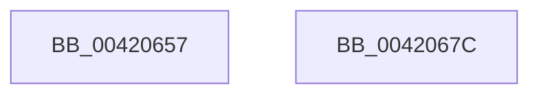

# sub_00420657

- RVA: `0x00420657`–`0x0042067D` (길이 `38` bytes)
- VA: `0x0000000140420657`
- 실행 섹션: `.text`
- PDB 이름 있음: `아니요`; PDB Function 태그: `아니요`
- unwind 정보 RVA: `0x000A016C`
- 디코드: `14`개 명령, `38/38` bytes 표시
- 미해석 바이트: `0` (있으면 어셈블리에 `.byte`로 보존)

> 이 문서는 커널 이미지의 기계어와 PDB 기호를 분석해 생성했습니다. 4번과 5번은 함수 원형과 자료형을 바이너리 사용 방식에서 추정한 C 해석이며 원본 소스 복구 결과는 아닙니다.

## 1. Dependencies

- 직접 호출 지점: **1**; 고유 호출 대상: **1**
- 직접 호출자로 확인된 함수: **0**
- RIP 상대 이미지 참조: **0**

### Outgoing calls
- `0x00420667` → [ST_STORE<SM_TRAITS>::StDmFinishPageRetrieve](../34/ST_STORE_SM_TRAITS_StDmFinishPageRetrieve_function_0034CB10.md) (function, `0x0034CB10`)

### Direct callers
- 이 함수 시작 RVA로 연결되는 직접 call은 확인되지 않았습니다. 간접 호출은 완전히 역산할 수 없습니다.

### Static image references
- 디코드된 RIP-relative 메모리 참조가 없습니다.

## 2. Other-region calls and transfers

- 다른 실행 섹션으로 향하는 call: **0**
- 별도 외부 분기/꼬리 이동을 확인하지 못했습니다.

## 3. Assembly (complete function range)

```asm
00420657  4D 8B CC                        mov r9, r12
0042065A  89 7C 24 20                     mov dword ptr [rsp + 0x20], edi
0042065E  4D 8B C7                        mov r8, r15
00420661  49 8B D6                        mov rdx, r14
00420664  48 8B CD                        mov rcx, rbp
00420667  E8 A4 C4 F2 FF                  call 0x14034cb10
0042066C  48 81 C4 80 00 00 00            add rsp, 0x80
00420673  41 5F                           pop r15
00420675  41 5E                           pop r14
00420677  41 5C                           pop r12
00420679  5F                              pop rdi
0042067A  5D                              pop rbp
0042067B  C3                              ret
0042067C  CC                              int3
```

## 4. C-style interpretation (structured pseudocode)

```c
__int64 __fastcall sub_00420657(void)
{
    __int64 result;
    __int64 v_rsp;
    unsigned int v_stack_p20;

    v_stack_p20 = (unsigned int)(v_rdi);
    result = ST_STORE_SM_TRAITS___StDmFinishPageRetrieve(v_rbp, v_r14, v_r15, v_r12);
    v_rsp = (v_rsp) + (128);
    return result;
}
```

## 5. (Beta) C Style

```c
void sub_00420657(void)
{
    int64_t result;
    int64_t local_rsp;
    uint32_t v_stack_p20;

    v_stack_p20 = (uint32_t)(local_rdi);
    result = ST_STORE_SM_TRAITS___StDmFinishPageRetrieve(local_rbp, local_r14, local_r15, local_r12);
    local_rsp = (local_rsp) + (128);
    return result;
}
```

## 6. Execution-region graph

[열기: 2D/3D 그래프와 함수 탐색 컨트롤 패널](../../../control-panel.html?section=text&rva=0x00420657&view=graph)

- 2D 그래프는 위에서 아래로 흐르고, 3D 그래프는 빈 공간을 드래그해 회전합니다. Shift+드래그는 이동, 휠은 확대·축소, 함수 노드 선택은 대상 보고서 이동입니다.

### Static fallback


