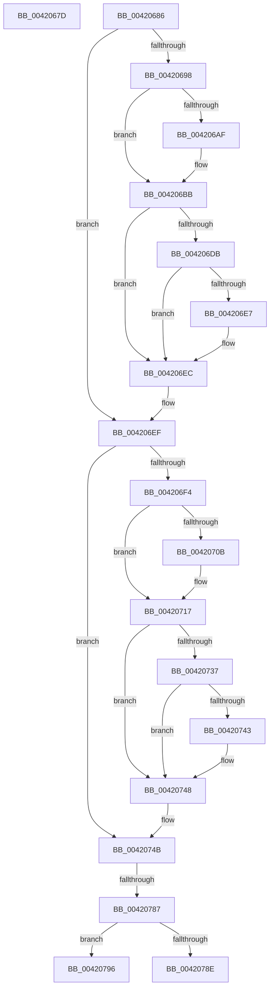

# sub_0042067D

- RVA: `0x0042067D`–`0x004207A1` (길이 `292` bytes)
- VA: `0x000000014042067D`
- 실행 섹션: `.text`
- PDB 이름 있음: `아니요`; PDB Function 태그: `아니요`
- unwind 정보 RVA: `0x000A0180`
- 디코드: `66`개 명령, `292/292` bytes 표시
- 미해석 바이트: `0` (있으면 어셈블리에 `.byte`로 보존)

> 이 문서는 커널 이미지의 기계어와 PDB 기호를 분석해 생성했습니다. 4번과 5번은 함수 원형과 자료형을 바이너리 사용 방식에서 추정한 C 해석이며 원본 소스 복구 결과는 아닙니다.

## 1. Dependencies

- 직접 호출 지점: **7**; 고유 호출 대상: **4**
- 직접 호출자로 확인된 함수: **0**
- RIP 상대 이미지 참조: **0**

### Outgoing calls
- `0x004206B6` → [ExfReleasePushLockShared](../26/ExfReleasePushLockShared_function_00263440.md) (function, `0x00263440`)
- `0x004206C2` → [KeAbPostRelease](../2E/KeAbPostRelease_function_002E1600.md) (function, `0x002E1600`)
- `0x004206E7` → [KiCheckForKernelApcDelivery](../2E/KiCheckForKernelApcDelivery_function_002E2C80.md) (function, `0x002E2C80`)
- `0x00420712` → [ExfReleasePushLockShared](../26/ExfReleasePushLockShared_function_00263440.md) (function, `0x00263440`)
- `0x0042071E` → [KeAbPostRelease](../2E/KeAbPostRelease_function_002E1600.md) (function, `0x002E1600`)
- `0x00420743` → [KiCheckForKernelApcDelivery](../2E/KiCheckForKernelApcDelivery_function_002E2C80.md) (function, `0x002E2C80`)
- `0x00420778` → [ST_STORE<SM_TRAITS>::StDmSinglePageTransfer](../31/ST_STORE_SM_TRAITS_StDmSinglePageTransfer_function_00317E50.md) (function, `0x00317E50`)

### Direct callers
- 이 함수 시작 RVA로 연결되는 직접 call은 확인되지 않았습니다. 간접 호출은 완전히 역산할 수 없습니다.

### Static image references
- 디코드된 RIP-relative 메모리 참조가 없습니다.

## 2. Other-region calls and transfers

- 다른 실행 섹션으로 향하는 call: **0**
- call이 아닌 외부 분기/꼬리 이동: **4**
  - `0x00420681` → [sub_004201AA + 0x3A1](Unknown_function_004201AA.md) (`tail-transfer`)
  - `0x00420781` → [sub_004201AA + 0x3DE](Unknown_function_004201AA.md) (`tail-transfer`)
  - `0x00420791` → [sub_004201AA + 0x3DE](Unknown_function_004201AA.md) (`tail-transfer`)
  - `0x0042079C` → [sub_004201AA + 0x3E1](Unknown_function_004201AA.md) (`tail-transfer`)

## 3. Assembly (complete function range)

```asm
0042067D  49 8B 77 18                     mov rsi, qword ptr [r15 + 0x18]
00420681  E9 C5 FE FF FF                  jmp 0x14042054b
00420686  41 83 4E 14 01                  or dword ptr [r14 + 0x14], 1
0042068B  4C 8B 6C 24 58                  mov r13, qword ptr [rsp + 0x58]
00420690  45 33 E4                        xor r12d, r12d
00420693  83 FB 04                        cmp ebx, 4
00420696  72 57                           jb 0x1404206ef
00420698  48 8B BD 20 03 00 00            mov rdi, qword ptr [rbp + 0x320]
0042069F  B8 11 00 00 00                  mov eax, 0x11
004206A4  F0 4C 0F B1 A7 B0 1A 00 00      lock cmpxchg qword ptr [rdi + 0x1ab0], r12
004206AD  74 0C                           je 0x1404206bb
004206AF  48 8D 8F B0 1A 00 00            lea rcx, [rdi + 0x1ab0]
004206B6  E8 85 2D E4 FF                  call 0x140263440
004206BB  48 8D 8F B0 1A 00 00            lea rcx, [rdi + 0x1ab0]
004206C2  E8 39 0F EC FF                  call 0x1402e1600
004206C7  65 48 8B 04 25 88 01 00 00      mov rax, qword ptr gs:[0x188]
004206D0  90                              nop
004206D1  66 83 80 E6 01 00 00 01         add word ptr [rax + 0x1e6], 1
004206D9  75 11                           jne 0x1404206ec
004206DB  48 05 98 00 00 00               add rax, 0x98
004206E1  90                              nop
004206E2  48 39 00                        cmp qword ptr [rax], rax
004206E5  74 05                           je 0x1404206ec
004206E7  E8 94 25 EC FF                  call 0x1402e2c80
004206EC  83 E3 FB                        and ebx, 0xfffffffb
004206EF  F6 C3 02                        test bl, 2
004206F2  74 57                           je 0x14042074b
004206F4  48 8B BD 20 03 00 00            mov rdi, qword ptr [rbp + 0x320]
004206FB  B8 11 00 00 00                  mov eax, 0x11
00420700  F0 4C 0F B1 A7 98 1A 00 00      lock cmpxchg qword ptr [rdi + 0x1a98], r12
00420709  74 0C                           je 0x140420717
0042070B  48 8D 8F 98 1A 00 00            lea rcx, [rdi + 0x1a98]
00420712  E8 29 2D E4 FF                  call 0x140263440
00420717  48 8D 8F 98 1A 00 00            lea rcx, [rdi + 0x1a98]
0042071E  E8 DD 0E EC FF                  call 0x1402e1600
00420723  65 48 8B 04 25 88 01 00 00      mov rax, qword ptr gs:[0x188]
0042072C  90                              nop
0042072D  66 83 80 E6 01 00 00 01         add word ptr [rax + 0x1e6], 1
00420735  75 11                           jne 0x140420748
00420737  48 05 98 00 00 00               add rax, 0x98
0042073D  90                              nop
0042073E  48 39 00                        cmp qword ptr [rax], rax
00420741  74 05                           je 0x140420748
00420743  E8 38 25 EC FF                  call 0x1402e2c80
00420748  83 E3 FD                        and ebx, 0xfffffffd
0042074B  49 8B 45 08                     mov rax, qword ptr [r13 + 8]
0042074F  48 8B CD                        mov rcx, rbp
00420752  44 8B 44 24 44                  mov r8d, dword ptr [rsp + 0x44]
00420757  4C 8B A4 24 C0 00 00 00         mov r12, qword ptr [rsp + 0xc0]
0042075F  4C 0B C6                        or r8, rsi
00420762  49 8B 57 10                     mov rdx, qword ptr [r15 + 0x10]
00420766  4D 8B CC                        mov r9, r12
00420769  4C 89 7C 24 30                  mov qword ptr [rsp + 0x30], r15
0042076E  4C 89 74 24 28                  mov qword ptr [rsp + 0x28], r14
00420773  48 89 44 24 20                  mov qword ptr [rsp + 0x20], rax
00420778  E8 D3 76 EF FF                  call 0x140317e50
0042077D  8B F8                           mov edi, eax
0042077F  85 C0                           test eax, eax
00420781  0F 88 01 FE FF FF               js 0x140420588
00420787  3D 03 01 00 00                  cmp eax, 0x103
0042078C  75 08                           jne 0x140420796
0042078E  83 E3 FE                        and ebx, 0xfffffffe
00420791  E9 F2 FD FF FF                  jmp 0x140420588
00420796  45 33 DB                        xor r11d, r11d
00420799  41 8B FB                        mov edi, r11d
0042079C  E9 EA FD FF FF                  jmp 0x14042058b
```

## 4. C-style interpretation (structured pseudocode)

```c
__int64 __fastcall sub_0042067D(void)
{
    unsigned __int64 v_stack_p20;
    unsigned __int64 v_stack_p28;
    unsigned __int64 v_stack_p30;
    unsigned int v_stack_p44;
    unsigned __int64 v_stack_p58;
    unsigned __int64 v_stack_pC0;
}
```

## 5. (Beta) C Style

```c
void sub_0042067D(void)
{
    uint64_t v_stack_p20;
    uint64_t v_stack_p28;
    uint64_t v_stack_p30;
    uint32_t v_stack_p44;
    uint64_t v_stack_p58;
    uint64_t v_stack_pC0;
}
```

## 6. Execution-region graph

[열기: 2D/3D 그래프와 함수 탐색 컨트롤 패널](../../../control-panel.html?section=text&rva=0x0042067D&view=graph)

- 2D 그래프는 위에서 아래로 흐르고, 3D 그래프는 빈 공간을 드래그해 회전합니다. Shift+드래그는 이동, 휠은 확대·축소, 함수 노드 선택은 대상 보고서 이동입니다.

### Static fallback


