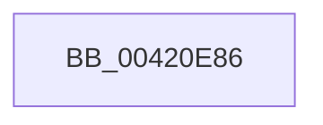

# sub_00420E86

- RVA: `0x00420E86`–`0x00420EA4` (길이 `30` bytes)
- VA: `0x0000000140420E86`
- 실행 섹션: `.text`
- PDB 이름 있음: `아니요`; PDB Function 태그: `아니요`
- unwind 정보 RVA: `0x000A0248`
- 디코드: `6`개 명령, `30/30` bytes 표시
- 미해석 바이트: `0` (있으면 어셈블리에 `.byte`로 보존)

> 이 문서는 커널 이미지의 기계어와 PDB 기호를 분석해 생성했습니다. 4번과 5번은 함수 원형과 자료형을 바이너리 사용 방식에서 추정한 C 해석이며 원본 소스 복구 결과는 아닙니다.

## 1. Dependencies

- 직접 호출 지점: **0**; 고유 호출 대상: **0**
- 직접 호출자로 확인된 함수: **0**
- RIP 상대 이미지 참조: **1**

### Outgoing calls
- 직접 디코드된 call 명령이 없습니다.

### Direct callers
- 이 함수 시작 RVA로 연결되는 직접 call은 확인되지 않았습니다. 간접 호출은 완전히 역산할 수 없습니다.

### Static image references
- `0x00420E9B` → RVA `0x00FC6B06` (`ALMOSTRO`; read)

## 2. Other-region calls and transfers

- 다른 실행 섹션으로 향하는 call: **0**
- call이 아닌 외부 분기/꼬리 이동: **1**
  - `0x00420EA2` → [sub_00420F13](Unknown_function_00420F13.md) (`tail-transfer`)

## 3. Assembly (complete function range)

```asm
00420E86  48 89 5C 24 30                  mov qword ptr [rsp + 0x30], rbx
00420E8B  65 48 8B 1C 25 28 00 00 00      mov rbx, qword ptr gs:[0x28]
00420E94  48 83 C3 70                     add rbx, 0x70
00420E98  0F B6 F9                        movzx edi, cl
00420E9B  F6 05 64 5C BA 00 01            test byte ptr [rip + 0xba5c64], 1
00420EA2  75 6F                           jne 0x140420f13
```

## 4. C-style interpretation (structured pseudocode)

```c
void __fastcall sub_00420E86(unsigned __int8 a1)
{
    __int64 v_rbx;
    unsigned __int64 v_stack_p30;

    v_stack_p30 = v_rbx;
    v_rbx = (*(unsigned __int64 *)(gs_base + (0 + 40))) + (112);
}
```

## 5. (Beta) C Style

```c
void sub_00420E86(uint8_t Arg1)
{
    int64_t local_rbx;
    uint64_t v_stack_p30;

    v_stack_p30 = local_rbx;
    local_rbx = (*(uint64_t *)(gs_base + (0 + 0x28))) + (112);
}
```

## 6. Execution-region graph

[열기: 2D/3D 그래프와 함수 탐색 컨트롤 패널](../../../control-panel.html?section=text&rva=0x00420E86&view=graph)

- 2D 그래프는 위에서 아래로 흐르고, 3D 그래프는 빈 공간을 드래그해 회전합니다. Shift+드래그는 이동, 휠은 확대·축소, 함수 노드 선택은 대상 보고서 이동입니다.

### Static fallback


