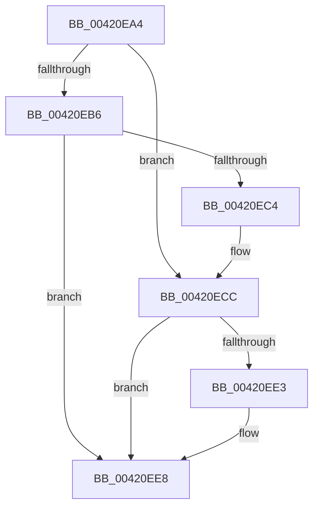

# sub_00420EA4

- RVA: `0x00420EA4`–`0x00420EED` (길이 `73` bytes)
- VA: `0x0000000140420EA4`
- 실행 섹션: `.text`
- PDB 이름 있음: `아니요`; PDB Function 태그: `아니요`
- unwind 정보 RVA: `0x000A025C`
- 디코드: `22`개 명령, `73/73` bytes 표시
- 미해석 바이트: `0` (있으면 어셈블리에 `.byte`로 보존)

> 이 문서는 커널 이미지의 기계어와 PDB 기호를 분석해 생성했습니다. 4번과 5번은 함수 원형과 자료형을 바이너리 사용 방식에서 추정한 C 해석이며 원본 소스 복구 결과는 아닙니다.

## 1. Dependencies

- 직접 호출 지점: **2**; 고유 호출 대상: **2**
- 직접 호출자로 확인된 함수: **0**
- RIP 상대 이미지 참조: **0**

### Outgoing calls
- `0x00420EC7` → [KxWaitForLockChainValid](../21/KxWaitForLockChainValid_function_00217AA0.md) (function, `0x00217AA0`)
- `0x00420EE3` → [KeWakeAddressAll](../21/KeWakeAddressAll_function_00217C20.md) (function, `0x00217C20`)

### Direct callers
- 이 함수 시작 RVA로 연결되는 직접 call은 확인되지 않았습니다. 간접 호출은 완전히 역산할 수 없습니다.

### Static image references
- 디코드된 RIP-relative 메모리 참조가 없습니다.

## 2. Other-region calls and transfers

- 다른 실행 섹션으로 향하는 call: **0**
- 별도 외부 분기/꼬리 이동을 확인하지 못했습니다.

## 3. Assembly (complete function range)

```asm
00420EA4  48 89 74 24 38                  mov qword ptr [rsp + 0x38], rsi
00420EA9  0F 0D 0B                        prefetchw byte ptr [rbx]
00420EAC  48 8B 03                        mov rax, qword ptr [rbx]
00420EAF  33 F6                           xor esi, esi
00420EB1  48 85 C0                        test rax, rax
00420EB4  75 16                           jne 0x140420ecc
00420EB6  48 8B 4B 08                     mov rcx, qword ptr [rbx + 8]
00420EBA  48 8B C3                        mov rax, rbx
00420EBD  F0 48 0F B1 31                  lock cmpxchg qword ptr [rcx], rsi
00420EC2  74 24                           je 0x140420ee8
00420EC4  48 8B CB                        mov rcx, rbx
00420EC7  E8 D4 6B DF FF                  call 0x140217aa0
00420ECC  48 8D 48 08                     lea rcx, [rax + 8]
00420ED0  48 89 33                        mov qword ptr [rbx], rsi
00420ED3  48 8B 53 08                     mov rdx, qword ptr [rbx + 8]
00420ED7  48 8B C2                        mov rax, rdx
00420EDA  48 87 01                        xchg qword ptr [rcx], rax
00420EDD  32 C2                           xor al, dl
00420EDF  A8 04                           test al, 4
00420EE1  74 05                           je 0x140420ee8
00420EE3  E8 38 6D DF FF                  call 0x140217c20
00420EE8  48 8B 74 24 38                  mov rsi, qword ptr [rsp + 0x38]
```

## 4. C-style interpretation (structured pseudocode)

```c
__int64 __fastcall sub_00420EA4(__int64 a1, __int64 a2, __int64 a3, __int64 a4, __int64 a5, __int64 a6, __int64 a7)
{
    __int64 result;
    __int64 v_rsi;
    unsigned __int64 v_stack_p38;

    v_stack_p38 = v_rsi;
    v_rsi = 0;
    if (*(unsigned __int64 *)(v_rbx) != 0) goto loc_00420ECC;
    if (*(unsigned __int64 *)(v_rbx) == 0) goto loc_00420EE8;
    result = KxWaitForLockChainValid(v_rbx, a2, a3, a4);
loc_00420ECC:
    *(unsigned __int64 *)(v_rbx) = 0;
    result = (unsigned __int8)((*(unsigned __int64 *)(v_rbx + 8)) ^ ((unsigned __int8)(*(unsigned __int64 *)(v_rbx + 8))));
    if ((((unsigned __int8)(result)) & (4)) != 0) {
        result = KeWakeAddressAll(result + 8, *(unsigned __int64 *)(v_rbx + 8), a3, a4);
    }
    return result;
}
```

## 5. (Beta) C Style

```c
int64_t sub_00420EA4(int64_t Arg1, int64_t Arg2, int64_t Arg3, int64_t Arg4, uint64_t Arg5, uint64_t Arg6, int64_t Arg7)
{
    int64_t result;
    int64_t local_rsi;
    uint64_t v_stack_p38;

    v_stack_p38 = local_rsi;
    local_rsi = 0;
    if (*(uint64_t *)(local_rbx) != 0) goto loc_00420ECC;
    if (*(uint64_t *)(local_rbx) == 0) goto loc_00420EE8;
    result = KxWaitForLockChainValid(local_rbx, Arg2, Arg3, Arg4);
loc_00420ECC:
    *(uint64_t *)(local_rbx) = 0;
    result = (uint8_t)((*(uint64_t *)(local_rbx + 0x8)) ^ ((uint8_t)(*(uint64_t *)(local_rbx + 0x8))));
    if ((((uint8_t)(result)) & (4)) != 0) {
        result = KeWakeAddressAll(result + 8, *(uint64_t *)(local_rbx + 0x8), Arg3, Arg4);
    }
    return result;
}
```

## 6. Execution-region graph

[열기: 2D/3D 그래프와 함수 탐색 컨트롤 패널](../../../control-panel.html?section=text&rva=0x00420EA4&view=graph)

- 2D 그래프는 위에서 아래로 흐르고, 3D 그래프는 빈 공간을 드래그해 회전합니다. Shift+드래그는 이동, 휠은 확대·축소, 함수 노드 선택은 대상 보고서 이동입니다.

### Static fallback


