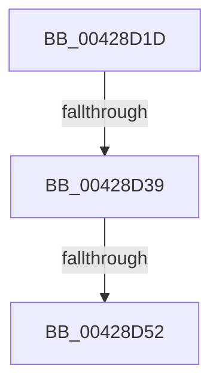

# sub_00428D1D

- RVA: `0x00428D1D`–`0x00428D6D` (길이 `80` bytes)
- VA: `0x0000000140428D1D`
- 실행 섹션: `.text`
- PDB 이름 있음: `아니요`; PDB Function 태그: `아니요`
- unwind 정보 RVA: `0x000A0DC4`
- 디코드: `20`개 명령, `80/80` bytes 표시
- 미해석 바이트: `0` (있으면 어셈블리에 `.byte`로 보존)

> 이 문서는 커널 이미지의 기계어와 PDB 기호를 분석해 생성했습니다. 4번과 5번은 함수 원형과 자료형을 바이너리 사용 방식에서 추정한 C 해석이며 원본 소스 복구 결과는 아닙니다.

## 1. Dependencies

- 직접 호출 지점: **0**; 고유 호출 대상: **0**
- 직접 호출자로 확인된 함수: **0**
- RIP 상대 이미지 참조: **0**

### Outgoing calls
- 직접 디코드된 call 명령이 없습니다.

### Direct callers
- 이 함수 시작 RVA로 연결되는 직접 call은 확인되지 않았습니다. 간접 호출은 완전히 역산할 수 없습니다.

### Static image references
- 디코드된 RIP-relative 메모리 참조가 없습니다.

## 2. Other-region calls and transfers

- 다른 실행 섹션으로 향하는 call: **0**
- call이 아닌 외부 분기/꼬리 이동: **3**
  - `0x00428D33` → [sub_00428DF9](Unknown_function_00428DF9.md) (`tail-transfer`)
  - `0x00428D50` → [sub_00428D7A](Unknown_function_00428D7A.md) (`tail-transfer`)
  - `0x00428D6B` → [sub_00428D6D + 0x4](Unknown_function_00428D6D.md) (`tail-transfer`)

## 3. Assembly (complete function range)

```asm
00428D1D  48 89 6C 24 30                  mov qword ptr [rsp + 0x30], rbp
00428D22  48 89 74 24 38                  mov qword ptr [rsp + 0x38], rsi
00428D27  48 8B F1                        mov rsi, rcx
00428D2A  4C 89 74 24 48                  mov qword ptr [rsp + 0x48], r14
00428D2F  8B 03                           mov eax, dword ptr [rbx]
00428D31  A8 03                           test al, 3
00428D33  0F 84 C0 00 00 00               je 0x140428df9
00428D39  BD 01 00 00 00                  mov ebp, 1
00428D3E  41 BE 01 00 00 00               mov r14d, 1
00428D44  48 89 7C 24 40                  mov qword ptr [rsp + 0x40], rdi
00428D49  48 8B 4B 38                     mov rcx, qword ptr [rbx + 0x38]
00428D4D  48 85 C9                        test rcx, rcx
00428D50  75 28                           jne 0x140428d7a
00428D52  8B 46 04                        mov eax, dword ptr [rsi + 4]
00428D55  4C 8B 74 24 48                  mov r14, qword ptr [rsp + 0x48]
00428D5A  48 8B 7C 24 40                  mov rdi, qword ptr [rsp + 0x40]
00428D5F  48 8B 74 24 38                  mov rsi, qword ptr [rsp + 0x38]
00428D64  48 8B 6C 24 30                  mov rbp, qword ptr [rsp + 0x30]
00428D69  A8 20                           test al, 0x20
00428D6B  74 04                           je 0x140428d71
```

## 4. C-style interpretation (structured pseudocode)

```c
__int64 __fastcall sub_00428D1D(__int64 a1, __int64 a2, __int64 a3, __int64 a4, __int64 a5, __int64 a6, __int64 a7, __int64 a8, __int64 a9)
{
    unsigned __int64 v_stack_p30;
    unsigned __int64 v_stack_p38;
    unsigned __int64 v_stack_p40;
    unsigned __int64 v_stack_p48;

    v_stack_p30 = v_rbp;
    v_stack_p38 = v_rsi;
    v_stack_p48 = v_r14;
    v_stack_p40 = v_rdi;
}
```

## 5. (Beta) C Style

```c
int64_t sub_00428D1D(void *Arg1, int64_t Arg2, int64_t Arg3, int64_t Arg4, uint64_t Arg5, int64_t Arg6, int64_t Arg7, int64_t Arg8, int64_t Arg9)
{
    uint8_t *arg1 = (uint8_t *)Arg1;

    uint64_t v_stack_p30;
    uint64_t v_stack_p38;
    uint64_t v_stack_p40;
    uint64_t v_stack_p48;

    v_stack_p30 = local_rbp;
    v_stack_p38 = local_rsi;
    v_stack_p48 = local_r14;
    v_stack_p40 = local_rdi;
}
```

### 관측된 메모리 오프셋

구조체 형식이 확인되지 않은 접근은 인자 기준의 오프셋으로만 기록했습니다.

| 기준 인자 | 오프셋 표현 | 폭 (bit) | 접근 |
|---|---:|---:|---|
| `Arg1` | `+ 0x4` | `32` | `R` |

## 6. Execution-region graph

[열기: 2D/3D 그래프와 함수 탐색 컨트롤 패널](../../../control-panel.html?section=text&rva=0x00428D1D&view=graph)

- 2D 그래프는 위에서 아래로 흐르고, 3D 그래프는 빈 공간을 드래그해 회전합니다. Shift+드래그는 이동, 휠은 확대·축소, 함수 노드 선택은 대상 보고서 이동입니다.

### Static fallback


