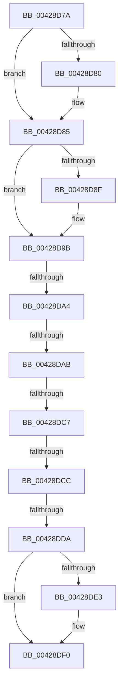

# sub_00428D7A

- RVA: `0x00428D7A`–`0x00428DF9` (길이 `127` bytes)
- VA: `0x0000000140428D7A`
- 실행 섹션: `.text`
- PDB 이름 있음: `아니요`; PDB Function 태그: `아니요`
- unwind 정보 RVA: `0x000A0DF8`
- 디코드: `31`개 명령, `127/127` bytes 표시
- 미해석 바이트: `0` (있으면 어셈블리에 `.byte`로 보존)

> 이 문서는 커널 이미지의 기계어와 PDB 기호를 분석해 생성했습니다. 4번과 5번은 함수 원형과 자료형을 바이너리 사용 방식에서 추정한 C 해석이며 원본 소스 복구 결과는 아닙니다.

## 1. Dependencies

- 직접 호출 지점: **4**; 고유 호출 대상: **4**
- 직접 호출자로 확인된 함수: **0**
- RIP 상대 이미지 참조: **1**

### Outgoing calls
- `0x00428D80` → [MiFlushTbList](../31/MiFlushTbList_function_00311FC0.md) (function, `0x00311FC0`)
- `0x00428D96` → [MiFreeWsleList](../24/MiFreeWsleList_function_00241168.md) (function, `0x00241168`)
- `0x00428DAB` → [MiReleaseProcessorFlushList](../31/MiReleaseProcessorFlushList_function_00313C70.md) (function, `0x00313C70`)
- `0x00428DEB` → [KiLowerIrqlProcessIrqlFlags](../4F/KiLowerIrqlProcessIrqlFlags_function_004F5698.md) (function, `0x004F5698`)

### Direct callers
- 이 함수 시작 RVA로 연결되는 직접 call은 확인되지 않았습니다. 간접 호출은 완전히 역산할 수 없습니다.

### Static image references
- `0x00428DDA` → RVA `0x00FC6D20` (`ALMOSTRO`; read)

## 2. Other-region calls and transfers

- 다른 실행 섹션으로 향하는 call: **0**
- call이 아닌 외부 분기/꼬리 이동: **6**
  - `0x00428DA2` → [sub_00428E14 + 0xA](Unknown_function_00428E14.md) (`tail-transfer`)
  - `0x00428DA9` → [sub_00428D1D + 0x35](Unknown_function_00428D1D.md) (`tail-transfer`)
  - `0x00428DC5` → [sub_00428E14](Unknown_function_00428E14.md) (`tail-transfer`)
  - `0x00428DCA` → [sub_00428D1D + 0x35](Unknown_function_00428D1D.md) (`tail-transfer`)
  - `0x00428DD4` → [sub_00428D1D + 0x35](Unknown_function_00428D1D.md) (`tail-transfer`)
  - `0x00428DF4` → [sub_00428D1D + 0x35](Unknown_function_00428D1D.md) (`tail-transfer`)

## 3. Assembly (complete function range)

```asm
00428D7A  83 79 1C 00                     cmp dword ptr [rcx + 0x1c], 0
00428D7E  74 05                           je 0x140428d85
00428D80  E8 3B 92 EE FF                  call 0x140311fc0
00428D85  48 8B 53 40                     mov rdx, qword ptr [rbx + 0x40]
00428D89  83 7A 1C 00                     cmp dword ptr [rdx + 0x1c], 0
00428D8D  74 0C                           je 0x140428d9b
00428D8F  48 8B 4E 20                     mov rcx, qword ptr [rsi + 0x20]
00428D93  45 33 C0                        xor r8d, r8d
00428D96  E8 CD 83 E1 FF                  call 0x140241168
00428D9B  48 8B 43 48                     mov rax, qword ptr [rbx + 0x48]
00428D9F  48 85 C0                        test rax, rax
00428DA2  75 7A                           jne 0x140428e1e
00428DA4  48 83 7B 38 00                  cmp qword ptr [rbx + 0x38], 0
00428DA9  74 A7                           je 0x140428d52
00428DAB  E8 C0 AE EE FF                  call 0x140313c70
00428DB0  48 83 7B 48 00                  cmp qword ptr [rbx + 0x48], 0
00428DB5  48 C7 43 38 00 00 00 00         mov qword ptr [rbx + 0x38], 0
00428DBD  48 C7 43 40 00 00 00 00         mov qword ptr [rbx + 0x40], 0
00428DC5  75 4D                           jne 0x140428e14
00428DC7  45 85 F6                        test r14d, r14d
00428DCA  75 86                           jne 0x140428d52
00428DCC  0F B6 7E 09                     movzx edi, byte ptr [rsi + 9]
00428DD0  40 80 FF 11                     cmp dil, 0x11
00428DD4  0F 84 78 FF FF FF               je 0x140428d52
00428DDA  44 39 35 3F DF B9 00            cmp dword ptr [rip + 0xb9df3f], r14d
00428DE1  74 0D                           je 0x140428df0
00428DE3  44 0F 20 C1                     mov rcx, cr8
00428DE7  40 0F B6 D7                     movzx edx, dil
00428DEB  E8 A8 C8 0C 00                  call 0x1404f5698
00428DF0  44 0F 22 C7                     mov cr8, rdi
00428DF4  E9 59 FF FF FF                  jmp 0x140428d52
```

## 4. C-style interpretation (structured pseudocode)

```c
__int64 __fastcall sub_00428D7A(__int64 a1, __int64 a2, int a3)
{
    __int64 result;

    if ((*(unsigned int *)(a1 + 28)) != 0) {
        result = MiFlushTbList(a1, a2, a3, a4);
    }
    if ((*(unsigned int *)(*(unsigned __int64 *)(v_rbx + 64) + 28)) != 0) {
        a1 = *(unsigned __int64 *)(v_rsi + 32);
        a3 = 0;
        result = MiFreeWsleList(a1, *(unsigned __int64 *)(v_rbx + 64), a3, a4);
    }
    result = MiReleaseProcessorFlushList(a1, *(unsigned __int64 *)(v_rbx + 64), a3, a4);
    *(unsigned __int64 *)(v_rbx + 56) = 0;
    *(unsigned __int64 *)(v_rbx + 64) = 0;
    if ((*(unsigned int *)(v_rip + 12181311)) != ((unsigned int)(v_r14))) {
        a1 = v_cr8;
        a2 = (unsigned __int8)(*(unsigned __int8 *)(v_rsi + 9));
        result = KiLowerIrqlProcessIrqlFlags(a1, a2, a3, a4);
    }
}
```

## 5. (Beta) C Style

```c
int64_t sub_00428D7A(void *Arg1, int64_t Arg2, int32_t Arg3)
{
    uint8_t *arg1 = (uint8_t *)Arg1;

    int64_t result;

    if ((*(uint32_t *)(arg1 + 0x1C)) != 0) {
        result = MiFlushTbList(Arg1, Arg2, Arg3, a4);
    }
    if ((*(uint32_t *)(*(uint64_t *)(local_rbx + 0x40) + 0x1C)) != 0) {
        Arg1 = *(uint64_t *)(local_rsi + 0x20);
        Arg3 = 0;
        result = MiFreeWsleList(Arg1, *(uint64_t *)(local_rbx + 0x40), Arg3, a4);
    }
    result = MiReleaseProcessorFlushList(Arg1, *(uint64_t *)(local_rbx + 0x40), Arg3, a4);
    *(uint64_t *)(local_rbx + 0x38) = 0;
    *(uint64_t *)(local_rbx + 0x40) = 0;
    if ((*(uint32_t *)(v_rip + 0xB9DF3F)) != ((uint32_t)(local_r14))) {
        Arg1 = v_cr8;
        Arg2 = (uint8_t)(*(uint8_t *)(local_rsi + 0x9));
        result = KiLowerIrqlProcessIrqlFlags(Arg1, Arg2, Arg3, a4);
    }
}
```

### 관측된 메모리 오프셋

구조체 형식이 확인되지 않은 접근은 인자 기준의 오프셋으로만 기록했습니다.

| 기준 인자 | 오프셋 표현 | 폭 (bit) | 접근 |
|---|---:|---:|---|
| `Arg1` | `+ 0x1C` | `32` | `R` |

## 6. Execution-region graph

[열기: 2D/3D 그래프와 함수 탐색 컨트롤 패널](../../../control-panel.html?section=text&rva=0x00428D7A&view=graph)

- 2D 그래프는 위에서 아래로 흐르고, 3D 그래프는 빈 공간을 드래그해 회전합니다. Shift+드래그는 이동, 휠은 확대·축소, 함수 노드 선택은 대상 보고서 이동입니다.

### Static fallback


