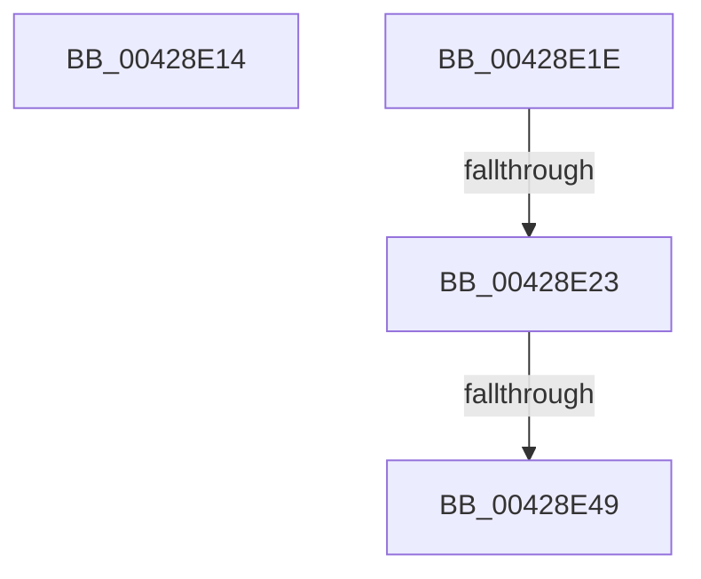

# sub_00428E14

- RVA: `0x00428E14`–`0x00428E68` (길이 `84` bytes)
- VA: `0x0000000140428E14`
- 실행 섹션: `.text`
- PDB 이름 있음: `아니요`; PDB Function 태그: `아니요`
- unwind 정보 RVA: `0x000A0E34`
- 디코드: `20`개 명령, `84/84` bytes 표시
- 미해석 바이트: `0` (있으면 어셈블리에 `.byte`로 보존)

> 이 문서는 커널 이미지의 기계어와 PDB 기호를 분석해 생성했습니다. 4번과 5번은 함수 원형과 자료형을 바이너리 사용 방식에서 추정한 C 해석이며 원본 소스 복구 결과는 아닙니다.

## 1. Dependencies

- 직접 호출 지점: **2**; 고유 호출 대상: **2**
- 직접 호출자로 확인된 함수: **0**
- RIP 상대 이미지 참조: **1**

### Outgoing calls
- `0x00428E35` → [MiQueryVpabAccessedState](MiQueryVpabAccessedState_function_00428E70.md) (function, `0x00428E70`)
- `0x00428E5E` → [MiProcessVpabAccessedInfo](MiProcessVpabAccessedInfo_function_00428FD4.md) (function, `0x00428FD4`)

### Direct callers
- 이 함수 시작 RVA로 연결되는 직접 call은 확인되지 않았습니다. 간접 호출은 완전히 역산할 수 없습니다.

### Static image references
- `0x00428E50` → RVA `0x0048DE00` (`MiAgeWorkingSetVpabCallback`; read)

## 2. Other-region calls and transfers

- 다른 실행 섹션으로 향하는 call: **0**
- call이 아닌 외부 분기/꼬리 이동: **4**
  - `0x00428E1C` → [sub_00428D7A + 0x4D](Unknown_function_00428D7A.md) (`tail-transfer`)
  - `0x00428E21` → [sub_00428D7A + 0x2A](Unknown_function_00428D7A.md) (`tail-transfer`)
  - `0x00428E43` → [sub_00428D7A + 0x2A](Unknown_function_00428D7A.md) (`tail-transfer`)
  - `0x00428E63` → [sub_00428D1D + 0x2C](Unknown_function_00428D1D.md) (`tail-transfer`)

## 3. Assembly (complete function range)

```asm
00428E14  48 C7 43 48 01 00 00 00         mov qword ptr [rbx + 0x48], 1
00428E1C  EB A9                           jmp 0x140428dc7
00428E1E  83 38 00                        cmp dword ptr [rax], 0
00428E21  74 81                           je 0x140428da4
00428E23  0F B6 7E 09                     movzx edi, byte ptr [rsi + 9]
00428E27  44 8B C5                        mov r8d, ebp
00428E2A  C6 46 09 11                     mov byte ptr [rsi + 9], 0x11
00428E2E  48 8B CE                        mov rcx, rsi
00428E31  48 8B 53 48                     mov rdx, qword ptr [rbx + 0x48]
00428E35  E8 36 00 00 00                  call 0x140428e70
00428E3A  40 88 7E 09                     mov byte ptr [rsi + 9], dil
00428E3E  44 8B F0                        mov r14d, eax
00428E41  85 C0                           test eax, eax
00428E43  0F 84 5B FF FF FF               je 0x140428da4
00428E49  4C 8B 8E B8 00 00 00            mov r9, qword ptr [rsi + 0xb8]
00428E50  4C 8D 05 A9 4F 06 00            lea r8, [rip + 0x64fa9]
00428E57  48 8B 53 48                     mov rdx, qword ptr [rbx + 0x48]
00428E5B  48 8B CE                        mov rcx, rsi
00428E5E  E8 71 01 00 00                  call 0x140428fd4
00428E63  E9 E1 FE FF FF                  jmp 0x140428d49
```

## 4. C-style interpretation (structured pseudocode)

```c
__int64 __fastcall sub_00428E14(void)
{
    *(unsigned __int64 *)(v_rbx + 72) = 1;
}
```

## 5. (Beta) C Style

```c
void sub_00428E14(void)
{
    *(uint64_t *)(local_rbx + 0x48) = 1;
}
```

## 6. Execution-region graph

[열기: 2D/3D 그래프와 함수 탐색 컨트롤 패널](../../../control-panel.html?section=text&rva=0x00428E14&view=graph)

- 2D 그래프는 위에서 아래로 흐르고, 3D 그래프는 빈 공간을 드래그해 회전합니다. Shift+드래그는 이동, 휠은 확대·축소, 함수 노드 선택은 대상 보고서 이동입니다.

### Static fallback


