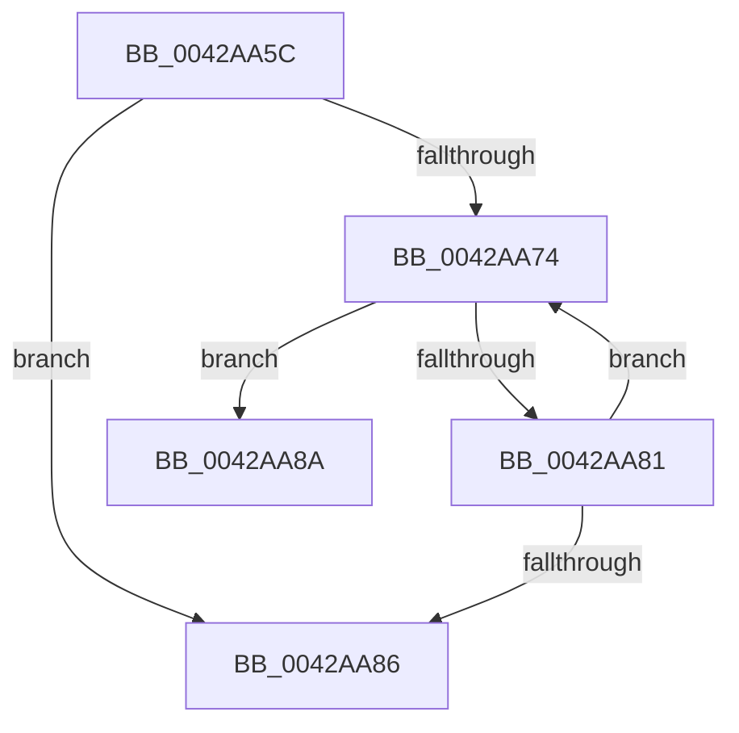

# sub_0042AA5C

- RVA: `0x0042AA5C`–`0x0042AAA4` (길이 `72` bytes)
- VA: `0x000000014042AA5C`
- 실행 섹션: `.text`
- PDB 이름 있음: `아니요`; PDB Function 태그: `아니요`
- unwind 정보 RVA: `0x000A1228`
- 디코드: `23`개 명령, `72/72` bytes 표시
- 미해석 바이트: `0` (있으면 어셈블리에 `.byte`로 보존)

> 이 문서는 커널 이미지의 기계어와 PDB 기호를 분석해 생성했습니다. 4번과 5번은 함수 원형과 자료형을 바이너리 사용 방식에서 추정한 C 해석이며 원본 소스 복구 결과는 아닙니다.

## 1. Dependencies

- 직접 호출 지점: **0**; 고유 호출 대상: **0**
- 직접 호출자로 확인된 함수: **0**
- RIP 상대 이미지 참조: **0**

### Outgoing calls
- 직접 디코드된 call 명령이 없습니다.

### Direct callers
- 이 함수 시작 RVA로 연결되는 직접 call은 확인되지 않았습니다. 간접 호출은 완전히 역산할 수 없습니다.

### Static image references
- 디코드된 RIP-relative 메모리 참조가 없습니다.

## 2. Other-region calls and transfers

- 다른 실행 섹션으로 향하는 call: **0**
- call이 아닌 외부 분기/꼬리 이동: **2**
  - `0x0042AA88` → [sub_0042AA1A + 0x3C](Unknown_function_0042AA1A.md) (`tail-transfer`)
  - `0x0042AA9F` → [RtlAreBitsSetEx + 0x35](RtlAreBitsSetEx_function_0042A9C0.md) (`tail-transfer`)

## 3. Assembly (complete function range)

```asm
0042AA5C  49 C7 C0 FF FF FF FF            mov r8, 0xffffffffffffffff
0042AA63  48 8B CA                        mov rcx, rdx
0042AA66  49 8B C0                        mov rax, r8
0042AA69  48 D3 E0                        shl rax, cl
0042AA6C  4C 23 D0                        and r10, rax
0042AA6F  4C 3B D0                        cmp r10, rax
0042AA72  75 12                           jne 0x14042aa86
0042AA74  49 8B 41 08                     mov rax, qword ptr [r9 + 8]
0042AA78  49 83 C1 08                     add r9, 8
0042AA7C  4D 3B CB                        cmp r9, r11
0042AA7F  74 09                           je 0x14042aa8a
0042AA81  49 3B C0                        cmp rax, r8
0042AA84  74 EE                           je 0x14042aa74
0042AA86  32 C0                           xor al, al
0042AA88  EB CC                           jmp 0x14042aa56
0042AA8A  0F B6 CB                        movzx ecx, bl
0042AA8D  48 8B 1C 24                     mov rbx, qword ptr [rsp]
0042AA91  F6 D1                           not cl
0042AA93  49 D3 E8                        shr r8, cl
0042AA96  49 23 C0                        and rax, r8
0042AA99  49 3B C0                        cmp rax, r8
0042AA9C  0F 94 C0                        sete al
0042AA9F  E9 51 FF FF FF                  jmp 0x14042a9f5
```

## 4. C-style interpretation (structured pseudocode)

```c
__int64 __fastcall sub_0042AA5C(__int64 a1, __int64 a2, __int64 a3, __int64 a4)
{
    __int64 result;
    __int64 v_r10;
    unsigned __int64 v_stack_p0;

    result = (-1) << ((unsigned __int8)(a2));
    v_r10 = (v_r10) & (result);
    if (v_r10 != result) goto loc_0042AA86;
loc_0042AA74:
    a4 = (a4) + (8);
    if (a4 == v_r11) goto loc_0042AA8A;
    if ((*(unsigned __int64 *)(a4 + 8)) == -1) goto loc_0042AA74;
loc_0042AA86:
    result = 0;
loc_0042AA8A:
    a1 = (unsigned __int8)(~((unsigned __int8)(v_rbx)));
    a3 = (-1) >> ((unsigned __int8)(a1));
    result = (result) & (a3);
    result = (result == a3) ? 1 : 0;
}
```

## 5. (Beta) C Style

```c
int64_t sub_0042AA5C(int64_t Arg1, int64_t Arg2, int64_t Arg3, int64_t Arg4)
{
    int64_t result;
    int64_t local_r10;
    uint64_t v_stack_p0;

    result = (-1) << ((uint8_t)(Arg2));
    local_r10 = (local_r10) & (result);
    if (local_r10 != result) goto loc_0042AA86;
loc_0042AA74:
    Arg4 = (Arg4) + (8);
    if (Arg4 == local_r11) goto loc_0042AA8A;
    if ((*(uint64_t *)(Arg4 + 0x8)) == -1) goto loc_0042AA74;
loc_0042AA86:
    result = 0;
loc_0042AA8A:
    Arg1 = (uint8_t)(~((uint8_t)(local_rbx)));
    Arg3 = (-1) >> ((uint8_t)(Arg1));
    result = (result) & (Arg3);
    result = (result == Arg3) ? 1 : 0;
}
```

## 6. Execution-region graph

[열기: 2D/3D 그래프와 함수 탐색 컨트롤 패널](../../../control-panel.html?section=text&rva=0x0042AA5C&view=graph)

- 2D 그래프는 위에서 아래로 흐르고, 3D 그래프는 빈 공간을 드래그해 회전합니다. Shift+드래그는 이동, 휠은 확대·축소, 함수 노드 선택은 대상 보고서 이동입니다.

### Static fallback


