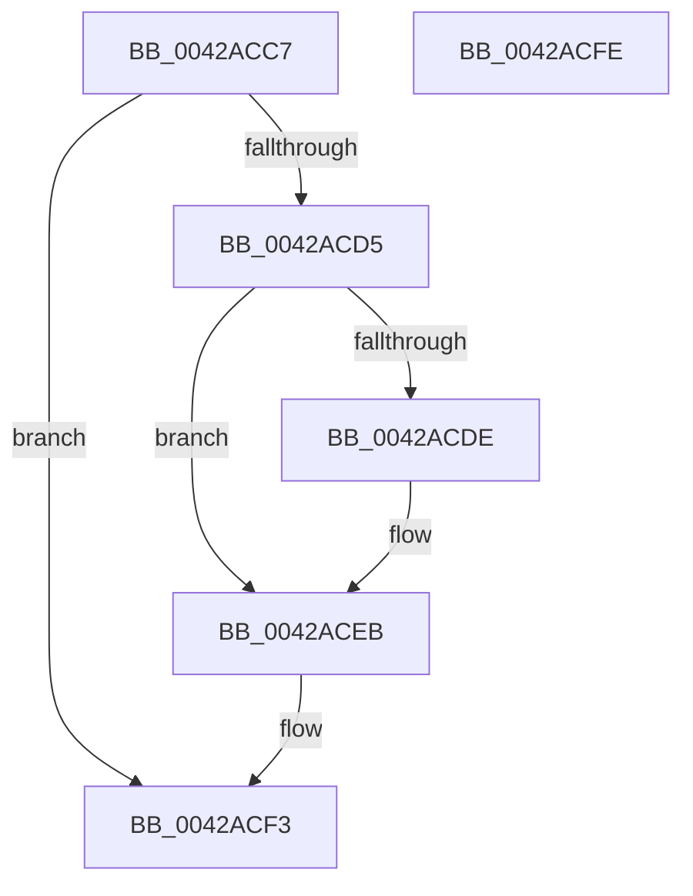

# sub_0042ACC7

- RVA: `0x0042ACC7`–`0x0042ACFF` (길이 `56` bytes)
- VA: `0x000000014042ACC7`
- 실행 섹션: `.text`
- PDB 이름 있음: `아니요`; PDB Function 태그: `아니요`
- unwind 정보 RVA: `0x000A1280`
- 디코드: `15`개 명령, `56/56` bytes 표시
- 미해석 바이트: `0` (있으면 어셈블리에 `.byte`로 보존)

> 이 문서는 커널 이미지의 기계어와 PDB 기호를 분석해 생성했습니다. 4번과 5번은 함수 원형과 자료형을 바이너리 사용 방식에서 추정한 C 해석이며 원본 소스 복구 결과는 아닙니다.

## 1. Dependencies

- 직접 호출 지점: **1**; 고유 호출 대상: **1**
- 직접 호출자로 확인된 함수: **0**
- RIP 상대 이미지 참조: **1**

### Outgoing calls
- `0x0042ACE6` → [KiLowerIrqlProcessIrqlFlags](../4F/KiLowerIrqlProcessIrqlFlags_function_004F5698.md) (function, `0x004F5698`)

### Direct callers
- 이 함수 시작 RVA로 연결되는 직접 call은 확인되지 않았습니다. 간접 호출은 완전히 역산할 수 없습니다.

### Static image references
- `0x0042ACD5` → RVA `0x00FC6D20` (`ALMOSTRO`; read)

## 2. Other-region calls and transfers

- 다른 실행 섹션으로 향하는 call: **0**
- 별도 외부 분기/꼬리 이동을 확인하지 못했습니다.

## 3. Assembly (complete function range)

```asm
0042ACC7  F0 81 67 30 FC FF FF 7F         lock and dword ptr [rdi + 0x30], 0x7ffffffc
0042ACCF  40 80 FE 11                     cmp sil, 0x11
0042ACD3  74 1E                           je 0x14042acf3
0042ACD5  83 3D 44 C0 B9 00 00            cmp dword ptr [rip + 0xb9c044], 0
0042ACDC  74 0D                           je 0x14042aceb
0042ACDE  44 0F 20 C1                     mov rcx, cr8
0042ACE2  40 0F B6 D6                     movzx edx, sil
0042ACE6  E8 AD A9 0C 00                  call 0x1404f5698
0042ACEB  40 0F B6 C6                     movzx eax, sil
0042ACEF  44 0F 22 C0                     mov cr8, rax
0042ACF3  48 8B 74 24 40                  mov rsi, qword ptr [rsp + 0x40]
0042ACF8  48 83 C4 20                     add rsp, 0x20
0042ACFC  5F                              pop rdi
0042ACFD  C3                              ret
0042ACFE  CC                              int3
```

## 4. C-style interpretation (structured pseudocode)

```c
__int64 __fastcall sub_0042ACC7(__int64 a1, __int64 a2, __int64 a3, __int64 a4, __int64 a5, __int64 a6, __int64 a7, __int64 a8)
{
    __int64 result;
    __int64 v_rsp;

    if (((unsigned __int8)(v_rsi)) == 17) goto loc_0042ACF3;
    if ((*(unsigned int *)(v_rip + 12173380)) != 0) {
        a1 = v_cr8;
        a2 = (unsigned __int8)(v_rsi);
        result = KiLowerIrqlProcessIrqlFlags(a1, a2, a3, a4);
    }
loc_0042ACF3:
    v_rsp = (v_rsp) + (32);
    return (unsigned __int8)(v_rsi);
}
```

## 5. (Beta) C Style

```c
int64_t sub_0042ACC7(int64_t Arg1, int64_t Arg2, int64_t Arg3, int64_t Arg4, uint64_t Arg5, uint64_t Arg6, uint64_t Arg7, int64_t Arg8)
{
    int64_t result;
    int64_t local_rsp;

    if (((uint8_t)(local_rsi)) == 17) goto loc_0042ACF3;
    if ((*(uint32_t *)(v_rip + 0xB9C044)) != 0) {
        Arg1 = v_cr8;
        Arg2 = (uint8_t)(local_rsi);
        result = KiLowerIrqlProcessIrqlFlags(Arg1, Arg2, Arg3, Arg4);
    }
loc_0042ACF3:
    local_rsp = (local_rsp) + (32);
    return (uint8_t)(local_rsi);
}
```

## 6. Execution-region graph

[열기: 2D/3D 그래프와 함수 탐색 컨트롤 패널](../../../control-panel.html?section=text&rva=0x0042ACC7&view=graph)

- 2D 그래프는 위에서 아래로 흐르고, 3D 그래프는 빈 공간을 드래그해 회전합니다. Shift+드래그는 이동, 휠은 확대·축소, 함수 노드 선택은 대상 보고서 이동입니다.

### Static fallback


