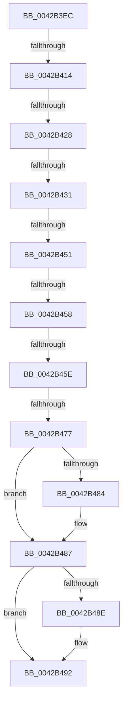

# sub_0042B3EC

- RVA: `0x0042B3EC`–`0x0042B4B2` (길이 `198` bytes)
- VA: `0x000000014042B3EC`
- 실행 섹션: `.text`
- PDB 이름 있음: `아니요`; PDB Function 태그: `아니요`
- unwind 정보 RVA: `0x000A16E4`
- 디코드: `52`개 명령, `198/198` bytes 표시
- 미해석 바이트: `0` (있으면 어셈블리에 `.byte`로 보존)

> 이 문서는 커널 이미지의 기계어와 PDB 기호를 분석해 생성했습니다. 4번과 5번은 함수 원형과 자료형을 바이너리 사용 방식에서 추정한 C 해석이며 원본 소스 복구 결과는 아닙니다.

## 1. Dependencies

- 직접 호출 지점: **1**; 고유 호출 대상: **1**
- 직접 호출자로 확인된 함수: **0**
- RIP 상대 이미지 참조: **0**

### Outgoing calls
- `0x0042B448` → [vsnwprintf](../4F/vsnwprintf_function_004FEF30.md) (function, `0x004FEF30`)

### Direct callers
- 이 함수 시작 RVA로 연결되는 직접 call은 확인되지 않았습니다. 간접 호출은 완전히 역산할 수 없습니다.

### Static image references
- 디코드된 RIP-relative 메모리 참조가 없습니다.

## 2. Other-region calls and transfers

- 다른 실행 섹션으로 향하는 call: **0**
- call이 아닌 외부 분기/꼬리 이동: **7**
  - `0x0042B40E` → [sub_0042B556](Unknown_function_0042B556.md) (`tail-transfer`)
  - `0x0042B422` → [sub_0042B573](Unknown_function_0042B573.md) (`tail-transfer`)
  - `0x0042B42B` → [sub_0042B5A5](Unknown_function_0042B5A5.md) (`tail-transfer`)
  - `0x0042B44F` → [sub_0042B4B3](Unknown_function_0042B4B3.md) (`tail-transfer`)
  - `0x0042B456` → [sub_0042B4B3](Unknown_function_0042B4B3.md) (`tail-transfer`)
  - `0x0042B458` → [sub_0042B543](Unknown_function_0042B543.md) (`tail-transfer`)
  - `0x0042B471` → [sub_0042B5A5 + 0x1B](Unknown_function_0042B5A5.md) (`tail-transfer`)

## 3. Assembly (complete function range)

```asm
0042B3EC  48 89 6C 24 60                  mov qword ptr [rsp + 0x60], rbp
0042B3F1  49 8B EF                        mov rbp, r15
0042B3F4  48 89 74 24 58                  mov qword ptr [rsp + 0x58], rsi
0042B3F9  48 89 7C 24 50                  mov qword ptr [rsp + 0x50], rdi
0042B3FE  48 8B FB                        mov rdi, rbx
0042B401  4C 89 7C 24 30                  mov qword ptr [rsp + 0x30], r15
0042B406  48 89 5C 24 38                  mov qword ptr [rsp + 0x38], rbx
0042B40B  45 85 D2                        test r10d, r10d
0042B40E  0F 85 42 01 00 00               jne 0x14042b556
0042B414  4C 89 74 24 48                  mov qword ptr [rsp + 0x48], r14
0042B419  8B F0                           mov esi, eax
0042B41B  41 F7 C4 00 E0 FF FF            test r12d, 0xffffe000
0042B422  0F 85 4B 01 00 00               jne 0x14042b573
0042B428  48 85 DB                        test rbx, rbx
0042B42B  0F 84 74 01 00 00               je 0x14042b5a5
0042B431  4C 8D 73 FF                     lea r14, [rbx - 1]
0042B435  48 89 44 24 38                  mov qword ptr [rsp + 0x38], rax
0042B43A  49 8B D6                        mov rdx, r14
0042B43D  4C 8D 8C 24 C0 00 00 00         lea r9, [rsp + 0xc0]
0042B445  49 8B CF                        mov rcx, r15
0042B448  E8 E3 3A 0D 00                  call 0x1404fef30
0042B44D  85 C0                           test eax, eax
0042B44F  78 62                           js 0x14042b4b3
0042B451  48 98                           cdqe
0042B453  49 3B C6                        cmp rax, r14
0042B456  77 5B                           ja 0x14042b4b3
0042B458  0F 84 E5 00 00 00               je 0x14042b543
0042B45E  48 2B F8                        sub rdi, rax
0042B461  49 8D 2C 47                     lea rbp, [r15 + rax*2]
0042B465  33 C9                           xor ecx, ecx
0042B467  48 8B D7                        mov rdx, rdi
0042B46A  8B F1                           mov esi, ecx
0042B46C  41 0F BA E4 09                  bt r12d, 9
0042B471  0F 82 49 01 00 00               jb 0x14042b5c0
0042B477  48 8B 84 24 A0 00 00 00         mov rax, qword ptr [rsp + 0xa0]
0042B47F  48 85 C0                        test rax, rax
0042B482  74 03                           je 0x14042b487
0042B484  48 89 28                        mov qword ptr [rax], rbp
0042B487  8B C6                           mov eax, esi
0042B489  4D 85 ED                        test r13, r13
0042B48C  74 04                           je 0x14042b492
0042B48E  49 89 7D 00                     mov qword ptr [r13], rdi
0042B492  4C 8B 74 24 48                  mov r14, qword ptr [rsp + 0x48]
0042B497  48 8B 74 24 58                  mov rsi, qword ptr [rsp + 0x58]
0042B49C  48 8B 6C 24 60                  mov rbp, qword ptr [rsp + 0x60]
0042B4A1  48 8B 7C 24 50                  mov rdi, qword ptr [rsp + 0x50]
0042B4A6  48 83 C4 68                     add rsp, 0x68
0042B4AA  41 5F                           pop r15
0042B4AC  41 5D                           pop r13
0042B4AE  41 5C                           pop r12
0042B4B0  5B                              pop rbx
0042B4B1  C3                              ret
```

## 4. C-style interpretation (structured pseudocode)

```c
__int64 __fastcall sub_0042B3EC(__int64 a1, __int64 a2, __int64 a3, __int64 a4, __int64 a5, __int64 a6, __int64 a7, __int64 a8, __int64 a9, __int64 a10, __int64 a11, __int64 a12, __int64 a13, __int64 a14, __int64 a15, __int64 a16, __int64 a17, __int64 a18, __int64 a19, __int64 a20, __int64 a21, __int64 a22, __int64 a23, __int64 a24)
{
    __int64 result;
    __int64 v_rdi;
    __int64 v_rsp;
    unsigned __int64 v_stack_p30;
    unsigned __int64 v_stack_p38;
    unsigned __int64 v_stack_p48;
    unsigned __int64 v_stack_p50;
    unsigned __int64 v_stack_p58;
    unsigned __int64 v_stack_p60;

    v_stack_p60 = v_rbp;
    v_stack_p58 = v_rsi;
    v_stack_p50 = v_rdi;
    v_stack_p30 = v_r15;
    v_stack_p38 = v_rbx;
    v_stack_p48 = v_r14;
    v_stack_p38 = result;
    result = vsnwprintf(v_r15, v_rbx - 1, a3, a24);
    v_rdi = (v_rbx) - (result);
    a1 = 0;
    if (a20 != 0) {
        *(unsigned __int64 *)(a20) = v_r15 + result * 2;
    }
    if (v_r13 != 0) {
        *(unsigned __int64 *)(v_r13) = v_rdi;
    }
    v_rsp = (v_rsp) + (104);
    return 0;
}
```

## 5. (Beta) C Style

```c
int64_t sub_0042B3EC(int64_t Arg1, int64_t Arg2, int64_t Arg3, int64_t Arg4, uint64_t Arg5, uint64_t Arg6, uint64_t Arg7, uint64_t Arg8, int64_t Arg9, int64_t Arg10, int64_t Arg11, int64_t Arg12, uint64_t Arg13, uint64_t Arg14, uint64_t Arg15, uint64_t Arg16, uint64_t Arg17, uint64_t Arg18, uint64_t Arg19, int64_t Arg20, uint64_t Arg21, uint64_t Arg22, uint64_t Arg23, int64_t Arg24)
{
    int64_t result;
    int64_t local_rdi;
    int64_t local_rsp;
    uint64_t v_stack_p30;
    uint64_t v_stack_p38;
    uint64_t v_stack_p48;
    uint64_t v_stack_p50;
    uint64_t v_stack_p58;
    uint64_t v_stack_p60;

    v_stack_p60 = local_rbp;
    v_stack_p58 = local_rsi;
    v_stack_p50 = local_rdi;
    v_stack_p30 = local_r15;
    v_stack_p38 = local_rbx;
    v_stack_p48 = local_r14;
    v_stack_p38 = result;
    result = vsnwprintf(local_r15, local_rbx - 1, Arg3, Arg24);
    local_rdi = (local_rbx) - (result);
    Arg1 = 0;
    if (Arg20 != 0) {
        *(uint64_t *)(Arg20) = local_r15 + result * 2;
    }
    if (local_r13 != 0) {
        *(uint64_t *)(local_r13) = local_rdi;
    }
    local_rsp = (local_rsp) + (104);
    return 0;
}
```

## 6. Execution-region graph

[열기: 2D/3D 그래프와 함수 탐색 컨트롤 패널](../../../control-panel.html?section=text&rva=0x0042B3EC&view=graph)

- 2D 그래프는 위에서 아래로 흐르고, 3D 그래프는 빈 공간을 드래그해 회전합니다. Shift+드래그는 이동, 휠은 확대·축소, 함수 노드 선택은 대상 보고서 이동입니다.

### Static fallback


