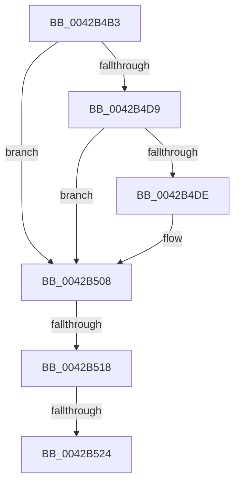

# sub_0042B4B3

- RVA: `0x0042B4B3`–`0x0042B52B` (길이 `120` bytes)
- VA: `0x000000014042B4B3`
- 실행 섹션: `.text`
- PDB 이름 있음: `아니요`; PDB Function 태그: `아니요`
- unwind 정보 RVA: `0x000A1718`
- 디코드: `28`개 명령, `120/120` bytes 표시
- 미해석 바이트: `0` (있으면 어셈블리에 `.byte`로 보존)

> 이 문서는 커널 이미지의 기계어와 PDB 기호를 분석해 생성했습니다. 4번과 5번은 함수 원형과 자료형을 바이너리 사용 방식에서 추정한 C 해석이며 원본 소스 복구 결과는 아닙니다.

## 1. Dependencies

- 직접 호출 지점: **1**; 고유 호출 대상: **1**
- 직접 호출자로 확인된 함수: **0**
- RIP 상대 이미지 참조: **0**

### Outgoing calls
- `0x0042B4F9` → [RtlStringExHandleOtherFlagsW](../41/RtlStringExHandleOtherFlagsW_function_0041E3F0.md) (function, `0x0041E3F0`)

### Direct callers
- 이 함수 시작 RVA로 연결되는 직접 call은 확인되지 않았습니다. 간접 호출은 완전히 역산할 수 없습니다.

### Static image references
- 디코드된 RIP-relative 메모리 참조가 없습니다.

## 2. Other-region calls and transfers

- 다른 실행 섹션으로 향하는 call: **0**
- call이 아닌 외부 분기/꼬리 이동: **3**
  - `0x0042B512` → [sub_0042B3EC + 0x8B](Unknown_function_0042B3EC.md) (`tail-transfer`)
  - `0x0042B51E` → [sub_0042B3EC + 0x8B](Unknown_function_0042B3EC.md) (`tail-transfer`)
  - `0x0042B526` → [sub_0042B3EC + 0xA6](Unknown_function_0042B3EC.md) (`tail-transfer`)

## 3. Assembly (complete function range)

```asm
0042B4B3  33 C9                           xor ecx, ecx
0042B4B5  4B 8D 2C 77                     lea rbp, [r15 + r14*2]
0042B4B9  49 2B FE                        sub rdi, r14
0042B4BC  66 43 89 0C 77                  mov word ptr [r15 + r14*2], cx
0042B4C1  48 89 7C 24 38                  mov qword ptr [rsp + 0x38], rdi
0042B4C6  BE 05 00 00 80                  mov esi, 0x80000005
0042B4CB  48 89 6C 24 30                  mov qword ptr [rsp + 0x30], rbp
0042B4D0  41 F7 C4 00 1C 00 00            test r12d, 0x1c00
0042B4D7  74 2F                           je 0x14042b508
0042B4D9  48 85 DB                        test rbx, rbx
0042B4DC  74 2A                           je 0x14042b508
0042B4DE  48 8D 44 24 38                  lea rax, [rsp + 0x38]
0042B4E3  44 89 64 24 28                  mov dword ptr [rsp + 0x28], r12d
0042B4E8  48 8D 14 1B                     lea rdx, [rbx + rbx]
0042B4EC  48 89 44 24 20                  mov qword ptr [rsp + 0x20], rax
0042B4F1  4C 8D 4C 24 30                  lea r9, [rsp + 0x30]
0042B4F6  49 8B CF                        mov rcx, r15
0042B4F9  E8 F2 2E FF FF                  call 0x14041e3f0
0042B4FE  48 8B 6C 24 30                  mov rbp, qword ptr [rsp + 0x30]
0042B503  48 8B 7C 24 38                  mov rdi, qword ptr [rsp + 0x38]
0042B508  B9 00 00 00 80                  mov ecx, 0x80000000
0042B50D  8D 04 0E                        lea eax, [rsi + rcx]
0042B510  85 C1                           test ecx, eax
0042B512  0F 85 5F FF FF FF               jne 0x14042b477
0042B518  81 FE 05 00 00 80               cmp esi, 0x80000005
0042B51E  0F 84 53 FF FF FF               je 0x14042b477
0042B524  8B C6                           mov eax, esi
0042B526  E9 67 FF FF FF                  jmp 0x14042b492
```

## 4. C-style interpretation (structured pseudocode)

```c
__int64 __fastcall sub_0042B4B3(int a1, __int64 a2, __int64 a3, __int64 a4, __int64 a5, __int64 a6, __int64 a7)
{
    __int64 result;
    __int64 v_rbp;
    __int64 v_rdi;
    unsigned __int64 v_stack_p20;
    unsigned int v_stack_p28;
    unsigned __int64 v_stack_p30;
    unsigned __int64 v_stack_p38;

    a1 = 0;
    v_rdi = (v_rdi) - (v_r14);
    *(unsigned __int16 *)(v_r15 + v_r14 * 2) = 0;
    v_stack_p38 = v_rdi;
    v_stack_p30 = v_r15 + v_r14 * 2;
    if ((((unsigned int)(v_r12)) & (0x1C00ULL)) == 0) goto loc_0042B508;
    v_rbp = v_r15 + v_r14 * 2;
    if (v_rbx != 0) {
        result = a7;
        v_stack_p28 = (unsigned int)(v_r12);
        a2 = v_rbx + v_rbx * 1;
        v_stack_p20 = result;
        a4 = a6;
        a1 = v_r15;
        result = RtlStringExHandleOtherFlagsW(a1, a2, a3, a4);
        v_rbp = a6;
        v_rdi = a7;
    }
}
```

## 5. (Beta) C Style

```c
int64_t sub_0042B4B3(int32_t Arg1, int64_t Arg2, int64_t Arg3, int64_t Arg4, uint64_t Arg5, int64_t Arg6, int64_t Arg7)
{
    int64_t result;
    int64_t local_rbp;
    int64_t local_rdi;
    uint64_t v_stack_p20;
    uint32_t v_stack_p28;
    uint64_t v_stack_p30;
    uint64_t v_stack_p38;

    Arg1 = 0;
    local_rdi = (local_rdi) - (local_r14);
    *(uint16_t *)(local_r15 + local_r14 * 2) = 0;
    v_stack_p38 = local_rdi;
    v_stack_p30 = local_r15 + local_r14 * 2;
    if ((((uint32_t)(local_r12)) & (0x1C00ULL)) == 0) goto loc_0042B508;
    local_rbp = local_r15 + local_r14 * 2;
    if (local_rbx != 0) {
        result = Arg7;
        v_stack_p28 = (uint32_t)(local_r12);
        Arg2 = local_rbx + local_rbx * 1;
        v_stack_p20 = result;
        Arg4 = Arg6;
        Arg1 = local_r15;
        result = RtlStringExHandleOtherFlagsW(Arg1, Arg2, Arg3, Arg4);
        local_rbp = Arg6;
        local_rdi = Arg7;
    }
}
```

## 6. Execution-region graph

[열기: 2D/3D 그래프와 함수 탐색 컨트롤 패널](../../../control-panel.html?section=text&rva=0x0042B4B3&view=graph)

- 2D 그래프는 위에서 아래로 흐르고, 3D 그래프는 빈 공간을 드래그해 회전합니다. Shift+드래그는 이동, 휠은 확대·축소, 함수 노드 선택은 대상 보고서 이동입니다.

### Static fallback


