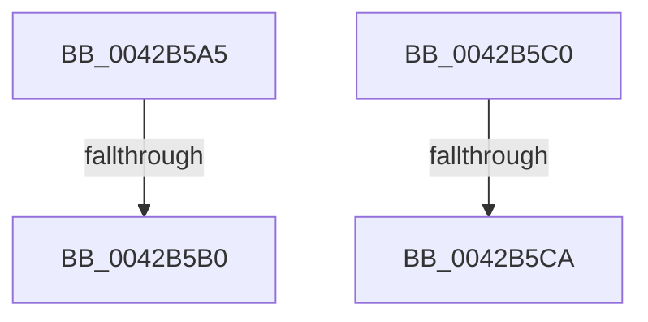

# sub_0042B5A5

- RVA: `0x0042B5A5`–`0x0042B5DD` (길이 `56` bytes)
- VA: `0x000000014042B5A5`
- 실행 섹션: `.text`
- PDB 이름 있음: `아니요`; PDB Function 태그: `아니요`
- unwind 정보 RVA: `0x000A17B8`
- 디코드: `13`개 명령, `56/56` bytes 표시
- 미해석 바이트: `0` (있으면 어셈블리에 `.byte`로 보존)

> 이 문서는 커널 이미지의 기계어와 PDB 기호를 분석해 생성했습니다. 4번과 5번은 함수 원형과 자료형을 바이너리 사용 방식에서 추정한 C 해석이며 원본 소스 복구 결과는 아닙니다.

## 1. Dependencies

- 직접 호출 지점: **1**; 고유 호출 대상: **1**
- 직접 호출자로 확인된 함수: **0**
- RIP 상대 이미지 참조: **0**

### Outgoing calls
- `0x0042B5D3` → [RtlStringExHandleFillBehindNullW](../5A/RtlStringExHandleFillBehindNullW_function_005A4F94.md) (function, `0x005A4F94`)

### Direct callers
- 이 함수 시작 RVA로 연결되는 직접 call은 확인되지 않았습니다. 간접 호출은 완전히 역산할 수 없습니다.

### Static image references
- 디코드된 RIP-relative 메모리 참조가 없습니다.

## 2. Other-region calls and transfers

- 다른 실행 섹션으로 향하는 call: **0**
- call이 아닌 외부 분기/꼬리 이동: **4**
  - `0x0042B5AA` → [sub_0042B3EC + 0x8B](Unknown_function_0042B3EC.md) (`tail-transfer`)
  - `0x0042B5BB` → [sub_0042B4B3 + 0x1D](Unknown_function_0042B4B3.md) (`tail-transfer`)
  - `0x0042B5C4` → [sub_0042B3EC + 0x8B](Unknown_function_0042B3EC.md) (`tail-transfer`)
  - `0x0042B5D8` → [sub_0042B3EC + 0x8B](Unknown_function_0042B3EC.md) (`tail-transfer`)

## 3. Assembly (complete function range)

```asm
0042B5A5  66 41 83 38 00                  cmp word ptr [r8], 0
0042B5AA  0F 84 C7 FE FF FF               je 0x14042b477
0042B5B0  4D 85 FF                        test r15, r15
0042B5B3  BE 05 00 00 80                  mov esi, 0x80000005
0042B5B8  0F 44 F1                        cmove esi, ecx
0042B5BB  E9 10 FF FF FF                  jmp 0x14042b4d0
0042B5C0  48 83 FA 01                     cmp rdx, 1
0042B5C4  0F 86 AD FE FF FF               jbe 0x14042b477
0042B5CA  48 03 D2                        add rdx, rdx
0042B5CD  45 8B C4                        mov r8d, r12d
0042B5D0  48 8B CD                        mov rcx, rbp
0042B5D3  E8 BC 99 17 00                  call 0x1405a4f94
0042B5D8  E9 9A FE FF FF                  jmp 0x14042b477
```

## 4. C-style interpretation (structured pseudocode)

```c
__int64 __fastcall sub_0042B5A5(int a1, __int64 a2, __int64 a3)
{
    __int64 v_rsi;

    v_rsi = (unsigned int)(0x80000005ULL);
    if (v_r15 == 0) { v_rsi = a1; }
}
```

## 5. (Beta) C Style

```c
int64_t sub_0042B5A5(int32_t Arg1, int64_t Arg2, void *Arg3)
{
    uint8_t *arg3 = (uint8_t *)Arg3;

    int64_t local_rsi;

    local_rsi = (uint32_t)(0x80000005ULL);
    if (local_r15 == 0) { local_rsi = Arg1; }
}
```

### 관측된 메모리 오프셋

구조체 형식이 확인되지 않은 접근은 인자 기준의 오프셋으로만 기록했습니다.

| 기준 인자 | 오프셋 표현 | 폭 (bit) | 접근 |
|---|---:|---:|---|
| `Arg3` | `+ 0x0` | `16` | `R` |

## 6. Execution-region graph

[열기: 2D/3D 그래프와 함수 탐색 컨트롤 패널](../../../control-panel.html?section=text&rva=0x0042B5A5&view=graph)

- 2D 그래프는 위에서 아래로 흐르고, 3D 그래프는 빈 공간을 드래그해 회전합니다. Shift+드래그는 이동, 휠은 확대·축소, 함수 노드 선택은 대상 보고서 이동입니다.

### Static fallback


