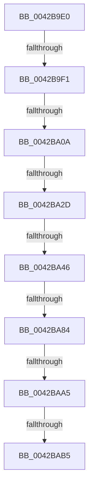

# sub_0042B9E0

- RVA: `0x0042B9E0`–`0x0042BAC2` (길이 `226` bytes)
- VA: `0x000000014042B9E0`
- 실행 섹션: `.text`
- PDB 이름 있음: `아니요`; PDB Function 태그: `아니요`
- unwind 정보 RVA: `0x000A1850`
- 디코드: `50`개 명령, `226/226` bytes 표시
- 미해석 바이트: `0` (있으면 어셈블리에 `.byte`로 보존)

> 이 문서는 커널 이미지의 기계어와 PDB 기호를 분석해 생성했습니다. 4번과 5번은 함수 원형과 자료형을 바이너리 사용 방식에서 추정한 C 해석이며 원본 소스 복구 결과는 아닙니다.

## 1. Dependencies

- 직접 호출 지점: **1**; 고유 호출 대상: **1**
- 직접 호출자로 확인된 함수: **0**
- RIP 상대 이미지 참조: **1**

### Outgoing calls
- `0x0042BAA5` → [HalpHvWatchdogArm](HalpHvWatchdogArm_function_0042BF90.md) (function, `0x0042BF90`)

### Direct callers
- 이 함수 시작 RVA로 연결되는 직접 call은 확인되지 않았습니다. 간접 호출은 완전히 역산할 수 없습니다.

### Static image references
- `0x0042BA8F` → RVA `0x0042BF90` (`HalpHvWatchdogArm`; read)

## 2. Other-region calls and transfers

- 다른 실행 섹션으로 향하는 call: **0**
- call이 아닌 외부 분기/꼬리 이동: **8**
  - `0x0042B9EB` → [sub_0042BCAE](Unknown_function_0042BCAE.md) (`tail-transfer`)
  - `0x0042BA04` → [sub_0042BBD4](Unknown_function_0042BBD4.md) (`tail-transfer`)
  - `0x0042BA27` → [sub_0042BBA3](Unknown_function_0042BBA3.md) (`tail-transfer`)
  - `0x0042BA40` → [sub_0042BBD4 + 0xB](Unknown_function_0042BBD4.md) (`tail-transfer`)
  - `0x0042BA7E` → [sub_0042BC3E](Unknown_function_0042BC3E.md) (`tail-transfer`)
  - `0x0042BA9F` → [sub_0042BCAE + 0x29](Unknown_function_0042BCAE.md) (`tail-transfer`)
  - `0x0042BAAF` → [sub_0042BCAE + 0x36](Unknown_function_0042BCAE.md) (`tail-transfer`)
  - `0x0042BABD` → [sub_0042BAC2 + 0xAA](Unknown_function_0042BAC2.md) (`tail-transfer`)

## 3. Assembly (complete function range)

```asm
0042B9E0  48 89 6C 24 50                  mov qword ptr [rsp + 0x50], rbp
0042B9E5  8B EF                           mov ebp, edi
0042B9E7  41 F6 C3 50                     test r11b, 0x50
0042B9EB  0F 84 BD 02 00 00               je 0x14042bcae
0042B9F1  4C 8B 8E C0 00 00 00            mov r9, qword ptr [rsi + 0xc0]
0042B9F8  48 8B C3                        mov rax, rbx
0042B9FB  49 F7 E1                        mul r9
0042B9FE  48 8B C8                        mov rcx, rax
0042BA01  48 85 D2                        test rdx, rdx
0042BA04  0F 85 CA 01 00 00               jne 0x14042bbd4
0042BA0A  48 B8 BD 42 7A E5 D5 94 BF D6   movabs rax, 0xd6bf94d5e57a42bd
0042BA14  48 F7 E1                        mul rcx
0042BA17  8B 8E DC 00 00 00               mov ecx, dword ptr [rsi + 0xdc]
0042BA1D  48 8B DA                        mov rbx, rdx
0042BA20  48 C1 EB 17                     shr rbx, 0x17
0042BA24  83 F9 40                        cmp ecx, 0x40
0042BA27  0F 82 76 01 00 00               jb 0x14042bba3
0042BA2D  49 B8 00 E4 0B 54 02 00 00 00   movabs r8, 0x2540be400
0042BA37  49 8B C0                        mov rax, r8
0042BA3A  48 F7 E3                        mul rbx
0042BA3D  48 85 D2                        test rdx, rdx
0042BA40  0F 85 99 01 00 00               jne 0x14042bbdf
0042BA46  49 F7 F1                        div r9
0042BA49  48 8B E8                        mov rbp, rax
0042BA4C  48 89 5E 10                     mov qword ptr [rsi + 0x10], rbx
0042BA50  48 B8 77 BE 9F 1A 2F DD 24 06   movabs rax, 0x624dd2f1a9fbe77
0042BA5A  C7 46 34 01 00 00 00            mov dword ptr [rsi + 0x34], 1
0042BA61  48 F7 E5                        mul rbp
0042BA64  48 2B EA                        sub rbp, rdx
0042BA67  48 D1 ED                        shr rbp, 1
0042BA6A  48 03 EA                        add rbp, rdx
0042BA6D  48 C1 ED 09                     shr rbp, 9
0042BA71  41 F6 C3 40                     test r11b, 0x40
0042BA75  40 0F 95 C7                     setne dil
0042BA79  41 0F BA E3 10                  bt r11d, 0x10
0042BA7E  0F 82 BA 01 00 00               jb 0x14042bc3e
0042BA84  48 8B 4E 48                     mov rcx, qword ptr [rsi + 0x48]
0042BA88  4C 8B 8E 80 00 00 00            mov r9, qword ptr [rsi + 0x80]
0042BA8F  48 8D 05 FA 04 00 00            lea rax, [rip + 0x4fa]
0042BA96  8D 57 01                        lea edx, [rdi + 1]
0042BA99  4C 8B C3                        mov r8, rbx
0042BA9C  4C 3B C8                        cmp r9, rax
0042BA9F  0F 85 32 02 00 00               jne 0x14042bcd7
0042BAA5  E8 E6 04 00 00                  call 0x14042bf90
0042BAAA  44 8B D0                        mov r10d, eax
0042BAAD  85 C0                           test eax, eax
0042BAAF  0F 88 2F 02 00 00               js 0x14042bce4
0042BAB5  48 8B FD                        mov rdi, rbp
0042BAB8  48 8B 6C 24 50                  mov rbp, qword ptr [rsp + 0x50]
0042BABD  E9 AA 00 00 00                  jmp 0x14042bb6c
```

## 4. C-style interpretation (structured pseudocode)

```c
__int64 __fastcall sub_0042B9E0(__int64 a1, __int64 a2, __int64 a3, __int64 a4, __int64 a5, __int64 a6, __int64 a7, __int64 a8, __int64 a9, __int64 a10)
{
    __int64 result;
    __int64 v_rbp;
    __int64 v_rbx;
    __int64 v_rdi;
    unsigned __int64 v_stack_p50;

    v_stack_p50 = v_rbp;
    v_rbx = (a2) >> (23);
    *(unsigned __int64 *)(v_rsi + 16) = v_rbx;
    *(unsigned int *)(v_rsi + 52) = 1;
    v_rbp = (a3) - (a2);
    v_rbp = (v_rbp) >> (1);
    v_rbp = (v_rbp) + (a2);
    v_rbp = (v_rbp) >> (9);
    v_rdi = ((((unsigned __int8)(v_r11)) & (64)) != 0) ? 1 : 0;
    result = HalpHvWatchdogArm(*(unsigned __int64 *)(v_rsi + 72), v_rdi + 1, v_rbx, *(unsigned __int64 *)(v_rsi + 128));
}
```

## 5. (Beta) C Style

```c
int64_t sub_0042B9E0(int64_t Arg1, int64_t Arg2, int64_t Arg3, int64_t Arg4, uint64_t Arg5, uint64_t Arg6, uint64_t Arg7, uint64_t Arg8, uint64_t Arg9, int64_t Arg10)
{
    int64_t result;
    int64_t local_rbp;
    int64_t local_rbx;
    int64_t local_rdi;
    uint64_t v_stack_p50;

    v_stack_p50 = local_rbp;
    local_rbx = (Arg2) >> (23);
    *(uint64_t *)(local_rsi + 0x10) = local_rbx;
    *(uint32_t *)(local_rsi + 0x34) = 1;
    local_rbp = (Arg3) - (Arg2);
    local_rbp = (local_rbp) >> (1);
    local_rbp = (local_rbp) + (Arg2);
    local_rbp = (local_rbp) >> (9);
    local_rdi = ((((uint8_t)(local_r11)) & (64)) != 0) ? 1 : 0;
    result = HalpHvWatchdogArm(*(uint64_t *)(local_rsi + 0x48), local_rdi + 1, local_rbx, *(uint64_t *)(local_rsi + 0x80));
}
```

## 6. Execution-region graph

[열기: 2D/3D 그래프와 함수 탐색 컨트롤 패널](../../../control-panel.html?section=text&rva=0x0042B9E0&view=graph)

- 2D 그래프는 위에서 아래로 흐르고, 3D 그래프는 빈 공간을 드래그해 회전합니다. Shift+드래그는 이동, 휠은 확대·축소, 함수 노드 선택은 대상 보고서 이동입니다.

### Static fallback


