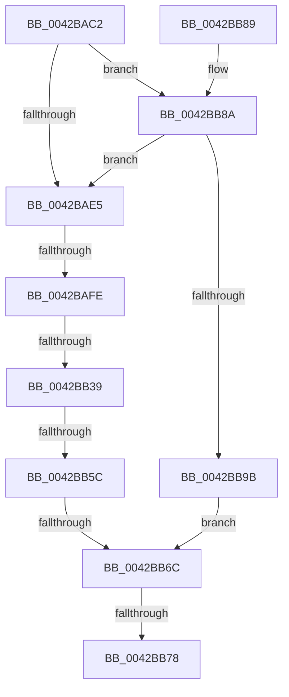

# sub_0042BAC2

- RVA: `0x0042BAC2`–`0x0042BBA3` (길이 `225` bytes)
- VA: `0x000000014042BAC2`
- 실행 섹션: `.text`
- PDB 이름 있음: `아니요`; PDB Function 태그: `아니요`
- unwind 정보 RVA: `0x000A1864`
- 디코드: `52`개 명령, `225/225` bytes 표시
- 미해석 바이트: `0` (있으면 어셈블리에 `.byte`로 보존)

> 이 문서는 커널 이미지의 기계어와 PDB 기호를 분석해 생성했습니다. 4번과 5번은 함수 원형과 자료형을 바이너리 사용 방식에서 추정한 C 해석이며 원본 소스 복구 결과는 아닙니다.

## 1. Dependencies

- 직접 호출 지점: **1**; 고유 호출 대상: **1**
- 직접 호출자로 확인된 함수: **0**
- RIP 상대 이미지 참조: **1**

### Outgoing calls
- `0x0042BB5C` → [HalpHvWatchdogArm](HalpHvWatchdogArm_function_0042BF90.md) (function, `0x0042BF90`)

### Direct callers
- 이 함수 시작 RVA로 연결되는 직접 call은 확인되지 않았습니다. 간접 호출은 완전히 역산할 수 없습니다.

### Static image references
- `0x0042BB44` → RVA `0x0042BF90` (`HalpHvWatchdogArm`; read)

## 2. Other-region calls and transfers

- 다른 실행 섹션으로 향하는 call: **0**
- call이 아닌 외부 분기/꼬리 이동: **5**
  - `0x0042BAF8` → [sub_0042BBC4](Unknown_function_0042BBC4.md) (`tail-transfer`)
  - `0x0042BB33` → [sub_0042BBEF + 0x38](Unknown_function_0042BBEF.md) (`tail-transfer`)
  - `0x0042BB56` → [sub_0042BC55 + 0x28](Unknown_function_0042BC55.md) (`tail-transfer`)
  - `0x0042BB66` → [sub_0042BC55 + 0x35](Unknown_function_0042BC55.md) (`tail-transfer`)
  - `0x0042BB72` → [sub_0042BD08](Unknown_function_0042BD08.md) (`tail-transfer`)

## 3. Assembly (complete function range)

```asm
0042BAC2  48 B8 BD 42 7A E5 D5 94 BF D6   movabs rax, 0xd6bf94d5e57a42bd
0042BACC  48 F7 E1                        mul rcx
0042BACF  8B 8E DC 00 00 00               mov ecx, dword ptr [rsi + 0xdc]
0042BAD5  4C 8B DA                        mov r11, rdx
0042BAD8  49 C1 EB 17                     shr r11, 0x17
0042BADC  83 F9 40                        cmp ecx, 0x40
0042BADF  0F 82 A5 00 00 00               jb 0x14042bb8a
0042BAE5  49 B8 00 E4 0B 54 02 00 00 00   movabs r8, 0x2540be400
0042BAEF  49 8B C0                        mov rax, r8
0042BAF2  49 F7 E3                        mul r11
0042BAF5  48 85 D2                        test rdx, rdx
0042BAF8  0F 85 C6 00 00 00               jne 0x14042bbc4
0042BAFE  49 F7 F1                        div r9
0042BB01  48 8B F8                        mov rdi, rax
0042BB04  4C 89 5E 10                     mov qword ptr [rsi + 0x10], r11
0042BB08  48 B8 77 BE 9F 1A 2F DD 24 06   movabs rax, 0x624dd2f1a9fbe77
0042BB12  C7 46 34 01 00 00 00            mov dword ptr [rsi + 0x34], 1
0042BB19  48 F7 E7                        mul rdi
0042BB1C  48 2B FA                        sub rdi, rdx
0042BB1F  48 D1 EF                        shr rdi, 1
0042BB22  48 03 FA                        add rdi, rdx
0042BB25  48 C1 EF 09                     shr rdi, 9
0042BB29  F7 86 E0 00 00 00 00 00 01 00   test dword ptr [rsi + 0xe0], 0x10000
0042BB33  0F 85 EE 00 00 00               jne 0x14042bc27
0042BB39  48 8B 4E 48                     mov rcx, qword ptr [rsi + 0x48]
0042BB3D  4C 8B 8E 80 00 00 00            mov r9, qword ptr [rsi + 0x80]
0042BB44  48 8D 05 45 04 00 00            lea rax, [rip + 0x445]
0042BB4B  4D 8B C3                        mov r8, r11
0042BB4E  BA 03 00 00 00                  mov edx, 3
0042BB53  4C 3B C8                        cmp r9, rax
0042BB56  0F 85 21 01 00 00               jne 0x14042bc7d
0042BB5C  E8 2F 04 00 00                  call 0x14042bf90
0042BB61  44 8B D0                        mov r10d, eax
0042BB64  85 C0                           test eax, eax
0042BB66  0F 88 1E 01 00 00               js 0x14042bc8a
0042BB6C  49 89 3E                        mov qword ptr [r14], rdi
0042BB6F  45 85 D2                        test r10d, r10d
0042BB72  0F 88 90 01 00 00               js 0x14042bd08
0042BB78  48 8B 5C 24 60                  mov rbx, qword ptr [rsp + 0x60]
0042BB7D  41 8B C2                        mov eax, r10d
0042BB80  48 83 C4 30                     add rsp, 0x30
0042BB84  41 5E                           pop r14
0042BB86  5F                              pop rdi
0042BB87  5E                              pop rsi
0042BB88  C3                              ret
0042BB89  CC                              int3
0042BB8A  B8 01 00 00 00                  mov eax, 1
0042BB8F  48 D3 E0                        shl rax, cl
0042BB92  4C 3B D8                        cmp r11, rax
0042BB95  0F 82 4A FF FF FF               jb 0x14042bae5
0042BB9B  41 BA 0D 00 00 C0               mov r10d, 0xc000000d
0042BBA1  EB C9                           jmp 0x14042bb6c
```

## 4. C-style interpretation (structured pseudocode)

```c
__int64 __fastcall sub_0042BAC2(__int64 a1, __int64 a2, __int64 a3, __int64 a4, __int64 a5, __int64 a6, __int64 a7, __int64 a8, __int64 a9, __int64 a10, __int64 a11, __int64 a12)
{
    __int64 result;
    __int64 v_r11;
    __int64 v_rdi;
    __int64 v_rsp;

    v_r11 = (a2) >> (23);
    if (((unsigned int)((unsigned int)(*(unsigned int *)(v_rsi + 220)))) < 64) goto loc_0042BB8A;
loc_0042BAE5:
    *(unsigned __int64 *)(v_rsi + 16) = v_r11;
    *(unsigned int *)(v_rsi + 52) = 1;
    v_rdi = (a3) - (a2);
    v_rdi = (v_rdi) >> (1);
    v_rdi = (v_rdi) + (a2);
    v_rdi = (v_rdi) >> (9);
    result = HalpHvWatchdogArm(*(unsigned __int64 *)(v_rsi + 72), 3, v_r11, *(unsigned __int64 *)(v_rsi + 128));
loc_0042BB6C:
    *(unsigned __int64 *)(v_r14) = v_rdi;
    v_rsp = (v_rsp) + (48);
    return (unsigned int)((unsigned int)((unsigned int)((unsigned int)(result))));
loc_0042BB8A:
    result = (1) << ((unsigned __int8)(*(unsigned __int64 *)(v_rsi + 72)));
    if (v_r11 < result) goto loc_0042BAE5;
    goto loc_0042BB6C;
}
```

## 5. (Beta) C Style

```c
int64_t sub_0042BAC2(int64_t Arg1, int64_t Arg2, int64_t Arg3, int64_t Arg4, uint64_t Arg5, uint64_t Arg6, uint64_t Arg7, uint64_t Arg8, uint64_t Arg9, uint64_t Arg10, uint64_t Arg11, int64_t Arg12)
{
    int64_t result;
    int64_t local_r11;
    int64_t local_rdi;
    int64_t local_rsp;

    local_r11 = (Arg2) >> (23);
    if (((uint32_t)((uint32_t)(*(uint32_t *)(local_rsi + 0xDC)))) < 64) goto loc_0042BB8A;
loc_0042BAE5:
    *(uint64_t *)(local_rsi + 0x10) = local_r11;
    *(uint32_t *)(local_rsi + 0x34) = 1;
    local_rdi = (Arg3) - (Arg2);
    local_rdi = (local_rdi) >> (1);
    local_rdi = (local_rdi) + (Arg2);
    local_rdi = (local_rdi) >> (9);
    result = HalpHvWatchdogArm(*(uint64_t *)(local_rsi + 0x48), 3, local_r11, *(uint64_t *)(local_rsi + 0x80));
loc_0042BB6C:
    *(uint64_t *)(local_r14) = local_rdi;
    local_rsp = (local_rsp) + (48);
    return (uint32_t)((uint32_t)((uint32_t)((uint32_t)(result))));
loc_0042BB8A:
    result = (1) << ((uint8_t)(*(uint64_t *)(local_rsi + 0x48)));
    if (local_r11 < result) goto loc_0042BAE5;
    goto loc_0042BB6C;
}
```

## 6. Execution-region graph

[열기: 2D/3D 그래프와 함수 탐색 컨트롤 패널](../../../control-panel.html?section=text&rva=0x0042BAC2&view=graph)

- 2D 그래프는 위에서 아래로 흐르고, 3D 그래프는 빈 공간을 드래그해 회전합니다. Shift+드래그는 이동, 휠은 확대·축소, 함수 노드 선택은 대상 보고서 이동입니다.

### Static fallback


