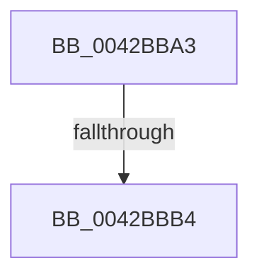

# sub_0042BBA3

- RVA: `0x0042BBA3`–`0x0042BBC4` (길이 `33` bytes)
- VA: `0x000000014042BBA3`
- 실행 섹션: `.text`
- PDB 이름 있음: `아니요`; PDB Function 태그: `아니요`
- unwind 정보 RVA: `0x000A1878`
- 디코드: `8`개 명령, `33/33` bytes 표시
- 미해석 바이트: `0` (있으면 어셈블리에 `.byte`로 보존)

> 이 문서는 커널 이미지의 기계어와 PDB 기호를 분석해 생성했습니다. 4번과 5번은 함수 원형과 자료형을 바이너리 사용 방식에서 추정한 C 해석이며 원본 소스 복구 결과는 아닙니다.

## 1. Dependencies

- 직접 호출 지점: **0**; 고유 호출 대상: **0**
- 직접 호출자로 확인된 함수: **0**
- RIP 상대 이미지 참조: **0**

### Outgoing calls
- 직접 디코드된 call 명령이 없습니다.

### Direct callers
- 이 함수 시작 RVA로 연결되는 직접 call은 확인되지 않았습니다. 간접 호출은 완전히 역산할 수 없습니다.

### Static image references
- 디코드된 RIP-relative 메모리 참조가 없습니다.

## 2. Other-region calls and transfers

- 다른 실행 섹션으로 향하는 call: **0**
- call이 아닌 외부 분기/꼬리 이동: **2**
  - `0x0042BBAE` → [sub_0042B9E0 + 0x4D](Unknown_function_0042B9E0.md) (`tail-transfer`)
  - `0x0042BBC2` → [sub_0042BAC2 + 0xAA](Unknown_function_0042BAC2.md) (`tail-transfer`)

## 3. Assembly (complete function range)

```asm
0042BBA3  B8 01 00 00 00                  mov eax, 1
0042BBA8  48 D3 E0                        shl rax, cl
0042BBAB  48 3B D8                        cmp rbx, rax
0042BBAE  0F 82 79 FE FF FF               jb 0x14042ba2d
0042BBB4  48 8B FD                        mov rdi, rbp
0042BBB7  41 BA 0D 00 00 C0               mov r10d, 0xc000000d
0042BBBD  48 8B 6C 24 50                  mov rbp, qword ptr [rsp + 0x50]
0042BBC2  EB A8                           jmp 0x14042bb6c
```

## 4. C-style interpretation (structured pseudocode)

```c
__int64 __fastcall sub_0042BBA3(unsigned __int8 a1, __int64 a2, __int64 a3, __int64 a4, __int64 a5, __int64 a6, __int64 a7, __int64 a8, __int64 a9, __int64 a10)
{
    __int64 result;

    result = (1) << (a1);
}
```

## 5. (Beta) C Style

```c
int64_t sub_0042BBA3(uint8_t Arg1, int64_t Arg2, int64_t Arg3, int64_t Arg4, uint64_t Arg5, uint64_t Arg6, uint64_t Arg7, uint64_t Arg8, uint64_t Arg9, int64_t Arg10)
{
    int64_t result;

    result = (1) << (Arg1);
}
```

## 6. Execution-region graph

[열기: 2D/3D 그래프와 함수 탐색 컨트롤 패널](../../../control-panel.html?section=text&rva=0x0042BBA3&view=graph)

- 2D 그래프는 위에서 아래로 흐르고, 3D 그래프는 빈 공간을 드래그해 회전합니다. Shift+드래그는 이동, 휠은 확대·축소, 함수 노드 선택은 대상 보고서 이동입니다.

### Static fallback


