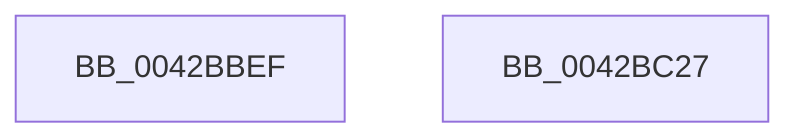

# sub_0042BBEF

- RVA: `0x0042BBEF`–`0x0042BC3E` (길이 `79` bytes)
- VA: `0x000000014042BBEF`
- 실행 섹션: `.text`
- PDB 이름 있음: `아니요`; PDB Function 태그: `아니요`
- unwind 정보 RVA: `0x000A18B0`
- 디코드: `12`개 명령, `79/79` bytes 표시
- 미해석 바이트: `0` (있으면 어셈블리에 `.byte`로 보존)

> 이 문서는 커널 이미지의 기계어와 PDB 기호를 분석해 생성했습니다. 4번과 5번은 함수 원형과 자료형을 바이너리 사용 방식에서 추정한 C 해석이며 원본 소스 복구 결과는 아닙니다.

## 1. Dependencies

- 직접 호출 지점: **0**; 고유 호출 대상: **0**
- 직접 호출자로 확인된 함수: **0**
- RIP 상대 이미지 참조: **2**

### Outgoing calls
- 직접 디코드된 call 명령이 없습니다.

### Direct callers
- 이 함수 시작 RVA로 연결되는 직접 call은 확인되지 않았습니다. 간접 호출은 완전히 역산할 수 없습니다.

### Static image references
- `0x0042BBEF` → RVA `0x000144D8` (`.rdata`; read)
- `0x0042BBF6` → RVA `0x00E10358` (`.data`; write)

## 2. Other-region calls and transfers

- 다른 실행 섹션으로 향하는 call: **0**
- call이 아닌 외부 분기/꼬리 이동: **2**
  - `0x0042BC22` → [sub_0042BAC2 + 0xAA](Unknown_function_0042BAC2.md) (`tail-transfer`)
  - `0x0042BC39` → [sub_0042BAC2 + 0x7B](Unknown_function_0042BAC2.md) (`tail-transfer`)

## 3. Assembly (complete function range)

```asm
0042BBEF  4C 8D 0D E2 88 BE FF            lea r9, [rip - 0x41771e]
0042BBF6  C7 05 58 47 9E 00 11 00 00 00   mov dword ptr [rip + 0x9e4758], 0x11
0042BC00  4C 89 8E 08 01 00 00            mov qword ptr [rsi + 0x108], r9
0042BC07  41 BA BB 00 00 C0               mov r10d, 0xc00000bb
0042BC0D  48 C7 86 FC 00 00 00 11 00 00 00  mov qword ptr [rsi + 0xfc], 0x11
0042BC18  C7 86 10 01 00 00 9F 02 00 00   mov dword ptr [rsi + 0x110], 0x29f
0042BC22  E9 45 FF FF FF                  jmp 0x14042bb6c
0042BC27  65 8B 04 25 A4 01 00 00         mov eax, dword ptr gs:[0x1a4]
0042BC2F  0F AF 46 50                     imul eax, dword ptr [rsi + 0x50]
0042BC33  8B C8                           mov ecx, eax
0042BC35  48 03 4E 48                     add rcx, qword ptr [rsi + 0x48]
0042BC39  E9 FF FE FF FF                  jmp 0x14042bb3d
```

## 4. C-style interpretation (structured pseudocode)

```c
__int64 __fastcall sub_0042BBEF(void)
{
    *(unsigned int *)(v_rip + 10372952) = 17;
    *(unsigned __int64 *)(v_rsi + 264) = v_rip - 4290334;
    *(unsigned __int64 *)(v_rsi + 252) = 17;
    *(unsigned int *)(v_rsi + 272) = 671;
}
```

## 5. (Beta) C Style

```c
void sub_0042BBEF(void)
{
    *(uint32_t *)(v_rip + 0x9E4758) = 17;
    *(uint64_t *)(local_rsi + 0x108) = v_rip - 4290334;
    *(uint64_t *)(local_rsi + 0xFC) = 17;
    *(uint32_t *)(local_rsi + 0x110) = 671;
}
```

## 6. Execution-region graph

[열기: 2D/3D 그래프와 함수 탐색 컨트롤 패널](../../../control-panel.html?section=text&rva=0x0042BBEF&view=graph)

- 2D 그래프는 위에서 아래로 흐르고, 3D 그래프는 빈 공간을 드래그해 회전합니다. Shift+드래그는 이동, 휠은 확대·축소, 함수 노드 선택은 대상 보고서 이동입니다.

### Static fallback


