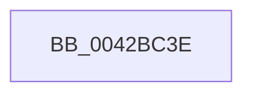

# sub_0042BC3E

- RVA: `0x0042BC3E`–`0x0042BC55` (길이 `23` bytes)
- VA: `0x000000014042BC3E`
- 실행 섹션: `.text`
- PDB 이름 있음: `아니요`; PDB Function 태그: `아니요`
- unwind 정보 RVA: `0x000A18C0`
- 디코드: `5`개 명령, `23/23` bytes 표시
- 미해석 바이트: `0` (있으면 어셈블리에 `.byte`로 보존)

> 이 문서는 커널 이미지의 기계어와 PDB 기호를 분석해 생성했습니다. 4번과 5번은 함수 원형과 자료형을 바이너리 사용 방식에서 추정한 C 해석이며 원본 소스 복구 결과는 아닙니다.

## 1. Dependencies

- 직접 호출 지점: **0**; 고유 호출 대상: **0**
- 직접 호출자로 확인된 함수: **0**
- RIP 상대 이미지 참조: **0**

### Outgoing calls
- 직접 디코드된 call 명령이 없습니다.

### Direct callers
- 이 함수 시작 RVA로 연결되는 직접 call은 확인되지 않았습니다. 간접 호출은 완전히 역산할 수 없습니다.

### Static image references
- 디코드된 RIP-relative 메모리 참조가 없습니다.

## 2. Other-region calls and transfers

- 다른 실행 섹션으로 향하는 call: **0**
- call이 아닌 외부 분기/꼬리 이동: **1**
  - `0x0042BC50` → [sub_0042B9E0 + 0xA8](Unknown_function_0042B9E0.md) (`tail-transfer`)

## 3. Assembly (complete function range)

```asm
0042BC3E  65 8B 04 25 A4 01 00 00         mov eax, dword ptr gs:[0x1a4]
0042BC46  0F AF 46 50                     imul eax, dword ptr [rsi + 0x50]
0042BC4A  8B C8                           mov ecx, eax
0042BC4C  48 03 4E 48                     add rcx, qword ptr [rsi + 0x48]
0042BC50  E9 33 FE FF FF                  jmp 0x14042ba88
```

## 4. C-style interpretation (structured pseudocode)

```c
__int64 __fastcall sub_0042BC3E(void)
{
    __int64 result;

    result = (unsigned int)(((unsigned int)(*(unsigned int *)(gs_base + (0 + 420)))) * (*(unsigned int *)(v_rsi + 80)));
    a1 = ((unsigned int)((unsigned int)(result))) + (*(unsigned __int64 *)(v_rsi + 72));
}
```

## 5. (Beta) C Style

```c
void sub_0042BC3E(void)
{
    int64_t result;

    result = (uint32_t)(((uint32_t)(*(uint32_t *)(gs_base + (0 + 0x1A4)))) * (*(uint32_t *)(local_rsi + 0x50)));
    a1 = ((uint32_t)((uint32_t)(result))) + (*(uint64_t *)(local_rsi + 0x48));
}
```

## 6. Execution-region graph

[열기: 2D/3D 그래프와 함수 탐색 컨트롤 패널](../../../control-panel.html?section=text&rva=0x0042BC3E&view=graph)

- 2D 그래프는 위에서 아래로 흐르고, 3D 그래프는 빈 공간을 드래그해 회전합니다. Shift+드래그는 이동, 휠은 확대·축소, 함수 노드 선택은 대상 보고서 이동입니다.

### Static fallback


