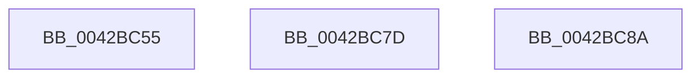

# sub_0042BC55

- RVA: `0x0042BC55`–`0x0042BCAE` (길이 `89` bytes)
- VA: `0x000000014042BC55`
- 실행 섹션: `.text`
- PDB 이름 있음: `아니요`; PDB Function 태그: `아니요`
- unwind 정보 RVA: `0x000A18D4`
- 디코드: `21`개 명령, `89/89` bytes 표시
- 미해석 바이트: `0` (있으면 어셈블리에 `.byte`로 보존)

> 이 문서는 커널 이미지의 기계어와 PDB 기호를 분석해 생성했습니다. 4번과 5번은 함수 원형과 자료형을 바이너리 사용 방식에서 추정한 C 해석이며 원본 소스 복구 결과는 아닙니다.

## 1. Dependencies

- 직접 호출 지점: **4**; 고유 호출 대상: **4**
- 직접 호출자로 확인된 함수: **0**
- RIP 상대 이미지 참조: **1**

### Outgoing calls
- `0x0042BC6B` → [KeBugCheckEx](../4F/KeBugCheckEx_function_004FD660.md) (function, `0x004FD660`)
- `0x0042BC73` → [HalpTimerSwitchToNormalClock](../54/HalpTimerSwitchToNormalClock_function_00548814.md) (function, `0x00548814`)
- `0x0042BC80` → [guard_dispatch_icall](../6B/guard_dispatch_icall_function_006BAAD0.md) (function, `0x006BAAD0`)
- `0x0042BCA4` → [HalpTimerSetProblemEx](../4F/HalpTimerSetProblemEx_function_004FAEC4.md) (function, `0x004FAEC4`)

### Direct callers
- 이 함수 시작 RVA로 연결되는 직접 call은 확인되지 않았습니다. 간접 호출은 완전히 역산할 수 없습니다.

### Static image references
- `0x0042BC8A` → RVA `0x000144D8` (`.rdata`; read)

## 2. Other-region calls and transfers

- 다른 실행 섹션으로 향하는 call: **0**
- call이 아닌 외부 분기/꼬리 이동: **3**
  - `0x0042BC78` → [HalpTimerClockArm + 0x49](HalpTimerClockArm_function_0042B950.md) (`tail-transfer`)
  - `0x0042BC85` → [sub_0042BAC2 + 0x9F](Unknown_function_0042BAC2.md) (`tail-transfer`)
  - `0x0042BCA9` → [sub_0042BAC2 + 0xAA](Unknown_function_0042BAC2.md) (`tail-transfer`)

## 3. Assembly (complete function range)

```asm
0042BC55  33 FF                           xor edi, edi
0042BC57  4C 8B CB                        mov r9, rbx
0042BC5A  BA 13 01 00 00                  mov edx, 0x113
0042BC5F  48 89 7C 24 20                  mov qword ptr [rsp + 0x20], rdi
0042BC64  8D 4F 5C                        lea ecx, [rdi + 0x5c]
0042BC67  44 8D 47 25                     lea r8d, [rdi + 0x25]
0042BC6B  E8 F0 19 0D 00                  call 0x1404fd660
0042BC70  CC                              int3
0042BC71  33 C9                           xor ecx, ecx
0042BC73  E8 9C CB 11 00                  call 0x140548814
0042BC78  E9 1C FD FF FF                  jmp 0x14042b999
0042BC7D  49 8B C1                        mov rax, r9
0042BC80  E8 4B EE 28 00                  call 0x1406baad0
0042BC85  E9 D7 FE FF FF                  jmp 0x14042bb61
0042BC8A  4C 8D 0D 47 88 BE FF            lea r9, [rip - 0x4177b9]
0042BC91  C7 44 24 20 0E 03 00 00         mov dword ptr [rsp + 0x20], 0x30e
0042BC99  45 8B C2                        mov r8d, r10d
0042BC9C  BA 12 00 00 00                  mov edx, 0x12
0042BCA1  48 8B CE                        mov rcx, rsi
0042BCA4  E8 1B F2 0C 00                  call 0x1404faec4
0042BCA9  E9 BE FE FF FF                  jmp 0x14042bb6c
```

## 4. C-style interpretation (structured pseudocode)

```c
__int64 __fastcall sub_0042BC55(void)
{
    __int64 result;
    __int64 v_rdi;
    unsigned __int64 v_stack_p20;

    v_rdi = 0;
    v_stack_p20 = 0;
    result = KeBugCheckEx(v_rdi + 92, 275, v_rdi + 37, v_rbx);
    a1 = 0;
    result = HalpTimerSwitchToNormalClock(a1, 275, v_rdi + 37, v_rbx);
}
```

## 5. (Beta) C Style

```c
void sub_0042BC55(void)
{
    int64_t result;
    int64_t local_rdi;
    uint64_t v_stack_p20;

    local_rdi = 0;
    v_stack_p20 = 0;
    result = KeBugCheckEx(local_rdi + 92, 275, local_rdi + 37, local_rbx);
    a1 = 0;
    result = HalpTimerSwitchToNormalClock(a1, 275, local_rdi + 37, local_rbx);
}
```

## 6. Execution-region graph

[열기: 2D/3D 그래프와 함수 탐색 컨트롤 패널](../../../control-panel.html?section=text&rva=0x0042BC55&view=graph)

- 2D 그래프는 위에서 아래로 흐르고, 3D 그래프는 빈 공간을 드래그해 회전합니다. Shift+드래그는 이동, 휠은 확대·축소, 함수 노드 선택은 대상 보고서 이동입니다.

### Static fallback


