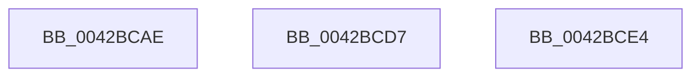

# sub_0042BCAE

- RVA: `0x0042BCAE`–`0x0042BD08` (길이 `90` bytes)
- VA: `0x000000014042BCAE`
- 실행 섹션: `.text`
- PDB 이름 있음: `아니요`; PDB Function 태그: `아니요`
- unwind 정보 RVA: `0x000A18E4`
- 디코드: `18`개 명령, `90/90` bytes 표시
- 미해석 바이트: `0` (있으면 어셈블리에 `.byte`로 보존)

> 이 문서는 커널 이미지의 기계어와 PDB 기호를 분석해 생성했습니다. 4번과 5번은 함수 원형과 자료형을 바이너리 사용 방식에서 추정한 C 해석이며 원본 소스 복구 결과는 아닙니다.

## 1. Dependencies

- 직접 호출 지점: **3**; 고유 호출 대상: **2**
- 직접 호출자로 확인된 함수: **0**
- RIP 상대 이미지 참조: **1**

### Outgoing calls
- `0x0042BCCD` → [HalpTimerSetProblemEx](../4F/HalpTimerSetProblemEx_function_004FAEC4.md) (function, `0x004FAEC4`)
- `0x0042BCDA` → [guard_dispatch_icall](../6B/guard_dispatch_icall_function_006BAAD0.md) (function, `0x006BAAD0`)
- `0x0042BCFE` → [HalpTimerSetProblemEx](../4F/HalpTimerSetProblemEx_function_004FAEC4.md) (function, `0x004FAEC4`)

### Direct callers
- 이 함수 시작 RVA로 연결되는 직접 call은 확인되지 않았습니다. 간접 호출은 완전히 역산할 수 없습니다.

### Static image references
- `0x0042BCB9` → RVA `0x000144D8` (`.rdata`; read)

## 2. Other-region calls and transfers

- 다른 실행 섹션으로 향하는 call: **0**
- call이 아닌 외부 분기/꼬리 이동: **3**
  - `0x0042BCD2` → [sub_0042B9E0 + 0xD5](Unknown_function_0042B9E0.md) (`tail-transfer`)
  - `0x0042BCDF` → [sub_0042B9E0 + 0xCA](Unknown_function_0042B9E0.md) (`tail-transfer`)
  - `0x0042BD03` → [sub_0042B9E0 + 0xD5](Unknown_function_0042B9E0.md) (`tail-transfer`)

## 3. Assembly (complete function range)

```asm
0042BCAE  45 33 C0                        xor r8d, r8d
0042BCB1  C7 44 24 20 AB 02 00 00         mov dword ptr [rsp + 0x20], 0x2ab
0042BCB9  4C 8D 0D 18 88 BE FF            lea r9, [rip - 0x4177e8]
0042BCC0  48 8B CE                        mov rcx, rsi
0042BCC3  41 BA BB 00 00 C0               mov r10d, 0xc00000bb
0042BCC9  41 8D 50 11                     lea edx, [r8 + 0x11]
0042BCCD  E8 F2 F1 0C 00                  call 0x1404faec4
0042BCD2  E9 DE FD FF FF                  jmp 0x14042bab5
0042BCD7  49 8B C1                        mov rax, r9
0042BCDA  E8 F1 ED 28 00                  call 0x1406baad0
0042BCDF  E9 C6 FD FF FF                  jmp 0x14042baaa
0042BCE4  4C 8D 0D ED 87 BE FF            lea r9, [rip - 0x417813]
0042BCEB  C7 44 24 20 0E 03 00 00         mov dword ptr [rsp + 0x20], 0x30e
0042BCF3  45 8B C2                        mov r8d, r10d
0042BCF6  BA 12 00 00 00                  mov edx, 0x12
0042BCFB  48 8B CE                        mov rcx, rsi
0042BCFE  E8 C1 F1 0C 00                  call 0x1404faec4
0042BD03  E9 AD FD FF FF                  jmp 0x14042bab5
```

## 4. C-style interpretation (structured pseudocode)

```c
__int64 __fastcall sub_0042BCAE(__int64 a1, __int64 a2, int a3)
{
    __int64 result;
    unsigned int v_stack_p20;

    a3 = 0;
    v_stack_p20 = 683;
    result = HalpTimerSetProblemEx(v_rsi, a3 + 17, a3, v_rip - 4290536);
}
```

## 5. (Beta) C Style

```c
int64_t sub_0042BCAE(int64_t Arg1, int64_t Arg2, int32_t Arg3)
{
    int64_t result;
    uint32_t v_stack_p20;

    Arg3 = 0;
    v_stack_p20 = 683;
    result = HalpTimerSetProblemEx(local_rsi, Arg3 + 17, Arg3, v_rip - 4290536);
}
```

## 6. Execution-region graph

[열기: 2D/3D 그래프와 함수 탐색 컨트롤 패널](../../../control-panel.html?section=text&rva=0x0042BCAE&view=graph)

- 2D 그래프는 위에서 아래로 흐르고, 3D 그래프는 빈 공간을 드래그해 회전합니다. Shift+드래그는 이동, 휠은 확대·축소, 함수 노드 선택은 대상 보고서 이동입니다.

### Static fallback


