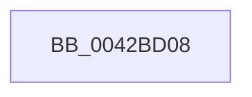

# sub_0042BD08

- RVA: `0x0042BD08`–`0x0042BD2A` (길이 `34` bytes)
- VA: `0x000000014042BD08`
- 실행 섹션: `.text`
- PDB 이름 있음: `아니요`; PDB Function 태그: `아니요`
- unwind 정보 RVA: `0x000A18F8`
- 디코드: `8`개 명령, `34/34` bytes 표시
- 미해석 바이트: `0` (있으면 어셈블리에 `.byte`로 보존)

> 이 문서는 커널 이미지의 기계어와 PDB 기호를 분석해 생성했습니다. 4번과 5번은 함수 원형과 자료형을 바이너리 사용 방식에서 추정한 C 해석이며 원본 소스 복구 결과는 아닙니다.

## 1. Dependencies

- 직접 호출 지점: **1**; 고유 호출 대상: **1**
- 직접 호출자로 확인된 함수: **0**
- RIP 상대 이미지 참조: **1**

### Outgoing calls
- `0x0042BD24` → [KeBugCheckEx](../4F/KeBugCheckEx_function_004FD660.md) (function, `0x004FD660`)

### Direct callers
- 이 함수 시작 RVA로 연결되는 직접 call은 확인되지 않았습니다. 간접 호출은 완전히 역산할 수 없습니다.

### Static image references
- `0x0042BD08` → RVA `0x00E10358` (`.data`; read)

## 2. Other-region calls and transfers

- 다른 실행 섹션으로 향하는 call: **0**
- 별도 외부 분기/꼬리 이동을 확인하지 못했습니다.

## 3. Assembly (complete function range)

```asm
0042BD08  4C 63 0D 49 46 9E 00            movsxd r9, dword ptr [rip + 0x9e4649]
0042BD0F  4C 8B C6                        mov r8, rsi
0042BD12  49 63 C2                        movsxd rax, r10d
0042BD15  BA 10 01 00 00                  mov edx, 0x110
0042BD1A  B9 5C 00 00 00                  mov ecx, 0x5c
0042BD1F  48 89 44 24 20                  mov qword ptr [rsp + 0x20], rax
0042BD24  E8 37 19 0D 00                  call 0x1404fd660
0042BD29  CC                              int3
```

## 4. C-style interpretation (structured pseudocode)

```c
__int64 __fastcall sub_0042BD08(void)
{
    __int64 result;
    unsigned __int64 v_stack_p20;

    v_stack_p20 = (int)((unsigned int)(v_r10));
    result = KeBugCheckEx(92, 272, v_rsi, (int)(*(unsigned int *)(v_rip + 10372681)));
    return result;
}
```

## 5. (Beta) C Style

```c
void sub_0042BD08(void)
{
    int64_t result;
    uint64_t v_stack_p20;

    v_stack_p20 = (int32_t)((uint32_t)(local_r10));
    result = KeBugCheckEx(92, 272, local_rsi, (int32_t)(*(uint32_t *)(v_rip + 0x9E4649)));
    return result;
}
```

## 6. Execution-region graph

[열기: 2D/3D 그래프와 함수 탐색 컨트롤 패널](../../../control-panel.html?section=text&rva=0x0042BD08&view=graph)

- 2D 그래프는 위에서 아래로 흐르고, 3D 그래프는 빈 공간을 드래그해 회전합니다. Shift+드래그는 이동, 휠은 확대·축소, 함수 노드 선택은 대상 보고서 이동입니다.

### Static fallback


