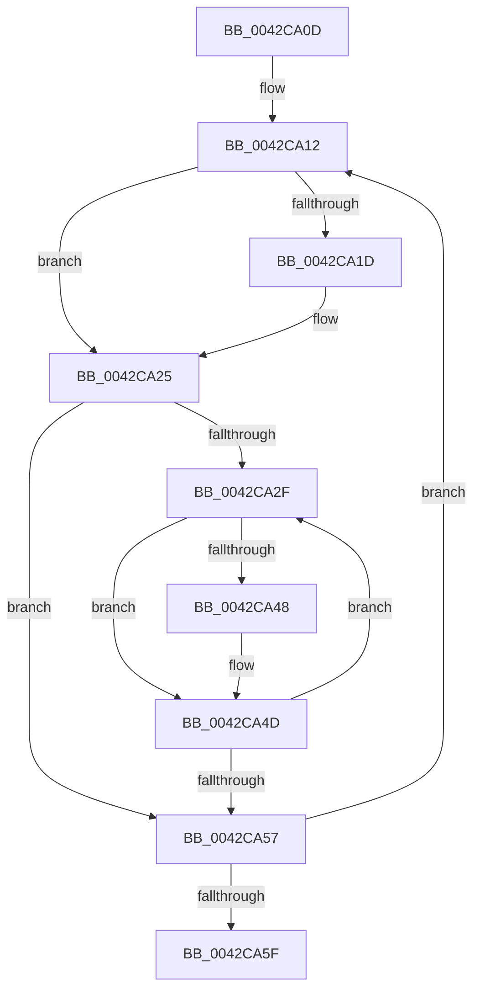

# sub_0042CA0D

- RVA: `0x0042CA0D`–`0x0042CA64` (길이 `87` bytes)
- VA: `0x000000014042CA0D`
- 실행 섹션: `.text`
- PDB 이름 있음: `아니요`; PDB Function 태그: `아니요`
- unwind 정보 RVA: `0x000A19AC`
- 디코드: `23`개 명령, `87/87` bytes 표시
- 미해석 바이트: `0` (있으면 어셈블리에 `.byte`로 보존)

> 이 문서는 커널 이미지의 기계어와 PDB 기호를 분석해 생성했습니다. 4번과 5번은 함수 원형과 자료형을 바이너리 사용 방식에서 추정한 C 해석이며 원본 소스 복구 결과는 아닙니다.

## 1. Dependencies

- 직접 호출 지점: **1**; 고유 호출 대상: **1**
- 직접 호출자로 확인된 함수: **0**
- RIP 상대 이미지 참조: **0**

### Outgoing calls
- `0x0042CA48` → [PpmPerfSelectProcessorState](PpmPerfSelectProcessorState_function_0042CA78.md) (function, `0x0042CA78`)

### Direct callers
- 이 함수 시작 RVA로 연결되는 직접 call은 확인되지 않았습니다. 간접 호출은 완전히 역산할 수 없습니다.

### Static image references
- 디코드된 RIP-relative 메모리 참조가 없습니다.

## 2. Other-region calls and transfers

- 다른 실행 섹션으로 향하는 call: **0**
- 별도 외부 분기/꼬리 이동을 확인하지 못했습니다.

## 3. Assembly (complete function range)

```asm
0042CA0D  48 89 5C 24 30                  mov qword ptr [rsp + 0x30], rbx
0042CA12  8B 87 B8 04 00 00               mov eax, dword ptr [rdi + 0x4b8]
0042CA18  83 F8 FF                        cmp eax, -1
0042CA1B  73 08                           jae 0x14042ca25
0042CA1D  FF C0                           inc eax
0042CA1F  89 87 B8 04 00 00               mov dword ptr [rdi + 0x4b8], eax
0042CA25  33 DB                           xor ebx, ebx
0042CA27  39 9F 28 01 00 00               cmp dword ptr [rdi + 0x128], ebx
0042CA2D  76 28                           jbe 0x14042ca57
0042CA2F  8B C3                           mov eax, ebx
0042CA31  48 69 C8 A8 04 00 00            imul rcx, rax, 0x4a8
0042CA38  48 8B 87 38 01 00 00            mov rax, qword ptr [rdi + 0x138]
0042CA3F  48 8B 0C 01                     mov rcx, qword ptr [rcx + rax]
0042CA43  48 85 C9                        test rcx, rcx
0042CA46  74 05                           je 0x14042ca4d
0042CA48  E8 2B 00 00 00                  call 0x14042ca78
0042CA4D  FF C3                           inc ebx
0042CA4F  3B 9F 28 01 00 00               cmp ebx, dword ptr [rdi + 0x128]
0042CA55  72 D8                           jb 0x14042ca2f
0042CA57  48 8B 3F                        mov rdi, qword ptr [rdi]
0042CA5A  48 3B FE                        cmp rdi, rsi
0042CA5D  75 B3                           jne 0x14042ca12
0042CA5F  48 8B 5C 24 30                  mov rbx, qword ptr [rsp + 0x30]
```

## 4. C-style interpretation (structured pseudocode)

```c
__int64 __fastcall sub_0042CA0D(__int64 a1, __int64 a2, __int64 a3, __int64 a4, __int64 a5, __int64 a6)
{
    __int64 result;
    __int64 v_rbx;
    unsigned __int64 v_stack_p30;

    v_stack_p30 = v_rbx;
loc_0042CA12:
    result = (unsigned int)(*(unsigned int *)(v_rdi + 1208));
    if (((unsigned int)((unsigned int)(*(unsigned int *)(v_rdi + 1208)))) < -1) {
        result = (unsigned int)(((unsigned int)(*(unsigned int *)(v_rdi + 1208))) + 1);
        *(unsigned int *)(v_rdi + 1208) = (unsigned int)(result);
    }
    v_rbx = 0;
    if ((*(unsigned int *)(v_rdi + 296)) <= 0) goto loc_0042CA57;
loc_0042CA2F:
    a1 = (a1) * (0);
    result = *(unsigned __int64 *)(v_rdi + 312);
    if (*(unsigned __int64 *)(a1 + *(unsigned __int64 *)(v_rdi + 312) * 1) != 0) {
        result = PpmPerfSelectProcessorState(*(unsigned __int64 *)(a1 + *(unsigned __int64 *)(v_rdi + 312) * 1), a2, a3, a4);
    }
    v_rbx = (unsigned int)((v_rbx) + 1);
    if (((unsigned int)(v_rbx)) < (*(unsigned int *)(v_rdi + 296))) goto loc_0042CA2F;
loc_0042CA57:
    if ((*(unsigned __int64 *)(v_rdi)) != v_rsi) goto loc_0042CA12;
    return result;
}
```

## 5. (Beta) C Style

```c
int64_t sub_0042CA0D(int64_t Arg1, int64_t Arg2, int64_t Arg3, int64_t Arg4, uint64_t Arg5, int64_t Arg6)
{
    int64_t result;
    int64_t local_rbx;
    uint64_t v_stack_p30;

    v_stack_p30 = local_rbx;
loc_0042CA12:
    result = (uint32_t)(*(uint32_t *)(local_rdi + 0x4B8));
    if (((uint32_t)((uint32_t)(*(uint32_t *)(local_rdi + 0x4B8)))) < -1) {
        result = (uint32_t)(((uint32_t)(*(uint32_t *)(local_rdi + 0x4B8))) + 1);
        *(uint32_t *)(local_rdi + 0x4B8) = (uint32_t)(result);
    }
    local_rbx = 0;
    if ((*(uint32_t *)(local_rdi + 0x128)) <= 0) goto loc_0042CA57;
loc_0042CA2F:
    Arg1 = (Arg1) * (0);
    result = *(uint64_t *)(local_rdi + 0x138);
    if (*(uint64_t *)(Arg1 + *(uint64_t *)(local_rdi + 0x138) * 1) != 0) {
        result = PpmPerfSelectProcessorState(*(uint64_t *)(Arg1 + *(uint64_t *)(local_rdi + 0x138) * 1), Arg2, Arg3, Arg4);
    }
    local_rbx = (uint32_t)((local_rbx) + 1);
    if (((uint32_t)(local_rbx)) < (*(uint32_t *)(local_rdi + 0x128))) goto loc_0042CA2F;
loc_0042CA57:
    if ((*(uint64_t *)(local_rdi)) != local_rsi) goto loc_0042CA12;
    return result;
}
```

## 6. Execution-region graph

[열기: 2D/3D 그래프와 함수 탐색 컨트롤 패널](../../../control-panel.html?section=text&rva=0x0042CA0D&view=graph)

- 2D 그래프는 위에서 아래로 흐르고, 3D 그래프는 빈 공간을 드래그해 회전합니다. Shift+드래그는 이동, 휠은 확대·축소, 함수 노드 선택은 대상 보고서 이동입니다.

### Static fallback


