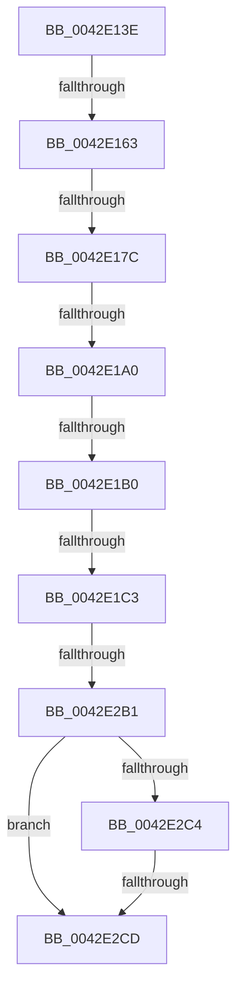

# sub_0042E13E

- RVA: `0x0042E13E`–`0x0042E380` (길이 `578` bytes)
- VA: `0x000000014042E13E`
- 실행 섹션: `.text`
- PDB 이름 있음: `아니요`; PDB Function 태그: `아니요`
- unwind 정보 RVA: `0x000A1B0C`
- 디코드: `149`개 명령, `578/578` bytes 표시
- 미해석 바이트: `0` (있으면 어셈블리에 `.byte`로 보존)

> 이 문서는 커널 이미지의 기계어와 PDB 기호를 분석해 생성했습니다. 4번과 5번은 함수 원형과 자료형을 바이너리 사용 방식에서 추정한 C 해석이며 원본 소스 복구 결과는 아닙니다.

## 1. Dependencies

- 직접 호출 지점: **0**; 고유 호출 대상: **0**
- 직접 호출자로 확인된 함수: **0**
- RIP 상대 이미지 참조: **3**

### Outgoing calls
- 직접 디코드된 call 명령이 없습니다.

### Direct callers
- 이 함수 시작 RVA로 연결되는 직접 call은 확인되지 않았습니다. 간접 호출은 완전히 역산할 수 없습니다.

### Static image references
- `0x0042E17C` → RVA `0x00014570` (`.rdata`; read)
- `0x0042E1A0` → RVA `0x00014568` (`.rdata`; read)
- `0x0042E2CD` → RVA `0x00000000` (`image boundary/outside`; read)

## 2. Other-region calls and transfers

- 다른 실행 섹션으로 향하는 call: **0**
- call이 아닌 외부 분기/꼬리 이동: **8**
  - `0x0042E15D` → [sub_0042E3E8](Unknown_function_0042E3E8.md) (`tail-transfer`)
  - `0x0042E176` → [sub_0042E3E8 + 0x13](Unknown_function_0042E3E8.md) (`tail-transfer`)
  - `0x0042E19A` → [sub_0042E3E8 + 0x1F](Unknown_function_0042E3E8.md) (`tail-transfer`)
  - `0x0042E1AA` → [sub_0042E3A6](Unknown_function_0042E3A6.md) (`tail-transfer`)
  - `0x0042E1BD` → [sub_0042E3E8 + 0x27](Unknown_function_0042E3E8.md) (`tail-transfer`)
  - `0x0042E2AB` → [sub_0042E3BB](Unknown_function_0042E3BB.md) (`tail-transfer`)
  - `0x0042E2C7` → [sub_0042E3BB](Unknown_function_0042E3BB.md) (`tail-transfer`)
  - `0x0042E37E` → [sub_0042E3D8](Unknown_function_0042E3D8.md) (`tail-transfer`)

## 3. Assembly (complete function range)

```asm
0042E13E  48 89 5C 24 40                  mov qword ptr [rsp + 0x40], rbx
0042E143  48 89 6C 24 48                  mov qword ptr [rsp + 0x48], rbp
0042E148  48 89 7C 24 50                  mov qword ptr [rsp + 0x50], rdi
0042E14D  F0 44 09 14 24                  lock or dword ptr [rsp], r10d
0042E152  4C 8B 01                        mov r8, qword ptr [rcx]
0042E155  41 8B CA                        mov ecx, r10d
0042E158  45 8B CA                        mov r9d, r10d
0042E15B  85 D2                           test edx, edx
0042E15D  0F 85 85 02 00 00               jne 0x14042e3e8
0042E163  49 63 C2                        movsxd rax, r10d
0042E166  41 8B E9                        mov ebp, r9d
0042E169  48 69 C8 80 69 67 FF            imul rcx, rax, -0x989680
0042E170  4C 03 C1                        add r8, rcx
0042E173  83 E5 02                        and ebp, 2
0042E176  0F 85 7F 02 00 00               jne 0x14042e3fb
0042E17C  48 8B 05 ED 63 BE FF            mov rax, qword ptr [rip - 0x419c13]
0042E183  49 8B C8                        mov rcx, r8
0042E186  48 F7 D9                        neg rcx
0042E189  49 0F 48 C8                     cmovs rcx, r8
0042E18D  48 F7 E1                        mul rcx
0042E190  48 8B CA                        mov rcx, rdx
0042E193  48 C1 E9 0D                     shr rcx, 0xd
0042E197  4D 85 C0                        test r8, r8
0042E19A  0F 88 67 02 00 00               js 0x14042e407
0042E1A0  48 8B 05 C1 63 BE FF            mov rax, qword ptr [rip - 0x419c3f]
0042E1A7  48 85 C9                        test rcx, rcx
0042E1AA  0F 88 F6 01 00 00               js 0x14042e3a6
0042E1B0  48 F7 E1                        mul rcx
0042E1B3  4C 8B C2                        mov r8, rdx
0042E1B6  49 C1 E8 1A                     shr r8, 0x1a
0042E1BA  48 85 C9                        test rcx, rcx
0042E1BD  0F 88 4C 02 00 00               js 0x14042e40f
0042E1C3  41 69 C0 00 5C 26 05            imul eax, r8d, 0x5265c00
0042E1CA  45 8D 50 01                     lea r10d, [r8 + 1]
0042E1CE  2B C8                           sub ecx, eax
0042E1D0  B8 25 49 92 24                  mov eax, 0x24924925
0042E1D5  41 F7 E2                        mul r10d
0042E1D8  41 8B C2                        mov eax, r10d
0042E1DB  2B C2                           sub eax, edx
0042E1DD  D1 E8                           shr eax, 1
0042E1DF  03 C2                           add eax, edx
0042E1E1  C1 E8 02                        shr eax, 2
0042E1E4  6B C0 07                        imul eax, eax, 7
0042E1E7  44 2B D0                        sub r10d, eax
0042E1EA  B8 BD 06 6B 39                  mov eax, 0x396b06bd
0042E1EF  41 F7 E0                        mul r8d
0042E1F2  66 44 89 54 24 2E               mov word ptr [rsp + 0x2e], r10w
0042E1F8  45 8B D0                        mov r10d, r8d
0042E1FB  8B FA                           mov edi, edx
0042E1FD  C1 EF 0F                        shr edi, 0xf
0042E200  69 C7 B1 3A 02 00               imul eax, edi, 0x23ab1
0042E206  44 2B D0                        sub r10d, eax
0042E209  B8 C7 03 FB 25                  mov eax, 0x25fb03c7
0042E20E  41 6B DA 64                     imul ebx, r10d, 0x64
0042E212  83 C3 4B                        add ebx, 0x4b
0042E215  F7 E3                           mul ebx
0042E217  2B DA                           sub ebx, edx
0042E219  D1 EB                           shr ebx, 1
0042E21B  03 DA                           add ebx, edx
0042E21D  C1 EB 15                        shr ebx, 0x15
0042E220  69 C3 54 71 FF FF               imul eax, ebx, 0xffff7154
0042E226  44 03 D0                        add r10d, eax
0042E229  B8 73 B0 6D 16                  mov eax, 0x166db073
0042E22E  41 F7 E2                        mul r10d
0042E231  44 8B DA                        mov r11d, edx
0042E234  41 C1 EB 07                     shr r11d, 7
0042E238  41 69 C3 B5 05 00 00            imul eax, r11d, 0x5b5
0042E23F  44 2B D0                        sub r10d, eax
0042E242  B8 E1 E5 AA E5                  mov eax, 0xe5aae5e1
0042E247  45 6B D2 64                     imul r10d, r10d, 0x64
0042E24B  41 83 C2 4B                     add r10d, 0x4b
0042E24F  41 F7 E2                        mul r10d
0042E252  8D 04 BB                        lea eax, [rbx + rdi*4]
0042E255  44 6B D0 19                     imul r10d, eax, 0x19
0042E259  B8 1F 85 EB 51                  mov eax, 0x51eb851f
0042E25E  C1 EA 0F                        shr edx, 0xf
0042E261  45 03 D3                        add r10d, r11d
0042E264  42 8D 3C 92                     lea edi, [rdx + r10*4]
0042E268  F7 E7                           mul edi
0042E26A  44 69 D7 93 FE FF FF            imul r10d, edi, 0xfffffe93
0042E271  8D 5F 01                        lea ebx, [rdi + 1]
0042E274  8B C7                           mov eax, edi
0042E276  C1 E8 02                        shr eax, 2
0042E279  C1 EA 07                        shr edx, 7
0042E27C  44 2B D2                        sub r10d, edx
0042E27F  44 2B D0                        sub r10d, eax
0042E282  B8 1F 85 EB 51                  mov eax, 0x51eb851f
0042E287  F7 E7                           mul edi
0042E289  43 8D 04 10                     lea eax, [r8 + r10]
0042E28D  44 8B DA                        mov r11d, edx
0042E290  41 C1 EB 05                     shr r11d, 5
0042E294  44 03 D8                        add r11d, eax
0042E297  B8 1F 85 EB 51                  mov eax, 0x51eb851f
0042E29C  F7 E3                           mul ebx
0042E29E  C1 EA 07                        shr edx, 7
0042E2A1  44 69 D2 90 01 00 00            imul r10d, edx, 0x190
0042E2A8  41 3B DA                        cmp ebx, r10d
0042E2AB  0F 84 0A 01 00 00               je 0x14042e3bb
0042E2B1  B8 1F 85 EB 51                  mov eax, 0x51eb851f
0042E2B6  F7 E3                           mul ebx
0042E2B8  C1 EA 05                        shr edx, 5
0042E2BB  44 6B C2 64                     imul r8d, edx, 0x64
0042E2BF  41 3B D8                        cmp ebx, r8d
0042E2C2  74 09                           je 0x14042e2cd
0042E2C4  F6 C3 03                        test bl, 3
0042E2C7  0F 84 EE 00 00 00               je 0x14042e3bb
0042E2CD  48 8D 15 2C 1D BD FF            lea rdx, [rip - 0x42e2d4]
0042E2D4  41 0F B6 9C 13 00 C6 02 00      movzx ebx, byte ptr [r11 + rdx + 0x2c600]
0042E2DD  0F BF 84 5A E0 C5 02 00         movsx eax, word ptr [rdx + rbx*2 + 0x2c5e0]
0042E2E5  44 2B D8                        sub r11d, eax
0042E2E8  66 FF C3                        inc bx
0042E2EB  B8 D3 4D 62 10                  mov eax, 0x10624dd3
0042E2F0  66 89 5C 24 22                  mov word ptr [rsp + 0x22], bx
0042E2F5  48 8B 5C 24 40                  mov rbx, qword ptr [rsp + 0x40]
0042E2FA  66 41 FF C3                     inc r11w
0042E2FE  F7 E1                           mul ecx
0042E300  B8 89 88 88 88                  mov eax, 0x88888889
0042E305  66 44 89 5C 24 24               mov word ptr [rsp + 0x24], r11w
0042E30B  44 8B D2                        mov r10d, edx
0042E30E  41 C1 EA 06                     shr r10d, 6
0042E312  41 F7 E2                        mul r10d
0042E315  B8 89 88 88 88                  mov eax, 0x88888889
0042E31A  44 8B C2                        mov r8d, edx
0042E31D  BA 41 06 00 00                  mov edx, 0x641
0042E322  66 03 FA                        add di, dx
0042E325  41 C1 E8 05                     shr r8d, 5
0042E329  41 F7 E0                        mul r8d
0042E32C  66 89 7C 24 20                  mov word ptr [rsp + 0x20], di
0042E331  48 8B 7C 24 50                  mov rdi, qword ptr [rsp + 0x50]
0042E336  C1 EA 05                        shr edx, 5
0042E339  0F BF C2                        movsx eax, dx
0042E33C  66 89 54 24 26                  mov word ptr [rsp + 0x26], dx
0042E341  6B D0 3C                        imul edx, eax, 0x3c
0042E344  41 0F B7 C0                     movzx eax, r8w
0042E348  66 2B C2                        sub ax, dx
0042E34B  66 89 44 24 28                  mov word ptr [rsp + 0x28], ax
0042E350  41 0F BF C0                     movsx eax, r8w
0042E354  45 0F B7 C2                     movzx r8d, r10w
0042E358  6B D0 3C                        imul edx, eax, 0x3c
0042E35B  B8 E8 03 00 00                  mov eax, 0x3e8
0042E360  98                              cwde
0042E361  66 44 2B C2                     sub r8w, dx
0042E365  41 0F BF D2                     movsx edx, r10w
0042E369  0F AF D0                        imul edx, eax
0042E36C  66 44 89 44 24 2A               mov word ptr [rsp + 0x2a], r8w
0042E372  66 2B CA                        sub cx, dx
0042E375  66 89 4C 24 2C                  mov word ptr [rsp + 0x2c], cx
0042E37A  41 F6 C1 01                     test r9b, 1
0042E37E  75 58                           jne 0x14042e3d8
```

## 4. C-style interpretation (structured pseudocode)

```c
__int64 __fastcall sub_0042E13E(__int64 a1, __int64 a2, __int64 a3, __int64 a4, __int64 a5, __int64 a6, __int64 a7, __int64 a8, __int64 a9, __int64 a10)
{
    __int64 result;
    __int64 v_r10;
    __int64 v_r11;
    __int64 v_rbp;
    __int64 v_rbx;
    __int64 v_rdi;
    unsigned int v_stack_p0;
    unsigned __int16 v_stack_p20;
    unsigned __int16 v_stack_p22;
    unsigned __int16 v_stack_p24;
    unsigned __int16 v_stack_p26;
    unsigned __int16 v_stack_p28;
    unsigned __int16 v_stack_p2A;
    unsigned __int16 v_stack_p2C;
    unsigned __int16 v_stack_p2E;
    unsigned __int64 v_stack_p40;
    unsigned __int64 v_stack_p48;
    unsigned __int64 v_stack_p50;

    v_stack_p40 = v_rbx;
    v_stack_p48 = v_rbp;
    v_stack_p50 = v_rdi;
    a1 = ((unsigned int)((unsigned int)(v_r10))) * ((int)((unsigned int)(v_r10)));
    a3 = (*(unsigned __int64 *)(a1)) + (a1);
    v_rbp = (unsigned int)(((unsigned int)((unsigned int)((unsigned int)((unsigned int)(v_r10))))) & (2));
    a1 = -(a3);
    if (sign_flag) { a1 = a3; }
    a1 = (a2) >> (13);
    a3 = (a2) >> (26);
    result = (unsigned int)((*(unsigned __int64 *)(v_rip - 4299839)) * ((unsigned int)(a3)));
    a1 = (unsigned int)((a1) - ((unsigned int)(result)));
    result = (unsigned int)(((unsigned int)((unsigned int)(a3 + 1))) - ((unsigned int)(a2)));
    result = (unsigned int)((result) >> (1));
    result = (unsigned int)((result) + ((unsigned int)(a2)));
    result = (unsigned int)((result) >> (2));
    result = (unsigned int)((result) * ((unsigned int)(result)));
    v_r10 = (unsigned int)((a3 + 1) - ((unsigned int)(result)));
    v_stack_p2E = (unsigned __int16)(v_r10);
    v_rdi = (unsigned int)(((unsigned int)((unsigned int)(a2))) >> (15));
    result = (unsigned int)(((unsigned int)(0x396B06BDULL)) * ((unsigned int)(v_rdi)));
    v_r10 = (unsigned int)(((unsigned int)((unsigned int)(a3))) - ((unsigned int)(result)));
    v_rbx = (unsigned int)((v_rbx) * ((unsigned int)(v_r10)));
    v_rbx = (unsigned int)((v_rbx) + (75));
    v_rbx = (unsigned int)((v_rbx) - ((unsigned int)(a2)));
    v_rbx = (unsigned int)((v_rbx) >> (1));
    v_rbx = (unsigned int)((v_rbx) + ((unsigned int)(a2)));
    v_rbx = (unsigned int)((v_rbx) >> (21));
    result = (unsigned int)(((unsigned int)(0x25FB03C7ULL)) * ((unsigned int)(v_rbx)));
    v_r10 = (unsigned int)((v_r10) + ((unsigned int)(result)));
    v_r11 = (unsigned int)(((unsigned int)((unsigned int)(a2))) >> (7));
    result = (unsigned int)(((unsigned int)(0x166DB073ULL)) * ((unsigned int)(v_r11)));
    v_r10 = (unsigned int)((v_r10) - ((unsigned int)(result)));
    v_r10 = (unsigned int)((v_r10) * ((unsigned int)(v_r10)));
    v_r10 = (unsigned int)((v_r10) + (75));
    v_r10 = (unsigned int)((v_r10) * ((unsigned int)(v_rbx + v_rdi * 4)));
    a2 = (unsigned int)((a2) >> (15));
    v_r10 = (unsigned int)((v_r10) + ((unsigned int)(v_r11)));
    v_r10 = (unsigned int)((v_r10) * ((unsigned int)(a2 + v_r10 * 4)));
    result = (unsigned int)(((unsigned int)((unsigned int)(a2 + v_r10 * 4))) >> (2));
    a2 = (unsigned int)((a2) >> (7));
    v_r10 = (unsigned int)((v_r10) - ((unsigned int)(a2)));
    v_r10 = (unsigned int)((v_r10) - ((unsigned int)(result)));
    v_r11 = (unsigned int)(((unsigned int)((unsigned int)(a2))) >> (5));
    v_r11 = (unsigned int)((v_r11) + ((unsigned int)(a3 + v_r10 * 1)));
    a2 = (unsigned int)((a2) >> (7));
    v_r10 = (unsigned int)((v_r10) * ((unsigned int)(a2)));
    a2 = (unsigned int)((a2) >> (5));
    a3 = (unsigned int)((a3) * ((unsigned int)(a2)));
    if (((unsigned int)(a2 + v_r10 * 4 + 1)) == ((unsigned int)(a3))) goto loc_0042E2CD;
loc_0042E2CD:
    v_r11 = (unsigned int)((v_r11) - ((unsigned int)((__int16)(*(unsigned __int16 *)(v_rip - 4383444 + *(unsigned __int8 *)(v_r11 + v_rip - 4383444 * 1 + 181760) * 2 + 181728)))));
    v_rbx = (unsigned __int16)((*(unsigned __int8 *)(v_r11 + v_rip - 4383444 * 1 + 181760)) + 1);
    v_stack_p22 = (unsigned __int16)(v_rbx);
    v_r11 = (unsigned __int16)((v_r11) + 1);
    v_stack_p24 = (unsigned __int16)(v_r11);
    v_r10 = (unsigned int)(((unsigned int)((unsigned int)(v_rip - 4383444))) >> (6));
    v_rdi = (unsigned __int16)((a2 + v_r10 * 4) + ((unsigned __int16)((unsigned int)(0x641ULL))));
    a3 = (unsigned int)(((unsigned int)((unsigned int)(v_rip - 4383444))) >> (5));
    v_stack_p20 = (unsigned __int16)(v_rdi);
    a2 = (unsigned int)(((unsigned int)(0x641ULL)) >> (5));
    v_stack_p26 = (unsigned __int16)(a2);
    a2 = (unsigned int)((a2) * ((unsigned int)((__int16)((unsigned __int16)(a2)))));
    result = (unsigned __int16)(((unsigned __int16)(a3)) - ((unsigned __int16)(a2)));
    v_stack_p28 = (unsigned __int16)(result);
    a2 = (unsigned int)((a2) * ((unsigned int)((__int16)((unsigned __int16)(a3)))));
    a3 = (unsigned __int16)(((unsigned __int16)(v_r10)) - ((unsigned __int16)(a2)));
    a2 = (unsigned int)(((__int16)((unsigned __int16)(v_r10))) * (1000));
    v_stack_p2A = (unsigned __int16)(a3);
    a1 = (unsigned __int16)((a1) - ((unsigned __int16)(a2)));
    v_stack_p2C = (unsigned __int16)(a1);
}
```

## 5. (Beta) C Style

```c
int64_t sub_0042E13E(void *Arg1, int64_t Arg2, int64_t Arg3, int64_t Arg4, uint64_t Arg5, uint64_t Arg6, uint64_t Arg7, int64_t Arg8, uint64_t Arg9, int64_t Arg10)
{
    uint8_t *arg1 = (uint8_t *)Arg1;

    int64_t result;
    int64_t local_r10;
    int64_t local_r11;
    int64_t local_rbp;
    int64_t local_rbx;
    int64_t local_rdi;
    uint32_t v_stack_p0;
    uint16_t v_stack_p20;
    uint16_t v_stack_p22;
    uint16_t v_stack_p24;
    uint16_t v_stack_p26;
    uint16_t v_stack_p28;
    uint16_t v_stack_p2A;
    uint16_t v_stack_p2C;
    uint16_t v_stack_p2E;
    uint64_t v_stack_p40;
    uint64_t v_stack_p48;
    uint64_t v_stack_p50;

    v_stack_p40 = local_rbx;
    v_stack_p48 = local_rbp;
    v_stack_p50 = local_rdi;
    Arg1 = ((uint32_t)((uint32_t)(local_r10))) * ((int32_t)((uint32_t)(local_r10)));
    Arg3 = (*(uint64_t *)(arg1)) + (Arg1);
    local_rbp = (uint32_t)(((uint32_t)((uint32_t)((uint32_t)((uint32_t)(local_r10))))) & (2));
    Arg1 = -(Arg3);
    if (sign_flag) { Arg1 = Arg3; }
    Arg1 = (Arg2) >> (13);
    Arg3 = (Arg2) >> (26);
    result = (uint32_t)((*(uint64_t *)(v_rip - 0x419C3F)) * ((uint32_t)(Arg3)));
    Arg1 = (uint32_t)((Arg1) - ((uint32_t)(result)));
    result = (uint32_t)(((uint32_t)((uint32_t)(Arg3 + 1))) - ((uint32_t)(Arg2)));
    result = (uint32_t)((result) >> (1));
    result = (uint32_t)((result) + ((uint32_t)(Arg2)));
    result = (uint32_t)((result) >> (2));
    result = (uint32_t)((result) * ((uint32_t)(result)));
    local_r10 = (uint32_t)((Arg3 + 1) - ((uint32_t)(result)));
    v_stack_p2E = (uint16_t)(local_r10);
    local_rdi = (uint32_t)(((uint32_t)((uint32_t)(Arg2))) >> (15));
    result = (uint32_t)(((uint32_t)(0x396B06BDULL)) * ((uint32_t)(local_rdi)));
    local_r10 = (uint32_t)(((uint32_t)((uint32_t)(Arg3))) - ((uint32_t)(result)));
    local_rbx = (uint32_t)((local_rbx) * ((uint32_t)(local_r10)));
    local_rbx = (uint32_t)((local_rbx) + (75));
    local_rbx = (uint32_t)((local_rbx) - ((uint32_t)(Arg2)));
    local_rbx = (uint32_t)((local_rbx) >> (1));
    local_rbx = (uint32_t)((local_rbx) + ((uint32_t)(Arg2)));
    local_rbx = (uint32_t)((local_rbx) >> (21));
    result = (uint32_t)(((uint32_t)(0x25FB03C7ULL)) * ((uint32_t)(local_rbx)));
    local_r10 = (uint32_t)((local_r10) + ((uint32_t)(result)));
    local_r11 = (uint32_t)(((uint32_t)((uint32_t)(Arg2))) >> (7));
    result = (uint32_t)(((uint32_t)(0x166DB073ULL)) * ((uint32_t)(local_r11)));
    local_r10 = (uint32_t)((local_r10) - ((uint32_t)(result)));
    local_r10 = (uint32_t)((local_r10) * ((uint32_t)(local_r10)));
    local_r10 = (uint32_t)((local_r10) + (75));
    local_r10 = (uint32_t)((local_r10) * ((uint32_t)(local_rbx + local_rdi * 4)));
    Arg2 = (uint32_t)((Arg2) >> (15));
    local_r10 = (uint32_t)((local_r10) + ((uint32_t)(local_r11)));
    local_r10 = (uint32_t)((local_r10) * ((uint32_t)(Arg2 + local_r10 * 4)));
    result = (uint32_t)(((uint32_t)((uint32_t)(Arg2 + local_r10 * 4))) >> (2));
    Arg2 = (uint32_t)((Arg2) >> (7));
    local_r10 = (uint32_t)((local_r10) - ((uint32_t)(Arg2)));
    local_r10 = (uint32_t)((local_r10) - ((uint32_t)(result)));
    local_r11 = (uint32_t)(((uint32_t)((uint32_t)(Arg2))) >> (5));
    local_r11 = (uint32_t)((local_r11) + ((uint32_t)(Arg3 + local_r10 * 1)));
    Arg2 = (uint32_t)((Arg2) >> (7));
    local_r10 = (uint32_t)((local_r10) * ((uint32_t)(Arg2)));
    Arg2 = (uint32_t)((Arg2) >> (5));
    Arg3 = (uint32_t)((Arg3) * ((uint32_t)(Arg2)));
    if (((uint32_t)(Arg2 + local_r10 * 4 + 1)) == ((uint32_t)(Arg3))) goto loc_0042E2CD;
loc_0042E2CD:
    local_r11 = (uint32_t)((local_r11) - ((uint32_t)((int16_t)(*(uint16_t *)(v_rip - 0x42E2D4 + *(uint8_t *)(local_r11 + v_rip - 0x42E2D4 * 1 + 0x2C600) * 2 + 0x2C5E0)))));
    local_rbx = (uint16_t)((*(uint8_t *)(local_r11 + v_rip - 0x42E2D4 * 1 + 0x2C600)) + 1);
    v_stack_p22 = (uint16_t)(local_rbx);
    local_r11 = (uint16_t)((local_r11) + 1);
    v_stack_p24 = (uint16_t)(local_r11);
    local_r10 = (uint32_t)(((uint32_t)((uint32_t)(v_rip - 4383444))) >> (6));
    local_rdi = (uint16_t)((Arg2 + local_r10 * 4) + ((uint16_t)((uint32_t)(0x641ULL))));
    Arg3 = (uint32_t)(((uint32_t)((uint32_t)(v_rip - 4383444))) >> (5));
    v_stack_p20 = (uint16_t)(local_rdi);
    Arg2 = (uint32_t)(((uint32_t)(0x641ULL)) >> (5));
    v_stack_p26 = (uint16_t)(Arg2);
    Arg2 = (uint32_t)((Arg2) * ((uint32_t)((int16_t)((uint16_t)(Arg2)))));
    result = (uint16_t)(((uint16_t)(Arg3)) - ((uint16_t)(Arg2)));
    v_stack_p28 = (uint16_t)(result);
    Arg2 = (uint32_t)((Arg2) * ((uint32_t)((int16_t)((uint16_t)(Arg3)))));
    Arg3 = (uint16_t)(((uint16_t)(local_r10)) - ((uint16_t)(Arg2)));
    Arg2 = (uint32_t)(((int16_t)((uint16_t)(local_r10))) * (1000));
    v_stack_p2A = (uint16_t)(Arg3);
    Arg1 = (uint16_t)((Arg1) - ((uint16_t)(Arg2)));
    v_stack_p2C = (uint16_t)(Arg1);
}
```

### 관측된 메모리 오프셋

구조체 형식이 확인되지 않은 접근은 인자 기준의 오프셋으로만 기록했습니다.

| 기준 인자 | 오프셋 표현 | 폭 (bit) | 접근 |
|---|---:|---:|---|
| `Arg1` | `+ 0x0` | `64` | `R` |

## 6. Execution-region graph

[열기: 2D/3D 그래프와 함수 탐색 컨트롤 패널](../../../control-panel.html?section=text&rva=0x0042E13E&view=graph)

- 2D 그래프는 위에서 아래로 흐르고, 3D 그래프는 빈 공간을 드래그해 회전합니다. Shift+드래그는 이동, 휠은 확대·축소, 함수 노드 선택은 대상 보고서 이동입니다.

### Static fallback


