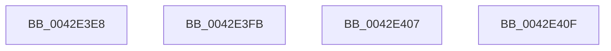

# sub_0042E3E8

- RVA: `0x0042E3E8`–`0x0042E417` (길이 `47` bytes)
- VA: `0x000000014042E3E8`
- 실행 섹션: `.text`
- PDB 이름 있음: `아니요`; PDB Function 태그: `아니요`
- unwind 정보 RVA: `0x000A1BAC`
- 디코드: `9`개 명령, `47/47` bytes 표시
- 미해석 바이트: `0` (있으면 어셈블리에 `.byte`로 보존)

> 이 문서는 커널 이미지의 기계어와 PDB 기호를 분석해 생성했습니다. 4번과 5번은 함수 원형과 자료형을 바이너리 사용 방식에서 추정한 C 해석이며 원본 소스 복구 결과는 아닙니다.

## 1. Dependencies

- 직접 호출 지점: **0**; 고유 호출 대상: **0**
- 직접 호출자로 확인된 함수: **0**
- RIP 상대 이미지 참조: **0**

### Outgoing calls
- 직접 디코드된 call 명령이 없습니다.

### Direct callers
- 이 함수 시작 RVA로 연결되는 직접 call은 확인되지 않았습니다. 간접 호출은 완전히 역산할 수 없습니다.

### Static image references
- 디코드된 RIP-relative 메모리 참조가 없습니다.

## 2. Other-region calls and transfers

- 다른 실행 섹션으로 향하는 call: **0**
- call이 아닌 외부 분기/꼬리 이동: **4**
  - `0x0042E3F6` → [sub_006EE672](../6E/Unknown_function_006EE672.md) (`tail-transfer`)
  - `0x0042E402` → [sub_0042E13E + 0x3E](Unknown_function_0042E13E.md) (`tail-transfer`)
  - `0x0042E40A` → [sub_0042E13E + 0x62](Unknown_function_0042E13E.md) (`tail-transfer`)
  - `0x0042E412` → [sub_0042E13E + 0x85](Unknown_function_0042E13E.md) (`tail-transfer`)

## 3. Assembly (complete function range)

```asm
0042E3E8  48 8D 58 08                     lea rbx, [rax + 8]
0042E3EC  48 BF FF FF FF FF FF FF FF 7F   movabs rdi, 0x7fffffffffffffff
0042E3F6  E9 77 02 2C 00                  jmp 0x1406ee672
0042E3FB  49 81 E8 80 96 98 00            sub r8, 0x989680
0042E402  E9 75 FD FF FF                  jmp 0x14042e17c
0042E407  48 F7 D9                        neg rcx
0042E40A  E9 91 FD FF FF                  jmp 0x14042e1a0
0042E40F  41 F7 D8                        neg r8d
0042E412  E9 AC FD FF FF                  jmp 0x14042e1c3
```

## 4. C-style interpretation (structured pseudocode)

```c
void __fastcall sub_0042E3E8(__int64 a1, __int64 a2, __int64 a3)
{
}
```

## 5. (Beta) C Style

```c
void sub_0042E3E8(int64_t Arg1, int64_t Arg2, int64_t Arg3)
{
}
```

## 6. Execution-region graph

[열기: 2D/3D 그래프와 함수 탐색 컨트롤 패널](../../../control-panel.html?section=text&rva=0x0042E3E8&view=graph)

- 2D 그래프는 위에서 아래로 흐르고, 3D 그래프는 빈 공간을 드래그해 회전합니다. Shift+드래그는 이동, 휠은 확대·축소, 함수 노드 선택은 대상 보고서 이동입니다.

### Static fallback


