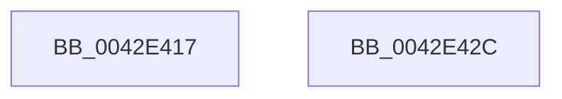

# sub_0042E417

- RVA: `0x0042E417`–`0x0042E446` (길이 `47` bytes)
- VA: `0x000000014042E417`
- 실행 섹션: `.text`
- PDB 이름 있음: `아니요`; PDB Function 태그: `아니요`
- unwind 정보 RVA: `0x000A1BC8`
- 디코드: `15`개 명령, `47/47` bytes 표시
- 미해석 바이트: `0` (있으면 어셈블리에 `.byte`로 보존)

> 이 문서는 커널 이미지의 기계어와 PDB 기호를 분석해 생성했습니다. 4번과 5번은 함수 원형과 자료형을 바이너리 사용 방식에서 추정한 C 해석이며 원본 소스 복구 결과는 아닙니다.

## 1. Dependencies

- 직접 호출 지점: **0**; 고유 호출 대상: **0**
- 직접 호출자로 확인된 함수: **0**
- RIP 상대 이미지 참조: **0**

### Outgoing calls
- 직접 디코드된 call 명령이 없습니다.

### Direct callers
- 이 함수 시작 RVA로 연결되는 직접 call은 확인되지 않았습니다. 간접 호출은 완전히 역산할 수 없습니다.

### Static image references
- 디코드된 RIP-relative 메모리 참조가 없습니다.

## 2. Other-region calls and transfers

- 다른 실행 섹션으로 향하는 call: **0**
- call이 아닌 외부 분기/꼬리 이동: **2**
  - `0x0042E427` → [sub_0042E380 + 0xA](Unknown_function_0042E380.md) (`tail-transfer`)
  - `0x0042E441` → [sub_0042E380 + 0x12](Unknown_function_0042E380.md) (`tail-transfer`)

## 3. Assembly (complete function range)

```asm
0042E417  0F BF C1                        movsx eax, cx
0042E41A  99                              cdq
0042E41B  2B C2                           sub eax, edx
0042E41D  D1 F8                           sar eax, 1
0042E41F  0F B7 C8                        movzx ecx, ax
0042E422  66 89 44 24 2C                  mov word ptr [rsp + 0x2c], ax
0042E427  E9 5E FF FF FF                  jmp 0x14042e38a
0042E42C  0F BF C1                        movsx eax, cx
0042E42F  B9 F4 01 00 00                  mov ecx, 0x1f4
0042E434  99                              cdq
0042E435  2B C2                           sub eax, edx
0042E437  D1 F8                           sar eax, 1
0042E439  66 03 C1                        add ax, cx
0042E43C  66 89 44 24 2C                  mov word ptr [rsp + 0x2c], ax
0042E441  E9 4C FF FF FF                  jmp 0x14042e392
```

## 4. C-style interpretation (structured pseudocode)

```c
__int64 __fastcall sub_0042E417(unsigned __int16 a1, int a2)
{
    __int64 result;
    unsigned __int16 v_stack_p2C;

    result = (unsigned int)(((__int16)(a1)) - (a2));
    result = (unsigned int)((result) >> (1));
    v_stack_p2C = (unsigned __int16)(result);
}
```

## 5. (Beta) C Style

```c
int64_t sub_0042E417(uint16_t Arg1, int32_t Arg2)
{
    int64_t result;
    uint16_t v_stack_p2C;

    result = (uint32_t)(((int16_t)(Arg1)) - (Arg2));
    result = (uint32_t)((result) >> (1));
    v_stack_p2C = (uint16_t)(result);
}
```

## 6. Execution-region graph

[열기: 2D/3D 그래프와 함수 탐색 컨트롤 패널](../../../control-panel.html?section=text&rva=0x0042E417&view=graph)

- 2D 그래프는 위에서 아래로 흐르고, 3D 그래프는 빈 공간을 드래그해 회전합니다. Shift+드래그는 이동, 휠은 확대·축소, 함수 노드 선택은 대상 보고서 이동입니다.

### Static fallback


