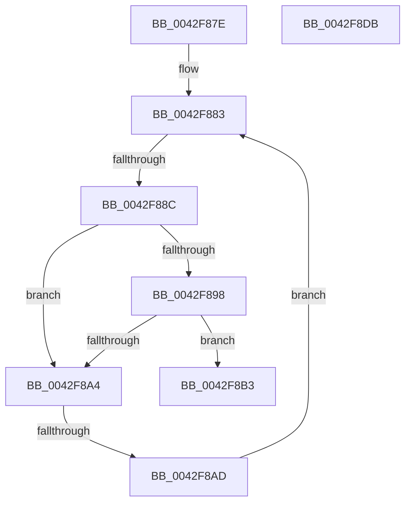

# sub_0042F87E

- RVA: `0x0042F87E`–`0x0042F8DC` (길이 `94` bytes)
- VA: `0x000000014042F87E`
- 실행 섹션: `.text`
- PDB 이름 있음: `아니요`; PDB Function 태그: `아니요`
- unwind 정보 RVA: `0x000A1F08`
- 디코드: `28`개 명령, `94/94` bytes 표시
- 미해석 바이트: `0` (있으면 어셈블리에 `.byte`로 보존)

> 이 문서는 커널 이미지의 기계어와 PDB 기호를 분석해 생성했습니다. 4번과 5번은 함수 원형과 자료형을 바이너리 사용 방식에서 추정한 C 해석이며 원본 소스 복구 결과는 아닙니다.

## 1. Dependencies

- 직접 호출 지점: **0**; 고유 호출 대상: **0**
- 직접 호출자로 확인된 함수: **0**
- RIP 상대 이미지 참조: **0**

### Outgoing calls
- 직접 디코드된 call 명령이 없습니다.

### Direct callers
- 이 함수 시작 RVA로 연결되는 직접 call은 확인되지 않았습니다. 간접 호출은 완전히 역산할 수 없습니다.

### Static image references
- 디코드된 RIP-relative 메모리 참조가 없습니다.

## 2. Other-region calls and transfers

- 다른 실행 섹션으로 향하는 call: **0**
- call이 아닌 외부 분기/꼬리 이동: **2**
  - `0x0042F886` → [sub_0042F8E4 + 0x33](Unknown_function_0042F8E4.md) (`tail-transfer`)
  - `0x0042F8AB` → [sub_0042F8E4](Unknown_function_0042F8E4.md) (`tail-transfer`)

## 3. Assembly (complete function range)

```asm
0042F87E  48 89 7C 24 30                  mov qword ptr [rsp + 0x30], rdi
0042F883  48 85 DB                        test rbx, rbx
0042F886  0F 84 8B 00 00 00               je 0x14042f917
0042F88C  8B 7B 20                        mov edi, dword ptr [rbx + 0x20]
0042F88F  48 8B 4B 08                     mov rcx, qword ptr [rbx + 8]
0042F893  48 3B F1                        cmp rsi, rcx
0042F896  72 0C                           jb 0x14042f8a4
0042F898  8B 43 2C                        mov eax, dword ptr [rbx + 0x2c]
0042F89B  48 8D 0C C1                     lea rcx, [rcx + rax*8]
0042F89F  48 3B F1                        cmp rsi, rcx
0042F8A2  72 0F                           jb 0x14042f8b3
0042F8A4  8B 43 20                        mov eax, dword ptr [rbx + 0x20]
0042F8A7  0F BA E0 11                     bt eax, 0x11
0042F8AB  72 37                           jb 0x14042f8e4
0042F8AD  48 8B 5B 10                     mov rbx, qword ptr [rbx + 0x10]
0042F8B1  EB D0                           jmp 0x14042f883
0042F8B3  33 C0                           xor eax, eax
0042F8B5  40 80 E7 3E                     and dil, 0x3e
0042F8B9  40 80 FF 08                     cmp dil, 8
0042F8BD  0F 93 C0                        setae al
0042F8C0  48 8B 7C 24 30                  mov rdi, qword ptr [rsp + 0x30]
0042F8C5  48 8B 5C 24 38                  mov rbx, qword ptr [rsp + 0x38]
0042F8CA  48 8B 6C 24 40                  mov rbp, qword ptr [rsp + 0x40]
0042F8CF  48 8B 74 24 48                  mov rsi, qword ptr [rsp + 0x48]
0042F8D4  48 83 C4 20                     add rsp, 0x20
0042F8D8  41 5E                           pop r14
0042F8DA  C3                              ret
0042F8DB  CC                              int3
```

## 4. C-style interpretation (structured pseudocode)

```c
__int64 __fastcall sub_0042F87E(__int64 a1, __int64 a2, __int64 a3, __int64 a4, __int64 a5, __int64 a6, __int64 a7, __int64 a8, __int64 a9)
{
    __int64 result;
    __int64 v_rdi;
    __int64 v_rsp;
    unsigned __int64 v_stack_p30;

    v_stack_p30 = v_rdi;
loc_0042F883:
    if (v_rsi < (*(unsigned __int64 *)(v_rbx + 8))) goto loc_0042F8A4;
    if (v_rsi < (*(unsigned __int64 *)(v_rbx + 8) + (unsigned int)(*(unsigned int *)(v_rbx + 44)) * 8)) goto loc_0042F8B3;
loc_0042F8A4:
    goto loc_0042F883;
loc_0042F8B3:
    result = 0;
    v_rdi = (unsigned __int8)(((unsigned int)(*(unsigned int *)(v_rbx + 32))) & (62));
    result = (((unsigned __int8)(v_rdi)) >= 8) ? 1 : 0;
    v_rsp = (v_rsp) + (32);
    return result;
}
```

## 5. (Beta) C Style

```c
int64_t sub_0042F87E(int64_t Arg1, int64_t Arg2, int64_t Arg3, int64_t Arg4, uint64_t Arg5, int64_t Arg6, int64_t Arg7, int64_t Arg8, int64_t Arg9)
{
    int64_t result;
    int64_t local_rdi;
    int64_t local_rsp;
    uint64_t v_stack_p30;

    v_stack_p30 = local_rdi;
loc_0042F883:
    if (local_rsi < (*(uint64_t *)(local_rbx + 0x8))) goto loc_0042F8A4;
    if (local_rsi < (*(uint64_t *)(local_rbx + 0x8) + (uint32_t)(*(uint32_t *)(local_rbx + 0x2C)) * 8)) goto loc_0042F8B3;
loc_0042F8A4:
    goto loc_0042F883;
loc_0042F8B3:
    result = 0;
    local_rdi = (uint8_t)(((uint32_t)(*(uint32_t *)(local_rbx + 0x20))) & (62));
    result = (((uint8_t)(local_rdi)) >= 8) ? 1 : 0;
    local_rsp = (local_rsp) + (32);
    return result;
}
```

## 6. Execution-region graph

[열기: 2D/3D 그래프와 함수 탐색 컨트롤 패널](../../../control-panel.html?section=text&rva=0x0042F87E&view=graph)

- 2D 그래프는 위에서 아래로 흐르고, 3D 그래프는 빈 공간을 드래그해 회전합니다. Shift+드래그는 이동, 휠은 확대·축소, 함수 노드 선택은 대상 보고서 이동입니다.

### Static fallback


