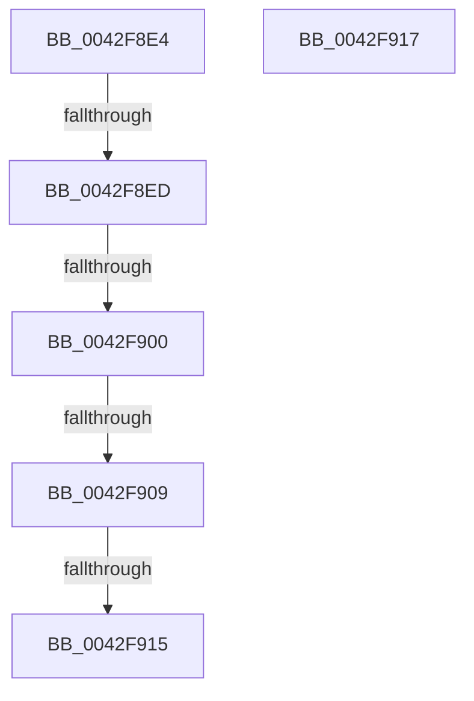

# sub_0042F8E4

- RVA: `0x0042F8E4`–`0x0042F91B` (길이 `55` bytes)
- VA: `0x000000014042F8E4`
- 실행 섹션: `.text`
- PDB 이름 있음: `아니요`; PDB Function 태그: `아니요`
- unwind 정보 RVA: `0x000A1F30`
- 디코드: `18`개 명령, `55/55` bytes 표시
- 미해석 바이트: `0` (있으면 어셈블리에 `.byte`로 보존)

> 이 문서는 커널 이미지의 기계어와 PDB 기호를 분석해 생성했습니다. 4번과 5번은 함수 원형과 자료형을 바이너리 사용 방식에서 추정한 C 해석이며 원본 소스 복구 결과는 아닙니다.

## 1. Dependencies

- 직접 호출 지점: **1**; 고유 호출 대상: **1**
- 직접 호출자로 확인된 함수: **0**
- RIP 상대 이미지 참조: **0**

### Outgoing calls
- `0x0042F8F6` → [MiGetSharedProtosAtDpc](MiGetSharedProtosAtDpc_function_0042F924.md) (function, `0x0042F924`)

### Direct callers
- 이 함수 시작 RVA로 연결되는 직접 call은 확인되지 않았습니다. 간접 호출은 완전히 역산할 수 없습니다.

### Static image references
- 디코드된 RIP-relative 메모리 참조가 없습니다.

## 2. Other-region calls and transfers

- 다른 실행 섹션으로 향하는 call: **0**
- call이 아닌 외부 분기/꼬리 이동: **6**
  - `0x0042F8EB` → [sub_0042F87E + 0x2F](Unknown_function_0042F87E.md) (`tail-transfer`)
  - `0x0042F8FE` → [sub_0042F87E + 0x2F](Unknown_function_0042F87E.md) (`tail-transfer`)
  - `0x0042F907` → [sub_0042F87E + 0x2F](Unknown_function_0042F87E.md) (`tail-transfer`)
  - `0x0042F913` → [sub_0042F87E + 0x2F](Unknown_function_0042F87E.md) (`tail-transfer`)
  - `0x0042F915` → [sub_0042F87E + 0x35](Unknown_function_0042F87E.md) (`tail-transfer`)
  - `0x0042F919` → [sub_0042F87E + 0x42](Unknown_function_0042F87E.md) (`tail-transfer`)

## 3. Assembly (complete function range)

```asm
0042F8E4  F7 45 38 00 00 00 08            test dword ptr [rbp + 0x38], 0x8000000
0042F8EB  74 C0                           je 0x14042f8ad
0042F8ED  4C 8B C3                        mov r8, rbx
0042F8F0  41 8B D6                        mov edx, r14d
0042F8F3  48 8B CD                        mov rcx, rbp
0042F8F6  E8 29 00 00 00                  call 0x14042f924
0042F8FB  48 85 C0                        test rax, rax
0042F8FE  74 AD                           je 0x14042f8ad
0042F900  48 8B 48 48                     mov rcx, qword ptr [rax + 0x48]
0042F904  48 3B F1                        cmp rsi, rcx
0042F907  72 A4                           jb 0x14042f8ad
0042F909  8B 43 2C                        mov eax, dword ptr [rbx + 0x2c]
0042F90C  48 8D 0C C1                     lea rcx, [rcx + rax*8]
0042F910  48 3B F1                        cmp rsi, rcx
0042F913  73 98                           jae 0x14042f8ad
0042F915  EB 9C                           jmp 0x14042f8b3
0042F917  33 C0                           xor eax, eax
0042F919  EB A5                           jmp 0x14042f8c0
```

## 4. C-style interpretation (structured pseudocode)

```c
__int64 __fastcall sub_0042F8E4(void)
{
    __int64 result;

    result = MiGetSharedProtosAtDpc(v_rbp, (unsigned int)((unsigned int)(v_r14)), v_rbx, a4);
}
```

## 5. (Beta) C Style

```c
void sub_0042F8E4(void)
{
    int64_t result;

    result = MiGetSharedProtosAtDpc(local_rbp, (uint32_t)((uint32_t)(local_r14)), local_rbx, a4);
}
```

## 6. Execution-region graph

[열기: 2D/3D 그래프와 함수 탐색 컨트롤 패널](../../../control-panel.html?section=text&rva=0x0042F8E4&view=graph)

- 2D 그래프는 위에서 아래로 흐르고, 3D 그래프는 빈 공간을 드래그해 회전합니다. Shift+드래그는 이동, 휠은 확대·축소, 함수 노드 선택은 대상 보고서 이동입니다.

### Static fallback


