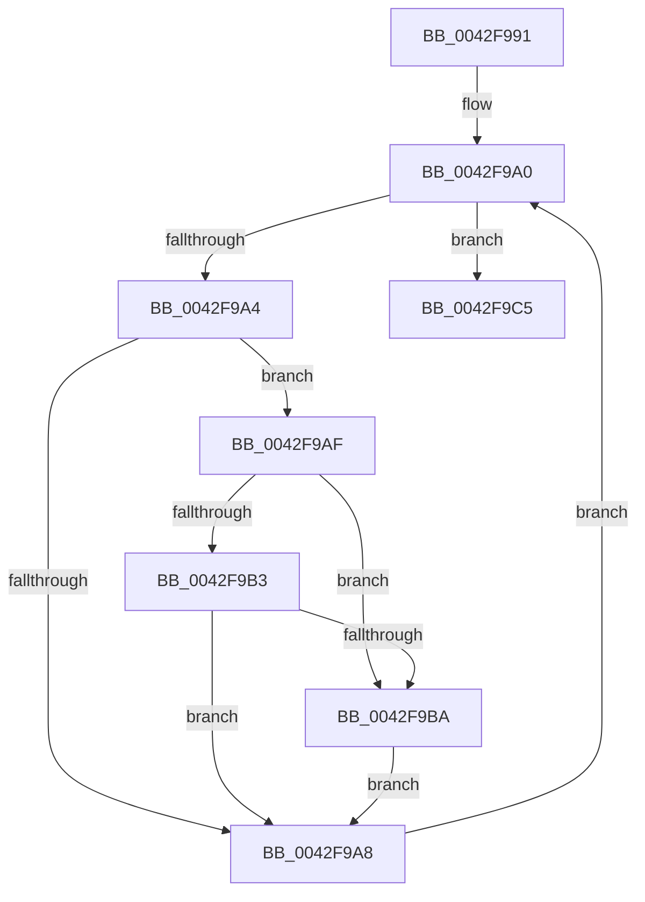

# sub_0042F991

- RVA: `0x0042F991`–`0x0042F9CA` (길이 `57` bytes)
- VA: `0x000000014042F991`
- 실행 섹션: `.text`
- PDB 이름 있음: `아니요`; PDB Function 태그: `아니요`
- unwind 정보 RVA: `0x000A1F8C`
- 디코드: `19`개 명령, `57/57` bytes 표시
- 미해석 바이트: `0` (있으면 어셈블리에 `.byte`로 보존)

> 이 문서는 커널 이미지의 기계어와 PDB 기호를 분석해 생성했습니다. 4번과 5번은 함수 원형과 자료형을 바이너리 사용 방식에서 추정한 C 해석이며 원본 소스 복구 결과는 아닙니다.

## 1. Dependencies

- 직접 호출 지점: **0**; 고유 호출 대상: **0**
- 직접 호출자로 확인된 함수: **0**
- RIP 상대 이미지 참조: **0**

### Outgoing calls
- 직접 디코드된 call 명령이 없습니다.

### Direct callers
- 이 함수 시작 RVA로 연결되는 직접 call은 확인되지 않았습니다. 간접 호출은 완전히 역산할 수 없습니다.

### Static image references
- 디코드된 RIP-relative 메모리 참조가 없습니다.

## 2. Other-region calls and transfers

- 다른 실행 섹션으로 향하는 call: **0**
- 별도 외부 분기/꼬리 이동을 확인하지 못했습니다.

## 3. Assembly (complete function range)

```asm
0042F991  48 89 5C 24 10                  mov qword ptr [rsp + 0x10], rbx
0042F996  0F B6 5C 24 30                  movzx ebx, byte ptr [rsp + 0x30]
0042F99B  0F 1F 44 00 00                  nop dword ptr [rax + rax]
0042F9A0  85 C0                           test eax, eax
0042F9A2  74 21                           je 0x14042f9c5
0042F9A4  85 C1                           test ecx, eax
0042F9A6  75 07                           jne 0x14042f9af
0042F9A8  41 FF C2                        inc r10d
0042F9AB  03 C0                           add eax, eax
0042F9AD  EB F1                           jmp 0x14042f9a0
0042F9AF  84 DB                           test bl, bl
0042F9B1  75 07                           jne 0x14042f9ba
0042F9B3  43 83 3C 91 00                  cmp dword ptr [r9 + r10*4], 0
0042F9B8  75 EE                           jne 0x14042f9a8
0042F9BA  8B D7                           mov edx, edi
0042F9BC  41 0B D0                        or edx, r8d
0042F9BF  43 89 14 91                     mov dword ptr [r9 + r10*4], edx
0042F9C3  EB E3                           jmp 0x14042f9a8
0042F9C5  48 8B 5C 24 10                  mov rbx, qword ptr [rsp + 0x10]
```

## 4. C-style interpretation (structured pseudocode)

```c
__int64 __fastcall sub_0042F991(int a1, __int64 a2, int a3, __int64 a4, __int64 a5, unsigned __int8 a6)
{
    __int64 result;
    __int64 v_r10;
    unsigned __int64 v_stack_p10;

    v_stack_p10 = v_rbx;
loc_0042F9A0:
    if ((unsigned int)(result) == 0) goto loc_0042F9C5;
    if (((a1) & ((unsigned int)(result))) != 0) goto loc_0042F9AF;
loc_0042F9A8:
    v_r10 = (unsigned int)((v_r10) + 1);
    result = (unsigned int)((result) + ((unsigned int)(result)));
    goto loc_0042F9A0;
loc_0042F9AF:
    if (a6 != 0) goto loc_0042F9BA;
    if ((*(unsigned int *)(a4 + v_r10 * 4)) != 0) goto loc_0042F9A8;
loc_0042F9BA:
    a2 = (unsigned int)(((unsigned int)((unsigned int)(v_rdi))) | (a3));
    *(unsigned int *)(a4 + v_r10 * 4) = (unsigned int)(a2);
    goto loc_0042F9A8;
loc_0042F9C5:
    return result;
}
```

## 5. (Beta) C Style

```c
int64_t sub_0042F991(int32_t Arg1, int64_t Arg2, int32_t Arg3, void *Arg4, uint64_t Arg5, uint8_t Arg6)
{
    uint8_t *arg4 = (uint8_t *)Arg4;

    int64_t result;
    int64_t local_r10;
    uint64_t v_stack_p10;

    v_stack_p10 = local_rbx;
loc_0042F9A0:
    if ((uint32_t)(result) == 0) goto loc_0042F9C5;
    if (((Arg1) & ((uint32_t)(result))) != 0) goto loc_0042F9AF;
loc_0042F9A8:
    local_r10 = (uint32_t)((local_r10) + 1);
    result = (uint32_t)((result) + ((uint32_t)(result)));
    goto loc_0042F9A0;
loc_0042F9AF:
    if (Arg6 != 0) goto loc_0042F9BA;
    if ((*(uint32_t *)(arg4 + local_r10 * 4)) != 0) goto loc_0042F9A8;
loc_0042F9BA:
    Arg2 = (uint32_t)(((uint32_t)((uint32_t)(local_rdi))) | (Arg3));
    *(uint32_t *)(arg4 + local_r10 * 4) = (uint32_t)(Arg2);
    goto loc_0042F9A8;
loc_0042F9C5:
    return result;
}
```

### 관측된 메모리 오프셋

구조체 형식이 확인되지 않은 접근은 인자 기준의 오프셋으로만 기록했습니다.

| 기준 인자 | 오프셋 표현 | 폭 (bit) | 접근 |
|---|---:|---:|---|
| `Arg4` | `+ 0x0 + r10*4` | `32` | `R` |
| `Arg4` | `+ 0x0 + r10*4` | `32` | `W` |

## 6. Execution-region graph

[열기: 2D/3D 그래프와 함수 탐색 컨트롤 패널](../../../control-panel.html?section=text&rva=0x0042F991&view=graph)

- 2D 그래프는 위에서 아래로 흐르고, 3D 그래프는 빈 공간을 드래그해 회전합니다. Shift+드래그는 이동, 휠은 확대·축소, 함수 노드 선택은 대상 보고서 이동입니다.

### Static fallback


