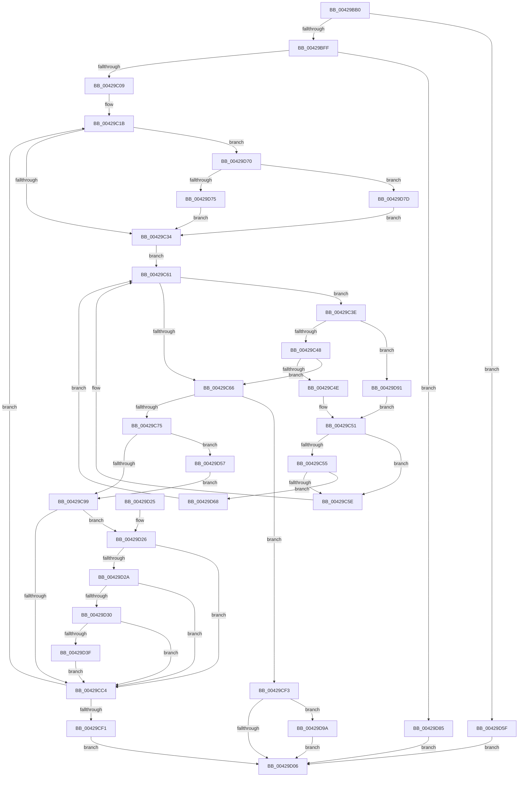

# VmColdPagesHint

- RVA: `0x00429BB0`–`0x00429DAA` (길이 `506` bytes)
- VA: `0x0000000140429BB0`
- 실행 섹션: `.text`
- PDB 이름 있음: `예`; PDB Function 태그: `아니요`
- unwind 정보 RVA: `0x000A0F3C`
- 디코드: `139`개 명령, `506/506` bytes 표시
- 미해석 바이트: `0` (있으면 어셈블리에 `.byte`로 보존)

> 이 문서는 커널 이미지의 기계어와 PDB 기호를 분석해 생성했습니다. 4번과 5번은 함수 원형과 자료형을 바이너리 사용 방식에서 추정한 C 해석이며 원본 소스 복구 결과는 아닙니다.

## 1. Dependencies

- 직접 호출 지점: **5**; 고유 호출 대상: **4**
- 직접 호출자로 확인된 함수: **0**
- RIP 상대 이미지 참조: **1**

### Outgoing calls
- `0x00429C1E` → [VmpProcessContextLockShared](VmpProcessContextLockShared_function_00429DB0.md) (function, `0x00429DB0`)
- `0x00429CA9` → [VmpProcessContextUnlockShared](VmpProcessContextUnlockShared_function_00429DFC.md) (function, `0x00429DFC`)
- `0x00429CE3` → [ZwUnlockVirtualMemory](../6B/ZwUnlockVirtualMemory_function_006B0CB0.md) (function, `0x006B0CB0`)
- `0x00429D49` → [VmpLogColdHint](../64/VmpLogColdHint_function_0064D8E0.md) (function, `0x0064D8E0`)
- `0x00429DA0` → [VmpProcessContextUnlockShared](VmpProcessContextUnlockShared_function_00429DFC.md) (function, `0x00429DFC`)

### Direct callers
- 이 함수 시작 RVA로 연결되는 직접 call은 확인되지 않았습니다. 간접 호출은 완전히 역산할 수 없습니다.

### Static image references
- `0x00429CB2` → RVA `0x00F02458` (`.data`; read)

## 2. Other-region calls and transfers

- 다른 실행 섹션으로 향하는 call: **0**
- 별도 외부 분기/꼬리 이동을 확인하지 못했습니다.

## 3. Assembly (complete function range)

```asm
00429BB0  48 89 5C 24 08                  mov qword ptr [rsp + 8], rbx
00429BB5  48 89 74 24 10                  mov qword ptr [rsp + 0x10], rsi
00429BBA  48 89 7C 24 18                  mov qword ptr [rsp + 0x18], rdi
00429BBF  55                              push rbp
00429BC0  41 54                           push r12
00429BC2  41 55                           push r13
00429BC4  41 56                           push r14
00429BC6  41 57                           push r15
00429BC8  48 8B EC                        mov rbp, rsp
00429BCB  48 83 EC 30                     sub rsp, 0x30
00429BCF  33 DB                           xor ebx, ebx
00429BD1  48 8B F9                        mov rdi, rcx
00429BD4  48 89 5D F0                     mov qword ptr [rbp - 0x10], rbx
00429BD8  4C 8B FA                        mov r15, rdx
00429BDB  48 89 5D 48                     mov qword ptr [rbp + 0x48], rbx
00429BDF  65 48 8B 04 25 88 01 00 00      mov rax, qword ptr gs:[0x188]
00429BE8  48 8B 88 B8 00 00 00            mov rcx, qword ptr [rax + 0xb8]
00429BEF  48 8B B1 70 06 00 00            mov rsi, qword ptr [rcx + 0x670]
00429BF6  48 85 F6                        test rsi, rsi
00429BF9  0F 84 60 01 00 00               je 0x140429d5f
00429BFF  4C 39 46 68                     cmp qword ptr [rsi + 0x68], r8
00429C03  0F 85 7C 01 00 00               jne 0x140429d85
00429C09  48 C1 EF 0C                     shr rdi, 0xc
00429C0D  4C 8D 6A FF                     lea r13, [rdx - 1]
00429C11  4C 03 EF                        add r13, rdi
00429C14  4C 8D 76 08                     lea r14, [rsi + 8]
00429C18  44 8B E3                        mov r12d, ebx
00429C1B  48 8B CE                        mov rcx, rsi
00429C1E  E8 8D 01 00 00                  call 0x140429db0
00429C23  41 F6 46 08 01                  test byte ptr [r14 + 8], 1
00429C28  4C 8B C0                        mov r8, rax
00429C2B  49 8B 0E                        mov rcx, qword ptr [r14]
00429C2E  0F 85 3C 01 00 00               jne 0x140429d70
00429C34  41 0F B6 56 08                  movzx edx, byte ptr [r14 + 8]
00429C39  83 E2 01                        and edx, 1
00429C3C  EB 23                           jmp 0x140429c61
00429C3E  48 3B 79 20                     cmp rdi, qword ptr [rcx + 0x20]
00429C42  0F 87 49 01 00 00               ja 0x140429d91
00429C48  48 3B 79 18                     cmp rdi, qword ptr [rcx + 0x18]
00429C4C  73 18                           jae 0x140429c66
00429C4E  48 8B 01                        mov rax, qword ptr [rcx]
00429C51  85 D2                           test edx, edx
00429C53  74 09                           je 0x140429c5e
00429C55  48 85 C0                        test rax, rax
00429C58  0F 85 0A 01 00 00               jne 0x140429d68
00429C5E  48 8B C8                        mov rcx, rax
00429C61  48 85 C9                        test rcx, rcx
00429C64  75 D8                           jne 0x140429c3e
00429C66  48 8D 41 E8                     lea rax, [rcx - 0x18]
00429C6A  48 F7 D9                        neg rcx
00429C6D  48 1B D2                        sbb rdx, rdx
00429C70  48 23 D0                        and rdx, rax
00429C73  74 7E                           je 0x140429cf3
00429C75  48 8B 42 10                     mov rax, qword ptr [rdx + 0x10]
00429C79  48 8B 48 18                     mov rcx, qword ptr [rax + 0x18]
00429C7D  48 89 4D 48                     mov qword ptr [rbp + 0x48], rcx
00429C81  48 2B 4A 30                     sub rcx, qword ptr [rdx + 0x30]
00429C85  48 03 CF                        add rcx, rdi
00429C88  48 89 4D 48                     mov qword ptr [rbp + 0x48], rcx
00429C8C  48 8B 42 38                     mov rax, qword ptr [rdx + 0x38]
00429C90  49 3B C5                        cmp rax, r13
00429C93  0F 83 BE 00 00 00               jae 0x140429d57
00429C99  48 2B C7                        sub rax, rdi
00429C9C  49 8B D0                        mov rdx, r8
00429C9F  48 FF C0                        inc rax
00429CA2  48 8B CE                        mov rcx, rsi
00429CA5  48 89 45 F0                     mov qword ptr [rbp - 0x10], rax
00429CA9  E8 4E 01 00 00                  call 0x140429dfc
00429CAE  48 8B 55 F0                     mov rdx, qword ptr [rbp - 0x10]
00429CB2  48 8B 0D 9F 87 AD 00            mov rcx, qword ptr [rip + 0xad879f]
00429CB9  4C 03 E2                        add r12, rdx
00429CBC  48 03 FA                        add rdi, rdx
00429CBF  48 85 C9                        test rcx, rcx
00429CC2  75 62                           jne 0x140429d26
00429CC4  48 C1 65 48 0C                  shl qword ptr [rbp + 0x48], 0xc
00429CC9  4C 8D 45 F0                     lea r8, [rbp - 0x10]
00429CCD  48 C1 E2 0C                     shl rdx, 0xc
00429CD1  41 B9 01 00 00 00               mov r9d, 1
00429CD7  48 89 55 F0                     mov qword ptr [rbp - 0x10], rdx
00429CDB  48 83 C9 FF                     or rcx, 0xffffffffffffffff
00429CDF  48 8D 55 48                     lea rdx, [rbp + 0x48]
00429CE3  E8 C8 6F 28 00                  call 0x1406b0cb0
00429CE8  4D 3B E7                        cmp r12, r15
00429CEB  0F 82 2A FF FF FF               jb 0x140429c1b
00429CF1  EB 13                           jmp 0x140429d06
00429CF3  CD 2C                           int 0x2c
00429CF5  BF 88 00 00 C0                  mov edi, 0xc0000088
00429CFA  8B DF                           mov ebx, edi
00429CFC  49 83 F8 FF                     cmp r8, -1
00429D00  0F 85 94 00 00 00               jne 0x140429d9a
00429D06  48 8B 74 24 68                  mov rsi, qword ptr [rsp + 0x68]
00429D0B  8B C3                           mov eax, ebx
00429D0D  48 8B 5C 24 60                  mov rbx, qword ptr [rsp + 0x60]
00429D12  48 8B 7C 24 70                  mov rdi, qword ptr [rsp + 0x70]
00429D17  48 83 C4 30                     add rsp, 0x30
00429D1B  41 5F                           pop r15
00429D1D  41 5E                           pop r14
00429D1F  41 5D                           pop r13
00429D21  41 5C                           pop r12
00429D23  5D                              pop rbp
00429D24  C3                              ret
00429D25  CC                              int3
00429D26  39 19                           cmp dword ptr [rcx], ebx
00429D28  76 9A                           jbe 0x140429cc4
00429D2A  F6 41 10 04                     test byte ptr [rcx + 0x10], 4
00429D2E  74 94                           je 0x140429cc4
00429D30  48 8B 49 18                     mov rcx, qword ptr [rcx + 0x18]
00429D34  48 8B C1                        mov rax, rcx
00429D37  83 E0 04                        and eax, 4
00429D3A  48 3B C1                        cmp rax, rcx
00429D3D  75 85                           jne 0x140429cc4
00429D3F  4C 8B 45 48                     mov r8, qword ptr [rbp + 0x48]
00429D43  4C 8B CA                        mov r9, rdx
00429D46  48 8B D7                        mov rdx, rdi
00429D49  E8 92 3B 22 00                  call 0x14064d8e0
00429D4E  48 8B 55 F0                     mov rdx, qword ptr [rbp - 0x10]
00429D52  E9 6D FF FF FF                  jmp 0x140429cc4
00429D57  49 8B C5                        mov rax, r13
00429D5A  E9 3A FF FF FF                  jmp 0x140429c99
00429D5F  CD 2C                           int 0x2c
00429D61  BB 41 01 00 C0                  mov ebx, 0xc0000141
00429D66  EB 9E                           jmp 0x140429d06
00429D68  48 33 C8                        xor rcx, rax
00429D6B  E9 F1 FE FF FF                  jmp 0x140429c61
00429D70  48 85 C9                        test rcx, rcx
00429D73  74 08                           je 0x140429d7d
00429D75  49 33 CE                        xor rcx, r14
00429D78  E9 B7 FE FF FF                  jmp 0x140429c34
00429D7D  48 8B CB                        mov rcx, rbx
00429D80  E9 AF FE FF FF                  jmp 0x140429c34
00429D85  CD 2C                           int 0x2c
00429D87  BB 0A 01 00 C0                  mov ebx, 0xc000010a
00429D8C  E9 75 FF FF FF                  jmp 0x140429d06
00429D91  48 8B 41 08                     mov rax, qword ptr [rcx + 8]
00429D95  E9 B7 FE FF FF                  jmp 0x140429c51
00429D9A  49 8B D0                        mov rdx, r8
00429D9D  48 8B CE                        mov rcx, rsi
00429DA0  E8 57 00 00 00                  call 0x140429dfc
00429DA5  E9 5C FF FF FF                  jmp 0x140429d06
```

## 4. C-style interpretation (structured pseudocode)

```c
__int64 __fastcall VmColdPagesHint(__int64 a1, __int64 a2, __int64 a3)
{
    __int64 result;
    __int64 v_r12;
    __int64 v_r13;
    __int64 v_rbx;
    __int64 v_rdi;
    __int64 v_rsp;
    unsigned __int64 v_stack_m38;
    unsigned __int64 v_stack_p10;
    unsigned __int64 v_stack_p18;
    unsigned __int64 v_stack_p20;
    unsigned __int64 v_stack_p8;

    v_stack_p8 = v_rbx;
    v_stack_p10 = v_rsi;
    v_stack_p18 = v_rdi;
    v_rsp = (v_rsp) - (48);
    v_rbx = 0;
    v_stack_m38 = 0;
    v_stack_p20 = 0;
    if (*(unsigned __int64 *)(*(unsigned __int64 *)(*(unsigned __int64 *)(gs_base + (0 + 392)) + 184) + 1648) == 0) goto loc_00429D5F;
    if ((*(unsigned __int64 *)(*(unsigned __int64 *)(*(unsigned __int64 *)(*(unsigned __int64 *)(gs_base + (0 + 392)) + 184) + 1648) + 104)) != a3) goto loc_00429D85;
    v_rdi = (a1) >> (12);
    v_r13 = (a2 - 1) + (v_rdi);
loc_00429C1B:
    result = VmpProcessContextLockShared(*(unsigned __int64 *)(*(unsigned __int64 *)(*(unsigned __int64 *)(gs_base + (0 + 392)) + 184) + 1648), a2, a3, a4);
    if (((*(unsigned __int8 *)(*(unsigned __int64 *)(*(unsigned __int64 *)(*(unsigned __int64 *)(gs_base + (0 + 392)) + 184) + 1648) + 8 + 8)) & (1)) != 0) goto loc_00429D70;
loc_00429C34:
    a2 = (unsigned int)((*(unsigned __int8 *)(*(unsigned __int64 *)(*(unsigned __int64 *)(*(unsigned __int64 *)(gs_base + (0 + 392)) + 184) + 1648) + 8 + 8)) & (1));
    goto loc_00429C61;
loc_00429C3E:
    if (v_rdi > (*(unsigned __int64 *)(*(unsigned __int64 *)(*(unsigned __int64 *)(*(unsigned __int64 *)(*(unsigned __int64 *)(gs_base + (0 + 392)) + 184) + 1648) + 8) + 32))) goto loc_00429D91;
    if (v_rdi >= (*(unsigned __int64 *)(*(unsigned __int64 *)(*(unsigned __int64 *)(*(unsigned __int64 *)(*(unsigned __int64 *)(gs_base + (0 + 392)) + 184) + 1648) + 8) + 24))) goto loc_00429C66;
loc_00429C51:
    if ((unsigned int)(a2) == 0) goto loc_00429C5E;
    if (*(unsigned __int64 *)(*(unsigned __int64 *)(*(unsigned __int64 *)(*(unsigned __int64 *)(*(unsigned __int64 *)(gs_base + (0 + 392)) + 184) + 1648) + 8)) != 0) goto loc_00429D68;
loc_00429C5E:
loc_00429C61:
    if (*(unsigned __int64 *)(*(unsigned __int64 *)(*(unsigned __int64 *)(*(unsigned __int64 *)(*(unsigned __int64 *)(gs_base + (0 + 392)) + 184) + 1648) + 8)) != 0) goto loc_00429C3E;
loc_00429C66:
    a1 = -(*(unsigned __int64 *)(*(unsigned __int64 *)(*(unsigned __int64 *)(*(unsigned __int64 *)(*(unsigned __int64 *)(gs_base + (0 + 392)) + 184) + 1648) + 8)));
    a2 = (a2) & (*(unsigned __int64 *)(*(unsigned __int64 *)(*(unsigned __int64 *)(*(unsigned __int64 *)(*(unsigned __int64 *)(gs_base + (0 + 392)) + 184) + 1648) + 8)) - 24);
    if (condition_is_equal) goto loc_00429CF3;
    v_stack_p20 = *(unsigned __int64 *)(*(unsigned __int64 *)(a2 + 16) + 24);
    a1 = (*(unsigned __int64 *)(*(unsigned __int64 *)(a2 + 16) + 24)) - (*(unsigned __int64 *)(a2 + 48));
    a1 = (a1) + (v_rdi);
    v_stack_p20 = a1;
    if ((*(unsigned __int64 *)(a2 + 56)) >= v_r13) goto loc_00429D57;
loc_00429C99:
    result = (*(unsigned __int64 *)(a2 + 56)) - (v_rdi);
    result = (result) + 1;
    v_stack_m38 = result;
    result = VmpProcessContextUnlockShared(*(unsigned __int64 *)(*(unsigned __int64 *)(*(unsigned __int64 *)(gs_base + (0 + 392)) + 184) + 1648), result, result, a4);
    v_r12 = (0) + (v_stack_m38);
    v_rdi = (v_rdi) + (v_stack_m38);
    if (*(unsigned __int64 *)(v_rip + 11372447) != 0) goto loc_00429D26;
loc_00429CC4:
    a2 = (v_stack_m38) << (12);
    v_stack_m38 = a2;
    a1 = (*(unsigned __int64 *)(v_rip + 11372447)) | (-1);
    result = ZwUnlockVirtualMemory(a1, v_stack_p20, v_stack_m38, 1);
    if (v_r12 < a2) goto loc_00429C1B;
    goto loc_00429D06;
loc_00429CF3:
    if (v_stack_m38 != -1) goto loc_00429D9A;
loc_00429D06:
    v_rsp = (v_rsp) + (48);
    return (unsigned int)((unsigned int)((unsigned int)((unsigned int)((unsigned int)(0xC0000088ULL)))));
loc_00429D26:
    if ((*(unsigned int *)(a1)) <= ((unsigned int)(v_stack_p8))) goto loc_00429CC4;
    if (((*(unsigned __int8 *)(a1 + 16)) & (4)) == 0) goto loc_00429CC4;
    result = (unsigned int)((*(unsigned __int64 *)(a1 + 24)) & (4));
    if (result != (*(unsigned __int64 *)(a1 + 24))) goto loc_00429CC4;
    result = VmpLogColdHint(*(unsigned __int64 *)(a1 + 24), v_stack_p18, v_stack_p20, v_stack_p20);
    goto loc_00429CC4;
loc_00429D57:
    goto loc_00429C99;
loc_00429D5F:
    goto loc_00429D06;
loc_00429D68:
    a1 = (*(unsigned __int64 *)(a1 + 24)) ^ (v_r13);
    goto loc_00429C61;
loc_00429D70:
    if (a1 == 0) goto loc_00429D7D;
    a1 = (a1) ^ (*(unsigned __int64 *)(*(unsigned __int64 *)(*(unsigned __int64 *)(gs_base + (0 + 392)) + 184) + 1648) + 8);
    goto loc_00429C34;
loc_00429D7D:
    goto loc_00429C34;
loc_00429D85:
    goto loc_00429D06;
loc_00429D91:
    goto loc_00429C51;
loc_00429D9A:
    result = VmpProcessContextUnlockShared(v_stack_p10, v_stack_p20, v_stack_p20, v_stack_p20);
    goto loc_00429D06;
}
```

## 5. (Beta) C Style

```c
int64_t VmColdPagesHint(int64_t Arg1, void *Arg2, int64_t Arg3)
{
    uint8_t *arg2 = (uint8_t *)Arg2;

    int64_t result;
    int64_t local_r12;
    int64_t local_r13;
    int64_t local_rbx;
    int64_t local_rdi;
    int64_t local_rsp;
    uint64_t v_stack_m38;
    uint64_t v_stack_p10;
    uint64_t v_stack_p18;
    uint64_t v_stack_p20;
    uint64_t v_stack_p8;

    v_stack_p8 = local_rbx;
    v_stack_p10 = local_rsi;
    v_stack_p18 = local_rdi;
    local_rsp = (local_rsp) - (48);
    local_rbx = 0;
    v_stack_m38 = 0;
    v_stack_p20 = 0;
    if (*(uint64_t *)(*(uint64_t *)(*(uint64_t *)(gs_base + (0 + 0x188)) + 0xB8) + 0x670) == 0) goto loc_00429D5F;
    if ((*(uint64_t *)(*(uint64_t *)(*(uint64_t *)(*(uint64_t *)(gs_base + (0 + 0x188)) + 0xB8) + 0x670) + 0x68)) != Arg3) goto loc_00429D85;
    local_rdi = (Arg1) >> (12);
    local_r13 = (Arg2 - 1) + (local_rdi);
loc_00429C1B:
    result = VmpProcessContextLockShared(*(uint64_t *)(*(uint64_t *)(*(uint64_t *)(gs_base + (0 + 0x188)) + 0xB8) + 0x670), Arg2, Arg3, a4);
    if (((*(uint8_t *)(*(uint64_t *)(*(uint64_t *)(*(uint64_t *)(gs_base + (0 + 0x188)) + 0xB8) + 0x670) + 0x8 + 0x8)) & (1)) != 0) goto loc_00429D70;
loc_00429C34:
    Arg2 = (uint32_t)((*(uint8_t *)(*(uint64_t *)(*(uint64_t *)(*(uint64_t *)(gs_base + (0 + 0x188)) + 0xB8) + 0x670) + 0x8 + 0x8)) & (1));
    goto loc_00429C61;
loc_00429C3E:
    if (local_rdi > (*(uint64_t *)(*(uint64_t *)(*(uint64_t *)(*(uint64_t *)(*(uint64_t *)(gs_base + (0 + 0x188)) + 0xB8) + 0x670) + 0x8) + 0x20))) goto loc_00429D91;
    if (local_rdi >= (*(uint64_t *)(*(uint64_t *)(*(uint64_t *)(*(uint64_t *)(*(uint64_t *)(gs_base + (0 + 0x188)) + 0xB8) + 0x670) + 0x8) + 0x18))) goto loc_00429C66;
loc_00429C51:
    if ((uint32_t)(Arg2) == 0) goto loc_00429C5E;
    if (*(uint64_t *)(*(uint64_t *)(*(uint64_t *)(*(uint64_t *)(*(uint64_t *)(gs_base + (0 + 0x188)) + 0xB8) + 0x670) + 0x8)) != 0) goto loc_00429D68;
loc_00429C5E:
loc_00429C61:
    if (*(uint64_t *)(*(uint64_t *)(*(uint64_t *)(*(uint64_t *)(*(uint64_t *)(gs_base + (0 + 0x188)) + 0xB8) + 0x670) + 0x8)) != 0) goto loc_00429C3E;
loc_00429C66:
    Arg1 = -(*(uint64_t *)(*(uint64_t *)(*(uint64_t *)(*(uint64_t *)(*(uint64_t *)(gs_base + (0 + 0x188)) + 0xB8) + 0x670) + 0x8)));
    Arg2 = (Arg2) & (*(uint64_t *)(*(uint64_t *)(*(uint64_t *)(*(uint64_t *)(*(uint64_t *)(gs_base + (0 + 0x188)) + 0xB8) + 0x670) + 0x8)) - 24);
    if (condition_is_equal) goto loc_00429CF3;
    v_stack_p20 = *(uint64_t *)(*(uint64_t *)(arg2 + 0x10) + 0x18);
    Arg1 = (*(uint64_t *)(*(uint64_t *)(arg2 + 0x10) + 0x18)) - (*(uint64_t *)(arg2 + 0x30));
    Arg1 = (Arg1) + (local_rdi);
    v_stack_p20 = Arg1;
    if ((*(uint64_t *)(arg2 + 0x38)) >= local_r13) goto loc_00429D57;
loc_00429C99:
    result = (*(uint64_t *)(arg2 + 0x38)) - (local_rdi);
    result = (result) + 1;
    v_stack_m38 = result;
    result = VmpProcessContextUnlockShared(*(uint64_t *)(*(uint64_t *)(*(uint64_t *)(gs_base + (0 + 0x188)) + 0xB8) + 0x670), result, result, a4);
    local_r12 = (0) + (v_stack_m38);
    local_rdi = (local_rdi) + (v_stack_m38);
    if (*(uint64_t *)(v_rip + 0xAD879F) != 0) goto loc_00429D26;
loc_00429CC4:
    Arg2 = (v_stack_m38) << (12);
    v_stack_m38 = Arg2;
    Arg1 = (*(uint64_t *)(v_rip + 0xAD879F)) | (-1);
    result = ZwUnlockVirtualMemory(Arg1, v_stack_p20, v_stack_m38, 1);
    if (local_r12 < Arg2) goto loc_00429C1B;
    goto loc_00429D06;
loc_00429CF3:
    if (v_stack_m38 != -1) goto loc_00429D9A;
loc_00429D06:
    local_rsp = (local_rsp) + (48);
    return (uint32_t)((uint32_t)((uint32_t)((uint32_t)((uint32_t)(0xC0000088ULL)))));
loc_00429D26:
    if ((*(uint32_t *)(Arg1)) <= ((uint32_t)(v_stack_p8))) goto loc_00429CC4;
    if (((*(uint8_t *)(Arg1 + 0x10)) & (4)) == 0) goto loc_00429CC4;
    result = (uint32_t)((*(uint64_t *)(Arg1 + 0x18)) & (4));
    if (result != (*(uint64_t *)(Arg1 + 0x18))) goto loc_00429CC4;
    result = VmpLogColdHint(*(uint64_t *)(Arg1 + 0x18), v_stack_p18, v_stack_p20, v_stack_p20);
    goto loc_00429CC4;
loc_00429D57:
    goto loc_00429C99;
loc_00429D5F:
    goto loc_00429D06;
loc_00429D68:
    Arg1 = (*(uint64_t *)(Arg1 + 0x18)) ^ (local_r13);
    goto loc_00429C61;
loc_00429D70:
    if (Arg1 == 0) goto loc_00429D7D;
    Arg1 = (Arg1) ^ (*(uint64_t *)(*(uint64_t *)(*(uint64_t *)(gs_base + (0 + 0x188)) + 0xB8) + 0x670) + 8);
    goto loc_00429C34;
loc_00429D7D:
    goto loc_00429C34;
loc_00429D85:
    goto loc_00429D06;
loc_00429D91:
    goto loc_00429C51;
loc_00429D9A:
    result = VmpProcessContextUnlockShared(v_stack_p10, v_stack_p20, v_stack_p20, v_stack_p20);
    goto loc_00429D06;
}
```

### 관측된 메모리 오프셋

구조체 형식이 확인되지 않은 접근은 인자 기준의 오프셋으로만 기록했습니다.

| 기준 인자 | 오프셋 표현 | 폭 (bit) | 접근 |
|---|---:|---:|---|
| `Arg2` | `- 0x1` | `64` | `R` |

## 6. Execution-region graph

[열기: 2D/3D 그래프와 함수 탐색 컨트롤 패널](../../../control-panel.html?section=text&rva=0x00429BB0&view=graph)

- 2D 그래프는 위에서 아래로 흐르고, 3D 그래프는 빈 공간을 드래그해 회전합니다. Shift+드래그는 이동, 휠은 확대·축소, 함수 노드 선택은 대상 보고서 이동입니다.

### Static fallback


