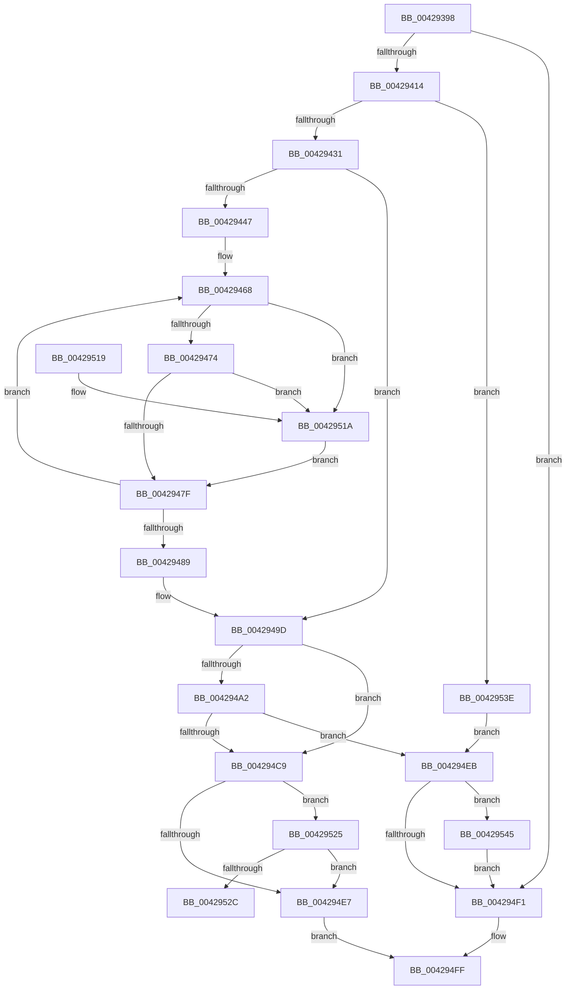

# VmpAccessFaultBatch

- RVA: `0x00429398`–`0x00429552` (길이 `442` bytes)
- VA: `0x0000000140429398`
- 실행 섹션: `.text`
- PDB 이름 있음: `예`; PDB Function 태그: `예`
- unwind 정보 RVA: `0x000A0EC8`
- 디코드: `121`개 명령, `442/442` bytes 표시
- 미해석 바이트: `0` (있으면 어셈블리에 `.byte`로 보존)

> 이 문서는 커널 이미지의 기계어와 PDB 기호를 분석해 생성했습니다. 4번과 5번은 함수 원형과 자료형을 바이너리 사용 방식에서 추정한 C 해석이며 원본 소스 복구 결과는 아닙니다.

## 1. Dependencies

- 직접 호출 지점: **8**; 고유 호출 대상: **6**
- 직접 호출자로 확인된 함수: **1**
- RIP 상대 이미지 참조: **0**

### Outgoing calls
- `0x004293D3` → [VmpFaultEntryInsert](VmpFaultEntryInsert_function_00429558.md) (function, `0x00429558`)
- `0x00429405` → [VmpAccessFaultBatchResolve](../../page/9F/VmpAccessFaultBatchResolve_function_009FF710.md) (function, `0x009FF710`)
- `0x00429417` → [VmpProcessContextLockShared](VmpProcessContextLockShared_function_00429DB0.md) (function, `0x00429DB0`)
- `0x004294BE` → [VmpProcessUpdateSlat](VmpProcessUpdateSlat_function_00429E54.md) (function, `0x00429E54`)
- `0x004294CF` → [VmpProcessContextUnlockShared](VmpProcessContextUnlockShared_function_00429DFC.md) (function, `0x00429DFC`)
- `0x004294DD` → [VmpFaultEntryRemove](VmpFaultEntryRemove_function_0042969C.md) (function, `0x0042969C`)
- `0x004294FA` → [VmpFaultEntryRemove](VmpFaultEntryRemove_function_0042969C.md) (function, `0x0042969C`)
- `0x0042954B` → [VmpProcessContextUnlockShared](VmpProcessContextUnlockShared_function_00429DFC.md) (function, `0x00429DFC`)

### Direct callers
- [VmAccessFault](../../page/A1/VmAccessFault_function_00A18BF0.md) at `0x00A18DB2`
- [VmAccessFault](../../page/A1/VmAccessFault_function_00A18BF0.md) at `0x00A18E90`

### Static image references
- 디코드된 RIP-relative 메모리 참조가 없습니다.

## 2. Other-region calls and transfers

- 다른 실행 섹션으로 향하는 call: **1**
  - `0x00429405` → [VmpAccessFaultBatchResolve](../../page/9F/VmpAccessFaultBatchResolve_function_009FF710.md) (`.text` → `PAGE`)
- call이 아닌 외부 분기/꼬리 이동: **1**
  - `0x00429539` → [sub_006EE0BE](../6E/Unknown_function_006EE0BE.md) (`tail-transfer`)

## 3. Assembly (complete function range)

```asm
00429398  48 8B C4                        mov rax, rsp
0042939B  48 89 58 18                     mov qword ptr [rax + 0x18], rbx
0042939F  4C 89 48 20                     mov qword ptr [rax + 0x20], r9
004293A3  48 89 50 10                     mov qword ptr [rax + 0x10], rdx
004293A7  48 89 48 08                     mov qword ptr [rax + 8], rcx
004293AB  55                              push rbp
004293AC  56                              push rsi
004293AD  57                              push rdi
004293AE  41 54                           push r12
004293B0  41 55                           push r13
004293B2  41 56                           push r14
004293B4  41 57                           push r15
004293B6  48 83 EC 40                     sub rsp, 0x40
004293BA  49 8B D9                        mov rbx, r9
004293BD  4C 8D 72 20                     lea r14, [rdx + 0x20]
004293C1  41 8B F0                        mov esi, r8d
004293C4  48 8B FA                        mov rdi, rdx
004293C7  48 8B E9                        mov rbp, rcx
004293CA  44 8B C6                        mov r8d, esi
004293CD  48 8B D7                        mov rdx, rdi
004293D0  48 8B CD                        mov rcx, rbp
004293D3  E8 80 01 00 00                  call 0x140429558
004293D8  8B 84 24 B0 00 00 00            mov eax, dword ptr [rsp + 0xb0]
004293DF  4C 8B CB                        mov r9, rbx
004293E2  89 44 24 30                     mov dword ptr [rsp + 0x30], eax
004293E6  44 8B C6                        mov r8d, esi
004293E9  8B 84 24 A8 00 00 00            mov eax, dword ptr [rsp + 0xa8]
004293F0  48 8B D7                        mov rdx, rdi
004293F3  89 44 24 28                     mov dword ptr [rsp + 0x28], eax
004293F7  48 8B CD                        mov rcx, rbp
004293FA  8B 84 24 A0 00 00 00            mov eax, dword ptr [rsp + 0xa0]
00429401  89 44 24 20                     mov dword ptr [rsp + 0x20], eax
00429405  E8 06 63 5D 00                  call 0x1409ff710
0042940A  8B D8                           mov ebx, eax
0042940C  85 C0                           test eax, eax
0042940E  0F 88 DD 00 00 00               js 0x1404294f1
00429414  48 8B CD                        mov rcx, rbp
00429417  E8 94 09 00 00                  call 0x140429db0
0042941C  4C 8B E0                        mov r12, rax
0042941F  48 8B 84 24 B8 00 00 00         mov rax, qword ptr [rsp + 0xb8]
00429427  48 39 45 68                     cmp qword ptr [rbp + 0x68], rax
0042942B  0F 85 0D 01 00 00               jne 0x14042953e
00429431  8B CE                           mov ecx, esi
00429433  45 33 FF                        xor r15d, r15d
00429436  48 8D 0C 49                     lea rcx, [rcx + rcx*2]
0042943A  48 C1 E1 04                     shl rcx, 4
0042943E  4C 8D 2C 39                     lea r13, [rcx + rdi]
00429442  49 3B FD                        cmp rdi, r13
00429445  73 56                           jae 0x14042949d
00429447  48 FF C9                        dec rcx
0042944A  48 B8 AB AA AA AA AA AA AA AA   movabs rax, 0xaaaaaaaaaaaaaaab
00429454  48 F7 E1                        mul rcx
00429457  48 BD 00 00 00 00 00 00 00 01   movabs rbp, 0x100000000000000
00429461  48 C1 EA 05                     shr rdx, 5
00429465  48 FF C2                        inc rdx
00429468  49 0F BA 66 F8 34               bt qword ptr [r14 - 8], 0x34
0042946E  0F 82 A6 00 00 00               jb 0x14042951a
00429474  49 0F BA 26 39                  bt qword ptr [r14], 0x39
00429479  0F 82 9B 00 00 00               jb 0x14042951a
0042947F  49 83 C6 30                     add r14, 0x30
00429483  48 83 EA 01                     sub rdx, 1
00429487  75 DF                           jne 0x140429468
00429489  48 8B BC 24 88 00 00 00         mov rdi, qword ptr [rsp + 0x88]
00429491  48 8B AC 24 80 00 00 00         mov rbp, qword ptr [rsp + 0x80]
00429499  4C 8D 77 20                     lea r14, [rdi + 0x20]
0042949D  44 3B FE                        cmp r15d, esi
004294A0  74 27                           je 0x1404294c9
004294A2  8B 84 24 A0 00 00 00            mov eax, dword ptr [rsp + 0xa0]
004294A9  44 8B C6                        mov r8d, esi
004294AC  4C 8B 8C 24 98 00 00 00         mov r9, qword ptr [rsp + 0x98]
004294B4  48 8B D7                        mov rdx, rdi
004294B7  48 8B CD                        mov rcx, rbp
004294BA  89 44 24 20                     mov dword ptr [rsp + 0x20], eax
004294BE  E8 91 09 00 00                  call 0x140429e54
004294C3  8B D8                           mov ebx, eax
004294C5  85 C0                           test eax, eax
004294C7  78 22                           js 0x1404294eb
004294C9  49 8B D4                        mov rdx, r12
004294CC  48 8B CD                        mov rcx, rbp
004294CF  E8 28 09 00 00                  call 0x140429dfc
004294D4  44 8B C6                        mov r8d, esi
004294D7  48 8B D7                        mov rdx, rdi
004294DA  48 8B CD                        mov rcx, rbp
004294DD  E8 BA 01 00 00                  call 0x14042969c
004294E2  45 85 FF                        test r15d, r15d
004294E5  75 3E                           jne 0x140429525
004294E7  33 DB                           xor ebx, ebx
004294E9  EB 14                           jmp 0x1404294ff
004294EB  49 83 FC FF                     cmp r12, -1
004294EF  75 54                           jne 0x140429545
004294F1  44 8B C6                        mov r8d, esi
004294F4  48 8B D7                        mov rdx, rdi
004294F7  48 8B CD                        mov rcx, rbp
004294FA  E8 9D 01 00 00                  call 0x14042969c
004294FF  8B C3                           mov eax, ebx
00429501  48 8B 9C 24 90 00 00 00         mov rbx, qword ptr [rsp + 0x90]
00429509  48 83 C4 40                     add rsp, 0x40
0042950D  41 5F                           pop r15
0042950F  41 5E                           pop r14
00429511  41 5D                           pop r13
00429513  41 5C                           pop r12
00429515  5F                              pop rdi
00429516  5E                              pop rsi
00429517  5D                              pop rbp
00429518  C3                              ret
00429519  CC                              int3
0042951A  49 09 2E                        or qword ptr [r14], rbp
0042951D  41 FF C7                        inc r15d
00429520  E9 5A FF FF FF                  jmp 0x14042947f
00429525  33 F6                           xor esi, esi
00429527  49 3B FD                        cmp rdi, r13
0042952A  73 BB                           jae 0x1404294e7
0042952C  49 8B D6                        mov rdx, r14
0042952F  48 B9 00 00 00 00 00 00 00 01   movabs rcx, 0x100000000000000
00429539  E9 80 4B 2C 00                  jmp 0x1406ee0be
0042953E  BB 0A 01 00 C0                  mov ebx, 0xc000010a
00429543  EB A6                           jmp 0x1404294eb
00429545  49 8B D4                        mov rdx, r12
00429548  48 8B CD                        mov rcx, rbp
0042954B  E8 AC 08 00 00                  call 0x140429dfc
00429550  EB 9F                           jmp 0x1404294f1
```

## 4. C-style interpretation (structured pseudocode)

```c
__int64 __fastcall VmpAccessFaultBatch(__int64 a1, __int64 a2, int a3, __int64 a4, unsigned int a5, unsigned int a6, unsigned int a7, __int64 a8)
{
    __int64 result;
    __int64 v_r14;
    __int64 v_r15;
    __int64 v_rbx;
    __int64 v_rsi;
    __int64 v_rsp;
    unsigned int v_stack_m48;
    unsigned int v_stack_m50;
    unsigned int v_stack_m58;
    unsigned __int64 v_stack_p10;
    unsigned __int64 v_stack_p18;
    unsigned __int64 v_stack_p20;
    unsigned __int64 v_stack_p8;

    *(unsigned __int64 *)(v_rsp + 24) = v_rbx;
    *(unsigned __int64 *)(v_rsp + 32) = a4;
    *(unsigned __int64 *)(v_rsp + 16) = a2;
    *(unsigned __int64 *)(v_rsp + 8) = a1;
    v_rsp = (v_rsp) - (64);
    result = VmpFaultEntryInsert(a1, a2, (unsigned int)((unsigned int)((unsigned int)(a3))), a4);
    v_stack_m48 = (unsigned int)((unsigned int)(a7));
    v_stack_m50 = (unsigned int)((unsigned int)(a6));
    v_stack_m58 = (unsigned int)((unsigned int)(a5));
    result = VmpAccessFaultBatchResolve(a1, a2, (unsigned int)((unsigned int)((unsigned int)(a3))), a4);
    if (sign_flag) goto loc_004294F1;
    result = VmpProcessContextLockShared(a1, a2, (unsigned int)((unsigned int)((unsigned int)(a3))), a4);
    if ((*(unsigned __int64 *)(a1 + 104)) != a8) goto loc_0042953E;
    v_r15 = 0;
    a1 = ((unsigned int)((unsigned int)((unsigned int)(a3))) + (unsigned int)((unsigned int)((unsigned int)(a3))) * 2) << (4);
    if (a2 >= (a1 + a2 * 1)) goto loc_0042949D;
    a1 = (a1) - 1;
    a2 = (a2) >> (5);
    a2 = (a2) + 1;
loc_00429468:
    if (condition_is_below) goto loc_0042951A;
    if (condition_is_below) goto loc_0042951A;
loc_0042947F:
    v_r14 = (a2 + 32) + (48);
    a2 = (a2) - (1);
    if (condition_is_not_equal) goto loc_00429468;
loc_0042949D:
    if (0 == ((unsigned int)((unsigned int)(a3)))) goto loc_004294C9;
    v_stack_m58 = (unsigned int)((unsigned int)(a5));
    result = VmpProcessUpdateSlat(v_stack_p8, v_stack_p10, (unsigned int)((unsigned int)((unsigned int)(a3))), v_stack_p20);
    if (sign_flag) goto loc_004294EB;
loc_004294C9:
    result = VmpProcessContextUnlockShared(v_stack_p8, result, (unsigned int)((unsigned int)((unsigned int)(a3))), v_stack_p20);
    result = VmpFaultEntryRemove(v_stack_p8, v_stack_p10, (unsigned int)((unsigned int)((unsigned int)(a3))), v_stack_p20);
    if (0 != 0) goto loc_00429525;
loc_004294E7:
    v_rbx = 0;
    goto loc_004294FF;
loc_004294EB:
    if (result != -1) goto loc_00429545;
loc_004294F1:
    result = VmpFaultEntryRemove(v_stack_p8, v_stack_p10, (unsigned int)((unsigned int)((unsigned int)(a3))), v_stack_p20);
loc_004294FF:
    v_rsp = (v_rsp) + (64);
    return 0;
loc_0042951A:
    v_r15 = (unsigned int)((v_r15) + 1);
    goto loc_0042947F;
loc_00429525:
    v_rsi = 0;
    if (v_stack_p10 >= (a1 + a2 * 1)) goto loc_004294E7;
loc_0042953E:
    goto loc_004294EB;
loc_00429545:
    result = VmpProcessContextUnlockShared(v_stack_p8, result, (unsigned int)((unsigned int)((unsigned int)(a3))), v_stack_p20);
    goto loc_004294F1;
}
```

## 5. (Beta) C Style

```c
int64_t VmpAccessFaultBatch(void *Arg1, void *Arg2, void *Arg3, int64_t Arg4, uint32_t Arg5, uint32_t Arg6, uint32_t Arg7, int64_t Arg8)
{
    uint8_t *arg1 = (uint8_t *)Arg1;
    uint8_t *arg2 = (uint8_t *)Arg2;
    uint8_t *arg3 = (uint8_t *)Arg3;

    int64_t result;
    int64_t local_r14;
    int64_t local_r15;
    int64_t local_rbx;
    int64_t local_rsi;
    int64_t local_rsp;
    uint32_t v_stack_m48;
    uint32_t v_stack_m50;
    uint32_t v_stack_m58;
    uint64_t v_stack_p10;
    uint64_t v_stack_p18;
    uint64_t v_stack_p20;
    uint64_t v_stack_p8;

    *(uint64_t *)(local_rsp + 0x18) = local_rbx;
    *(uint64_t *)(local_rsp + 0x20) = Arg4;
    *(void **)(local_rsp + 0x10) = Arg2;
    *(void **)(local_rsp + 0x8) = Arg1;
    local_rsp = (local_rsp) - (64);
    result = VmpFaultEntryInsert(Arg1, Arg2, (uint32_t)((uint32_t)((uint32_t)(Arg3))), Arg4);
    v_stack_m48 = (uint32_t)((uint32_t)(Arg7));
    v_stack_m50 = (uint32_t)((uint32_t)(Arg6));
    v_stack_m58 = (uint32_t)((uint32_t)(Arg5));
    result = VmpAccessFaultBatchResolve(Arg1, Arg2, (uint32_t)((uint32_t)((uint32_t)(Arg3))), Arg4);
    if (sign_flag) goto loc_004294F1;
    result = VmpProcessContextLockShared(Arg1, Arg2, (uint32_t)((uint32_t)((uint32_t)(Arg3))), Arg4);
    if ((*(uint64_t *)(arg1 + 0x68)) != Arg8) goto loc_0042953E;
    local_r15 = 0;
    Arg1 = ((uint32_t)((uint32_t)((uint32_t)(Arg3))) + (uint32_t)((uint32_t)((uint32_t)(Arg3))) * 2) << (4);
    if (Arg2 >= (Arg1 + Arg2 * 1)) goto loc_0042949D;
    Arg1 = (Arg1) - 1;
    Arg2 = (Arg2) >> (5);
    Arg2 = (Arg2) + 1;
loc_00429468:
    if (condition_is_below) goto loc_0042951A;
    if (condition_is_below) goto loc_0042951A;
loc_0042947F:
    local_r14 = (Arg2 + 32) + (48);
    Arg2 = (Arg2) - (1);
    if (condition_is_not_equal) goto loc_00429468;
loc_0042949D:
    if (0 == ((uint32_t)((uint32_t)(Arg3)))) goto loc_004294C9;
    v_stack_m58 = (uint32_t)((uint32_t)(Arg5));
    result = VmpProcessUpdateSlat(v_stack_p8, v_stack_p10, (uint32_t)((uint32_t)((uint32_t)(Arg3))), v_stack_p20);
    if (sign_flag) goto loc_004294EB;
loc_004294C9:
    result = VmpProcessContextUnlockShared(v_stack_p8, result, (uint32_t)((uint32_t)((uint32_t)(Arg3))), v_stack_p20);
    result = VmpFaultEntryRemove(v_stack_p8, v_stack_p10, (uint32_t)((uint32_t)((uint32_t)(Arg3))), v_stack_p20);
    if (0 != 0) goto loc_00429525;
loc_004294E7:
    local_rbx = 0;
    goto loc_004294FF;
loc_004294EB:
    if (result != -1) goto loc_00429545;
loc_004294F1:
    result = VmpFaultEntryRemove(v_stack_p8, v_stack_p10, (uint32_t)((uint32_t)((uint32_t)(Arg3))), v_stack_p20);
loc_004294FF:
    local_rsp = (local_rsp) + (64);
    return 0;
loc_0042951A:
    local_r15 = (uint32_t)((local_r15) + 1);
    goto loc_0042947F;
loc_00429525:
    local_rsi = 0;
    if (v_stack_p10 >= (Arg1 + Arg2 * 1)) goto loc_004294E7;
loc_0042953E:
    goto loc_004294EB;
loc_00429545:
    result = VmpProcessContextUnlockShared(v_stack_p8, result, (uint32_t)((uint32_t)((uint32_t)(Arg3))), v_stack_p20);
    goto loc_004294F1;
}
```

### 관측된 메모리 오프셋

구조체 형식이 확인되지 않은 접근은 인자 기준의 오프셋으로만 기록했습니다.

| 기준 인자 | 오프셋 표현 | 폭 (bit) | 접근 |
|---|---:|---:|---|
| `Arg1` | `+ 0x68` | `64` | `R` |
| `Arg2` | `- 0x8` | `64` | `R` |
| `Arg2` | `+ 0x0` | `64` | `R` |
| `Arg2` | `+ 0x0` | `64` | `R/W` |
| `Arg2` | `+ 0x20` | `64` | `R` |
| `Arg3` | `+ 0x0 + rcx*2` | `64` | `R` |

## 6. Execution-region graph

[열기: 2D/3D 그래프와 함수 탐색 컨트롤 패널](../../../control-panel.html?section=text&rva=0x00429398&view=graph)

- 2D 그래프는 위에서 아래로 흐르고, 3D 그래프는 빈 공간을 드래그해 회전합니다. Shift+드래그는 이동, 휠은 확대·축소, 함수 노드 선택은 대상 보고서 이동입니다.

### Static fallback


