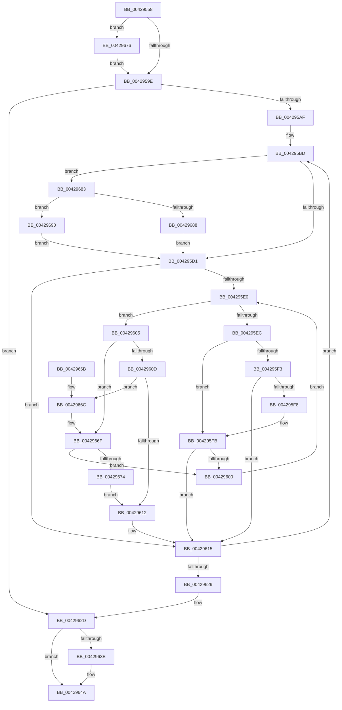

# VmpFaultEntryInsert

- RVA: `0x00429558`–`0x00429695` (길이 `317` bytes)
- VA: `0x0000000140429558`
- 실행 섹션: `.text`
- PDB 이름 있음: `예`; PDB Function 태그: `아니요`
- unwind 정보 RVA: `0x000A0EF4`
- 디코드: `92`개 명령, `317/317` bytes 표시
- 미해석 바이트: `0` (있으면 어셈블리에 `.byte`로 보존)

> 이 문서는 커널 이미지의 기계어와 PDB 기호를 분석해 생성했습니다. 4번과 5번은 함수 원형과 자료형을 바이너리 사용 방식에서 추정한 C 해석이며 원본 소스 복구 결과는 아닙니다.

## 1. Dependencies

- 직접 호출 지점: **5**; 고유 호출 대상: **5**
- 직접 호출자로 확인된 함수: **1**
- RIP 상대 이미지 참조: **1**

### Outgoing calls
- `0x004295A5` → [ExAcquireSpinLockExclusiveAtDpcLevel](../24/ExAcquireSpinLockExclusiveAtDpcLevel_function_00248E80.md) (function, `0x00248E80`)
- `0x0042961B` → [RtlRbInsertNodeEx](../2E/RtlRbInsertNodeEx_function_002E4570.md) (function, `0x002E4570`)
- `0x00429630` → [ExReleaseSpinLockExclusiveFromDpcLevel](../24/ExReleaseSpinLockExclusiveFromDpcLevel_function_002497E0.md) (function, `0x002497E0`)
- `0x00429645` → [KiLowerIrqlProcessIrqlFlags](../4F/KiLowerIrqlProcessIrqlFlags_function_004F5698.md) (function, `0x004F5698`)
- `0x00429679` → [KiRaiseIrqlProcessIrqlFlags](../4F/KiRaiseIrqlProcessIrqlFlags_function_004F56FC.md) (function, `0x004F56FC`)

### Direct callers
- [VmpAccessFaultBatch](VmpAccessFaultBatch_function_00429398.md) at `0x004293D3`

### Static image references
- `0x00429591` → RVA `0x00FC6D20` (`ALMOSTRO`; read)

## 2. Other-region calls and transfers

- 다른 실행 섹션으로 향하는 call: **0**
- 별도 외부 분기/꼬리 이동을 확인하지 못했습니다.

## 3. Assembly (complete function range)

```asm
00429558  48 89 5C 24 08                  mov qword ptr [rsp + 8], rbx
0042955D  48 89 6C 24 10                  mov qword ptr [rsp + 0x10], rbp
00429562  48 89 74 24 18                  mov qword ptr [rsp + 0x18], rsi
00429567  57                              push rdi
00429568  41 56                           push r14
0042956A  41 57                           push r15
0042956C  48 83 EC 20                     sub rsp, 0x20
00429570  41 8B C0                        mov eax, r8d
00429573  48 8B FA                        mov rdi, rdx
00429576  48 8B E9                        mov rbp, rcx
00429579  4C 8D 34 40                     lea r14, [rax + rax*2]
0042957D  49 C1 E6 04                     shl r14, 4
00429581  4C 03 F2                        add r14, rdx
00429584  44 0F 20 C6                     mov rsi, cr8
00429588  BA 0F 00 00 00                  mov edx, 0xf
0042958D  44 0F 22 C2                     mov cr8, rdx
00429591  83 3D 88 D7 B9 00 00            cmp dword ptr [rip + 0xb9d788], 0
00429598  0F 85 D8 00 00 00               jne 0x140429676
0042959E  48 8D 5D 60                     lea rbx, [rbp + 0x60]
004295A2  48 8B CB                        mov rcx, rbx
004295A5  E8 D6 F8 E1 FF                  call 0x140248e80
004295AA  49 3B FE                        cmp rdi, r14
004295AD  73 7E                           jae 0x14042962d
004295AF  48 8D 5D 50                     lea rbx, [rbp + 0x50]
004295B3  49 BF FF FF FF FF FF FF 0F 00   movabs r15, 0xfffffffffffff
004295BD  4C 8B 4F 18                     mov r9, qword ptr [rdi + 0x18]
004295C1  48 8B 13                        mov rdx, qword ptr [rbx]
004295C4  4D 23 CF                        and r9, r15
004295C7  F6 43 08 01                     test byte ptr [rbx + 8], 1
004295CB  0F 85 B2 00 00 00               jne 0x140429683
004295D1  0F B6 4B 08                     movzx ecx, byte ptr [rbx + 8]
004295D5  45 32 C0                        xor r8b, r8b
004295D8  83 E1 01                        and ecx, 1
004295DB  48 85 D2                        test rdx, rdx
004295DE  74 35                           je 0x140429615
004295E0  48 8B 42 18                     mov rax, qword ptr [rdx + 0x18]
004295E4  49 23 C7                        and rax, r15
004295E7  4C 3B C8                        cmp r9, rax
004295EA  73 19                           jae 0x140429605
004295EC  48 8B 02                        mov rax, qword ptr [rdx]
004295EF  85 C9                           test ecx, ecx
004295F1  74 08                           je 0x1404295fb
004295F3  48 85 C0                        test rax, rax
004295F6  74 1D                           je 0x140429615
004295F8  48 33 C2                        xor rax, rdx
004295FB  48 85 C0                        test rax, rax
004295FE  74 15                           je 0x140429615
00429600  48 8B D0                        mov rdx, rax
00429603  EB DB                           jmp 0x1404295e0
00429605  48 8B 42 08                     mov rax, qword ptr [rdx + 8]
00429609  85 C9                           test ecx, ecx
0042960B  74 62                           je 0x14042966f
0042960D  48 85 C0                        test rax, rax
00429610  75 5A                           jne 0x14042966c
00429612  41 B0 01                        mov r8b, 1
00429615  4C 8B CF                        mov r9, rdi
00429618  48 8B CB                        mov rcx, rbx
0042961B  E8 50 AF EB FF                  call 0x1402e4570
00429620  48 83 C7 30                     add rdi, 0x30
00429624  49 3B FE                        cmp rdi, r14
00429627  72 94                           jb 0x1404295bd
00429629  48 8D 5D 60                     lea rbx, [rbp + 0x60]
0042962D  48 8B CB                        mov rcx, rbx
00429630  E8 AB 01 E2 FF                  call 0x1402497e0
00429635  83 3D E4 D6 B9 00 00            cmp dword ptr [rip + 0xb9d6e4], 0
0042963C  74 0C                           je 0x14042964a
0042963E  44 0F 20 C1                     mov rcx, cr8
00429642  40 8A D6                        mov dl, sil
00429645  E8 4E C0 0C 00                  call 0x1404f5698
0042964A  40 0F B6 C6                     movzx eax, sil
0042964E  44 0F 22 C0                     mov cr8, rax
00429652  48 8B 5C 24 40                  mov rbx, qword ptr [rsp + 0x40]
00429657  48 8B 6C 24 48                  mov rbp, qword ptr [rsp + 0x48]
0042965C  48 8B 74 24 50                  mov rsi, qword ptr [rsp + 0x50]
00429661  48 83 C4 20                     add rsp, 0x20
00429665  41 5F                           pop r15
00429667  41 5E                           pop r14
00429669  5F                              pop rdi
0042966A  C3                              ret
0042966B  CC                              int3
0042966C  48 33 C2                        xor rax, rdx
0042966F  48 85 C0                        test rax, rax
00429672  75 8C                           jne 0x140429600
00429674  EB 9C                           jmp 0x140429612
00429676  40 8A CE                        mov cl, sil
00429679  E8 7E C0 0C 00                  call 0x1404f56fc
0042967E  E9 1B FF FF FF                  jmp 0x14042959e
00429683  48 85 D2                        test rdx, rdx
00429686  74 08                           je 0x140429690
00429688  48 33 D3                        xor rdx, rbx
0042968B  E9 41 FF FF FF                  jmp 0x1404295d1
00429690  E9 3C FF FF FF                  jmp 0x1404295d1
```

## 4. C-style interpretation (structured pseudocode)

```c
__int64 __fastcall VmpFaultEntryInsert(__int64 a1, __int64 a2, int a3)
{
    __int64 result;
    __int64 v_r14;
    __int64 v_rdi;
    __int64 v_rsp;
    unsigned __int64 v_stack_p10;
    unsigned __int64 v_stack_p18;
    unsigned __int64 v_stack_p8;

    v_stack_p8 = v_rbx;
    v_stack_p10 = v_rbp;
    v_stack_p18 = v_rsi;
    v_rsp = (v_rsp) - (32);
    v_r14 = ((unsigned int)(a3) + (unsigned int)(a3) * 2) << (4);
    v_r14 = (v_r14) + (a2);
    if ((*(unsigned int *)(v_rip + 12179336)) != 0) goto loc_00429676;
loc_0042959E:
    result = ExAcquireSpinLockExclusiveAtDpcLevel(a1 + 96, 15, a3, a4);
    if (a2 >= v_r14) goto loc_0042962D;
loc_004295BD:
    a4 = (*(unsigned __int64 *)(a2 + 24)) & (v_r15);
    if (((*(unsigned __int8 *)(a1 + 80 + 8)) & (1)) != 0) goto loc_00429683;
loc_004295D1:
    a3 = 0;
    a1 = (unsigned int)((*(unsigned __int8 *)(a1 + 80 + 8)) & (1));
    if (*(unsigned __int64 *)(a1 + 80) == 0) goto loc_00429615;
loc_004295E0:
    result = (*(unsigned __int64 *)(*(unsigned __int64 *)(a1 + 80) + 24)) & (v_r15);
    if (a4 >= result) goto loc_00429605;
    if ((unsigned int)(a1) == 0) goto loc_004295FB;
    if (*(unsigned __int64 *)(*(unsigned __int64 *)(a1 + 80)) == 0) goto loc_00429615;
    result = (*(unsigned __int64 *)(*(unsigned __int64 *)(a1 + 80))) ^ (*(unsigned __int64 *)(a1 + 80));
loc_004295FB:
    if (result == 0) goto loc_00429615;
loc_00429600:
    goto loc_004295E0;
loc_00429605:
    if ((unsigned int)(a1) == 0) goto loc_0042966F;
    if (*(unsigned __int64 *)(result + 8) != 0) goto loc_0042966C;
loc_00429612:
loc_00429615:
    result = RtlRbInsertNodeEx(a1 + 80, result, 1, a2);
    v_rdi = (a2) + (48);
    if (v_rdi < v_r14) goto loc_004295BD;
loc_0042962D:
    result = ExReleaseSpinLockExclusiveFromDpcLevel(a1 + 96, result, 1, a2);
    if ((*(unsigned int *)(v_rip + 12179172)) != 0) {
        a1 = 15;
        a2 = (unsigned __int8)(v_cr8);
        result = KiLowerIrqlProcessIrqlFlags(a1, a2, 1, a2);
    }
    v_rsp = (v_rsp) + (32);
    return (unsigned __int8)(v_cr8);
loc_0042966C:
    result = ((unsigned __int8)(v_cr8)) ^ (a2);
loc_0042966F:
    if (result != 0) goto loc_00429600;
    goto loc_00429612;
loc_00429676:
    result = KiRaiseIrqlProcessIrqlFlags((unsigned __int8)(v_stack_p18), a2, 1, a2);
    goto loc_0042959E;
loc_00429683:
    if (a2 == 0) goto loc_00429690;
    a2 = (a2) ^ (v_stack_p8);
    goto loc_004295D1;
loc_00429690:
    goto loc_004295D1;
}
```

## 5. (Beta) C Style

```c
int64_t VmpFaultEntryInsert(void *Arg1, int64_t Arg2, void *Arg3)
{
    uint8_t *arg1 = (uint8_t *)Arg1;
    uint8_t *arg3 = (uint8_t *)Arg3;

    int64_t result;
    int64_t local_r14;
    int64_t local_rdi;
    int64_t local_rsp;
    uint64_t v_stack_p10;
    uint64_t v_stack_p18;
    uint64_t v_stack_p8;

    v_stack_p8 = local_rbx;
    v_stack_p10 = local_rbp;
    v_stack_p18 = local_rsi;
    local_rsp = (local_rsp) - (32);
    local_r14 = ((uint32_t)(Arg3) + (uint32_t)(Arg3) * 2) << (4);
    local_r14 = (local_r14) + (Arg2);
    if ((*(uint32_t *)(v_rip + 0xB9D788)) != 0) goto loc_00429676;
loc_0042959E:
    result = ExAcquireSpinLockExclusiveAtDpcLevel(Arg1 + 96, 15, Arg3, a4);
    if (Arg2 >= local_r14) goto loc_0042962D;
loc_004295BD:
    a4 = (*(uint64_t *)(Arg2 + 0x18)) & (local_r15);
    if (((*(uint8_t *)(arg1 + 0x50 + 0x8)) & (1)) != 0) goto loc_00429683;
loc_004295D1:
    Arg3 = 0;
    Arg1 = (uint32_t)((*(uint8_t *)(arg1 + 0x50 + 0x8)) & (1));
    if (*(uint64_t *)(arg1 + 0x50) == 0) goto loc_00429615;
loc_004295E0:
    result = (*(uint64_t *)(*(uint64_t *)(arg1 + 0x50) + 0x18)) & (local_r15);
    if (a4 >= result) goto loc_00429605;
    if ((uint32_t)(Arg1) == 0) goto loc_004295FB;
    if (*(uint64_t *)(*(uint64_t *)(arg1 + 0x50)) == 0) goto loc_00429615;
    result = (*(uint64_t *)(*(uint64_t *)(arg1 + 0x50))) ^ (*(uint64_t *)(arg1 + 0x50));
loc_004295FB:
    if (result == 0) goto loc_00429615;
loc_00429600:
    goto loc_004295E0;
loc_00429605:
    if ((uint32_t)(Arg1) == 0) goto loc_0042966F;
    if (*(uint64_t *)(result + 0x8) != 0) goto loc_0042966C;
loc_00429612:
loc_00429615:
    result = RtlRbInsertNodeEx(Arg1 + 80, result, 1, Arg2);
    local_rdi = (Arg2) + (48);
    if (local_rdi < local_r14) goto loc_004295BD;
loc_0042962D:
    result = ExReleaseSpinLockExclusiveFromDpcLevel(Arg1 + 96, result, 1, Arg2);
    if ((*(uint32_t *)(v_rip + 0xB9D6E4)) != 0) {
        Arg1 = 15;
        Arg2 = (uint8_t)(v_cr8);
        result = KiLowerIrqlProcessIrqlFlags(Arg1, Arg2, 1, Arg2);
    }
    local_rsp = (local_rsp) + (32);
    return (uint8_t)(v_cr8);
loc_0042966C:
    result = ((uint8_t)(v_cr8)) ^ (Arg2);
loc_0042966F:
    if (result != 0) goto loc_00429600;
    goto loc_00429612;
loc_00429676:
    result = KiRaiseIrqlProcessIrqlFlags((uint8_t)(v_stack_p18), Arg2, 1, Arg2);
    goto loc_0042959E;
loc_00429683:
    if (Arg2 == 0) goto loc_00429690;
    Arg2 = (Arg2) ^ (v_stack_p8);
    goto loc_004295D1;
loc_00429690:
    goto loc_004295D1;
}
```

### 관측된 메모리 오프셋

구조체 형식이 확인되지 않은 접근은 인자 기준의 오프셋으로만 기록했습니다.

| 기준 인자 | 오프셋 표현 | 폭 (bit) | 접근 |
|---|---:|---:|---|
| `Arg1` | `+ 0x0` | `64` | `R` |
| `Arg1` | `+ 0x8` | `8` | `R` |
| `Arg1` | `+ 0x50` | `64` | `R` |
| `Arg1` | `+ 0x60` | `64` | `R` |
| `Arg3` | `+ 0x0 + rax*2` | `64` | `R` |

## 6. Execution-region graph

[열기: 2D/3D 그래프와 함수 탐색 컨트롤 패널](../../../control-panel.html?section=text&rva=0x00429558&view=graph)

- 2D 그래프는 위에서 아래로 흐르고, 3D 그래프는 빈 공간을 드래그해 회전합니다. Shift+드래그는 이동, 휠은 확대·축소, 함수 노드 선택은 대상 보고서 이동입니다.

### Static fallback


