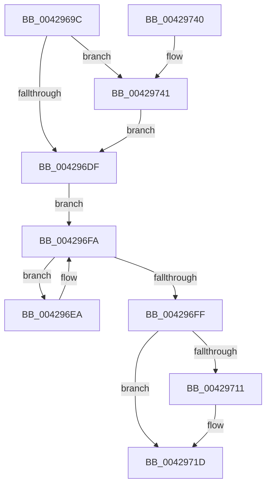

# VmpFaultEntryRemove

- RVA: `0x0042969C`–`0x0042974B` (길이 `175` bytes)
- VA: `0x000000014042969C`
- 실행 섹션: `.text`
- PDB 이름 있음: `예`; PDB Function 태그: `아니요`
- unwind 정보 RVA: `0x000841B4`
- 디코드: `47`개 명령, `175/175` bytes 표시
- 미해석 바이트: `0` (있으면 어셈블리에 `.byte`로 보존)

> 이 문서는 커널 이미지의 기계어와 PDB 기호를 분석해 생성했습니다. 4번과 5번은 함수 원형과 자료형을 바이너리 사용 방식에서 추정한 C 해석이며 원본 소스 복구 결과는 아닙니다.

## 1. Dependencies

- 직접 호출 지점: **5**; 고유 호출 대상: **5**
- 직접 호출자로 확인된 함수: **1**
- RIP 상대 이미지 참조: **1**

### Outgoing calls
- `0x004296E3` → [ExAcquireSpinLockExclusiveAtDpcLevel](../24/ExAcquireSpinLockExclusiveAtDpcLevel_function_00248E80.md) (function, `0x00248E80`)
- `0x004296F1` → [RtlRbRemoveNode](../2E/RtlRbRemoveNode_function_002E4C10.md) (function, `0x002E4C10`)
- `0x00429703` → [ExReleaseSpinLockExclusiveFromDpcLevel](../24/ExReleaseSpinLockExclusiveFromDpcLevel_function_002497E0.md) (function, `0x002497E0`)
- `0x00429718` → [KiLowerIrqlProcessIrqlFlags](../4F/KiLowerIrqlProcessIrqlFlags_function_004F5698.md) (function, `0x004F5698`)
- `0x00429744` → [KiRaiseIrqlProcessIrqlFlags](../4F/KiRaiseIrqlProcessIrqlFlags_function_004F56FC.md) (function, `0x004F56FC`)

### Direct callers
- [VmpAccessFaultBatch](VmpAccessFaultBatch_function_00429398.md) at `0x004294DD`
- [VmpAccessFaultBatch](VmpAccessFaultBatch_function_00429398.md) at `0x004294FA`

### Static image references
- `0x004296D6` → RVA `0x00FC6D20` (`ALMOSTRO`; read)

## 2. Other-region calls and transfers

- 다른 실행 섹션으로 향하는 call: **0**
- 별도 외부 분기/꼬리 이동을 확인하지 못했습니다.

## 3. Assembly (complete function range)

```asm
0042969C  48 8B C4                        mov rax, rsp
0042969F  48 89 58 08                     mov qword ptr [rax + 8], rbx
004296A3  48 89 68 10                     mov qword ptr [rax + 0x10], rbp
004296A7  48 89 70 18                     mov qword ptr [rax + 0x18], rsi
004296AB  48 89 78 20                     mov qword ptr [rax + 0x20], rdi
004296AF  41 56                           push r14
004296B1  48 83 EC 20                     sub rsp, 0x20
004296B5  41 8B C0                        mov eax, r8d
004296B8  48 8B DA                        mov rbx, rdx
004296BB  4C 8B F1                        mov r14, rcx
004296BE  48 8D 34 40                     lea rsi, [rax + rax*2]
004296C2  48 C1 E6 04                     shl rsi, 4
004296C6  48 03 F2                        add rsi, rdx
004296C9  44 0F 20 C7                     mov rdi, cr8
004296CD  BA 0F 00 00 00                  mov edx, 0xf
004296D2  44 0F 22 C2                     mov cr8, rdx
004296D6  83 3D 43 D6 B9 00 00            cmp dword ptr [rip + 0xb9d643], 0
004296DD  75 62                           jne 0x140429741
004296DF  49 8D 4E 60                     lea rcx, [r14 + 0x60]
004296E3  E8 98 F7 E1 FF                  call 0x140248e80
004296E8  EB 10                           jmp 0x1404296fa
004296EA  48 8B D3                        mov rdx, rbx
004296ED  49 8D 4E 50                     lea rcx, [r14 + 0x50]
004296F1  E8 1A B5 EB FF                  call 0x1402e4c10
004296F6  48 83 C3 30                     add rbx, 0x30
004296FA  48 3B DE                        cmp rbx, rsi
004296FD  72 EB                           jb 0x1404296ea
004296FF  49 8D 4E 60                     lea rcx, [r14 + 0x60]
00429703  E8 D8 00 E2 FF                  call 0x1402497e0
00429708  83 3D 11 D6 B9 00 00            cmp dword ptr [rip + 0xb9d611], 0
0042970F  74 0C                           je 0x14042971d
00429711  44 0F 20 C1                     mov rcx, cr8
00429715  40 8A D7                        mov dl, dil
00429718  E8 7B BF 0C 00                  call 0x1404f5698
0042971D  40 0F B6 C7                     movzx eax, dil
00429721  44 0F 22 C0                     mov cr8, rax
00429725  48 8B 5C 24 30                  mov rbx, qword ptr [rsp + 0x30]
0042972A  48 8B 6C 24 38                  mov rbp, qword ptr [rsp + 0x38]
0042972F  48 8B 74 24 40                  mov rsi, qword ptr [rsp + 0x40]
00429734  48 8B 7C 24 48                  mov rdi, qword ptr [rsp + 0x48]
00429739  48 83 C4 20                     add rsp, 0x20
0042973D  41 5E                           pop r14
0042973F  C3                              ret
00429740  CC                              int3
00429741  40 8A CF                        mov cl, dil
00429744  E8 B3 BF 0C 00                  call 0x1404f56fc
00429749  EB 94                           jmp 0x1404296df
```

## 4. C-style interpretation (structured pseudocode)

```c
__int64 __fastcall VmpFaultEntryRemove(__int64 a1, __int64 a2, int a3)
{
    __int64 result;
    __int64 v_rbx;
    __int64 v_rsi;
    __int64 v_rsp;
    unsigned __int64 v_stack_p10;
    unsigned __int64 v_stack_p18;
    unsigned __int64 v_stack_p20;
    unsigned __int64 v_stack_p8;

    *(unsigned __int64 *)(v_rsp + 8) = v_rbx;
    *(unsigned __int64 *)(v_rsp + 16) = v_rbp;
    *(unsigned __int64 *)(v_rsp + 24) = v_rsi;
    *(unsigned __int64 *)(v_rsp + 32) = v_rdi;
    v_rsp = (v_rsp) - (32);
    v_rsi = ((unsigned int)(a3) + (unsigned int)(a3) * 2) << (4);
    v_rsi = (v_rsi) + (a2);
    if ((*(unsigned int *)(v_rip + 12179011)) != 0) goto loc_00429741;
loc_004296DF:
    result = ExAcquireSpinLockExclusiveAtDpcLevel(a1 + 96, 15, a3, a4);
    goto loc_004296FA;
loc_004296EA:
    result = RtlRbRemoveNode(a1 + 80, a2, a3, a4);
    v_rbx = (a2) + (48);
loc_004296FA:
    if (v_rbx < v_rsi) goto loc_004296EA;
    result = ExReleaseSpinLockExclusiveFromDpcLevel(a1 + 96, a2, a3, a4);
    if ((*(unsigned int *)(v_rip + 12178961)) != 0) {
        a1 = 15;
        a2 = (unsigned __int8)(v_cr8);
        result = KiLowerIrqlProcessIrqlFlags(a1, a2, a3, a4);
    }
    v_rsp = (v_rsp) + (32);
    return (unsigned __int8)(v_cr8);
loc_00429741:
    result = KiRaiseIrqlProcessIrqlFlags((unsigned __int8)(v_stack_p20), a2, a3, a4);
    goto loc_004296DF;
}
```

## 5. (Beta) C Style

```c
int64_t VmpFaultEntryRemove(void *Arg1, int64_t Arg2, void *Arg3)
{
    uint8_t *arg1 = (uint8_t *)Arg1;
    uint8_t *arg3 = (uint8_t *)Arg3;

    int64_t result;
    int64_t local_rbx;
    int64_t local_rsi;
    int64_t local_rsp;
    uint64_t v_stack_p10;
    uint64_t v_stack_p18;
    uint64_t v_stack_p20;
    uint64_t v_stack_p8;

    *(uint64_t *)(local_rsp + 0x8) = local_rbx;
    *(uint64_t *)(local_rsp + 0x10) = local_rbp;
    *(uint64_t *)(local_rsp + 0x18) = local_rsi;
    *(uint64_t *)(local_rsp + 0x20) = local_rdi;
    local_rsp = (local_rsp) - (32);
    local_rsi = ((uint32_t)(Arg3) + (uint32_t)(Arg3) * 2) << (4);
    local_rsi = (local_rsi) + (Arg2);
    if ((*(uint32_t *)(v_rip + 0xB9D643)) != 0) goto loc_00429741;
loc_004296DF:
    result = ExAcquireSpinLockExclusiveAtDpcLevel(Arg1 + 96, 15, Arg3, a4);
    goto loc_004296FA;
loc_004296EA:
    result = RtlRbRemoveNode(Arg1 + 80, Arg2, Arg3, a4);
    local_rbx = (Arg2) + (48);
loc_004296FA:
    if (local_rbx < local_rsi) goto loc_004296EA;
    result = ExReleaseSpinLockExclusiveFromDpcLevel(Arg1 + 96, Arg2, Arg3, a4);
    if ((*(uint32_t *)(v_rip + 0xB9D611)) != 0) {
        Arg1 = 15;
        Arg2 = (uint8_t)(v_cr8);
        result = KiLowerIrqlProcessIrqlFlags(Arg1, Arg2, Arg3, a4);
    }
    local_rsp = (local_rsp) + (32);
    return (uint8_t)(v_cr8);
loc_00429741:
    result = KiRaiseIrqlProcessIrqlFlags((uint8_t)(v_stack_p20), Arg2, Arg3, a4);
    goto loc_004296DF;
}
```

### 관측된 메모리 오프셋

구조체 형식이 확인되지 않은 접근은 인자 기준의 오프셋으로만 기록했습니다.

| 기준 인자 | 오프셋 표현 | 폭 (bit) | 접근 |
|---|---:|---:|---|
| `Arg1` | `+ 0x50` | `64` | `R` |
| `Arg1` | `+ 0x60` | `64` | `R` |
| `Arg3` | `+ 0x0 + rax*2` | `64` | `R` |

## 6. Execution-region graph

[열기: 2D/3D 그래프와 함수 탐색 컨트롤 패널](../../../control-panel.html?section=text&rva=0x0042969C&view=graph)

- 2D 그래프는 위에서 아래로 흐르고, 3D 그래프는 빈 공간을 드래그해 회전합니다. Shift+드래그는 이동, 휠은 확대·축소, 함수 노드 선택은 대상 보고서 이동입니다.

### Static fallback


