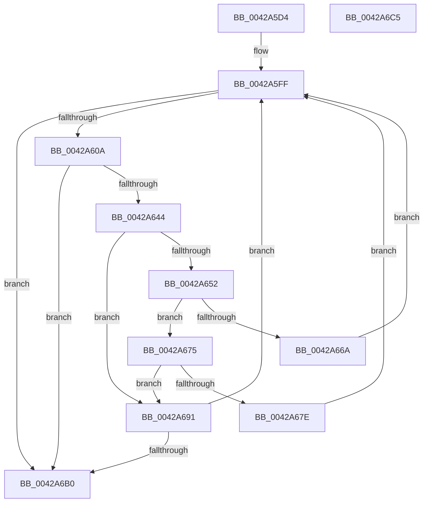

# VmpFillGpnRanges

- RVA: `0x0042A5D4`–`0x0042A6C6` (길이 `242` bytes)
- VA: `0x000000014042A5D4`
- 실행 섹션: `.text`
- PDB 이름 있음: `예`; PDB Function 태그: `아니요`
- unwind 정보 RVA: `0x000A1020`
- 디코드: `62`개 명령, `242/242` bytes 표시
- 미해석 바이트: `0` (있으면 어셈블리에 `.byte`로 보존)

> 이 문서는 커널 이미지의 기계어와 PDB 기호를 분석해 생성했습니다. 4번과 5번은 함수 원형과 자료형을 바이너리 사용 방식에서 추정한 C 해석이며 원본 소스 복구 결과는 아닙니다.

## 1. Dependencies

- 직접 호출 지점: **1**; 고유 호출 대상: **1**
- 직접 호출자로 확인된 함수: **1**
- RIP 상대 이미지 참조: **0**

### Outgoing calls
- `0x0042A635` → [VmpConvertPortionVpnRangeToGpnRange](../31/VmpConvertPortionVpnRangeToGpnRange_function_003147F0.md) (function, `0x003147F0`)

### Direct callers
- [VmpPrefetchVirtualAddresses](VmpPrefetchVirtualAddresses_function_00428844.md) at `0x00428956`

### Static image references
- 디코드된 RIP-relative 메모리 참조가 없습니다.

## 2. Other-region calls and transfers

- 다른 실행 섹션으로 향하는 call: **0**
- 별도 외부 분기/꼬리 이동을 확인하지 못했습니다.

## 3. Assembly (complete function range)

```asm
0042A5D4  48 8B C4                        mov rax, rsp
0042A5D7  48 89 58 08                     mov qword ptr [rax + 8], rbx
0042A5DB  48 89 68 18                     mov qword ptr [rax + 0x18], rbp
0042A5DF  48 89 70 20                     mov qword ptr [rax + 0x20], rsi
0042A5E3  57                              push rdi
0042A5E4  48 83 EC 50                     sub rsp, 0x50
0042A5E8  83 60 10 00                     and dword ptr [rax + 0x10], 0
0042A5EC  0F 57 C0                        xorps xmm0, xmm0
0042A5EF  0F 11 40 E8                     movups xmmword ptr [rax - 0x18], xmm0
0042A5F3  49 8B F1                        mov rsi, r9
0042A5F6  49 8B D8                        mov rbx, r8
0042A5F9  48 8B FA                        mov rdi, rdx
0042A5FC  48 8B E9                        mov rbp, rcx
0042A5FF  48 83 7F 08 00                  cmp qword ptr [rdi + 8], 0
0042A604  0F 84 A6 00 00 00               je 0x14042a6b0
0042A60A  83 64 24 30 00                  and dword ptr [rsp + 0x30], 0
0042A60F  48 8D 44 24 68                  lea rax, [rsp + 0x68]
0042A614  4C 8B 8C 24 88 00 00 00         mov r9, qword ptr [rsp + 0x88]
0042A61C  49 83 C8 FF                     or r8, 0xffffffffffffffff
0042A620  48 89 44 24 28                  mov qword ptr [rsp + 0x28], rax
0042A625  48 8B D7                        mov rdx, rdi
0042A628  48 8D 44 24 40                  lea rax, [rsp + 0x40]
0042A62D  48 8B CD                        mov rcx, rbp
0042A630  48 89 44 24 20                  mov qword ptr [rsp + 0x20], rax
0042A635  E8 B6 A1 EE FF                  call 0x1403147f0
0042A63A  4C 8B 44 24 48                  mov r8, qword ptr [rsp + 0x48]
0042A63F  4D 85 C0                        test r8, r8
0042A642  74 6C                           je 0x14042a6b0
0042A644  48 8B 16                        mov rdx, qword ptr [rsi]
0042A647  48 8B CA                        mov rcx, rdx
0042A64A  48 03 C9                        add rcx, rcx
0042A64D  48 85 D2                        test rdx, rdx
0042A650  74 3F                           je 0x14042a691
0042A652  4C 8B 4C CB F8                  mov r9, qword ptr [rbx + rcx*8 - 8]
0042A657  4C 8B 5C CB F0                  mov r11, qword ptr [rbx + rcx*8 - 0x10]
0042A65C  4C 8B 54 24 40                  mov r10, qword ptr [rsp + 0x40]
0042A661  4B 8D 04 0B                     lea rax, [r11 + r9]
0042A665  49 3B C2                        cmp rax, r10
0042A668  75 0B                           jne 0x14042a675
0042A66A  4B 8D 04 01                     lea rax, [r9 + r8]
0042A66E  48 89 44 CB F8                  mov qword ptr [rbx + rcx*8 - 8], rax
0042A673  EB 8A                           jmp 0x14042a5ff
0042A675  4B 8D 04 02                     lea rax, [r10 + r8]
0042A679  4C 3B D8                        cmp r11, rax
0042A67C  75 13                           jne 0x14042a691
0042A67E  4B 8D 04 01                     lea rax, [r9 + r8]
0042A682  4C 89 54 CB F0                  mov qword ptr [rbx + rcx*8 - 0x10], r10
0042A687  48 89 44 CB F8                  mov qword ptr [rbx + rcx*8 - 8], rax
0042A68C  E9 6E FF FF FF                  jmp 0x14042a5ff
0042A691  0F 10 44 24 40                  movups xmm0, xmmword ptr [rsp + 0x40]
0042A696  48 8D 42 01                     lea rax, [rdx + 1]
0042A69A  48 89 06                        mov qword ptr [rsi], rax
0042A69D  F3 0F 7F 04 CB                  movdqu xmmword ptr [rbx + rcx*8], xmm0
0042A6A2  48 3B 84 24 80 00 00 00         cmp rax, qword ptr [rsp + 0x80]
0042A6AA  0F 85 4F FF FF FF               jne 0x14042a5ff
0042A6B0  48 8B 5C 24 60                  mov rbx, qword ptr [rsp + 0x60]
0042A6B5  48 8B 6C 24 70                  mov rbp, qword ptr [rsp + 0x70]
0042A6BA  48 8B 74 24 78                  mov rsi, qword ptr [rsp + 0x78]
0042A6BF  48 83 C4 50                     add rsp, 0x50
0042A6C3  5F                              pop rdi
0042A6C4  C3                              ret
0042A6C5  CC                              int3
```

## 4. C-style interpretation (structured pseudocode)

```c
__int64 __fastcall VmpFillGpnRanges(__int64 a1, __int64 a2, __int64 a3, __int64 a4, __int64 a5, __int64 a6)
{
    __int64 result;
    __int64 v_rsp;
    unsigned __int64 v_stack_m10;
    unsigned __int64 v_stack_m18;
    unsigned int v_stack_m28;
    unsigned __int64 v_stack_m30;
    unsigned __int64 v_stack_m38;
    unsigned __int64 v_stack_p10;
    unsigned __int64 v_stack_p18;
    unsigned __int64 v_stack_p20;
    unsigned __int64 v_stack_p8;

    *(unsigned __int64 *)(v_rsp + 8) = v_rbx;
    *(unsigned __int64 *)(v_rsp + 24) = v_rbp;
    *(unsigned __int64 *)(v_rsp + 32) = v_rsi;
    v_rsp = (v_rsp) - (80);
    *(unsigned __int64 *)(v_rsp - 24) = v_xmm0;
loc_0042A5FF:
    if ((*(unsigned __int64 *)(a2 + 8)) == 0) goto loc_0042A6B0;
    a3 = (a3) | (-1);
    v_stack_m30 = v_stack_p10;
    v_stack_m38 = v_stack_m18;
    result = VmpConvertPortionVpnRangeToGpnRange(a1, a2, a3, a6);
    if (v_stack_m10 == 0) goto loc_0042A6B0;
    a1 = (*(unsigned __int64 *)(a4)) + (*(unsigned __int64 *)(a4));
    if (*(unsigned __int64 *)(a4) == 0) goto loc_0042A691;
    if ((*(unsigned __int64 *)(a3 + a1 * 8 - 16) + *(unsigned __int64 *)(a3 + a1 * 8 - 8) * 1) != v_stack_m18) goto loc_0042A675;
    *(unsigned __int64 *)(a3 + a1 * 8 - 8) = *(unsigned __int64 *)(a3 + a1 * 8 - 8) + v_stack_m10 * 1;
    goto loc_0042A5FF;
loc_0042A675:
    if ((*(unsigned __int64 *)(a3 + a1 * 8 - 16)) != (v_stack_m18 + v_stack_m10 * 1)) goto loc_0042A691;
    *(unsigned __int64 *)(a3 + a1 * 8 - 16) = v_stack_m18;
    *(unsigned __int64 *)(a3 + a1 * 8 - 8) = *(unsigned __int64 *)(a3 + a1 * 8 - 8) + v_stack_m10 * 1;
    goto loc_0042A5FF;
loc_0042A691:
    *(unsigned __int64 *)(a4) = *(unsigned __int64 *)(a4) + 1;
    *(unsigned __int64 *)(a3 + a1 * 8) = v_xmm0;
    if ((*(unsigned __int64 *)(a4) + 1) != a5) goto loc_0042A5FF;
loc_0042A6B0:
    v_rsp = (v_rsp) + (80);
    return *(unsigned __int64 *)(a4) + 1;
}
```

## 5. (Beta) C Style

```c
int64_t VmpFillGpnRanges(int64_t Arg1, void *Arg2, void *Arg3, void *Arg4, int64_t Arg5, int64_t Arg6)
{
    uint8_t *arg2 = (uint8_t *)Arg2;
    uint8_t *arg3 = (uint8_t *)Arg3;
    uint8_t *arg4 = (uint8_t *)Arg4;

    int64_t result;
    int64_t local_rsp;
    uint64_t v_stack_m10;
    uint64_t v_stack_m18;
    uint32_t v_stack_m28;
    uint64_t v_stack_m30;
    uint64_t v_stack_m38;
    uint64_t v_stack_p10;
    uint64_t v_stack_p18;
    uint64_t v_stack_p20;
    uint64_t v_stack_p8;

    *(uint64_t *)(local_rsp + 0x8) = local_rbx;
    *(uint64_t *)(local_rsp + 0x18) = local_rbp;
    *(uint64_t *)(local_rsp + 0x20) = local_rsi;
    local_rsp = (local_rsp) - (80);
    *(uint64_t *)(local_rsp - 0x18) = v_xmm0;
loc_0042A5FF:
    if ((*(uint64_t *)(arg2 + 0x8)) == 0) goto loc_0042A6B0;
    Arg3 = (Arg3) | (-1);
    v_stack_m30 = v_stack_p10;
    v_stack_m38 = v_stack_m18;
    result = VmpConvertPortionVpnRangeToGpnRange(Arg1, Arg2, Arg3, Arg6);
    if (v_stack_m10 == 0) goto loc_0042A6B0;
    Arg1 = (*(uint64_t *)(arg4)) + (*(uint64_t *)(arg4));
    if (*(uint64_t *)(arg4) == 0) goto loc_0042A691;
    if ((*(uint64_t *)(arg3 + Arg1 * 8 - 0x10) + *(uint64_t *)(arg3 + Arg1 * 8 - 0x8) * 1) != v_stack_m18) goto loc_0042A675;
    *(uint64_t *)(arg3 + Arg1 * 8 - 0x8) = *(uint64_t *)(arg3 + Arg1 * 8 - 0x8) + v_stack_m10 * 1;
    goto loc_0042A5FF;
loc_0042A675:
    if ((*(uint64_t *)(arg3 + Arg1 * 8 - 0x10)) != (v_stack_m18 + v_stack_m10 * 1)) goto loc_0042A691;
    *(uint64_t *)(arg3 + Arg1 * 8 - 0x10) = v_stack_m18;
    *(uint64_t *)(arg3 + Arg1 * 8 - 0x8) = *(uint64_t *)(arg3 + Arg1 * 8 - 0x8) + v_stack_m10 * 1;
    goto loc_0042A5FF;
loc_0042A691:
    *(uint64_t *)(arg4) = *(uint64_t *)(arg4) + 1;
    *(uint64_t *)(arg3 + Arg1 * 8) = v_xmm0;
    if ((*(uint64_t *)(arg4) + 1) != Arg5) goto loc_0042A5FF;
loc_0042A6B0:
    local_rsp = (local_rsp) + (80);
    return *(uint64_t *)(arg4) + 1;
}
```

### 관측된 메모리 오프셋

구조체 형식이 확인되지 않은 접근은 인자 기준의 오프셋으로만 기록했습니다.

| 기준 인자 | 오프셋 표현 | 폭 (bit) | 접근 |
|---|---:|---:|---|
| `Arg2` | `+ 0x8` | `64` | `R` |
| `Arg3` | `- 0x10 + rcx*8` | `64` | `R` |
| `Arg3` | `- 0x10 + rcx*8` | `64` | `W` |
| `Arg3` | `- 0x8 + rcx*8` | `64` | `R` |
| `Arg3` | `- 0x8 + rcx*8` | `64` | `W` |
| `Arg3` | `+ 0x0 + rcx*8` | `128` | `W` |
| `Arg4` | `+ 0x0` | `64` | `R` |
| `Arg4` | `+ 0x0` | `64` | `W` |

## 6. Execution-region graph

[열기: 2D/3D 그래프와 함수 탐색 컨트롤 패널](../../../control-panel.html?section=text&rva=0x0042A5D4&view=graph)

- 2D 그래프는 위에서 아래로 흐르고, 3D 그래프는 빈 공간을 드래그해 회전합니다. Shift+드래그는 이동, 휠은 확대·축소, 함수 노드 선택은 대상 보고서 이동입니다.

### Static fallback


