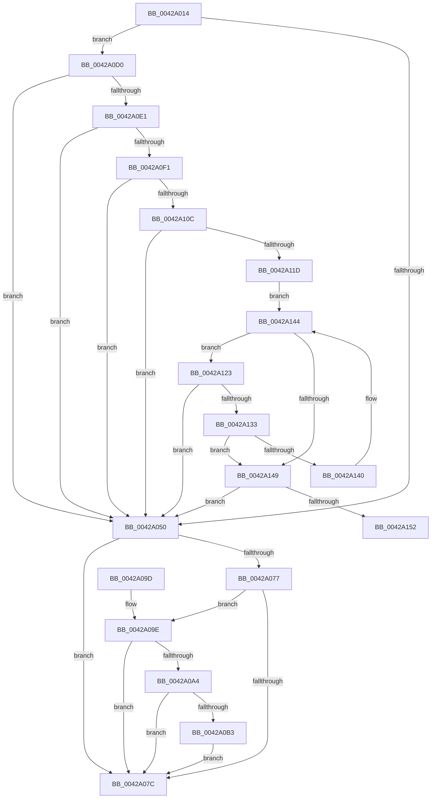

# VmpFillSlat

- RVA: `0x0042A014`–`0x0042A157` (길이 `323` bytes)
- VA: `0x000000014042A014`
- 실행 섹션: `.text`
- PDB 이름 있음: `예`; PDB Function 태그: `예`
- unwind 정보 RVA: `0x000A0F80`
- 디코드: `87`개 명령, `323/323` bytes 표시
- 미해석 바이트: `0` (있으면 어셈블리에 `.byte`로 보존)

> 이 문서는 커널 이미지의 기계어와 PDB 기호를 분석해 생성했습니다. 4번과 5번은 함수 원형과 자료형을 바이너리 사용 방식에서 추정한 C 해석이며 원본 소스 복구 결과는 아닙니다.

## 1. Dependencies

- 직접 호출 지점: **2**; 고유 호출 대상: **2**
- 직접 호출자로 확인된 함수: **1**
- RIP 상대 이미지 참조: **1**

### Outgoing calls
- `0x0042A064` → [HvlMapSparseGpaPages](HvlMapSparseGpaPages_function_0042A160.md) (function, `0x0042A160`)
- `0x0042A0C9` → [VmpLogSparseSlatFill](../64/VmpLogSparseSlatFill_function_0064DC38.md) (function, `0x0064DC38`)

### Direct callers
- [VmpProcessUpdateSlat](VmpProcessUpdateSlat_function_00429E54.md) at `0x00429FA3`
- [VmpProcessUpdateSlat](VmpProcessUpdateSlat_function_00429E54.md) at `0x0042A001`

### Static image references
- `0x0042A069` → RVA `0x00F02458` (`.data`; read)

## 2. Other-region calls and transfers

- 다른 실행 섹션으로 향하는 call: **0**
- call이 아닌 외부 분기/꼬리 이동: **1**
  - `0x0042A152` → [sub_006EE22C](../6E/Unknown_function_006EE22C.md) (`tail-transfer`)

## 3. Assembly (complete function range)

```asm
0042A014  48 8B C4                        mov rax, rsp
0042A017  48 89 58 08                     mov qword ptr [rax + 8], rbx
0042A01B  48 89 68 10                     mov qword ptr [rax + 0x10], rbp
0042A01F  48 89 70 18                     mov qword ptr [rax + 0x18], rsi
0042A023  48 89 78 20                     mov qword ptr [rax + 0x20], rdi
0042A027  41 54                           push r12
0042A029  41 56                           push r14
0042A02B  41 57                           push r15
0042A02D  48 83 EC 30                     sub rsp, 0x30
0042A031  49 8B D9                        mov rbx, r9
0042A034  49 8B F0                        mov rsi, r8
0042A037  44 8B F2                        mov r14d, edx
0042A03A  48 8B E9                        mov rbp, rcx
0042A03D  41 BC 01 00 00 00               mov r12d, 1
0042A043  49 81 F8 00 02 00 00            cmp r8, 0x200
0042A04A  0F 84 80 00 00 00               je 0x14042a0d0
0042A050  48 8B 44 24 70                  mov rax, qword ptr [rsp + 0x70]
0042A055  4C 8B C6                        mov r8, rsi
0042A058  48 8B 4D 68                     mov rcx, qword ptr [rbp + 0x68]
0042A05C  41 8B D6                        mov edx, r14d
0042A05F  48 89 44 24 20                  mov qword ptr [rsp + 0x20], rax
0042A064  E8 F7 00 00 00                  call 0x14042a160
0042A069  48 8B 0D E8 83 AD 00            mov rcx, qword ptr [rip + 0xad83e8]
0042A070  8B F8                           mov edi, eax
0042A072  48 85 C9                        test rcx, rcx
0042A075  74 05                           je 0x14042a07c
0042A077  83 39 00                        cmp dword ptr [rcx], 0
0042A07A  77 22                           ja 0x14042a09e
0042A07C  48 8B 5C 24 50                  mov rbx, qword ptr [rsp + 0x50]
0042A081  8B C7                           mov eax, edi
0042A083  48 8B 7C 24 68                  mov rdi, qword ptr [rsp + 0x68]
0042A088  48 8B 6C 24 58                  mov rbp, qword ptr [rsp + 0x58]
0042A08D  48 8B 74 24 60                  mov rsi, qword ptr [rsp + 0x60]
0042A092  48 83 C4 30                     add rsp, 0x30
0042A096  41 5F                           pop r15
0042A098  41 5E                           pop r14
0042A09A  41 5C                           pop r12
0042A09C  C3                              ret
0042A09D  CC                              int3
0042A09E  44 84 61 10                     test byte ptr [rcx + 0x10], r12b
0042A0A2  74 D8                           je 0x14042a07c
0042A0A4  48 8B 49 18                     mov rcx, qword ptr [rcx + 0x18]
0042A0A8  48 8B C1                        mov rax, rcx
0042A0AB  49 23 C4                        and rax, r12
0042A0AE  48 3B C1                        cmp rax, rcx
0042A0B1  75 C9                           jne 0x14042a07c
0042A0B3  48 8B 45 68                     mov rax, qword ptr [rbp + 0x68]
0042A0B7  45 8B CE                        mov r9d, r14d
0042A0BA  89 7C 24 28                     mov dword ptr [rsp + 0x28], edi
0042A0BE  44 8B C6                        mov r8d, esi
0042A0C1  48 8B D3                        mov rdx, rbx
0042A0C4  48 89 44 24 20                  mov qword ptr [rsp + 0x20], rax
0042A0C9  E8 6A 3B 22 00                  call 0x14064dc38
0042A0CE  EB AC                           jmp 0x14042a07c
0042A0D0  49 8B 09                        mov rcx, qword ptr [r9]
0042A0D3  B8 FF 01 00 00                  mov eax, 0x1ff
0042A0D8  48 85 C8                        test rax, rcx
0042A0DB  0F 85 6F FF FF FF               jne 0x14042a050
0042A0E1  4D 8D 79 08                     lea r15, [r9 + 8]
0042A0E5  4D 8B 07                        mov r8, qword ptr [r15]
0042A0E8  4C 85 C0                        test rax, r8
0042A0EB  0F 85 5F FF FF FF               jne 0x14042a050
0042A0F1  48 8B D6                        mov rdx, rsi
0042A0F4  48 8D 81 FF 01 00 00            lea rax, [rcx + 0x1ff]
0042A0FB  48 C1 E2 04                     shl rdx, 4
0042A0FF  48 03 D3                        add rdx, rbx
0042A102  48 39 42 F0                     cmp qword ptr [rdx - 0x10], rax
0042A106  0F 85 44 FF FF FF               jne 0x14042a050
0042A10C  49 8D 80 FF 01 00 00            lea rax, [r8 + 0x1ff]
0042A113  48 39 42 F8                     cmp qword ptr [rdx - 8], rax
0042A117  0F 85 33 FF FF FF               jne 0x14042a050
0042A11D  49 8D 49 10                     lea rcx, [r9 + 0x10]
0042A121  EB 21                           jmp 0x14042a144
0042A123  48 8B 41 F0                     mov rax, qword ptr [rcx - 0x10]
0042A127  49 03 C4                        add rax, r12
0042A12A  48 39 01                        cmp qword ptr [rcx], rax
0042A12D  0F 85 1D FF FF FF               jne 0x14042a050
0042A133  48 8B 41 F8                     mov rax, qword ptr [rcx - 8]
0042A137  49 03 C4                        add rax, r12
0042A13A  48 39 41 08                     cmp qword ptr [rcx + 8], rax
0042A13E  75 09                           jne 0x14042a149
0042A140  48 83 C1 10                     add rcx, 0x10
0042A144  48 3B CA                        cmp rcx, rdx
0042A147  72 DA                           jb 0x14042a123
0042A149  48 3B CA                        cmp rcx, rdx
0042A14C  0F 85 FE FE FF FF               jne 0x14042a050
0042A152  E9 D5 40 2C 00                  jmp 0x1406ee22c
```

## 4. C-style interpretation (structured pseudocode)

```c
__int64 __fastcall VmpFillSlat(__int64 a1, int a2, __int64 a3, __int64 a4, __int64 a5)
{
    __int64 result;
    __int64 v_rsp;
    unsigned __int64 v_stack_m28;
    unsigned __int64 v_stack_p10;
    unsigned __int64 v_stack_p18;
    unsigned __int64 v_stack_p20;
    unsigned int v_stack_p28;
    unsigned __int64 v_stack_p8;

    *(unsigned __int64 *)(v_rsp + 8) = v_rbx;
    *(unsigned __int64 *)(v_rsp + 16) = v_rbp;
    *(unsigned __int64 *)(v_rsp + 24) = v_rsi;
    *(unsigned __int64 *)(v_rsp + 32) = v_rdi;
    v_rsp = (v_rsp) - (48);
    if (a3 == 512) goto loc_0042A0D0;
loc_0042A050:
    v_stack_m28 = a5;
    result = HvlMapSparseGpaPages(*(unsigned __int64 *)(a1 + 104), (unsigned int)((unsigned int)((unsigned int)(a2))), a3, a4);
    if (*(unsigned __int64 *)(v_rip + 11371496) == 0) goto loc_0042A07C;
    if ((*(unsigned int *)(*(unsigned __int64 *)(v_rip + 11371496))) > 0) goto loc_0042A09E;
loc_0042A07C:
    v_rsp = (v_rsp) + (48);
    return (unsigned int)((unsigned int)((unsigned int)((unsigned int)(result))));
loc_0042A09E:
    if (((*(unsigned __int8 *)(*(unsigned __int64 *)(v_rip + 11371496) + 16)) & (1)) == 0) goto loc_0042A07C;
    result = (*(unsigned __int64 *)(*(unsigned __int64 *)(v_rip + 11371496) + 24)) & (1);
    if (result != (*(unsigned __int64 *)(*(unsigned __int64 *)(v_rip + 11371496) + 24))) goto loc_0042A07C;
    v_stack_p28 = (unsigned int)(v_stack_p20);
    v_stack_p20 = *(unsigned __int64 *)(v_stack_p10 + 104);
    result = VmpLogSparseSlatFill(*(unsigned __int64 *)(*(unsigned __int64 *)(v_rip + 11371496) + 24), v_stack_p8, (unsigned int)((unsigned int)(v_stack_p18)), (unsigned int)((unsigned int)((unsigned int)(a2))));
    goto loc_0042A07C;
loc_0042A0D0:
    if (((511) & (*(unsigned __int64 *)((unsigned int)((unsigned int)((unsigned int)(a2)))))) != 0) goto loc_0042A050;
    if (((511) & (*(unsigned __int64 *)((unsigned int)((unsigned int)((unsigned int)(a2))) + 8))) != 0) goto loc_0042A050;
    a2 = (v_stack_p18) << (4);
    a2 = (a2) + (v_stack_p8);
    if ((*(unsigned __int64 *)(a2 - 16)) != (*(unsigned __int64 *)((unsigned int)((unsigned int)((unsigned int)(a2)))) + 511)) goto loc_0042A050;
    if ((*(unsigned __int64 *)(a2 - 8)) != (*(unsigned __int64 *)((unsigned int)((unsigned int)((unsigned int)(a2))) + 8) + 511)) goto loc_0042A050;
    goto loc_0042A144;
loc_0042A123:
    result = (*(unsigned __int64 *)((unsigned int)((unsigned int)((unsigned int)(a2))) + 16 - 16)) + (1);
    if ((*(unsigned __int64 *)((unsigned int)((unsigned int)((unsigned int)(a2))) + 16)) != result) goto loc_0042A050;
    result = (*(unsigned __int64 *)((unsigned int)((unsigned int)((unsigned int)(a2))) + 16 - 8)) + (1);
    if ((*(unsigned __int64 *)((unsigned int)((unsigned int)((unsigned int)(a2))) + 16 + 8)) != result) goto loc_0042A149;
    a1 = ((unsigned int)((unsigned int)((unsigned int)(a2))) + 16) + (16);
loc_0042A144:
    if (a1 < a2) goto loc_0042A123;
loc_0042A149:
    if (a1 != a2) goto loc_0042A050;
}
```

## 5. (Beta) C Style

```c
int64_t VmpFillSlat(void *Arg1, int32_t Arg2, int64_t Arg3, void *Arg4, int64_t Arg5)
{
    uint8_t *arg1 = (uint8_t *)Arg1;
    uint8_t *arg4 = (uint8_t *)Arg4;

    int64_t result;
    int64_t local_rsp;
    uint64_t v_stack_m28;
    uint64_t v_stack_p10;
    uint64_t v_stack_p18;
    uint64_t v_stack_p20;
    uint32_t v_stack_p28;
    uint64_t v_stack_p8;

    *(uint64_t *)(local_rsp + 0x8) = local_rbx;
    *(uint64_t *)(local_rsp + 0x10) = local_rbp;
    *(uint64_t *)(local_rsp + 0x18) = local_rsi;
    *(uint64_t *)(local_rsp + 0x20) = local_rdi;
    local_rsp = (local_rsp) - (48);
    if (Arg3 == 512) goto loc_0042A0D0;
loc_0042A050:
    v_stack_m28 = Arg5;
    result = HvlMapSparseGpaPages(*(uint64_t *)(arg1 + 0x68), (uint32_t)((uint32_t)((uint32_t)(Arg2))), Arg3, Arg4);
    if (*(uint64_t *)(v_rip + 0xAD83E8) == 0) goto loc_0042A07C;
    if ((*(uint32_t *)(*(uint64_t *)(v_rip + 0xAD83E8))) > 0) goto loc_0042A09E;
loc_0042A07C:
    local_rsp = (local_rsp) + (48);
    return (uint32_t)((uint32_t)((uint32_t)((uint32_t)(result))));
loc_0042A09E:
    if (((*(uint8_t *)(*(uint64_t *)(v_rip + 0xAD83E8) + 0x10)) & (1)) == 0) goto loc_0042A07C;
    result = (*(uint64_t *)(*(uint64_t *)(v_rip + 0xAD83E8) + 0x18)) & (1);
    if (result != (*(uint64_t *)(*(uint64_t *)(v_rip + 0xAD83E8) + 0x18))) goto loc_0042A07C;
    v_stack_p28 = (uint32_t)(v_stack_p20);
    v_stack_p20 = *(uint64_t *)(v_stack_p10 + 0x68);
    result = VmpLogSparseSlatFill(*(uint64_t *)(*(uint64_t *)(v_rip + 0xAD83E8) + 0x18), v_stack_p8, (uint32_t)((uint32_t)(v_stack_p18)), (uint32_t)((uint32_t)((uint32_t)(Arg2))));
    goto loc_0042A07C;
loc_0042A0D0:
    if (((511) & (*(uint64_t *)((uint32_t)((uint32_t)((uint32_t)(Arg2)))))) != 0) goto loc_0042A050;
    if (((511) & (*(uint64_t *)((uint32_t)((uint32_t)((uint32_t)(Arg2))) + 0x8))) != 0) goto loc_0042A050;
    Arg2 = (v_stack_p18) << (4);
    Arg2 = (Arg2) + (v_stack_p8);
    if ((*(uint64_t *)(Arg2 - 0x10)) != (*(uint64_t *)((uint32_t)((uint32_t)((uint32_t)(Arg2)))) + 511)) goto loc_0042A050;
    if ((*(uint64_t *)(Arg2 - 0x8)) != (*(uint64_t *)((uint32_t)((uint32_t)((uint32_t)(Arg2))) + 0x8) + 511)) goto loc_0042A050;
    goto loc_0042A144;
loc_0042A123:
    result = (*(uint64_t *)((uint32_t)((uint32_t)((uint32_t)(Arg2))) + 0x10 - 0x10)) + (1);
    if ((*(uint64_t *)((uint32_t)((uint32_t)((uint32_t)(Arg2))) + 0x10)) != result) goto loc_0042A050;
    result = (*(uint64_t *)((uint32_t)((uint32_t)((uint32_t)(Arg2))) + 0x10 - 0x8)) + (1);
    if ((*(uint64_t *)((uint32_t)((uint32_t)((uint32_t)(Arg2))) + 0x10 + 0x8)) != result) goto loc_0042A149;
    Arg1 = ((uint32_t)((uint32_t)((uint32_t)(Arg2))) + 16) + (16);
loc_0042A144:
    if (Arg1 < Arg2) goto loc_0042A123;
loc_0042A149:
    if (Arg1 != Arg2) goto loc_0042A050;
}
```

### 관측된 메모리 오프셋

구조체 형식이 확인되지 않은 접근은 인자 기준의 오프셋으로만 기록했습니다.

| 기준 인자 | 오프셋 표현 | 폭 (bit) | 접근 |
|---|---:|---:|---|
| `Arg1` | `+ 0x68` | `64` | `R` |
| `Arg4` | `+ 0x0` | `64` | `R` |
| `Arg4` | `+ 0x8` | `64` | `R` |
| `Arg4` | `+ 0x10` | `64` | `R` |

## 6. Execution-region graph

[열기: 2D/3D 그래프와 함수 탐색 컨트롤 패널](../../../control-panel.html?section=text&rva=0x0042A014&view=graph)

- 2D 그래프는 위에서 아래로 흐르고, 3D 그래프는 빈 공간을 드래그해 회전합니다. Shift+드래그는 이동, 휠은 확대·축소, 함수 노드 선택은 대상 보고서 이동입니다.

### Static fallback


