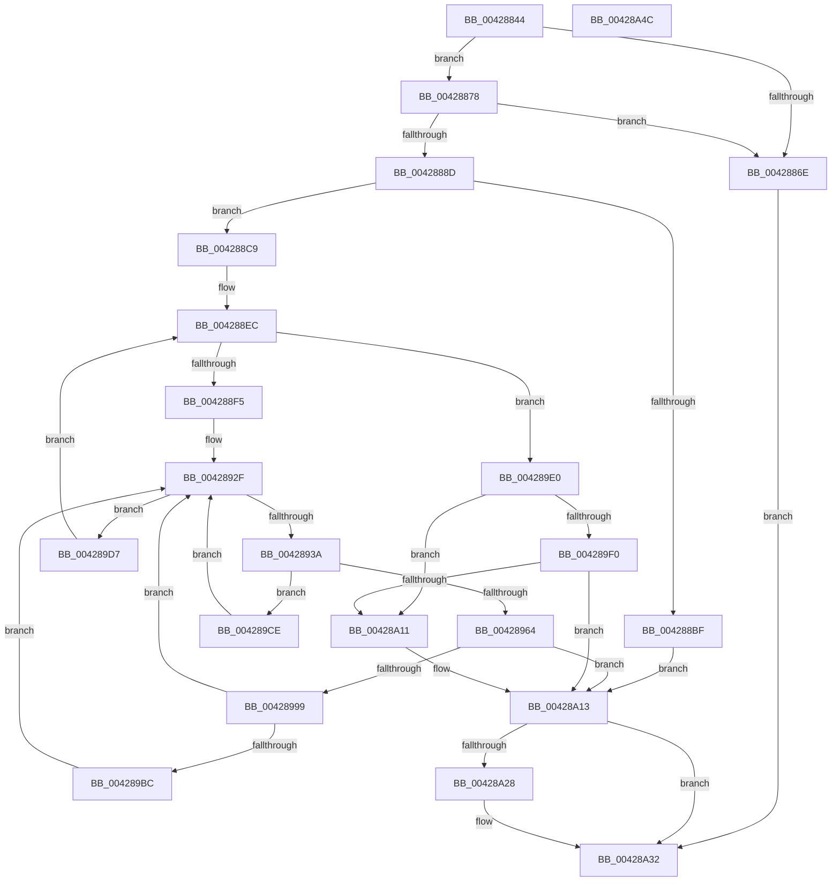

# VmpPrefetchVirtualAddresses

- RVA: `0x00428844`–`0x00428A4D` (길이 `521` bytes)
- VA: `0x0000000140428844`
- 실행 섹션: `.text`
- PDB 이름 있음: `예`; PDB Function 태그: `아니요`
- unwind 정보 RVA: `0x000A0D74`
- 디코드: `147`개 명령, `521/521` bytes 표시
- 미해석 바이트: `0` (있으면 어셈블리에 `.byte`로 보존)

> 이 문서는 커널 이미지의 기계어와 PDB 기호를 분석해 생성했습니다. 4번과 5번은 함수 원형과 자료형을 바이너리 사용 방식에서 추정한 C 해석이며 원본 소스 복구 결과는 아닙니다.

## 1. Dependencies

- 직접 호출 지점: **11**; 고유 호출 대상: **8**
- 직접 호출자로 확인된 함수: **2**
- RIP 상대 이미지 참조: **1**

### Outgoing calls
- `0x0042887F` → [ExGetExtensionTable](ExGetExtensionTable_function_00428814.md) (function, `0x00428814`)
- `0x004288B2` → [ExAllocatePool2](../../poolcode/B8/ExAllocatePool2_function_00B820F0.md) (function, `0x00B820F0`)
- `0x004288E0` → [VmpProcessContextLockShared](VmpProcessContextLockShared_function_00429DB0.md) (function, `0x00429DB0`)
- `0x00428956` → [VmpFillGpnRanges](VmpFillGpnRanges_function_0042A5D4.md) (function, `0x0042A5D4`)
- `0x00428973` → [VmpProcessContextUnlockShared](VmpProcessContextUnlockShared_function_00429DFC.md) (function, `0x00429DFC`)
- `0x0042898E` → [guard_dispatch_icall](../6B/guard_dispatch_icall_function_006BAAD0.md) (function, `0x006BAAD0`)
- `0x004289A2` → [VmpProcessContextLockShared](VmpProcessContextLockShared_function_00429DB0.md) (function, `0x00429DB0`)
- `0x004289E6` → [VmpProcessContextUnlockShared](VmpProcessContextUnlockShared_function_00429DFC.md) (function, `0x00429DFC`)
- `0x00428A06` → [guard_dispatch_icall](../6B/guard_dispatch_icall_function_006BAAD0.md) (function, `0x006BAAD0`)
- `0x00428A1E` → [ExReleaseRundownProtection](../34/ExReleaseRundownProtection_function_00349E80.md) (function, `0x00349E80`)
- `0x00428A2D` → [ExFreePoolWithTag](../../poolcode/B8/ExFreePoolWithTag_function_00B82870.md) (function, `0x00B82870`)

### Direct callers
- [VmPrefetchVirtualAddresses](../../page/7A/VmPrefetchVirtualAddresses_function_007ACE98.md) at `0x007ACEEA`
- [VmpPrefetchWorker](../../page/7A/VmpPrefetchWorker_function_007ADD20.md) at `0x007ADD6B`

### Static image references
- `0x00428878` → RVA `0x00F02460` (`.data`; read)

## 2. Other-region calls and transfers

- 다른 실행 섹션으로 향하는 call: **2**
  - `0x004288B2` → [ExAllocatePool2](../../poolcode/B8/ExAllocatePool2_function_00B820F0.md) (`.text` → `POOLCODE`)
  - `0x00428A2D` → [ExFreePoolWithTag](../../poolcode/B8/ExFreePoolWithTag_function_00B82870.md) (`.text` → `POOLCODE`)
- 별도 외부 분기/꼬리 이동을 확인하지 못했습니다.

## 3. Assembly (complete function range)

```asm
00428844  48 89 5C 24 10                  mov qword ptr [rsp + 0x10], rbx
00428849  55                              push rbp
0042884A  56                              push rsi
0042884B  57                              push rdi
0042884C  41 54                           push r12
0042884E  41 55                           push r13
00428850  41 56                           push r14
00428852  41 57                           push r15
00428854  48 8B EC                        mov rbp, rsp
00428857  48 83 EC 70                     sub rsp, 0x70
0042885B  4C 8B 69 68                     mov r13, qword ptr [rcx + 0x68]
0042885F  4D 8B F8                        mov r15, r8
00428862  48 8B F2                        mov rsi, rdx
00428865  48 8B F9                        mov rdi, rcx
00428868  49 83 FD FF                     cmp r13, -1
0042886C  75 0A                           jne 0x140428878
0042886E  BB 9D 00 00 C0                  mov ebx, 0xc000009d
00428873  E9 BA 01 00 00                  jmp 0x140428a32
00428878  48 8B 0D E1 9B AD 00            mov rcx, qword ptr [rip + 0xad9be1]
0042887F  E8 90 FF FF FF                  call 0x140428814
00428884  48 89 45 C0                     mov qword ptr [rbp - 0x40], rax
00428888  48 85 C0                        test rax, rax
0042888B  74 E1                           je 0x14042886e
0042888D  33 DB                           xor ebx, ebx
0042888F  B8 00 20 00 00                  mov eax, 0x2000
00428894  4C 3B F8                        cmp r15, rax
00428897  48 89 5D 40                     mov qword ptr [rbp + 0x40], rbx
0042889B  4D 8B E7                        mov r12, r15
0042889E  41 B8 56 6D 50 72               mov r8d, 0x72506d56
004288A4  4C 0F 43 E0                     cmovae r12, rax
004288A8  49 8B D4                        mov rdx, r12
004288AB  8D 4B 40                        lea ecx, [rbx + 0x40]
004288AE  48 C1 E2 04                     shl rdx, 4
004288B2  E8 39 98 75 00                  call 0x140b820f0
004288B7  4C 8B F0                        mov r14, rax
004288BA  48 85 C0                        test rax, rax
004288BD  75 0A                           jne 0x1404288c9
004288BF  BB 9A 00 00 C0                  mov ebx, 0xc000009a
004288C4  E9 4A 01 00 00                  jmp 0x140428a13
004288C9  49 C1 E7 04                     shl r15, 4
004288CD  0F 57 C0                        xorps xmm0, xmm0
004288D0  33 C0                           xor eax, eax
004288D2  4C 03 FE                        add r15, rsi
004288D5  48 8B CF                        mov rcx, rdi
004288D8  48 89 45 F0                     mov qword ptr [rbp - 0x10], rax
004288DC  0F 11 45 E0                     movups xmmword ptr [rbp - 0x20], xmm0
004288E0  E8 CB 14 00 00                  call 0x140429db0
004288E5  4C 8B D0                        mov r10, rax
004288E8  48 89 45 58                     mov qword ptr [rbp + 0x58], rax
004288EC  49 3B F7                        cmp rsi, r15
004288EF  0F 83 EB 00 00 00               jae 0x1404289e0
004288F5  4C 8B 06                        mov r8, qword ptr [rsi]
004288F8  48 8B 56 08                     mov rdx, qword ptr [rsi + 8]
004288FC  41 8B C8                        mov ecx, r8d
004288FF  48 81 C2 FF 0F 00 00            add rdx, 0xfff
00428906  81 E1 FF 0F 00 00               and ecx, 0xfff
0042890C  48 03 D1                        add rdx, rcx
0042890F  4D 8B C8                        mov r9, r8
00428912  48 81 E2 00 F0 FF FF            and rdx, 0xfffffffffffff000
00428919  49 C1 E9 0C                     shr r9, 0xc
0042891D  49 03 D0                        add rdx, r8
00428920  4C 89 4D D0                     mov qword ptr [rbp - 0x30], r9
00428924  48 C1 EA 0C                     shr rdx, 0xc
00428928  49 2B D1                        sub rdx, r9
0042892B  48 89 55 D8                     mov qword ptr [rbp - 0x28], rdx
0042892F  48 83 7D D8 00                  cmp qword ptr [rbp - 0x28], 0
00428934  0F 84 9D 00 00 00               je 0x1404289d7
0042893A  48 8D 45 E0                     lea rax, [rbp - 0x20]
0042893E  4D 8B C6                        mov r8, r14
00428941  48 89 44 24 28                  mov qword ptr [rsp + 0x28], rax
00428946  4C 8D 4D 40                     lea r9, [rbp + 0x40]
0042894A  48 8D 55 D0                     lea rdx, [rbp - 0x30]
0042894E  4C 89 64 24 20                  mov qword ptr [rsp + 0x20], r12
00428953  48 8B CF                        mov rcx, rdi
00428956  E8 79 1C 00 00                  call 0x14042a5d4
0042895B  48 8B 5D 40                     mov rbx, qword ptr [rbp + 0x40]
0042895F  49 3B DC                        cmp rbx, r12
00428962  72 6A                           jb 0x1404289ce
00428964  48 8B 47 48                     mov rax, qword ptr [rdi + 0x48]
00428968  48 8B CF                        mov rcx, rdi
0042896B  48 8B 55 58                     mov rdx, qword ptr [rbp + 0x58]
0042896F  48 89 45 C8                     mov qword ptr [rbp - 0x38], rax
00428973  E8 84 14 00 00                  call 0x140429dfc
00428978  48 8B 4D C0                     mov rcx, qword ptr [rbp - 0x40]
0042897C  41 B9 01 00 00 00               mov r9d, 1
00428982  4D 8B C5                        mov r8, r13
00428985  48 8B D3                        mov rdx, rbx
00428988  48 8B 01                        mov rax, qword ptr [rcx]
0042898B  49 8B CE                        mov rcx, r14
0042898E  E8 3D 21 29 00                  call 0x1406baad0
00428993  8B D8                           mov ebx, eax
00428995  85 C0                           test eax, eax
00428997  78 7A                           js 0x140428a13
00428999  33 DB                           xor ebx, ebx
0042899B  48 8B CF                        mov rcx, rdi
0042899E  48 89 5D 40                     mov qword ptr [rbp + 0x40], rbx
004289A2  E8 09 14 00 00                  call 0x140429db0
004289A7  4C 8B D0                        mov r10, rax
004289AA  48 89 45 58                     mov qword ptr [rbp + 0x58], rax
004289AE  48 8B 45 C8                     mov rax, qword ptr [rbp - 0x38]
004289B2  48 3B 47 48                     cmp rax, qword ptr [rdi + 0x48]
004289B6  0F 84 73 FF FF FF               je 0x14042892f
004289BC  0F 57 C0                        xorps xmm0, xmm0
004289BF  33 C0                           xor eax, eax
004289C1  0F 11 45 E0                     movups xmmword ptr [rbp - 0x20], xmm0
004289C5  48 89 45 F0                     mov qword ptr [rbp - 0x10], rax
004289C9  E9 61 FF FF FF                  jmp 0x14042892f
004289CE  4C 8B 55 58                     mov r10, qword ptr [rbp + 0x58]
004289D2  E9 58 FF FF FF                  jmp 0x14042892f
004289D7  48 83 C6 10                     add rsi, 0x10
004289DB  E9 0C FF FF FF                  jmp 0x1404288ec
004289E0  49 8B D2                        mov rdx, r10
004289E3  48 8B CF                        mov rcx, rdi
004289E6  E8 11 14 00 00                  call 0x140429dfc
004289EB  48 85 DB                        test rbx, rbx
004289EE  74 21                           je 0x140428a11
004289F0  48 8B 45 C0                     mov rax, qword ptr [rbp - 0x40]
004289F4  41 B9 01 00 00 00               mov r9d, 1
004289FA  4D 8B C5                        mov r8, r13
004289FD  48 8B D3                        mov rdx, rbx
00428A00  49 8B CE                        mov rcx, r14
00428A03  48 8B 00                        mov rax, qword ptr [rax]
00428A06  E8 C5 20 29 00                  call 0x1406baad0
00428A0B  8B D8                           mov ebx, eax
00428A0D  85 C0                           test eax, eax
00428A0F  78 02                           js 0x140428a13
00428A11  33 DB                           xor ebx, ebx
00428A13  48 8B 0D 46 9A AD 00            mov rcx, qword ptr [rip + 0xad9a46]
00428A1A  48 83 C1 58                     add rcx, 0x58
00428A1E  E8 5D 14 F2 FF                  call 0x140349e80
00428A23  4D 85 F6                        test r14, r14
00428A26  74 0A                           je 0x140428a32
00428A28  33 D2                           xor edx, edx
00428A2A  49 8B CE                        mov rcx, r14
00428A2D  E8 3E 9E 75 00                  call 0x140b82870
00428A32  8B C3                           mov eax, ebx
00428A34  48 8B 9C 24 B8 00 00 00         mov rbx, qword ptr [rsp + 0xb8]
00428A3C  48 83 C4 70                     add rsp, 0x70
00428A40  41 5F                           pop r15
00428A42  41 5E                           pop r14
00428A44  41 5D                           pop r13
00428A46  41 5C                           pop r12
00428A48  5F                              pop rdi
00428A49  5E                              pop rsi
00428A4A  5D                              pop rbp
00428A4B  C3                              ret
00428A4C  CC                              int3
```

## 4. C-style interpretation (structured pseudocode)

```c
__int64 __fastcall VmpPrefetchVirtualAddresses(__int64 a1, __int64 a2, __int64 a3)
{
    __int64 result;
    __int64 v_r15;
    __int64 v_rbx;
    __int64 v_rsi;
    __int64 v_rsp;
    unsigned __int64 v_stack_m48;
    unsigned __int64 v_stack_m58;
    unsigned __int64 v_stack_m60;
    unsigned __int64 v_stack_m68;
    unsigned __int64 v_stack_m70;
    unsigned __int64 v_stack_m78;
    unsigned __int64 v_stack_m80;
    unsigned __int64 v_stack_m88;
    unsigned __int64 v_stack_p10;
    unsigned __int64 v_stack_p20;
    unsigned __int64 v_stack_p8;

    v_stack_p10 = v_rbx;
    v_rsp = (v_rsp) - (112);
    if ((*(unsigned __int64 *)(a1 + 104)) != -1) goto loc_00428878;
loc_0042886E:
    goto loc_00428A32;
loc_00428878:
    result = ExGetExtensionTable(*(unsigned __int64 *)(v_rip + 11377633), a2, a3, a4);
    v_stack_m78 = result;
    if (result == 0) goto loc_0042886E;
    v_rbx = 0;
    v_stack_p8 = 0;
    if (a3 >= ((unsigned int)(0x2000ULL))) { a3 = (unsigned int)(0x2000ULL); }
    a2 = (a3) << (4);
    result = ExAllocatePool2(v_rbx + 64, a2, (unsigned int)(0x72506D56ULL), a4);
    if (result != 0) goto loc_004288C9;
    goto loc_00428A13;
loc_004288C9:
    v_r15 = (a3) << (4);
    result = 0;
    v_r15 = (v_r15) + (a2);
    v_stack_m48 = 0;
    v_stack_m58 = v_xmm0;
    result = VmpProcessContextLockShared(a1, a2, (unsigned int)(0x72506D56ULL), a4);
    v_stack_p20 = result;
loc_004288EC:
    if (a2 >= v_r15) goto loc_004289E0;
    a2 = (*(unsigned __int64 *)(a2 + 8)) + (0xFFFULL);
    a1 = (unsigned int)(((unsigned int)((unsigned int)(*(unsigned __int64 *)(a2)))) & (0xFFFULL));
    a2 = (a2) + (a1);
    a2 = (a2) & (0xFFFFFFFFFFFFF000ULL);
    a4 = (*(unsigned __int64 *)(a2)) >> (12);
    a2 = (a2) + (*(unsigned __int64 *)(a2));
    v_stack_m68 = a4;
    a2 = (a2) >> (12);
    a2 = (a2) - (a4);
    v_stack_m60 = a2;
loc_0042892F:
    if (v_stack_m60 == 0) goto loc_004289D7;
    v_stack_m80 = v_stack_m58;
    v_stack_m88 = a3;
    result = VmpFillGpnRanges(a1, v_stack_m68, result, v_stack_p8);
    if (v_stack_p8 < a3) goto loc_004289CE;
    v_stack_m70 = *(unsigned __int64 *)(a1 + 72);
    result = VmpProcessContextUnlockShared(a1, v_stack_p20, result, v_stack_p8);
    result = guard_dispatch_icall(result, v_stack_p8, *(unsigned __int64 *)(a1 + 104), 1);
    if (sign_flag) goto loc_00428A13;
    v_rbx = 0;
    v_stack_p8 = 0;
    result = VmpProcessContextLockShared(a1, v_stack_p8, *(unsigned __int64 *)(a1 + 104), 1);
    v_stack_p20 = result;
    if (v_stack_m70 == (*(unsigned __int64 *)(a1 + 72))) goto loc_0042892F;
    result = 0;
    v_stack_m58 = v_xmm0;
    v_stack_m48 = 0;
    goto loc_0042892F;
loc_004289CE:
    goto loc_0042892F;
loc_004289D7:
    v_rsi = (a2) + (16);
    goto loc_004288EC;
loc_004289E0:
    result = VmpProcessContextUnlockShared(a1, v_stack_p20, *(unsigned __int64 *)(a1 + 104), 1);
    if (0 == 0) goto loc_00428A11;
    result = guard_dispatch_icall(result, 0, *(unsigned __int64 *)(a1 + 104), 1);
    v_rbx = (unsigned int)((unsigned int)(result));
    if (!(sign_flag)) {
        v_rbx = 0;
    }
    a1 = (*(unsigned __int64 *)(v_rip + 11377222)) + (88);
    result = ExReleaseRundownProtection(a1, 0, *(unsigned __int64 *)(a1 + 104), 1);
    if (result != 0) {
        a2 = 0;
        a1 = result;
        result = ExFreePoolWithTag(a1, a2, *(unsigned __int64 *)(a1 + 104), 1);
    }
    v_rsp = (v_rsp) + (112);
    return 0;
}
```

## 5. (Beta) C Style

```c
int64_t VmpPrefetchVirtualAddresses(void *Arg1, int64_t Arg2, int64_t Arg3)
{
    uint8_t *arg1 = (uint8_t *)Arg1;

    int64_t result;
    int64_t local_r15;
    int64_t local_rbx;
    int64_t local_rsi;
    int64_t local_rsp;
    uint64_t v_stack_m48;
    uint64_t v_stack_m58;
    uint64_t v_stack_m60;
    uint64_t v_stack_m68;
    uint64_t v_stack_m70;
    uint64_t v_stack_m78;
    uint64_t v_stack_m80;
    uint64_t v_stack_m88;
    uint64_t v_stack_p10;
    uint64_t v_stack_p20;
    uint64_t v_stack_p8;

    v_stack_p10 = local_rbx;
    local_rsp = (local_rsp) - (112);
    if ((*(uint64_t *)(arg1 + 0x68)) != -1) goto loc_00428878;
loc_0042886E:
    goto loc_00428A32;
loc_00428878:
    result = ExGetExtensionTable(*(uint64_t *)(v_rip + 0xAD9BE1), Arg2, Arg3, a4);
    v_stack_m78 = result;
    if (result == 0) goto loc_0042886E;
    local_rbx = 0;
    v_stack_p8 = 0;
    if (Arg3 >= ((uint32_t)(0x2000ULL))) { Arg3 = (uint32_t)(0x2000ULL); }
    Arg2 = (Arg3) << (4);
    result = ExAllocatePool2(local_rbx + 64, Arg2, (uint32_t)(0x72506D56ULL), a4);
    if (result != 0) goto loc_004288C9;
    goto loc_00428A13;
loc_004288C9:
    local_r15 = (Arg3) << (4);
    result = 0;
    local_r15 = (local_r15) + (Arg2);
    v_stack_m48 = 0;
    v_stack_m58 = v_xmm0;
    result = VmpProcessContextLockShared(Arg1, Arg2, (uint32_t)(0x72506D56ULL), a4);
    v_stack_p20 = result;
loc_004288EC:
    if (Arg2 >= local_r15) goto loc_004289E0;
    Arg2 = (*(uint64_t *)(Arg2 + 0x8)) + (0xFFFULL);
    Arg1 = (uint32_t)(((uint32_t)((uint32_t)(*(uint64_t *)(Arg2)))) & (0xFFFULL));
    Arg2 = (Arg2) + (Arg1);
    Arg2 = (Arg2) & (0xFFFFFFFFFFFFF000ULL);
    a4 = (*(uint64_t *)(Arg2)) >> (12);
    Arg2 = (Arg2) + (*(uint64_t *)(Arg2));
    v_stack_m68 = a4;
    Arg2 = (Arg2) >> (12);
    Arg2 = (Arg2) - (a4);
    v_stack_m60 = Arg2;
loc_0042892F:
    if (v_stack_m60 == 0) goto loc_004289D7;
    v_stack_m80 = v_stack_m58;
    v_stack_m88 = Arg3;
    result = VmpFillGpnRanges(Arg1, v_stack_m68, result, v_stack_p8);
    if (v_stack_p8 < Arg3) goto loc_004289CE;
    v_stack_m70 = *(uint64_t *)(arg1 + 0x48);
    result = VmpProcessContextUnlockShared(Arg1, v_stack_p20, result, v_stack_p8);
    result = guard_dispatch_icall(result, v_stack_p8, *(uint64_t *)(arg1 + 0x68), 1);
    if (sign_flag) goto loc_00428A13;
    local_rbx = 0;
    v_stack_p8 = 0;
    result = VmpProcessContextLockShared(Arg1, v_stack_p8, *(uint64_t *)(arg1 + 0x68), 1);
    v_stack_p20 = result;
    if (v_stack_m70 == (*(uint64_t *)(arg1 + 0x48))) goto loc_0042892F;
    result = 0;
    v_stack_m58 = v_xmm0;
    v_stack_m48 = 0;
    goto loc_0042892F;
loc_004289CE:
    goto loc_0042892F;
loc_004289D7:
    local_rsi = (Arg2) + (16);
    goto loc_004288EC;
loc_004289E0:
    result = VmpProcessContextUnlockShared(Arg1, v_stack_p20, *(uint64_t *)(arg1 + 0x68), 1);
    if (0 == 0) goto loc_00428A11;
    result = guard_dispatch_icall(result, 0, *(uint64_t *)(arg1 + 0x68), 1);
    local_rbx = (uint32_t)((uint32_t)(result));
    if (!(sign_flag)) {
        local_rbx = 0;
    }
    Arg1 = (*(uint64_t *)(v_rip + 0xAD9A46)) + (88);
    result = ExReleaseRundownProtection(Arg1, 0, *(uint64_t *)(arg1 + 0x68), 1);
    if (result != 0) {
        Arg2 = 0;
        Arg1 = result;
        result = ExFreePoolWithTag(Arg1, Arg2, *(uint64_t *)(arg1 + 0x68), 1);
    }
    local_rsp = (local_rsp) + (112);
    return 0;
}
```

### 관측된 메모리 오프셋

구조체 형식이 확인되지 않은 접근은 인자 기준의 오프셋으로만 기록했습니다.

| 기준 인자 | 오프셋 표현 | 폭 (bit) | 접근 |
|---|---:|---:|---|
| `Arg1` | `+ 0x48` | `64` | `R` |
| `Arg1` | `+ 0x68` | `64` | `R` |

## 6. Execution-region graph

[열기: 2D/3D 그래프와 함수 탐색 컨트롤 패널](../../../control-panel.html?section=text&rva=0x00428844&view=graph)

- 2D 그래프는 위에서 아래로 흐르고, 3D 그래프는 빈 공간을 드래그해 회전합니다. Shift+드래그는 이동, 휠은 확대·축소, 함수 노드 선택은 대상 보고서 이동입니다.

### Static fallback


