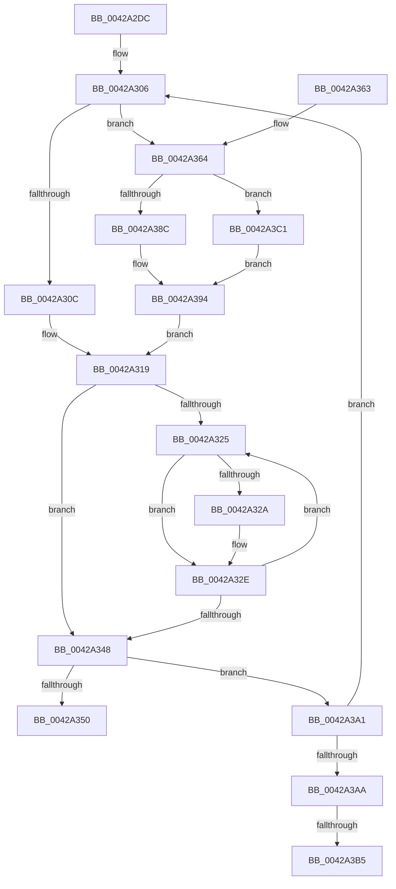

# VmpProcessAccessedBatch

- RVA: `0x0042A2DC`–`0x0042A3CB` (길이 `239` bytes)
- VA: `0x000000014042A2DC`
- 실행 섹션: `.text`
- PDB 이름 있음: `예`; PDB Function 태그: `예`
- unwind 정보 RVA: `0x000A0FDC`
- 디코드: `69`개 명령, `239/239` bytes 표시
- 미해석 바이트: `0` (있으면 어셈블리에 `.byte`로 보존)

> 이 문서는 커널 이미지의 기계어와 PDB 기호를 분석해 생성했습니다. 4번과 5번은 함수 원형과 자료형을 바이너리 사용 방식에서 추정한 C 해석이며 원본 소스 복구 결과는 아닙니다.

## 1. Dependencies

- 직접 호출 지점: **2**; 고유 호출 대상: **2**
- 직접 호출자로 확인된 함수: **2**
- RIP 상대 이미지 참조: **0**

### Outgoing calls
- `0x0042A38F` → [HvlGetGpaPagesAccessState](HvlGetGpaPagesAccessState_function_0042A3D4.md) (function, `0x0042A3D4`)
- `0x0042A3C4` → [HvlGetSparseGpaPagesAccessState](../30/HvlGetSparseGpaPagesAccessState_function_00306A78.md) (function, `0x00306A78`)

### Direct callers
- [VmpQueryAccessedState](VmpQueryAccessedState_function_004290A8.md) at `0x0042929E`
- [sub_006EDFF2](../6E/Unknown_function_006EDFF2.md) at `0x006EE027`

### Static image references
- 디코드된 RIP-relative 메모리 참조가 없습니다.

## 2. Other-region calls and transfers

- 다른 실행 섹션으로 향하는 call: **0**
- call이 아닌 외부 분기/꼬리 이동: **2**
  - `0x0042A3AF` → [sub_006EE2C4](../6E/Unknown_function_006EE2C4.md) (`tail-transfer`)
  - `0x0042A3BC` → [sub_006EE2C4](../6E/Unknown_function_006EE2C4.md) (`tail-transfer`)

## 3. Assembly (complete function range)

```asm
0042A2DC  48 89 5C 24 10                  mov qword ptr [rsp + 0x10], rbx
0042A2E1  48 89 6C 24 18                  mov qword ptr [rsp + 0x18], rbp
0042A2E6  56                              push rsi
0042A2E7  57                              push rdi
0042A2E8  41 56                           push r14
0042A2EA  48 83 EC 30                     sub rsp, 0x30
0042A2EE  48 83 64 24 50 00               and qword ptr [rsp + 0x50], 0
0042A2F4  49 8B D9                        mov rbx, r9
0042A2F7  4C 8B 71 68                     mov r14, qword ptr [rcx + 0x68]
0042A2FB  41 8B F0                        mov esi, r8d
0042A2FE  48 8B 6C 24 70                  mov rbp, qword ptr [rsp + 0x70]
0042A303  48 8B FA                        mov rdi, rdx
0042A306  49 83 FE FF                     cmp r14, -1
0042A30A  75 58                           jne 0x14042a364
0042A30C  33 C9                           xor ecx, ecx
0042A30E  41 B9 01 00 00 C0               mov r9d, 0xc0000001
0042A314  48 89 4C 24 50                  mov qword ptr [rsp + 0x50], rcx
0042A319  4C 8D 04 29                     lea r8, [rcx + rbp]
0042A31D  48 8B D5                        mov rdx, rbp
0042A320  49 3B E8                        cmp rbp, r8
0042A323  73 23                           jae 0x14042a348
0042A325  F6 02 01                        test byte ptr [rdx], 1
0042A328  74 04                           je 0x14042a32e
0042A32A  48 83 0B 01                     or qword ptr [rbx], 1
0042A32E  48 8B 03                        mov rax, qword ptr [rbx]
0042A331  48 FF C2                        inc rdx
0042A334  48 83 E0 FD                     and rax, 0xfffffffffffffffd
0042A338  48 83 C8 04                     or rax, 4
0042A33C  48 89 03                        mov qword ptr [rbx], rax
0042A33F  48 83 C3 08                     add rbx, 8
0042A343  49 3B D0                        cmp rdx, r8
0042A346  72 DD                           jb 0x14042a325
0042A348  48 8D 3C CF                     lea rdi, [rdi + rcx*8]
0042A34C  2B F1                           sub esi, ecx
0042A34E  75 51                           jne 0x14042a3a1
0042A350  48 8B 5C 24 58                  mov rbx, qword ptr [rsp + 0x58]
0042A355  48 8B 6C 24 60                  mov rbp, qword ptr [rsp + 0x60]
0042A35A  48 83 C4 30                     add rsp, 0x30
0042A35E  41 5E                           pop r14
0042A360  5F                              pop rdi
0042A361  5E                              pop rsi
0042A362  C3                              ret
0042A363  CC                              int3
0042A364  33 D2                           xor edx, edx
0042A366  48 89 6C 24 28                  mov qword ptr [rsp + 0x28], rbp
0042A36B  39 54 24 78                     cmp dword ptr [rsp + 0x78], edx
0042A36F  48 8D 44 24 50                  lea rax, [rsp + 0x50]
0042A374  44 8B C6                        mov r8d, esi
0042A377  49 8B CE                        mov rcx, r14
0042A37A  0F 95 C2                        setne dl
0042A37D  48 89 44 24 20                  mov qword ptr [rsp + 0x20], rax
0042A382  83 BC 24 80 00 00 00 00         cmp dword ptr [rsp + 0x80], 0
0042A38A  74 35                           je 0x14042a3c1
0042A38C  4C 8B 0F                        mov r9, qword ptr [rdi]
0042A38F  E8 40 00 00 00                  call 0x14042a3d4
0042A394  48 8B 4C 24 50                  mov rcx, qword ptr [rsp + 0x50]
0042A399  44 8B C8                        mov r9d, eax
0042A39C  E9 78 FF FF FF                  jmp 0x14042a319
0042A3A1  45 85 C9                        test r9d, r9d
0042A3A4  0F 89 5C FF FF FF               jns 0x14042a306
0042A3AA  48 8B 03                        mov rax, qword ptr [rbx]
0042A3AD  A8 04                           test al, 4
0042A3AF  0F 85 0F 3F 2C 00               jne 0x1406ee2c4
0042A3B5  48 83 C8 06                     or rax, 6
0042A3B9  48 89 03                        mov qword ptr [rbx], rax
0042A3BC  E9 03 3F 2C 00                  jmp 0x1406ee2c4
0042A3C1  4C 8B CF                        mov r9, rdi
0042A3C4  E8 AF C6 ED FF                  call 0x140306a78
0042A3C9  EB C9                           jmp 0x14042a394
```

## 4. C-style interpretation (structured pseudocode)

```c
__int64 __fastcall VmpProcessAccessedBatch(__int64 a1, __int64 a2, int a3, __int64 a4, __int64 a5, unsigned int a6, unsigned int a7)
{
    __int64 result;
    __int64 v_rbx;
    __int64 v_rsi;
    __int64 v_rsp;
    unsigned __int64 v_stack_p10;
    unsigned __int64 v_stack_p18;
    unsigned __int64 v_stack_p20;
    unsigned __int64 v_stack_p28;
    unsigned __int64 v_stack_p50;
    unsigned __int64 v_stack_p8;

    v_stack_p10 = v_rbx;
    v_stack_p18 = v_rbp;
    v_rsp = (v_rsp) - (48);
loc_0042A306:
    if ((*(unsigned __int64 *)(a1 + 104)) != -1) goto loc_0042A364;
    a1 = 0;
    v_stack_p8 = 0;
loc_0042A319:
    if (a5 >= (a1 + a5 * 1)) goto loc_0042A348;
loc_0042A325:
    if (((*(unsigned __int8 *)(a5)) & (1)) != 0) {
    }
    a2 = (a5) + 1;
    result = (*(unsigned __int64 *)(a4)) & (-3);
    result = (result) | (4);
    *(unsigned __int64 *)(a4) = result;
    v_rbx = (a4) + (8);
    if (a2 < (a1 + a5 * 1)) goto loc_0042A325;
loc_0042A348:
    v_rsi = (unsigned int)(((unsigned int)(a3)) - (0));
    if (condition_is_not_equal) goto loc_0042A3A1;
    v_rsp = (v_rsp) + (48);
    return result;
loc_0042A364:
    a2 = 0;
    v_stack_p28 = v_stack_p18;
    a2 = (a6 != 0) ? 1 : 0;
    v_stack_p20 = v_stack_p50;
    if (a7 == 0) goto loc_0042A3C1;
    result = HvlGetGpaPagesAccessState(*(unsigned __int64 *)(a1 + 104), a2, (unsigned int)((unsigned int)(v_rsi)), *(unsigned __int64 *)(a2 + a1 * 8));
loc_0042A394:
    goto loc_0042A319;
loc_0042A3A1:
    if (!sign_flag) goto loc_0042A306;
    result = (*(unsigned __int64 *)(v_stack_p10)) | (6);
    *(unsigned __int64 *)(v_stack_p10) = result;
loc_0042A3C1:
    result = HvlGetSparseGpaPagesAccessState(v_stack_p50, a2, (unsigned int)((unsigned int)(v_rsi)), a2 + a1 * 8);
    goto loc_0042A394;
}
```

## 5. (Beta) C Style

```c
int64_t VmpProcessAccessedBatch(void *Arg1, void *Arg2, int32_t Arg3, void *Arg4, int64_t Arg5, uint32_t Arg6, uint32_t Arg7)
{
    uint8_t *arg1 = (uint8_t *)Arg1;
    uint8_t *arg2 = (uint8_t *)Arg2;
    uint8_t *arg4 = (uint8_t *)Arg4;

    int64_t result;
    int64_t local_rbx;
    int64_t local_rsi;
    int64_t local_rsp;
    uint64_t v_stack_p10;
    uint64_t v_stack_p18;
    uint64_t v_stack_p20;
    uint64_t v_stack_p28;
    uint64_t v_stack_p50;
    uint64_t v_stack_p8;

    v_stack_p10 = local_rbx;
    v_stack_p18 = local_rbp;
    local_rsp = (local_rsp) - (48);
loc_0042A306:
    if ((*(uint64_t *)(arg1 + 0x68)) != -1) goto loc_0042A364;
    Arg1 = 0;
    v_stack_p8 = 0;
loc_0042A319:
    if (Arg5 >= (Arg1 + Arg5 * 1)) goto loc_0042A348;
loc_0042A325:
    if (((*(uint8_t *)(Arg5)) & (1)) != 0) {
    }
    Arg2 = (Arg5) + 1;
    result = (*(uint64_t *)(arg4)) & (-3);
    result = (result) | (4);
    *(uint64_t *)(arg4) = result;
    local_rbx = (Arg4) + (8);
    if (Arg2 < (Arg1 + Arg5 * 1)) goto loc_0042A325;
loc_0042A348:
    local_rsi = (uint32_t)(((uint32_t)(Arg3)) - (0));
    if (condition_is_not_equal) goto loc_0042A3A1;
    local_rsp = (local_rsp) + (48);
    return result;
loc_0042A364:
    Arg2 = 0;
    v_stack_p28 = v_stack_p18;
    Arg2 = (Arg6 != 0) ? 1 : 0;
    v_stack_p20 = v_stack_p50;
    if (Arg7 == 0) goto loc_0042A3C1;
    result = HvlGetGpaPagesAccessState(*(uint64_t *)(arg1 + 0x68), Arg2, (uint32_t)((uint32_t)(local_rsi)), *(uint64_t *)(arg2 + arg1 * 8));
loc_0042A394:
    goto loc_0042A319;
loc_0042A3A1:
    if (!sign_flag) goto loc_0042A306;
    result = (*(uint64_t *)(v_stack_p10)) | (6);
    *(uint64_t *)(v_stack_p10) = result;
loc_0042A3C1:
    result = HvlGetSparseGpaPagesAccessState(v_stack_p50, Arg2, (uint32_t)((uint32_t)(local_rsi)), Arg2 + Arg1 * 8);
    goto loc_0042A394;
}
```

### 관측된 메모리 오프셋

구조체 형식이 확인되지 않은 접근은 인자 기준의 오프셋으로만 기록했습니다.

| 기준 인자 | 오프셋 표현 | 폭 (bit) | 접근 |
|---|---:|---:|---|
| `Arg1` | `+ 0x68` | `64` | `R` |
| `Arg2` | `+ 0x0` | `64` | `R` |
| `Arg2` | `+ 0x0 + rcx*8` | `64` | `R` |
| `Arg4` | `+ 0x0` | `64` | `R` |
| `Arg4` | `+ 0x0` | `64` | `R/W` |
| `Arg4` | `+ 0x0` | `64` | `W` |

## 6. Execution-region graph

[열기: 2D/3D 그래프와 함수 탐색 컨트롤 패널](../../../control-panel.html?section=text&rva=0x0042A2DC&view=graph)

- 2D 그래프는 위에서 아래로 흐르고, 3D 그래프는 빈 공간을 드래그해 회전합니다. Shift+드래그는 이동, 휠은 확대·축소, 함수 노드 선택은 대상 보고서 이동입니다.

### Static fallback


