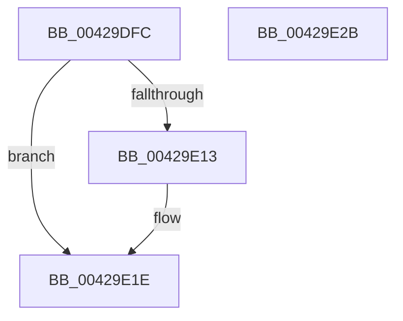

# VmpProcessContextUnlockShared

- RVA: `0x00429DFC`–`0x00429E2C` (길이 `48` bytes)
- VA: `0x0000000140429DFC`
- 실행 섹션: `.text`
- PDB 이름 있음: `예`; PDB Function 태그: `아니요`
- unwind 정보 RVA: `0x0005CF00`
- 디코드: `15`개 명령, `48/48` bytes 표시
- 미해석 바이트: `0` (있으면 어셈블리에 `.byte`로 보존)

> 이 문서는 커널 이미지의 기계어와 PDB 기호를 분석해 생성했습니다. 4번과 5번은 함수 원형과 자료형을 바이너리 사용 방식에서 추정한 C 해석이며 원본 소스 복구 결과는 아닙니다.

## 1. Dependencies

- 직접 호출 지점: **2**; 고유 호출 대상: **2**
- 직접 호출자로 확인된 함수: **7**
- RIP 상대 이미지 참조: **1**

### Outgoing calls
- `0x00429E05` → [ExReleaseSpinLockSharedFromDpcLevel](../24/ExReleaseSpinLockSharedFromDpcLevel_function_0024A590.md) (function, `0x0024A590`)
- `0x00429E19` → [KiLowerIrqlProcessIrqlFlags](../4F/KiLowerIrqlProcessIrqlFlags_function_004F5698.md) (function, `0x004F5698`)

### Direct callers
- [VmpPrefetchVirtualAddresses](VmpPrefetchVirtualAddresses_function_00428844.md) at `0x00428973`
- [VmpPrefetchVirtualAddresses](VmpPrefetchVirtualAddresses_function_00428844.md) at `0x004289E6`
- [VmpQueryAccessedState](VmpQueryAccessedState_function_004290A8.md) at `0x004291F0`
- [VmpAccessFaultBatch](VmpAccessFaultBatch_function_00429398.md) at `0x004294CF`
- [VmpAccessFaultBatch](VmpAccessFaultBatch_function_00429398.md) at `0x0042954B`
- [VmpSplitMemoryRange](VmpSplitMemoryRange_function_00429754.md) at `0x00429804`
- [VmpSplitMemoryRange](VmpSplitMemoryRange_function_00429754.md) at `0x00429B3D`
- [VmColdPagesHint](VmColdPagesHint_function_00429BB0.md) at `0x00429CA9`
- [VmColdPagesHint](VmColdPagesHint_function_00429BB0.md) at `0x00429DA0`
- [VmpUpdateCommitStateMemoryRange](../64/VmpUpdateCommitStateMemoryRange_function_0064D5D0.md) at `0x0064D71B`
- [VmpUpdateCommitStateMemoryRange](../64/VmpUpdateCommitStateMemoryRange_function_0064D5D0.md) at `0x0064D74B`
- [sub_006EDFF2](../6E/Unknown_function_006EDFF2.md) at `0x006EDFFD`

### Static image references
- `0x00429E0A` → RVA `0x00FC6D20` (`ALMOSTRO`; read)

## 2. Other-region calls and transfers

- 다른 실행 섹션으로 향하는 call: **0**
- 별도 외부 분기/꼬리 이동을 확인하지 못했습니다.

## 3. Assembly (complete function range)

```asm
00429DFC  40 53                           push rbx
00429DFE  48 83 EC 20                     sub rsp, 0x20
00429E02  48 8B DA                        mov rbx, rdx
00429E05  E8 86 07 E2 FF                  call 0x14024a590
00429E0A  83 3D 0F CF B9 00 00            cmp dword ptr [rip + 0xb9cf0f], 0
00429E11  74 0B                           je 0x140429e1e
00429E13  44 0F 20 C1                     mov rcx, cr8
00429E17  8A D3                           mov dl, bl
00429E19  E8 7A B8 0C 00                  call 0x1404f5698
00429E1E  0F B6 C3                        movzx eax, bl
00429E21  44 0F 22 C0                     mov cr8, rax
00429E25  48 83 C4 20                     add rsp, 0x20
00429E29  5B                              pop rbx
00429E2A  C3                              ret
00429E2B  CC                              int3
```

## 4. C-style interpretation (structured pseudocode)

```c
__int64 __fastcall VmpProcessContextUnlockShared(__int64 a1, __int64 a2)
{
    __int64 result;
    __int64 v_rsp;

    v_rsp = (v_rsp) - (32);
    result = ExReleaseSpinLockSharedFromDpcLevel(a1, a2, a3, a4);
    if ((*(unsigned int *)(v_rip + 12177167)) != 0) {
        a1 = v_cr8;
        a2 = (unsigned __int8)(a2);
        result = KiLowerIrqlProcessIrqlFlags(a1, a2, a3, a4);
    }
    v_rsp = (v_rsp) + (32);
    return (unsigned __int8)(a2);
}
```

## 5. (Beta) C Style

```c
int64_t VmpProcessContextUnlockShared(int64_t Arg1, int64_t Arg2)
{
    int64_t result;
    int64_t local_rsp;

    local_rsp = (local_rsp) - (32);
    result = ExReleaseSpinLockSharedFromDpcLevel(Arg1, Arg2, a3, a4);
    if ((*(uint32_t *)(v_rip + 0xB9CF0F)) != 0) {
        Arg1 = v_cr8;
        Arg2 = (uint8_t)(Arg2);
        result = KiLowerIrqlProcessIrqlFlags(Arg1, Arg2, a3, a4);
    }
    local_rsp = (local_rsp) + (32);
    return (uint8_t)(Arg2);
}
```

## 6. Execution-region graph

[열기: 2D/3D 그래프와 함수 탐색 컨트롤 패널](../../../control-panel.html?section=text&rva=0x00429DFC&view=graph)

- 2D 그래프는 위에서 아래로 흐르고, 3D 그래프는 빈 공간을 드래그해 회전합니다. Shift+드래그는 이동, 휠은 확대·축소, 함수 노드 선택은 대상 보고서 이동입니다.

### Static fallback


