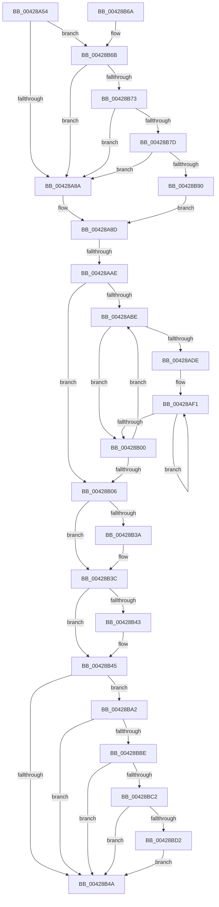

# VmpProcessInvalidateList

- RVA: `0x00428A54`–`0x00428BF5` (길이 `417` bytes)
- VA: `0x0000000140428A54`
- 실행 섹션: `.text`
- PDB 이름 있음: `예`; PDB Function 태그: `예`
- unwind 정보 RVA: `0x000A0D90`
- 디코드: `121`개 명령, `417/417` bytes 표시
- 미해석 바이트: `0` (있으면 어셈블리에 `.byte`로 보존)

> 이 문서는 커널 이미지의 기계어와 PDB 기호를 분석해 생성했습니다. 4번과 5번은 함수 원형과 자료형을 바이너리 사용 방식에서 추정한 C 해석이며 원본 소스 복구 결과는 아닙니다.

## 1. Dependencies

- 직접 호출 지점: **5**; 고유 호출 대상: **4**
- 직접 호출자로 확인된 함수: **6**
- RIP 상대 이미지 참조: **1**

### Outgoing calls
- `0x00428B31` → [HvlMapSparseGpaPages](HvlMapSparseGpaPages_function_0042A160.md) (function, `0x0042A160`)
- `0x00428B95` → [KeQueryUnbiasedInterruptTimePrecise](../37/KeQueryUnbiasedInterruptTimePrecise_function_0037AC20.md) (function, `0x0037AC20`)
- `0x00428BA7` → [KeQueryUnbiasedInterruptTimePrecise](../37/KeQueryUnbiasedInterruptTimePrecise_function_0037AC20.md) (function, `0x0037AC20`)
- `0x00428BC5` → [tlgKeywordOn](tlgKeywordOn_function_0042EAA0.md) (function, `0x0042EAA0`)
- `0x00428BEB` → [VmpLogTbFlushSlatInvalidate](../64/VmpLogTbFlushSlatInvalidate_function_0064DE38.md) (function, `0x0064DE38`)

### Direct callers
- [VmpFlushTb](../31/VmpFlushTb_function_00311BD0.md) at `0x00311D11`
- [VmpFlushTb](../31/VmpFlushTb_function_00311BD0.md) at `0x00311F68`
- [VmpFlushTb](../31/VmpFlushTb_function_00311BD0.md) at `0x00311F93`
- [VmpFlushTb](../31/VmpFlushTb_function_00311BD0.md) at `0x00311FAF`
- [sub_00314635](../31/Unknown_function_00314635.md) at `0x00314642`
- [sub_00314756](../31/Unknown_function_00314756.md) at `0x00314790`
- [VmpInsertInvalidateListRange](../46/VmpInsertInvalidateListRange_function_00463B64.md) at `0x00463CD4`
- [VmpInsertInvalidateListRange](../46/VmpInsertInvalidateListRange_function_00463B64.md) at `0x00463D67`
- [VmpInvalidateSlatBatched](../48/VmpInvalidateSlatBatched_function_00489300.md) at `0x0048945C`
- [VmpInvalidateSlatBatched](../48/VmpInvalidateSlatBatched_function_00489300.md) at `0x004894A4`
- [sub_006F2C26](../6F/Unknown_function_006F2C26.md) at `0x006F2C2C`
- [sub_006F2C26](../6F/Unknown_function_006F2C26.md) at `0x006F2C46`

### Static image references
- `0x00428A72` → RVA `0x00F02458` (`.data`; read)

## 2. Other-region calls and transfers

- 다른 실행 섹션으로 향하는 call: **0**
- call이 아닌 외부 분기/꼬리 이동: **1**
  - `0x00428AA8` → [sub_006EDF40](../6E/Unknown_function_006EDF40.md) (`tail-transfer`)

## 3. Assembly (complete function range)

```asm
00428A54  48 89 5C 24 18                  mov qword ptr [rsp + 0x18], rbx
00428A59  48 89 4C 24 08                  mov qword ptr [rsp + 8], rcx
00428A5E  55                              push rbp
00428A5F  56                              push rsi
00428A60  57                              push rdi
00428A61  41 54                           push r12
00428A63  41 55                           push r13
00428A65  41 56                           push r14
00428A67  41 57                           push r15
00428A69  48 83 EC 30                     sub rsp, 0x30
00428A6D  4C 8B F1                        mov r14, rcx
00428A70  33 F6                           xor esi, esi
00428A72  48 8B 0D DF 99 AD 00            mov rcx, qword ptr [rip + 0xad99df]
00428A79  48 8B DA                        mov rbx, rdx
00428A7C  BD 02 00 00 00                  mov ebp, 2
00428A81  48 85 C9                        test rcx, rcx
00428A84  0F 85 E1 00 00 00               jne 0x140428b6b
00428A8A  4C 8B EE                        mov r13, rsi
00428A8D  44 0F B7 43 06                  movzx r8d, word ptr [rbx + 6]
00428A92  66 44 23 C5                     and r8w, bp
00428A96  41 0F B7 C0                     movzx eax, r8w
00428A9A  66 F7 D8                        neg ax
00428A9D  8B 43 04                        mov eax, dword ptr [rbx + 4]
00428AA0  45 1B E4                        sbb r12d, r12d
00428AA3  44 23 E5                        and r12d, ebp
00428AA6  A8 01                           test al, 1
00428AA8  0F 85 92 54 2C 00               jne 0x1406edf40
00428AAE  4C 8D 93 10 10 00 00            lea r10, [rbx + 0x1010]
00428AB5  48 8B FE                        mov rdi, rsi
00428AB8  8B D6                           mov edx, esi
00428ABA  39 33                           cmp dword ptr [rbx], esi
00428ABC  76 48                           jbe 0x140428b06
00428ABE  8B C2                           mov eax, edx
00428AC0  48 8B 4C C3 10                  mov rcx, qword ptr [rbx + rax*8 + 0x10]
00428AC5  48 8B C1                        mov rax, rcx
00428AC8  81 E1 FF 0F 00 00               and ecx, 0xfff
00428ACE  48 C1 E8 0C                     shr rax, 0xc
00428AD2  4C 8D 48 FF                     lea r9, [rax - 1]
00428AD6  4C 03 C9                        add r9, rcx
00428AD9  49 3B C1                        cmp rax, r9
00428ADC  77 22                           ja 0x140428b00
00428ADE  48 8B CF                        mov rcx, rdi
00428AE1  48 2B F8                        sub rdi, rax
00428AE4  48 C1 E1 04                     shl rcx, 4
00428AE8  48 FF C7                        inc rdi
00428AEB  49 03 CA                        add rcx, r10
00428AEE  49 03 F9                        add rdi, r9
00428AF1  48 89 01                        mov qword ptr [rcx], rax
00428AF4  48 FF C0                        inc rax
00428AF7  48 8D 49 10                     lea rcx, [rcx + 0x10]
00428AFB  49 3B C1                        cmp rax, r9
00428AFE  76 F1                           jbe 0x140428af1
00428B00  FF C2                           inc edx
00428B02  3B 13                           cmp edx, dword ptr [rbx]
00428B04  72 B8                           jb 0x140428abe
00428B06  49 8B 4E 68                     mov rcx, qword ptr [r14 + 0x68]
00428B0A  48 8D 44 24 78                  lea rax, [rsp + 0x78]
00428B0F  66 41 F7 D8                     neg r8w
00428B13  48 89 74 24 78                  mov qword ptr [rsp + 0x78], rsi
00428B18  4D 8B CA                        mov r9, r10
00428B1B  48 89 44 24 20                  mov qword ptr [rsp + 0x20], rax
00428B20  1B D2                           sbb edx, edx
00428B22  4C 8B C7                        mov r8, rdi
00428B25  81 E2 00 80 00 00               and edx, 0x8000
00428B2B  81 C2 00 00 01 01               add edx, 0x1010000
00428B31  E8 2A 16 00 00                  call 0x14042a160
00428B36  85 C0                           test eax, eax
00428B38  79 02                           jns 0x140428b3c
00428B3A  CD 2C                           int 0x2c
00428B3C  48 39 7C 24 78                  cmp qword ptr [rsp + 0x78], rdi
00428B41  74 02                           je 0x140428b45
00428B43  CD 2C                           int 0x2c
00428B45  4D 85 ED                        test r13, r13
00428B48  75 58                           jne 0x140428ba2
00428B4A  48 83 23 00                     and qword ptr [rbx], 0
00428B4E  48 89 73 08                     mov qword ptr [rbx + 8], rsi
00428B52  48 8B 9C 24 80 00 00 00         mov rbx, qword ptr [rsp + 0x80]
00428B5A  48 83 C4 30                     add rsp, 0x30
00428B5E  41 5F                           pop r15
00428B60  41 5E                           pop r14
00428B62  41 5D                           pop r13
00428B64  41 5C                           pop r12
00428B66  5F                              pop rdi
00428B67  5E                              pop rsi
00428B68  5D                              pop rbp
00428B69  C3                              ret
00428B6A  CC                              int3
00428B6B  39 31                           cmp dword ptr [rcx], esi
00428B6D  0F 86 17 FF FF FF               jbe 0x140428a8a
00428B73  40 84 69 10                     test byte ptr [rcx + 0x10], bpl
00428B77  0F 84 0D FF FF FF               je 0x140428a8a
00428B7D  48 8B 49 18                     mov rcx, qword ptr [rcx + 0x18]
00428B81  48 8B C1                        mov rax, rcx
00428B84  48 23 C5                        and rax, rbp
00428B87  48 3B C1                        cmp rax, rcx
00428B8A  0F 85 FA FE FF FF               jne 0x140428a8a
00428B90  48 8D 4C 24 78                  lea rcx, [rsp + 0x78]
00428B95  E8 86 20 F5 FF                  call 0x14037ac20
00428B9A  4C 8B E8                        mov r13, rax
00428B9D  E9 EB FE FF FF                  jmp 0x140428a8d
00428BA2  48 8D 4C 24 78                  lea rcx, [rsp + 0x78]
00428BA7  E8 74 20 F5 FF                  call 0x14037ac20
00428BAC  48 8B 0D A5 98 AD 00            mov rcx, qword ptr [rip + 0xad98a5]
00428BB3  4C 8B C0                        mov r8, rax
00428BB6  4D 2B C5                        sub r8, r13
00428BB9  48 85 C9                        test rcx, rcx
00428BBC  74 8C                           je 0x140428b4a
00428BBE  39 31                           cmp dword ptr [rcx], esi
00428BC0  76 88                           jbe 0x140428b4a
00428BC2  48 8B D5                        mov rdx, rbp
00428BC5  E8 D6 5E 00 00                  call 0x14042eaa0
00428BCA  84 C0                           test al, al
00428BCC  0F 84 78 FF FF FF               je 0x140428b4a
00428BD2  49 8B 46 68                     mov rax, qword ptr [r14 + 0x68]
00428BD6  44 8B 4B 04                     mov r9d, dword ptr [rbx + 4]
00428BDA  48 8B 53 08                     mov rdx, qword ptr [rbx + 8]
00428BDE  48 89 44 24 28                  mov qword ptr [rsp + 0x28], rax
00428BE3  4C 89 44 24 20                  mov qword ptr [rsp + 0x20], r8
00428BE8  44 8B 03                        mov r8d, dword ptr [rbx]
00428BEB  E8 48 52 22 00                  call 0x14064de38
00428BF0  E9 55 FF FF FF                  jmp 0x140428b4a
```

## 4. C-style interpretation (structured pseudocode)

```c
__int64 __fastcall VmpProcessInvalidateList(__int64 a1, __int64 a2)
{
    __int64 result;
    __int64 v_r12;
    __int64 v_rdi;
    __int64 v_rsi;
    __int64 v_rsp;
    unsigned __int64 v_stack_m48;
    unsigned __int64 v_stack_p10;
    unsigned __int64 v_stack_p18;
    unsigned __int64 v_stack_p20;
    unsigned __int64 v_stack_p28;
    unsigned __int64 v_stack_p78;
    unsigned __int64 v_stack_p8;

    v_stack_p18 = v_rbx;
    v_stack_p8 = a1;
    v_rsp = (v_rsp) - (48);
    v_rsi = 0;
    if (*(unsigned __int64 *)(v_rip + 11377119) != 0) goto loc_00428B6B;
loc_00428A8A:
loc_00428A8D:
    a3 = (unsigned __int16)((*(unsigned __int16 *)(a2 + 6)) & (2));
    result = (unsigned __int16)(-((unsigned __int16)(a3)));
    v_r12 = (unsigned int)((v_r12) & (2));
    if ((*(unsigned int *)(a2)) <= 0) goto loc_00428B06;
loc_00428ABE:
    a1 = (unsigned int)((*(unsigned __int64 *)(a2 + 0 * 8 + 16)) & (0xFFFULL));
    result = (*(unsigned __int64 *)(a2 + 0 * 8 + 16)) >> (12);
    a4 = (result - 1) + (a1);
    if (result > a4) goto loc_00428B00;
    v_rdi = (0) - (result);
    a1 = (0) << (4);
    v_rdi = (v_rdi) + 1;
    a1 = (a1) + (a2 + 4112);
    v_rdi = (v_rdi) + (a4);
loc_00428AF1:
    *(unsigned __int64 *)(a1) = result;
    result = (result) + 1;
    if (result <= a4) goto loc_00428AF1;
loc_00428B00:
    a2 = (unsigned int)((0) + 1);
    if (((unsigned int)(a2)) < (*(unsigned int *)(a2))) goto loc_00428ABE;
loc_00428B06:
    a3 = (unsigned __int16)(-(a3));
    v_stack_p10 = 0;
    v_stack_m48 = v_stack_p10;
    a2 = (unsigned int)((a2) & (0x8000ULL));
    a2 = (unsigned int)((a2) + (0x1010000ULL));
    result = HvlMapSparseGpaPages(*(unsigned __int64 *)(a1 + 104), a2, v_rdi, a2 + 4112);
    if (sign_flag) {
    }
    if (v_stack_p10 != v_rdi) {
    }
    if (0 != 0) goto loc_00428BA2;
loc_00428B4A:
    *(unsigned __int64 *)(a2 + 8) = 0;
    v_rsp = (v_rsp) + (48);
    return result;
loc_00428B6B:
    if ((*(unsigned int *)(*(unsigned __int64 *)(a1 + 104))) <= 0) goto loc_00428A8A;
    if (((*(unsigned __int8 *)(*(unsigned __int64 *)(a1 + 104) + 16)) & (2)) == 0) goto loc_00428A8A;
    result = (*(unsigned __int64 *)(*(unsigned __int64 *)(a1 + 104) + 24)) & (2);
    if (result != (*(unsigned __int64 *)(*(unsigned __int64 *)(a1 + 104) + 24))) goto loc_00428A8A;
    result = KeQueryUnbiasedInterruptTimePrecise(v_stack_p78, a2, v_rdi, a2 + 4112);
    goto loc_00428A8D;
loc_00428BA2:
    result = KeQueryUnbiasedInterruptTimePrecise(v_stack_p78, a2, v_rdi, a2 + 4112);
    a3 = (result) - (result);
    if (*(unsigned __int64 *)(v_rip + 11376805) == 0) goto loc_00428B4A;
    if ((*(unsigned int *)(*(unsigned __int64 *)(v_rip + 11376805))) <= 0) goto loc_00428B4A;
    result = tlgKeywordOn(*(unsigned __int64 *)(v_rip + 11376805), 2, a3, a2 + 4112);
    if ((unsigned __int8)(result) == 0) goto loc_00428B4A;
    v_stack_p28 = *(unsigned __int64 *)(a1 + 104);
    v_stack_p20 = a3;
    result = VmpLogTbFlushSlatInvalidate(*(unsigned __int64 *)(v_rip + 11376805), *(unsigned __int64 *)(v_stack_p18 + 8), (unsigned int)(*(unsigned int *)(v_stack_p18)), (unsigned int)(*(unsigned int *)(v_stack_p18 + 4)));
    goto loc_00428B4A;
}
```

## 5. (Beta) C Style

```c
int64_t VmpProcessInvalidateList(void *Arg1, void *Arg2)
{
    uint8_t *arg1 = (uint8_t *)Arg1;
    uint8_t *arg2 = (uint8_t *)Arg2;

    int64_t result;
    int64_t local_r12;
    int64_t local_rdi;
    int64_t local_rsi;
    int64_t local_rsp;
    uint64_t v_stack_m48;
    uint64_t v_stack_p10;
    uint64_t v_stack_p18;
    uint64_t v_stack_p20;
    uint64_t v_stack_p28;
    uint64_t v_stack_p78;
    uint64_t v_stack_p8;

    v_stack_p18 = local_rbx;
    v_stack_p8 = Arg1;
    local_rsp = (local_rsp) - (48);
    local_rsi = 0;
    if (*(uint64_t *)(v_rip + 0xAD99DF) != 0) goto loc_00428B6B;
loc_00428A8A:
loc_00428A8D:
    a3 = (uint16_t)((*(uint16_t *)(arg2 + 0x6)) & (2));
    result = (uint16_t)(-((uint16_t)(a3)));
    local_r12 = (uint32_t)((local_r12) & (2));
    if ((*(uint32_t *)(arg2)) <= 0) goto loc_00428B06;
loc_00428ABE:
    Arg1 = (uint32_t)((*(uint64_t *)(arg2 + 0x0 * 8 + 0x10)) & (0xFFFULL));
    result = (*(uint64_t *)(arg2 + 0x0 * 8 + 0x10)) >> (12);
    a4 = (result - 1) + (Arg1);
    if (result > a4) goto loc_00428B00;
    local_rdi = (0) - (result);
    Arg1 = (0) << (4);
    local_rdi = (local_rdi) + 1;
    Arg1 = (Arg1) + (Arg2 + 4112);
    local_rdi = (local_rdi) + (a4);
loc_00428AF1:
    *(uint64_t *)(arg1) = result;
    result = (result) + 1;
    if (result <= a4) goto loc_00428AF1;
loc_00428B00:
    Arg2 = (uint32_t)((0) + 1);
    if (((uint32_t)(Arg2)) < (*(uint32_t *)(arg2))) goto loc_00428ABE;
loc_00428B06:
    a3 = (uint16_t)(-(a3));
    v_stack_p10 = 0;
    v_stack_m48 = v_stack_p10;
    Arg2 = (uint32_t)((Arg2) & (0x8000ULL));
    Arg2 = (uint32_t)((Arg2) + (0x1010000ULL));
    result = HvlMapSparseGpaPages(*(uint64_t *)(arg1 + 0x68), Arg2, local_rdi, Arg2 + 4112);
    if (sign_flag) {
    }
    if (v_stack_p10 != local_rdi) {
    }
    if (0 != 0) goto loc_00428BA2;
loc_00428B4A:
    *(uint64_t *)(arg2 + 0x8) = 0;
    local_rsp = (local_rsp) + (48);
    return result;
loc_00428B6B:
    if ((*(uint32_t *)(*(uint64_t *)(arg1 + 0x68))) <= 0) goto loc_00428A8A;
    if (((*(uint8_t *)(*(uint64_t *)(arg1 + 0x68) + 0x10)) & (2)) == 0) goto loc_00428A8A;
    result = (*(uint64_t *)(*(uint64_t *)(arg1 + 0x68) + 0x18)) & (2);
    if (result != (*(uint64_t *)(*(uint64_t *)(arg1 + 0x68) + 0x18))) goto loc_00428A8A;
    result = KeQueryUnbiasedInterruptTimePrecise(v_stack_p78, Arg2, local_rdi, Arg2 + 4112);
    goto loc_00428A8D;
loc_00428BA2:
    result = KeQueryUnbiasedInterruptTimePrecise(v_stack_p78, Arg2, local_rdi, Arg2 + 4112);
    a3 = (result) - (result);
    if (*(uint64_t *)(v_rip + 0xAD98A5) == 0) goto loc_00428B4A;
    if ((*(uint32_t *)(*(uint64_t *)(v_rip + 0xAD98A5))) <= 0) goto loc_00428B4A;
    result = tlgKeywordOn(*(uint64_t *)(v_rip + 0xAD98A5), 2, a3, Arg2 + 4112);
    if ((uint8_t)(result) == 0) goto loc_00428B4A;
    v_stack_p28 = *(uint64_t *)(arg1 + 0x68);
    v_stack_p20 = a3;
    result = VmpLogTbFlushSlatInvalidate(*(uint64_t *)(v_rip + 0xAD98A5), *(uint64_t *)(v_stack_p18 + 0x8), (uint32_t)(*(uint32_t *)(v_stack_p18)), (uint32_t)(*(uint32_t *)(v_stack_p18 + 0x4)));
    goto loc_00428B4A;
}
```

### 관측된 메모리 오프셋

구조체 형식이 확인되지 않은 접근은 인자 기준의 오프셋으로만 기록했습니다.

| 기준 인자 | 오프셋 표현 | 폭 (bit) | 접근 |
|---|---:|---:|---|
| `Arg1` | `+ 0x68` | `64` | `R` |
| `Arg2` | `+ 0x0` | `32` | `R` |
| `Arg2` | `+ 0x0` | `64` | `R/W` |
| `Arg2` | `+ 0x4` | `32` | `R` |
| `Arg2` | `+ 0x6` | `16` | `R` |
| `Arg2` | `+ 0x8` | `64` | `R` |
| `Arg2` | `+ 0x8` | `64` | `W` |
| `Arg2` | `+ 0x10 + rax*8` | `64` | `R` |
| `Arg2` | `+ 0x1010` | `64` | `R` |

## 6. Execution-region graph

[열기: 2D/3D 그래프와 함수 탐색 컨트롤 패널](../../../control-panel.html?section=text&rva=0x00428A54&view=graph)

- 2D 그래프는 위에서 아래로 흐르고, 3D 그래프는 빈 공간을 드래그해 회전합니다. Shift+드래그는 이동, 휠은 확대·축소, 함수 노드 선택은 대상 보고서 이동입니다.

### Static fallback


