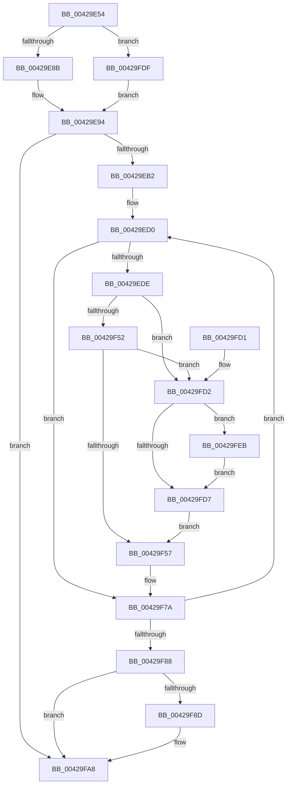

# VmpProcessUpdateSlat

- RVA: `0x00429E54`–`0x0042A00E` (길이 `442` bytes)
- VA: `0x0000000140429E54`
- 실행 섹션: `.text`
- PDB 이름 있음: `예`; PDB Function 태그: `아니요`
- unwind 정보 RVA: `0x000A0F5C`
- 디코드: `114`개 명령, `442/442` bytes 표시
- 미해석 바이트: `0` (있으면 어셈블리에 `.byte`로 보존)

> 이 문서는 커널 이미지의 기계어와 PDB 기호를 분석해 생성했습니다. 4번과 5번은 함수 원형과 자료형을 바이너리 사용 방식에서 추정한 C 해석이며 원본 소스 복구 결과는 아닙니다.

## 1. Dependencies

- 직접 호출 지점: **3**; 고유 호출 대상: **2**
- 직접 호출자로 확인된 함수: **1**
- RIP 상대 이미지 참조: **1**

### Outgoing calls
- `0x00429FA3` → [VmpFillSlat](VmpFillSlat_function_0042A014.md) (function, `0x0042A014`)
- `0x00429FB5` → [_security_check_cookie](../6A/_security_check_cookie_function_006AC640.md) (function, `0x006AC640`)
- `0x0042A001` → [VmpFillSlat](VmpFillSlat_function_0042A014.md) (function, `0x0042A014`)

### Direct callers
- [VmpAccessFaultBatch](VmpAccessFaultBatch_function_00429398.md) at `0x004294BE`

### Static image references
- `0x00429E67` → RVA `0x00E0A740` (`.data`; read)

## 2. Other-region calls and transfers

- 다른 실행 섹션으로 향하는 call: **0**
- 별도 외부 분기/꼬리 이동을 확인하지 못했습니다.

## 3. Assembly (complete function range)

```asm
00429E54  48 89 5C 24 10                  mov qword ptr [rsp + 0x10], rbx
00429E59  55                              push rbp
00429E5A  56                              push rsi
00429E5B  57                              push rdi
00429E5C  41 56                           push r14
00429E5E  41 57                           push r15
00429E60  48 81 EC 50 01 00 00            sub rsp, 0x150
00429E67  48 8B 05 D2 08 9E 00            mov rax, qword ptr [rip + 0x9e08d2]
00429E6E  48 33 C4                        xor rax, rsp
00429E71  48 89 84 24 40 01 00 00         mov qword ptr [rsp + 0x140], rax
00429E79  48 83 64 24 30 00               and qword ptr [rsp + 0x30], 0
00429E7F  4C 8B F1                        mov r14, rcx
00429E82  4D 85 C9                        test r9, r9
00429E85  0F 85 54 01 00 00               jne 0x140429fdf
00429E8B  48 8D 7C 24 40                  lea rdi, [rsp + 0x40]
00429E90  41 8D 69 10                     lea ebp, [r9 + 0x10]
00429E94  41 8B C0                        mov eax, r8d
00429E97  45 33 C9                        xor r9d, r9d
00429E9A  45 33 DB                        xor r11d, r11d
00429E9D  48 8D 0C 40                     lea rcx, [rax + rax*2]
00429EA1  48 C1 E1 04                     shl rcx, 4
00429EA5  48 8D 04 11                     lea rax, [rcx + rdx]
00429EA9  48 3B D0                        cmp rdx, rax
00429EAC  0F 83 F6 00 00 00               jae 0x140429fa8
00429EB2  48 FF C9                        dec rcx
00429EB5  48 8D 72 20                     lea rsi, [rdx + 0x20]
00429EB9  48 B8 AB AA AA AA AA AA AA AA   movabs rax, 0xaaaaaaaaaaaaaaab
00429EC3  48 F7 E1                        mul rcx
00429EC6  48 8B DA                        mov rbx, rdx
00429EC9  48 C1 EB 05                     shr rbx, 5
00429ECD  48 FF C3                        inc rbx
00429ED0  4C 8B 16                        mov r10, qword ptr [rsi]
00429ED3  49 0F BA E2 38                  bt r10, 0x38
00429ED8  0F 82 9C 00 00 00               jb 0x140429f7a
00429EDE  48 BA 00 00 00 00 00 00 20 00   movabs rdx, 0x20000000000000
00429EE8  49 8B CA                        mov rcx, r10
00429EEB  48 C1 E9 33                     shr rcx, 0x33
00429EEF  49 8B C2                        mov rax, r10
00429EF2  83 E1 02                        and ecx, 2
00429EF5  48 23 C2                        and rax, rdx
00429EF8  83 C9 01                        or ecx, 1
00429EFB  8B D1                           mov edx, ecx
00429EFD  83 CA 0C                        or edx, 0xc
00429F00  48 85 C0                        test rax, rax
00429F03  49 8B C2                        mov rax, r10
00429F06  0F 44 D1                        cmove edx, ecx
00429F09  48 B9 00 00 00 00 00 00 80 00   movabs rcx, 0x80000000000000
00429F13  44 8B C2                        mov r8d, edx
00429F16  41 0F BA E8 15                  bts r8d, 0x15
00429F1B  49 0F BA E2 36                  bt r10, 0x36
00429F20  44 0F 43 C2                     cmovae r8d, edx
00429F24  48 23 C1                        and rax, rcx
00429F27  41 8B C8                        mov ecx, r8d
00429F2A  0F BA E9 0F                     bts ecx, 0xf
00429F2E  48 85 C0                        test rax, rax
00429F31  41 0F 44 C8                     cmove ecx, r8d
00429F35  44 8B F9                        mov r15d, ecx
00429F38  41 0F BA EF 19                  bts r15d, 0x19
00429F3D  F6 84 24 A0 01 00 00 20         test byte ptr [rsp + 0x1a0], 0x20
00429F45  44 0F 45 F9                     cmovne r15d, ecx
00429F49  45 3B DF                        cmp r11d, r15d
00429F4C  0F 85 80 00 00 00               jne 0x140429fd2
00429F52  44 3B CD                        cmp r9d, ebp
00429F55  74 7B                           je 0x140429fd2
00429F57  41 8B C9                        mov ecx, r9d
00429F5A  48 B8 FF FF FF FF FF FF 0F 00   movabs rax, 0xfffffffffffff
00429F64  48 03 C9                        add rcx, rcx
00429F67  4C 23 D0                        and r10, rax
00429F6A  41 FF C1                        inc r9d
00429F6D  4C 89 14 CF                     mov qword ptr [rdi + rcx*8], r10
00429F71  48 8B 46 08                     mov rax, qword ptr [rsi + 8]
00429F75  48 89 44 CF 08                  mov qword ptr [rdi + rcx*8 + 8], rax
00429F7A  48 83 C6 30                     add rsi, 0x30
00429F7E  48 83 EB 01                     sub rbx, 1
00429F82  0F 85 48 FF FF FF               jne 0x140429ed0
00429F88  45 85 C9                        test r9d, r9d
00429F8B  74 1B                           je 0x140429fa8
00429F8D  45 8B C1                        mov r8d, r9d
00429F90  48 8D 44 24 30                  lea rax, [rsp + 0x30]
00429F95  4C 8B CF                        mov r9, rdi
00429F98  48 89 44 24 20                  mov qword ptr [rsp + 0x20], rax
00429F9D  41 8B D3                        mov edx, r11d
00429FA0  49 8B CE                        mov rcx, r14
00429FA3  E8 6C 00 00 00                  call 0x14042a014
00429FA8  33 C0                           xor eax, eax
00429FAA  48 8B 8C 24 40 01 00 00         mov rcx, qword ptr [rsp + 0x140]
00429FB2  48 33 CC                        xor rcx, rsp
00429FB5  E8 86 26 28 00                  call 0x1406ac640
00429FBA  48 8B 9C 24 88 01 00 00         mov rbx, qword ptr [rsp + 0x188]
00429FC2  48 81 C4 50 01 00 00            add rsp, 0x150
00429FC9  41 5F                           pop r15
00429FCB  41 5E                           pop r14
00429FCD  5F                              pop rdi
00429FCE  5E                              pop rsi
00429FCF  5D                              pop rbp
00429FD0  C3                              ret
00429FD1  CC                              int3
00429FD2  45 85 C9                        test r9d, r9d
00429FD5  75 14                           jne 0x140429feb
00429FD7  45 8B DF                        mov r11d, r15d
00429FDA  E9 78 FF FF FF                  jmp 0x140429f57
00429FDF  49 8B 79 18                     mov rdi, qword ptr [r9 + 0x18]
00429FE3  41 8B 29                        mov ebp, dword ptr [r9]
00429FE6  E9 A9 FE FF FF                  jmp 0x140429e94
00429FEB  45 8B C1                        mov r8d, r9d
00429FEE  48 8D 44 24 30                  lea rax, [rsp + 0x30]
00429FF3  4C 8B CF                        mov r9, rdi
00429FF6  48 89 44 24 20                  mov qword ptr [rsp + 0x20], rax
00429FFB  41 8B D3                        mov edx, r11d
00429FFE  49 8B CE                        mov rcx, r14
0042A001  E8 0E 00 00 00                  call 0x14042a014
0042A006  4C 8B 16                        mov r10, qword ptr [rsi]
0042A009  45 33 C9                        xor r9d, r9d
0042A00C  EB C9                           jmp 0x140429fd7
```

## 4. C-style interpretation (structured pseudocode)

```c
__int64 __fastcall VmpProcessUpdateSlat(__int64 a1, __int64 a2, int a3, __int64 a4, unsigned __int8 a5)
{
    __int64 result;
    __int64 v_r10;
    __int64 v_r11;
    __int64 v_r15;
    __int64 v_rbx;
    __int64 v_rsi;
    __int64 v_rsp;
    unsigned __int64 v_stack_m138;
    unsigned __int64 v_stack_m148;
    unsigned __int64 v_stack_m158;
    unsigned __int64 v_stack_m38;
    unsigned __int64 v_stack_p10;
    unsigned __int64 v_stack_p20;
    unsigned __int64 v_stack_p30;

    v_stack_p10 = v_rbx;
    v_rsp = (v_rsp) - (336);
    result = (*(unsigned __int64 *)(v_rip + 10356946)) ^ (v_rsp);
    v_stack_m38 = result;
    if (a4 != 0) goto loc_00429FDF;
loc_00429E94:
    a4 = 0;
    v_r11 = 0;
    a1 = ((unsigned int)(a3) + (unsigned int)(a3) * 2) << (4);
    if (a2 >= (a1 + a2 * 1)) goto loc_00429FA8;
    a1 = (a1) - 1;
    v_rbx = (a2) >> (5);
    v_rbx = (v_rbx) + 1;
loc_00429ED0:
    if (condition_is_below) goto loc_00429F7A;
    a1 = (*(unsigned __int64 *)(a2 + 32)) >> (51);
    a1 = (unsigned int)((a1) & (2));
    result = (*(unsigned __int64 *)(a2 + 32)) & (a2);
    a1 = (unsigned int)((a1) | (1));
    a2 = (unsigned int)(((unsigned int)((unsigned int)(a1))) | (12));
    if (result == 0) { a2 = (unsigned int)(a1); }
    a3 = (unsigned int)((unsigned int)(a2));
    if (condition_is_above_or_equal) { a3 = (unsigned int)(a2); }
    result = (*(unsigned __int64 *)(a2 + 32)) & (a1);
    a1 = (unsigned int)(a3);
    if (result == 0) { a1 = a3; }
    v_r15 = (unsigned int)((unsigned int)(a1));
    if (((a5) & (32)) != 0) { v_r15 = (unsigned int)(a1); }
    if (0 != ((unsigned int)(v_r15))) goto loc_00429FD2;
    if (0 == ((unsigned int)(a4 + 16))) goto loc_00429FD2;
loc_00429F57:
    a1 = (0) + (0);
    v_r10 = (*(unsigned __int64 *)(a2 + 32)) & (result);
    a4 = (unsigned int)((a4) + 1);
    *(unsigned __int64 *)(v_stack_m138 + a1 * 8) = v_r10;
    *(unsigned __int64 *)(v_stack_m138 + a1 * 8 + 8) = *(unsigned __int64 *)(a2 + 32 + 8);
loc_00429F7A:
    v_rsi = (a2 + 32) + (48);
    v_rbx = (v_rbx) - (1);
    if (condition_is_not_equal) goto loc_00429ED0;
    result = *(unsigned __int64 *)(a2 + 32 + 8);
    if ((unsigned int)(a4) != 0) {
        a3 = (unsigned int)(a4);
        result = v_stack_m148;
        a4 = v_stack_m138;
        v_stack_m158 = result;
        a2 = 0;
        a1 = a1;
        result = VmpFillSlat(a1, a2, a3, a4);
    }
    result = 0;
    a1 = (v_stack_m38) ^ (v_rsp);
    result = _security_check_cookie(a1, a2, a3, a4);
    v_rsp = (v_rsp) + (336);
    return result;
loc_00429FD2:
    if ((unsigned int)(a4) != 0) goto loc_00429FEB;
loc_00429FD7:
    goto loc_00429F57;
loc_00429FDF:
    goto loc_00429E94;
loc_00429FEB:
    v_stack_p20 = v_stack_p30;
    result = VmpFillSlat(a1, (unsigned int)((unsigned int)((unsigned int)((unsigned int)(v_r15)))), (unsigned int)((unsigned int)(a4)), *(unsigned __int64 *)(a4 + 24));
    a4 = 0;
    goto loc_00429FD7;
}
```

## 5. (Beta) C Style

```c
int64_t VmpProcessUpdateSlat(int64_t Arg1, int64_t Arg2, void *Arg3, int64_t Arg4, uint8_t Arg5)
{
    uint8_t *arg3 = (uint8_t *)Arg3;

    int64_t result;
    int64_t local_r10;
    int64_t local_r11;
    int64_t local_r15;
    int64_t local_rbx;
    int64_t local_rsi;
    int64_t local_rsp;
    uint64_t v_stack_m138;
    uint64_t v_stack_m148;
    uint64_t v_stack_m158;
    uint64_t v_stack_m38;
    uint64_t v_stack_p10;
    uint64_t v_stack_p20;
    uint64_t v_stack_p30;

    v_stack_p10 = local_rbx;
    local_rsp = (local_rsp) - (336);
    result = (*(uint64_t *)(v_rip + 0x9E08D2)) ^ (local_rsp);
    v_stack_m38 = result;
    if (Arg4 != 0) goto loc_00429FDF;
loc_00429E94:
    Arg4 = 0;
    local_r11 = 0;
    Arg1 = ((uint32_t)(Arg3) + (uint32_t)(Arg3) * 2) << (4);
    if (Arg2 >= (Arg1 + Arg2 * 1)) goto loc_00429FA8;
    Arg1 = (Arg1) - 1;
    local_rbx = (Arg2) >> (5);
    local_rbx = (local_rbx) + 1;
loc_00429ED0:
    if (condition_is_below) goto loc_00429F7A;
    Arg1 = (*(uint64_t *)(Arg2 + 0x20)) >> (51);
    Arg1 = (uint32_t)((Arg1) & (2));
    result = (*(uint64_t *)(Arg2 + 0x20)) & (Arg2);
    Arg1 = (uint32_t)((Arg1) | (1));
    Arg2 = (uint32_t)(((uint32_t)((uint32_t)(Arg1))) | (12));
    if (result == 0) { Arg2 = (uint32_t)(Arg1); }
    Arg3 = (uint32_t)((uint32_t)(Arg2));
    if (condition_is_above_or_equal) { Arg3 = (uint32_t)(Arg2); }
    result = (*(uint64_t *)(Arg2 + 0x20)) & (Arg1);
    Arg1 = (uint32_t)(Arg3);
    if (result == 0) { Arg1 = Arg3; }
    local_r15 = (uint32_t)((uint32_t)(Arg1));
    if (((Arg5) & (32)) != 0) { local_r15 = (uint32_t)(Arg1); }
    if (0 != ((uint32_t)(local_r15))) goto loc_00429FD2;
    if (0 == ((uint32_t)(Arg4 + 16))) goto loc_00429FD2;
loc_00429F57:
    Arg1 = (0) + (0);
    local_r10 = (*(uint64_t *)(Arg2 + 0x20)) & (result);
    Arg4 = (uint32_t)((Arg4) + 1);
    *(uint64_t *)(v_stack_m138 + Arg1 * 8) = local_r10;
    *(uint64_t *)(v_stack_m138 + Arg1 * 8 + 0x8) = *(uint64_t *)(Arg2 + 0x20 + 0x8);
loc_00429F7A:
    local_rsi = (Arg2 + 32) + (48);
    local_rbx = (local_rbx) - (1);
    if (condition_is_not_equal) goto loc_00429ED0;
    result = *(uint64_t *)(Arg2 + 0x20 + 0x8);
    if ((uint32_t)(Arg4) != 0) {
        Arg3 = (uint32_t)(Arg4);
        result = v_stack_m148;
        Arg4 = v_stack_m138;
        v_stack_m158 = result;
        Arg2 = 0;
        Arg1 = Arg1;
        result = VmpFillSlat(Arg1, Arg2, Arg3, Arg4);
    }
    result = 0;
    Arg1 = (v_stack_m38) ^ (local_rsp);
    result = _security_check_cookie(Arg1, Arg2, Arg3, Arg4);
    local_rsp = (local_rsp) + (336);
    return result;
loc_00429FD2:
    if ((uint32_t)(Arg4) != 0) goto loc_00429FEB;
loc_00429FD7:
    goto loc_00429F57;
loc_00429FDF:
    goto loc_00429E94;
loc_00429FEB:
    v_stack_p20 = v_stack_p30;
    result = VmpFillSlat(Arg1, (uint32_t)((uint32_t)((uint32_t)((uint32_t)(local_r15)))), (uint32_t)((uint32_t)(Arg4)), *(uint64_t *)(Arg4 + 0x18));
    Arg4 = 0;
    goto loc_00429FD7;
}
```

### 관측된 메모리 오프셋

구조체 형식이 확인되지 않은 접근은 인자 기준의 오프셋으로만 기록했습니다.

| 기준 인자 | 오프셋 표현 | 폭 (bit) | 접근 |
|---|---:|---:|---|
| `Arg3` | `+ 0x0 + rax*2` | `64` | `R` |

## 6. Execution-region graph

[열기: 2D/3D 그래프와 함수 탐색 컨트롤 패널](../../../control-panel.html?section=text&rva=0x00429E54&view=graph)

- 2D 그래프는 위에서 아래로 흐르고, 3D 그래프는 빈 공간을 드래그해 회전합니다. Shift+드래그는 이동, 휠은 확대·축소, 함수 노드 선택은 대상 보고서 이동입니다.

### Static fallback


