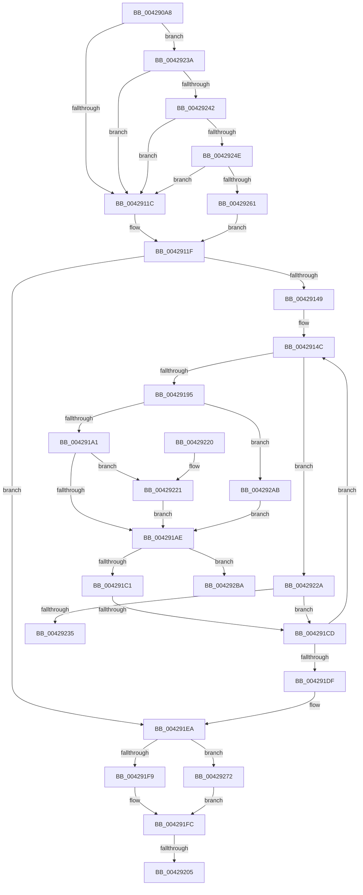

# VmpQueryAccessedState

- RVA: `0x004290A8`–`0x004292C3` (길이 `539` bytes)
- VA: `0x00000001404290A8`
- 실행 섹션: `.text`
- PDB 이름 있음: `예`; PDB Function 태그: `예`
- unwind 정보 RVA: `0x000A0E74`
- 디코드: `142`개 명령, `539/539` bytes 표시
- 미해석 바이트: `0` (있으면 어셈블리에 `.byte`로 보존)

> 이 문서는 커널 이미지의 기계어와 PDB 기호를 분석해 생성했습니다. 4번과 5번은 함수 원형과 자료형을 바이너리 사용 방식에서 추정한 C 해석이며 원본 소스 복구 결과는 아닙니다.

## 1. Dependencies

- 직접 호출 지점: **5**; 고유 호출 대상: **5**
- 직접 호출자로 확인된 함수: **1**
- RIP 상대 이미지 참조: **1**

### Outgoing calls
- `0x00429136` → [VmpProcessContextLockShared](VmpProcessContextLockShared_function_00429DB0.md) (function, `0x00429DB0`)
- `0x00429185` → [VmpConvertPortionVpnRangeToGpnRange](../31/VmpConvertPortionVpnRangeToGpnRange_function_003147F0.md) (function, `0x003147F0`)
- `0x004291F0` → [VmpProcessContextUnlockShared](VmpProcessContextUnlockShared_function_00429DFC.md) (function, `0x00429DFC`)
- `0x00429265` → [KeQueryUnbiasedInterruptTimePrecise](../37/KeQueryUnbiasedInterruptTimePrecise_function_0037AC20.md) (function, `0x0037AC20`)
- `0x0042929E` → [VmpProcessAccessedBatch](VmpProcessAccessedBatch_function_0042A2DC.md) (function, `0x0042A2DC`)

### Direct callers
- [MiQueryVpabAccessedState](MiQueryVpabAccessedState_function_00428E70.md) at `0x00428EE2`

### Static image references
- `0x004290E8` → RVA `0x00F02458` (`.data`; read)

## 2. Other-region calls and transfers

- 다른 실행 섹션으로 향하는 call: **0**
- call이 아닌 외부 분기/꼬리 이동: **4**
  - `0x004291C7` → [sub_006EDFF2](../6E/Unknown_function_006EDFF2.md) (`tail-transfer`)
  - `0x004291FF` → [sub_006EDFF2 + 0x63](../6E/Unknown_function_006EDFF2.md) (`tail-transfer`)
  - `0x00429235` → [sub_006EDFF2](../6E/Unknown_function_006EDFF2.md) (`tail-transfer`)
  - `0x004292BE` → [sub_006EDFF2](../6E/Unknown_function_006EDFF2.md) (`tail-transfer`)

## 3. Assembly (complete function range)

```asm
004290A8  48 8B C4                        mov rax, rsp
004290AB  48 89 58 08                     mov qword ptr [rax + 8], rbx
004290AF  44 89 48 20                     mov dword ptr [rax + 0x20], r9d
004290B3  44 89 40 18                     mov dword ptr [rax + 0x18], r8d
004290B7  55                              push rbp
004290B8  56                              push rsi
004290B9  57                              push rdi
004290BA  41 54                           push r12
004290BC  41 55                           push r13
004290BE  41 56                           push r14
004290C0  41 57                           push r15
004290C2  48 8D 68 A1                     lea rbp, [rax - 0x5f]
004290C6  48 81 EC B0 00 00 00            sub rsp, 0xb0
004290CD  33 F6                           xor esi, esi
004290CF  41 8B C0                        mov eax, r8d
004290D2  4C 8B F1                        mov r14, rcx
004290D5  89 75 C7                        mov dword ptr [rbp - 0x39], esi
004290D8  33 C9                           xor ecx, ecx
004290DA  C7 45 BB 01 00 00 00            mov dword ptr [rbp - 0x45], 1
004290E1  0F 57 C0                        xorps xmm0, xmm0
004290E4  48 89 4D 17                     mov qword ptr [rbp + 0x17], rcx
004290E8  48 8B 0D 69 93 AD 00            mov rcx, qword ptr [rip + 0xad9369]
004290EF  48 8D 04 C2                     lea rax, [rdx + rax*8]
004290F3  48 89 45 DF                     mov qword ptr [rbp - 0x21], rax
004290F7  48 8B FA                        mov rdi, rdx
004290FA  89 75 B7                        mov dword ptr [rbp - 0x49], esi
004290FD  8B DE                           mov ebx, esi
004290FF  48 89 75 D7                     mov qword ptr [rbp - 0x29], rsi
00429103  44 8B E6                        mov r12d, esi
00429106  BA 00 02 00 00                  mov edx, 0x200
0042910B  0F 11 45 E7                     movups xmmword ptr [rbp - 0x19], xmm0
0042910F  0F 11 45 07                     movups xmmword ptr [rbp + 7], xmm0
00429113  48 85 C9                        test rcx, rcx
00429116  0F 85 1E 01 00 00               jne 0x14042923a
0042911C  4C 8B EE                        mov r13, rsi
0042911F  65 48 8B 04 25 20 00 00 00      mov rax, qword ptr gs:[0x20]
00429128  49 8B CE                        mov rcx, r14
0042912B  4C 89 6D CF                     mov qword ptr [rbp - 0x31], r13
0042912F  4C 8B B8 50 8B 00 00            mov r15, qword ptr [rax + 0x8b50]
00429136  E8 75 0C 00 00                  call 0x140429db0
0042913B  48 89 45 BF                     mov qword ptr [rbp - 0x41], rax
0042913F  48 3B 7D DF                     cmp rdi, qword ptr [rbp - 0x21]
00429143  0F 83 A1 00 00 00               jae 0x1404291ea
00429149  44 8B EB                        mov r13d, ebx
0042914C  48 8B 0F                        mov rcx, qword ptr [rdi]
0042914F  48 8D 45 C7                     lea rax, [rbp - 0x39]
00429153  83 64 24 30 00                  and dword ptr [rsp + 0x30], 0
00429158  4C 8D 4D 07                     lea r9, [rbp + 7]
0042915C  48 C1 E9 0C                     shr rcx, 0xc
00429160  48 8D 55 F7                     lea rdx, [rbp - 9]
00429164  48 89 44 24 28                  mov qword ptr [rsp + 0x28], rax
00429169  49 83 C8 FF                     or r8, 0xffffffffffffffff
0042916D  48 89 4D F7                     mov qword ptr [rbp - 9], rcx
00429171  48 8D 45 E7                     lea rax, [rbp - 0x19]
00429175  49 8B CE                        mov rcx, r14
00429178  48 C7 45 FF 01 00 00 00         mov qword ptr [rbp - 1], 1
00429180  48 89 44 24 20                  mov qword ptr [rsp + 0x20], rax
00429185  E8 66 B6 EE FF                  call 0x1403147f0
0042918A  48 83 7D EF 00                  cmp qword ptr [rbp - 0x11], 0
0042918F  0F 84 95 00 00 00               je 0x14042922a
00429195  48 8B 55 E7                     mov rdx, qword ptr [rbp - 0x19]
00429199  85 F6                           test esi, esi
0042919B  0F 84 0A 01 00 00               je 0x1404292ab
004291A1  8D 4E FF                        lea ecx, [rsi - 1]
004291A4  48 8D 42 FF                     lea rax, [rdx - 1]
004291A8  49 39 04 CF                     cmp qword ptr [r15 + rcx*8], rax
004291AC  75 73                           jne 0x140429221
004291AE  8B C6                           mov eax, esi
004291B0  FF C6                           inc esi
004291B2  48 83 7D FF 00                  cmp qword ptr [rbp - 1], 0
004291B7  49 89 14 C7                     mov qword ptr [r15 + rax*8], rdx
004291BB  0F 85 F9 00 00 00               jne 0x1404292ba
004291C1  81 FE 00 02 00 00               cmp esi, 0x200
004291C7  0F 84 25 4E 2C 00               je 0x1406edff2
004291CD  48 8B 45 BF                     mov rax, qword ptr [rbp - 0x41]
004291D1  48 83 C7 08                     add rdi, 8
004291D5  48 3B 7D DF                     cmp rdi, qword ptr [rbp - 0x21]
004291D9  0F 82 6D FF FF FF               jb 0x14042914c
004291DF  44 89 6D 6F                     mov dword ptr [rbp + 0x6f], r13d
004291E3  4C 8B 6D CF                     mov r13, qword ptr [rbp - 0x31]
004291E7  8B 5D 6F                        mov ebx, dword ptr [rbp + 0x6f]
004291EA  48 8B D0                        mov rdx, rax
004291ED  49 8B CE                        mov rcx, r14
004291F0  E8 07 0C 00 00                  call 0x140429dfc
004291F5  85 F6                           test esi, esi
004291F7  75 79                           jne 0x140429272
004291F9  8B 5D 7F                        mov ebx, dword ptr [rbp + 0x7f]
004291FC  4D 85 ED                        test r13, r13
004291FF  0F 85 50 4E 2C 00               jne 0x1406ee055
00429205  48 8B 9C 24 F0 00 00 00         mov rbx, qword ptr [rsp + 0xf0]
0042920D  48 81 C4 B0 00 00 00            add rsp, 0xb0
00429214  41 5F                           pop r15
00429216  41 5E                           pop r14
00429218  41 5D                           pop r13
0042921A  41 5C                           pop r12
0042921C  5F                              pop rdi
0042921D  5E                              pop rsi
0042921E  5D                              pop rbp
0042921F  C3                              ret
00429220  CC                              int3
00429221  45 33 ED                        xor r13d, r13d
00429224  44 21 6D BB                     and dword ptr [rbp - 0x45], r13d
00429228  EB 84                           jmp 0x1404291ae
0042922A  48 83 0F 06                     or qword ptr [rdi], 6
0042922E  FF 45 B7                        inc dword ptr [rbp - 0x49]
00429231  85 F6                           test esi, esi
00429233  74 98                           je 0x1404291cd
00429235  E9 B8 4D 2C 00                  jmp 0x1406edff2
0042923A  39 31                           cmp dword ptr [rcx], esi
0042923C  0F 86 DA FE FF FF               jbe 0x14042911c
00429242  8B 41 10                        mov eax, dword ptr [rcx + 0x10]
00429245  48 85 C2                        test rdx, rax
00429248  0F 84 CE FE FF FF               je 0x14042911c
0042924E  48 8B 49 18                     mov rcx, qword ptr [rcx + 0x18]
00429252  48 8B C1                        mov rax, rcx
00429255  48 23 C2                        and rax, rdx
00429258  48 3B C1                        cmp rax, rcx
0042925B  0F 85 BB FE FF FF               jne 0x14042911c
00429261  48 8D 4D CF                     lea rcx, [rbp - 0x31]
00429265  E8 B6 19 F5 FF                  call 0x14037ac20
0042926A  4C 8B E8                        mov r13, rax
0042926D  E9 AD FE FF FF                  jmp 0x14042911f
00429272  89 5C 24 30                     mov dword ptr [rsp + 0x30], ebx
00429276  49 8D 8F 00 10 00 00            lea rcx, [r15 + 0x1000]
0042927D  8B 5D 7F                        mov ebx, dword ptr [rbp + 0x7f]
00429280  44 8B C6                        mov r8d, esi
00429283  8B C6                           mov eax, esi
00429285  49 8B D7                        mov rdx, r15
00429288  48 C1 E0 03                     shl rax, 3
0042928C  48 2B F8                        sub rdi, rax
0042928F  89 5C 24 28                     mov dword ptr [rsp + 0x28], ebx
00429293  48 89 4C 24 20                  mov qword ptr [rsp + 0x20], rcx
00429298  4C 8B CF                        mov r9, rdi
0042929B  49 8B CE                        mov rcx, r14
0042929E  E8 39 10 00 00                  call 0x14042a2dc
004292A3  41 FF C4                        inc r12d
004292A6  E9 51 FF FF FF                  jmp 0x1404291fc
004292AB  48 89 7D D7                     mov qword ptr [rbp - 0x29], rdi
004292AF  41 BD 01 00 00 00               mov r13d, 1
004292B5  E9 F4 FE FF FF                  jmp 0x1404291ae
004292BA  48 83 EF 08                     sub rdi, 8
004292BE  E9 2F 4D 2C 00                  jmp 0x1406edff2
```

## 4. C-style interpretation (structured pseudocode)

```c
__int64 __fastcall VmpQueryAccessedState(__int64 a1, __int64 a2, __int64 a3, int a4)
{
    __int64 result;
    __int64 v_r12;
    __int64 v_r13;
    __int64 v_rdi;
    __int64 v_rsi;
    __int64 v_rsp;
    unsigned int v_stack_mB8;
    unsigned __int64 v_stack_mC0;
    unsigned __int64 v_stack_mC8;
    unsigned __int64 v_stack_p20;
    unsigned int v_stack_p28;
    unsigned int v_stack_p30;
    unsigned __int64 v_stack_p8;

    *(unsigned __int64 *)(v_rsp + 8) = v_rbx;
    *(unsigned int *)(v_rsp + 32) = a4;
    *(unsigned int *)(v_rsp + 24) = (unsigned int)(a3);
    v_rsp = (v_rsp) - (176);
    v_rsi = 0;
    *(unsigned int *)(v_rsp - 95 - 57) = 0;
    a1 = 0;
    *(unsigned int *)(v_rsp - 95 - 69) = 1;
    *(unsigned __int64 *)(v_rsp - 95 + 23) = 0;
    *(unsigned __int64 *)(v_rsp - 95 - 33) = a2 + (unsigned int)((unsigned int)(a3)) * 8;
    *(unsigned int *)(v_rsp - 95 - 73) = 0;
    *(unsigned __int64 *)(v_rsp - 95 - 41) = 0;
    *(unsigned __int64 *)(v_rsp - 95 - 25) = v_xmm0;
    *(unsigned __int64 *)(v_rsp - 95 + 7) = v_xmm0;
    if (*(unsigned __int64 *)(v_rip + 11375465) != 0) goto loc_0042923A;
loc_0042911C:
loc_0042911F:
    *(unsigned __int64 *)(v_rsp - 95 - 49) = 0;
    result = VmpProcessContextLockShared(0, 512, a3, a4);
    *(unsigned __int64 *)(v_rsp - 95 - 65) = result;
    if (a2 >= (*(unsigned __int64 *)(v_rsp - 95 - 33))) goto loc_004291EA;
loc_0042914C:
    a1 = (*(unsigned __int64 *)(a2)) >> (12);
    v_stack_mC0 = v_rsp - 95 - 57;
    a3 = (a3) | (-1);
    *(unsigned __int64 *)(v_rsp - 95 - 9) = a1;
    *(unsigned __int64 *)(v_rsp - 95 - 1) = 1;
    v_stack_mC8 = v_rsp - 95 - 25;
    result = VmpConvertPortionVpnRangeToGpnRange(a1, v_rsp - 95 - 9, a3, v_rsp - 95 + 7);
    if ((*(unsigned __int64 *)(v_rsp - 95 - 17)) == 0) goto loc_0042922A;
    if (0 == 0) goto loc_004292AB;
    if ((*(unsigned __int64 *)(*(unsigned __int64 *)(*(unsigned __int64 *)(gs_base + (0 + 32)) + 35664) + v_rsi - 1 * 8)) != (*(unsigned __int64 *)(v_rsp - 95 - 25) - 1)) goto loc_00429221;
loc_004291AE:
    v_rsi = (unsigned int)((v_rsi) + 1);
    *(unsigned __int64 *)(*(unsigned __int64 *)(*(unsigned __int64 *)(gs_base + (0 + 32)) + 35664) + 0 * 8) = *(unsigned __int64 *)(v_rsp - 95 - 25);
    if ((*(unsigned __int64 *)(v_rsp - 95 - 1)) != 0) goto loc_004292BA;
loc_004291CD:
    v_rdi = (a2) + (8);
    if (v_rdi < (*(unsigned __int64 *)(v_rsp - 95 - 33))) goto loc_0042914C;
    *(unsigned int *)(v_rsp - 95 + 111) = 0;
loc_004291EA:
    result = VmpProcessContextUnlockShared(a1, *(unsigned __int64 *)(v_rsp - 95 - 65), a3, v_rsp - 95 + 7);
    if ((unsigned int)(v_rsi) != 0) goto loc_00429272;
loc_004291FC:
    v_rsp = (v_rsp) + (176);
    return result;
loc_00429221:
    v_r13 = 0;
    goto loc_004291AE;
loc_0042922A:
    if ((unsigned int)(v_rsi) == 0) goto loc_004291CD;
loc_0042923A:
    if ((*(unsigned int *)(a1)) <= ((unsigned int)(v_rsi))) goto loc_0042911C;
    if (((*(unsigned __int64 *)(v_rsp - 95 - 65)) & ((unsigned int)(*(unsigned int *)(a1 + 16)))) == 0) goto loc_0042911C;
    result = (*(unsigned __int64 *)(a1 + 24)) & (*(unsigned __int64 *)(v_rsp - 95 - 65));
    if (result != (*(unsigned __int64 *)(a1 + 24))) goto loc_0042911C;
    result = KeQueryUnbiasedInterruptTimePrecise(v_rsp - 95 - 49, *(unsigned __int64 *)(v_rsp - 95 - 65), a3, v_rsp - 95 + 7);
    goto loc_0042911F;
loc_00429272:
    v_stack_p30 = (unsigned int)(v_stack_p8);
    result = ((unsigned int)((unsigned int)(v_rsi))) << (3);
    v_rdi = (v_rdi) - (result);
    v_stack_p28 = (unsigned int)((unsigned int)(*(unsigned int *)(v_rsp - 95 + 127)));
    v_stack_p20 = *(unsigned __int64 *)(*(unsigned __int64 *)(gs_base + (0 + 32)) + 35664) + 4096;
    result = VmpProcessAccessedBatch(a1, *(unsigned __int64 *)(*(unsigned __int64 *)(gs_base + (0 + 32)) + 35664), (unsigned int)((unsigned int)(v_rsi)), v_rdi);
    v_r12 = (unsigned int)((0) + 1);
    goto loc_004291FC;
loc_004292AB:
    *(unsigned __int64 *)(v_rsp - 95 - 41) = v_rdi;
    goto loc_004291AE;
loc_004292BA:
    v_rdi = (v_rdi) - (8);
}
```

## 5. (Beta) C Style

```c
int64_t VmpQueryAccessedState(int64_t Arg1, void *Arg2, int64_t Arg3, int32_t Arg4)
{
    uint8_t *arg2 = (uint8_t *)Arg2;

    int64_t result;
    int64_t local_r12;
    int64_t local_r13;
    int64_t local_rdi;
    int64_t local_rsi;
    int64_t local_rsp;
    uint32_t v_stack_mB8;
    uint64_t v_stack_mC0;
    uint64_t v_stack_mC8;
    uint64_t v_stack_p20;
    uint32_t v_stack_p28;
    uint32_t v_stack_p30;
    uint64_t v_stack_p8;

    *(uint64_t *)(local_rsp + 0x8) = local_rbx;
    *(uint32_t *)(local_rsp + 0x20) = Arg4;
    *(uint32_t *)(local_rsp + 0x18) = (uint32_t)(Arg3);
    local_rsp = (local_rsp) - (176);
    local_rsi = 0;
    *(uint32_t *)(local_rsp - 0x5F - 0x39) = 0;
    Arg1 = 0;
    *(uint32_t *)(local_rsp - 0x5F - 0x45) = 1;
    *(uint64_t *)(local_rsp - 0x5F + 0x17) = 0;
    *(void **)(local_rsp - 0x5F - 0x21) = Arg2 + (uint32_t)((uint32_t)(Arg3)) * 8;
    *(uint32_t *)(local_rsp - 0x5F - 0x49) = 0;
    *(uint64_t *)(local_rsp - 0x5F - 0x29) = 0;
    *(uint64_t *)(local_rsp - 0x5F - 0x19) = v_xmm0;
    *(uint64_t *)(local_rsp - 0x5F + 0x7) = v_xmm0;
    if (*(uint64_t *)(v_rip + 0xAD9369) != 0) goto loc_0042923A;
loc_0042911C:
loc_0042911F:
    *(uint64_t *)(local_rsp - 0x5F - 0x31) = 0;
    result = VmpProcessContextLockShared(0, 512, Arg3, Arg4);
    *(uint64_t *)(local_rsp - 0x5F - 0x41) = result;
    if (Arg2 >= (*(uint64_t *)(local_rsp - 0x5F - 0x21))) goto loc_004291EA;
loc_0042914C:
    Arg1 = (*(uint64_t *)(arg2)) >> (12);
    v_stack_mC0 = local_rsp - 95 - 57;
    Arg3 = (Arg3) | (-1);
    *(uint64_t *)(local_rsp - 0x5F - 0x9) = Arg1;
    *(uint64_t *)(local_rsp - 0x5F - 0x1) = 1;
    v_stack_mC8 = local_rsp - 95 - 25;
    result = VmpConvertPortionVpnRangeToGpnRange(Arg1, local_rsp - 95 - 9, Arg3, local_rsp - 95 + 7);
    if ((*(uint64_t *)(local_rsp - 0x5F - 0x11)) == 0) goto loc_0042922A;
    if (0 == 0) goto loc_004292AB;
    if ((*(uint64_t *)(*(uint64_t *)(*(uint64_t *)(gs_base + (0 + 0x20)) + 0x8B50) + local_rsi - 0x1 * 8)) != (*(uint64_t *)(local_rsp - 0x5F - 0x19) - 1)) goto loc_00429221;
loc_004291AE:
    local_rsi = (uint32_t)((local_rsi) + 1);
    *(uint64_t *)(*(uint64_t *)(*(uint64_t *)(gs_base + (0 + 0x20)) + 0x8B50) + 0x0 * 8) = *(uint64_t *)(local_rsp - 0x5F - 0x19);
    if ((*(uint64_t *)(local_rsp - 0x5F - 0x1)) != 0) goto loc_004292BA;
loc_004291CD:
    local_rdi = (Arg2) + (8);
    if (local_rdi < (*(uint64_t *)(local_rsp - 0x5F - 0x21))) goto loc_0042914C;
    *(uint32_t *)(local_rsp - 0x5F + 0x6F) = 0;
loc_004291EA:
    result = VmpProcessContextUnlockShared(Arg1, *(uint64_t *)(local_rsp - 0x5F - 0x41), Arg3, local_rsp - 95 + 7);
    if ((uint32_t)(local_rsi) != 0) goto loc_00429272;
loc_004291FC:
    local_rsp = (local_rsp) + (176);
    return result;
loc_00429221:
    local_r13 = 0;
    goto loc_004291AE;
loc_0042922A:
    if ((uint32_t)(local_rsi) == 0) goto loc_004291CD;
loc_0042923A:
    if ((*(uint32_t *)(Arg1)) <= ((uint32_t)(local_rsi))) goto loc_0042911C;
    if (((*(uint64_t *)(local_rsp - 0x5F - 0x41)) & ((uint32_t)(*(uint32_t *)(Arg1 + 0x10)))) == 0) goto loc_0042911C;
    result = (*(uint64_t *)(Arg1 + 0x18)) & (*(uint64_t *)(local_rsp - 0x5F - 0x41));
    if (result != (*(uint64_t *)(Arg1 + 0x18))) goto loc_0042911C;
    result = KeQueryUnbiasedInterruptTimePrecise(local_rsp - 95 - 49, *(uint64_t *)(local_rsp - 0x5F - 0x41), Arg3, local_rsp - 95 + 7);
    goto loc_0042911F;
loc_00429272:
    v_stack_p30 = (uint32_t)(v_stack_p8);
    result = ((uint32_t)((uint32_t)(local_rsi))) << (3);
    local_rdi = (local_rdi) - (result);
    v_stack_p28 = (uint32_t)((uint32_t)(*(uint32_t *)(local_rsp - 0x5F + 0x7F)));
    v_stack_p20 = *(uint64_t *)(*(uint64_t *)(gs_base + (0 + 0x20)) + 0x8B50) + 4096;
    result = VmpProcessAccessedBatch(Arg1, *(uint64_t *)(*(uint64_t *)(gs_base + (0 + 0x20)) + 0x8B50), (uint32_t)((uint32_t)(local_rsi)), local_rdi);
    local_r12 = (uint32_t)((0) + 1);
    goto loc_004291FC;
loc_004292AB:
    *(uint64_t *)(local_rsp - 0x5F - 0x29) = local_rdi;
    goto loc_004291AE;
loc_004292BA:
    local_rdi = (local_rdi) - (8);
}
```

### 관측된 메모리 오프셋

구조체 형식이 확인되지 않은 접근은 인자 기준의 오프셋으로만 기록했습니다.

| 기준 인자 | 오프셋 표현 | 폭 (bit) | 접근 |
|---|---:|---:|---|
| `Arg2` | `+ 0x0 + rax*8` | `64` | `R` |

## 6. Execution-region graph

[열기: 2D/3D 그래프와 함수 탐색 컨트롤 패널](../../../control-panel.html?section=text&rva=0x004290A8&view=graph)

- 2D 그래프는 위에서 아래로 흐르고, 3D 그래프는 빈 공간을 드래그해 회전합니다. Shift+드래그는 이동, 휠은 확대·축소, 함수 노드 선택은 대상 보고서 이동입니다.

### Static fallback


