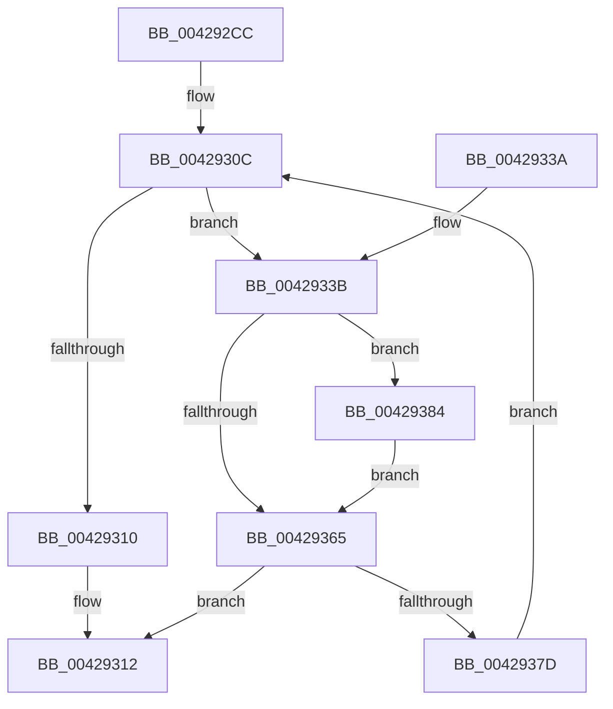

# VslQueryPrivilegedAccessedState

- RVA: `0x004292CC`–`0x0042938F` (길이 `195` bytes)
- VA: `0x00000001404292CC`
- 실행 섹션: `.text`
- PDB 이름 있음: `예`; PDB Function 태그: `아니요`
- unwind 정보 RVA: `0x000A0EA4`
- 디코드: `56`개 명령, `195/195` bytes 표시
- 미해석 바이트: `0` (있으면 어셈블리에 `.byte`로 보존)

> 이 문서는 커널 이미지의 기계어와 PDB 기호를 분석해 생성했습니다. 4번과 5번은 함수 원형과 자료형을 바이너리 사용 방식에서 추정한 C 해석이며 원본 소스 복구 결과는 아닙니다.

## 1. Dependencies

- 직접 호출 지점: **4**; 고유 호출 대상: **4**
- 직접 호출자로 확인된 함수: **1**
- RIP 상대 이미지 참조: **1**

### Outgoing calls
- `0x00429307` → [memset](../6C/memset_function_006C6C40.md) (function, `0x006C6C40`)
- `0x0042931D` → [_security_check_cookie](../6A/_security_check_cookie_function_006AC640.md) (function, `0x006AC640`)
- `0x0042935B` → [memcpy](../6C/memcpy_function_006C6840.md) (function, `0x006C6840`)
- `0x00429374` → [VslpEnterIumSecureMode](../23/VslpEnterIumSecureMode_function_00235E50.md) (function, `0x00235E50`)

### Direct callers
- [MiQueryVpabAccessedState](MiQueryVpabAccessedState_function_00428E70.md) at `0x00428F25`

### Static image references
- `0x004292E1` → RVA `0x00E0A740` (`.data`; read)

## 2. Other-region calls and transfers

- 다른 실행 섹션으로 향하는 call: **0**
- 별도 외부 분기/꼬리 이동을 확인하지 못했습니다.

## 3. Assembly (complete function range)

```asm
004292CC  48 89 5C 24 18                  mov qword ptr [rsp + 0x18], rbx
004292D1  48 89 6C 24 20                  mov qword ptr [rsp + 0x20], rbp
004292D6  56                              push rsi
004292D7  57                              push rdi
004292D8  41 56                           push r14
004292DA  48 81 EC A0 00 00 00            sub rsp, 0xa0
004292E1  48 8B 05 58 14 9E 00            mov rax, qword ptr [rip + 0x9e1458]
004292E8  48 33 C4                        xor rax, rsp
004292EB  48 89 84 24 90 00 00 00         mov qword ptr [rsp + 0x90], rax
004292F3  8B DA                           mov ebx, edx
004292F5  45 0F B6 F0                     movzx r14d, r8b
004292F9  33 D2                           xor edx, edx
004292FB  48 8B F1                        mov rsi, rcx
004292FE  48 8D 4C 24 20                  lea rcx, [rsp + 0x20]
00429303  44 8D 42 68                     lea r8d, [rdx + 0x68]
00429307  E8 34 D9 29 00                  call 0x1406c6c40
0042930C  85 DB                           test ebx, ebx
0042930E  75 2B                           jne 0x14042933b
00429310  33 C0                           xor eax, eax
00429312  48 8B 8C 24 90 00 00 00         mov rcx, qword ptr [rsp + 0x90]
0042931A  48 33 CC                        xor rcx, rsp
0042931D  E8 1E 33 28 00                  call 0x1406ac640
00429322  4C 8D 9C 24 A0 00 00 00         lea r11, [rsp + 0xa0]
0042932A  49 8B 5B 30                     mov rbx, qword ptr [r11 + 0x30]
0042932E  49 8B 6B 38                     mov rbp, qword ptr [r11 + 0x38]
00429332  49 8B E3                        mov rsp, r11
00429335  41 5E                           pop r14
00429337  5F                              pop rdi
00429338  5E                              pop rsi
00429339  C3                              ret
0042933A  CC                              int3
0042933B  BF 0B 00 00 00                  mov edi, 0xb
00429340  4C 89 74 24 28                  mov qword ptr [rsp + 0x28], r14
00429345  3B DF                           cmp ebx, edi
00429347  48 8D 4C 24 30                  lea rcx, [rsp + 0x30]
0042934C  48 8B D6                        mov rdx, rsi
0042934F  0F 42 FB                        cmovb edi, ebx
00429352  8B EF                           mov ebp, edi
00429354  48 C1 E5 03                     shl rbp, 3
00429358  4C 8B C5                        mov r8, rbp
0042935B  E8 E0 D4 29 00                  call 0x1406c6840
00429360  83 FF 0B                        cmp edi, 0xb
00429363  72 1F                           jb 0x140429384
00429365  BA F8 00 00 00                  mov edx, 0xf8
0042936A  4C 8D 4C 24 20                  lea r9, [rsp + 0x20]
0042936F  45 33 C0                        xor r8d, r8d
00429372  B1 02                           mov cl, 2
00429374  E8 D7 CA E0 FF                  call 0x140235e50
00429379  85 C0                           test eax, eax
0042937B  78 95                           js 0x140429312
0042937D  48 03 F5                        add rsi, rbp
00429380  2B DF                           sub ebx, edi
00429382  EB 88                           jmp 0x14042930c
00429384  8D 47 01                        lea eax, [rdi + 1]
00429387  48 83 64 C4 28 00               and qword ptr [rsp + rax*8 + 0x28], 0
0042938D  EB D6                           jmp 0x140429365
```

## 4. C-style interpretation (structured pseudocode)

```c
__int64 __fastcall VslQueryPrivilegedAccessedState(__int64 a1, int a2, unsigned __int8 a3)
{
    __int64 result;
    __int64 v_rbp;
    __int64 v_rbx;
    __int64 v_rdi;
    __int64 v_rsi;
    __int64 v_rsp;
    unsigned __int64 v_stack_m18;
    unsigned __int64 v_stack_m28;
    unsigned __int64 v_stack_m70;
    unsigned __int64 v_stack_m78;
    unsigned __int64 v_stack_m80;
    unsigned __int64 v_stack_m98;
    unsigned __int64 v_stack_p18;
    unsigned __int64 v_stack_p20;

    v_stack_p18 = v_rbx;
    v_stack_p20 = v_rbp;
    v_rsp = (v_rsp) - (160);
    result = (*(unsigned __int64 *)(v_rip + 10359896)) ^ (v_rsp);
    v_stack_m28 = result;
    a2 = 0;
    result = memset(v_stack_m98, a2, a2 + 104, a4);
loc_0042930C:
    if ((unsigned int)((unsigned int)(a2)) != 0) goto loc_0042933B;
    result = 0;
loc_00429312:
    a1 = (v_stack_m28) ^ (v_rsp);
    result = _security_check_cookie(a1, a2, a2 + 104, a4);
    return result;
loc_0042933B:
    v_stack_m78 = a3;
    v_rdi = 11;
    if (((unsigned int)(*(unsigned __int64 *)(v_stack_m18 + 48))) < 11) { v_rdi = (unsigned int)(*(unsigned __int64 *)(v_stack_m18 + 48)); }
    v_rbp = ((unsigned int)((unsigned int)(v_rdi))) << (3);
    result = memcpy(v_stack_m70, a1, v_rbp, a4);
    if (((unsigned int)(v_rdi)) < 11) goto loc_00429384;
loc_00429365:
    a3 = 0;
    result = VslpEnterIumSecureMode(2, 248, a3, v_stack_m80);
    if (sign_flag) goto loc_00429312;
    v_rsi = (a1) + (v_rbp);
    v_rbx = (unsigned int)((*(unsigned __int64 *)(v_stack_m18 + 48)) - ((unsigned int)(v_rdi)));
    goto loc_0042930C;
loc_00429384:
    goto loc_00429365;
}
```

## 5. (Beta) C Style

```c
int64_t VslQueryPrivilegedAccessedState(int64_t Arg1, int32_t Arg2, uint8_t Arg3)
{
    int64_t result;
    int64_t local_rbp;
    int64_t local_rbx;
    int64_t local_rdi;
    int64_t local_rsi;
    int64_t local_rsp;
    uint64_t v_stack_m18;
    uint64_t v_stack_m28;
    uint64_t v_stack_m70;
    uint64_t v_stack_m78;
    uint64_t v_stack_m80;
    uint64_t v_stack_m98;
    uint64_t v_stack_p18;
    uint64_t v_stack_p20;

    v_stack_p18 = local_rbx;
    v_stack_p20 = local_rbp;
    local_rsp = (local_rsp) - (160);
    result = (*(uint64_t *)(v_rip + 0x9E1458)) ^ (local_rsp);
    v_stack_m28 = result;
    Arg2 = 0;
    result = memset(v_stack_m98, Arg2, Arg2 + 104, a4);
loc_0042930C:
    if ((uint32_t)((uint32_t)(Arg2)) != 0) goto loc_0042933B;
    result = 0;
loc_00429312:
    Arg1 = (v_stack_m28) ^ (local_rsp);
    result = _security_check_cookie(Arg1, Arg2, Arg2 + 104, a4);
    return result;
loc_0042933B:
    v_stack_m78 = Arg3;
    local_rdi = 11;
    if (((uint32_t)(*(uint64_t *)(v_stack_m18 + 0x30))) < 11) { local_rdi = (uint32_t)(*(uint64_t *)(v_stack_m18 + 0x30)); }
    local_rbp = ((uint32_t)((uint32_t)(local_rdi))) << (3);
    result = memcpy(v_stack_m70, Arg1, local_rbp, a4);
    if (((uint32_t)(local_rdi)) < 11) goto loc_00429384;
loc_00429365:
    Arg3 = 0;
    result = VslpEnterIumSecureMode(2, 248, Arg3, v_stack_m80);
    if (sign_flag) goto loc_00429312;
    local_rsi = (Arg1) + (local_rbp);
    local_rbx = (uint32_t)((*(uint64_t *)(v_stack_m18 + 0x30)) - ((uint32_t)(local_rdi)));
    goto loc_0042930C;
loc_00429384:
    goto loc_00429365;
}
```

## 6. Execution-region graph

[열기: 2D/3D 그래프와 함수 탐색 컨트롤 패널](../../../control-panel.html?section=text&rva=0x004292CC&view=graph)

- 2D 그래프는 위에서 아래로 흐르고, 3D 그래프는 빈 공간을 드래그해 회전합니다. Shift+드래그는 이동, 휠은 확대·축소, 함수 노드 선택은 대상 보고서 이동입니다.

### Static fallback


