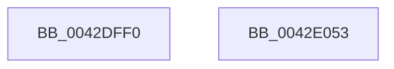

# WheaInitializeRecordHeader

- RVA: `0x0042DFF0`–`0x0042E054` (길이 `100` bytes)
- VA: `0x000000014042DFF0`
- 실행 섹션: `.text`
- PDB 이름 있음: `예`; PDB Function 태그: `아니요`
- unwind 정보 RVA: `0x0005CF00`
- 디코드: `24`개 명령, `100/100` bytes 표시
- 미해석 바이트: `0` (있으면 어셈블리에 `.byte`로 보존)

> 이 문서는 커널 이미지의 기계어와 PDB 기호를 분석해 생성했습니다. 4번과 5번은 함수 원형과 자료형을 바이너리 사용 방식에서 추정한 C 해석이며 원본 소스 복구 결과는 아닙니다.

## 1. Dependencies

- 직접 호출 지점: **2**; 고유 호출 대상: **2**
- 직접 호출자로 확인된 함수: **4**
- RIP 상대 이미지 참조: **2**

### Outgoing calls
- `0x0042E001` → [memset](../6C/memset_function_006C6C40.md) (function, `0x006C6C40`)
- `0x0042E031` → [WheapGetTimestamp](WheapGetTimestamp_function_0042E05C.md) (function, `0x0042E05C`)

### Direct callers
- [HalpCreateMcaMemoryErrorRecord](../54/HalpCreateMcaMemoryErrorRecord_function_00540C78.md) at `0x00540CD2`
- [HalpCreateMcaProcessorErrorRecord](../54/HalpCreateMcaProcessorErrorRecord_function_00541038.md) at `0x0054108B`
- [HalpCreateNMIErrorRecord](../54/HalpCreateNMIErrorRecord_function_005459A8.md) at `0x005459FF`
- [WheapCreateRecordFromGenericErrorData](../65/WheapCreateRecordFromGenericErrorData_function_0065FCE4.md) at `0x0065FDDF`

### Static image references
- `0x0042E006` → RVA `0x00014558` (`.rdata`; read)
- `0x0042E03B` → RVA `0x00EEF010` (`.data`; read/write)

## 2. Other-region calls and transfers

- 다른 실행 섹션으로 향하는 call: **0**
- 별도 외부 분기/꼬리 이동을 확인하지 못했습니다.

## 3. Assembly (complete function range)

```asm
0042DFF0  40 53                           push rbx
0042DFF2  48 83 EC 20                     sub rsp, 0x20
0042DFF6  33 D2                           xor edx, edx
0042DFF8  41 B8 80 00 00 00               mov r8d, 0x80
0042DFFE  48 8B D9                        mov rbx, rcx
0042E001  E8 3A 8C 29 00                  call 0x1406c6c40
0042E006  0F 10 05 4B 65 BE FF            movups xmm0, xmmword ptr [rip - 0x419ab5]
0042E00D  83 4B 06 FF                     or dword ptr [rbx + 6], 0xffffffff
0042E011  48 8D 4B 18                     lea rcx, [rbx + 0x18]
0042E015  83 4B 10 02                     or dword ptr [rbx + 0x10], 2
0042E019  F3 0F 7F 43 40                  movdqu xmmword ptr [rbx + 0x40], xmm0
0042E01E  C7 03 43 50 45 52               mov dword ptr [rbx], 0x52455043
0042E024  66 C7 43 04 10 02               mov word ptr [rbx + 4], 0x210
0042E02A  C7 43 0C 03 00 00 00            mov dword ptr [rbx + 0xc], 3
0042E031  E8 26 00 00 00                  call 0x14042e05c
0042E036  B8 01 00 00 00                  mov eax, 1
0042E03B  F0 48 0F C1 05 CC 0F AC 00      lock xadd qword ptr [rip + 0xac0fcc], rax
0042E044  48 FF C0                        inc rax
0042E047  48 89 43 60                     mov qword ptr [rbx + 0x60], rax
0042E04B  33 C0                           xor eax, eax
0042E04D  48 83 C4 20                     add rsp, 0x20
0042E051  5B                              pop rbx
0042E052  C3                              ret
0042E053  CC                              int3
```

## 4. C-style interpretation (structured pseudocode)

```c
__int64 __fastcall WheaInitializeRecordHeader(__int64 a1, int a2)
{
    __int64 result;
    __int64 v_rsp;

    v_rsp = (v_rsp) - (32);
    a2 = 0;
    result = memset(a1, a2, 128, a4);
    *(unsigned __int64 *)(a1 + 64) = v_xmm0;
    *(unsigned int *)(a1) = 0x52455043ULL;
    *(unsigned __int16 *)(a1 + 4) = 528;
    *(unsigned int *)(a1 + 12) = 3;
    result = WheapGetTimestamp(a1 + 24, a2, 128, a4);
    result = (1) + 1;
    *(unsigned __int64 *)(a1 + 96) = result;
    result = 0;
    v_rsp = (v_rsp) + (32);
    return result;
}
```

## 5. (Beta) C Style

```c
int64_t WheaInitializeRecordHeader(void *Arg1, int32_t Arg2)
{
    uint8_t *arg1 = (uint8_t *)Arg1;

    int64_t result;
    int64_t local_rsp;

    local_rsp = (local_rsp) - (32);
    Arg2 = 0;
    result = memset(Arg1, Arg2, 128, a4);
    *(uint64_t *)(arg1 + 0x40) = v_xmm0;
    *(uint32_t *)(arg1) = 0x52455043ULL;
    *(uint16_t *)(arg1 + 0x4) = 528;
    *(uint32_t *)(arg1 + 0xC) = 3;
    result = WheapGetTimestamp(Arg1 + 24, Arg2, 128, a4);
    result = (1) + 1;
    *(uint64_t *)(arg1 + 0x60) = result;
    result = 0;
    local_rsp = (local_rsp) + (32);
    return result;
}
```

### 관측된 메모리 오프셋

구조체 형식이 확인되지 않은 접근은 인자 기준의 오프셋으로만 기록했습니다.

| 기준 인자 | 오프셋 표현 | 폭 (bit) | 접근 |
|---|---:|---:|---|
| `Arg1` | `+ 0x0` | `32` | `W` |
| `Arg1` | `+ 0x4` | `16` | `W` |
| `Arg1` | `+ 0x6` | `32` | `R/W` |
| `Arg1` | `+ 0xC` | `32` | `W` |
| `Arg1` | `+ 0x10` | `32` | `R/W` |
| `Arg1` | `+ 0x18` | `64` | `R` |
| `Arg1` | `+ 0x40` | `128` | `W` |
| `Arg1` | `+ 0x60` | `64` | `W` |

## 6. Execution-region graph

[열기: 2D/3D 그래프와 함수 탐색 컨트롤 패널](../../../control-panel.html?section=text&rva=0x0042DFF0&view=graph)

- 2D 그래프는 위에서 아래로 흐르고, 3D 그래프는 빈 공간을 드래그해 회전합니다. Shift+드래그는 이동, 휠은 확대·축소, 함수 노드 선택은 대상 보고서 이동입니다.

### Static fallback


