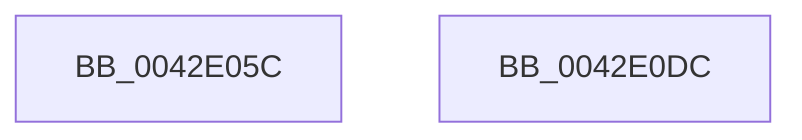

# WheapGetTimestamp

- RVA: `0x0042E05C`–`0x0042E0DD` (길이 `129` bytes)
- VA: `0x000000014042E05C`
- 실행 섹션: `.text`
- PDB 이름 있음: `예`; PDB Function 태그: `아니요`
- unwind 정보 RVA: `0x00064C80`
- 디코드: `37`개 명령, `129/129` bytes 표시
- 미해석 바이트: `0` (있으면 어셈블리에 `.byte`로 보존)

> 이 문서는 커널 이미지의 기계어와 PDB 기호를 분석해 생성했습니다. 4번과 5번은 함수 원형과 자료형을 바이너리 사용 방식에서 추정한 C 해석이며 원본 소스 복구 결과는 아닙니다.

## 1. Dependencies

- 직접 호출 지점: **1**; 고유 호출 대상: **1**
- 직접 호출자로 확인된 함수: **1**
- RIP 상대 이미지 참조: **0**

### Outgoing calls
- `0x0042E089` → [RtlpTimeToTimeFields](RtlpTimeToTimeFields_function_0042E110.md) (function, `0x0042E110`)

### Direct callers
- [WheaInitializeRecordHeader](WheaInitializeRecordHeader_function_0042DFF0.md) at `0x0042E031`

### Static image references
- 디코드된 RIP-relative 메모리 참조가 없습니다.

## 2. Other-region calls and transfers

- 다른 실행 섹션으로 향하는 call: **0**
- 별도 외부 분기/꼬리 이동을 확인하지 못했습니다.

## 3. Assembly (complete function range)

```asm
0042E05C  40 53                           push rbx
0042E05E  48 83 EC 30                     sub rsp, 0x30
0042E062  48 8B D9                        mov rbx, rcx
0042E065  48 8D 54 24 20                  lea rdx, [rsp + 0x20]
0042E06A  0F 57 C0                        xorps xmm0, xmm0
0042E06D  48 8D 4C 24 40                  lea rcx, [rsp + 0x40]
0042E072  48 B8 14 00 00 00 80 F7 FF FF   movabs rax, 0xfffff78000000014
0042E07C  0F 11 44 24 20                  movups xmmword ptr [rsp + 0x20], xmm0
0042E081  48 8B 00                        mov rax, qword ptr [rax]
0042E084  48 89 44 24 40                  mov qword ptr [rsp + 0x40], rax
0042E089  E8 82 00 00 00                  call 0x14042e110
0042E08E  8A 44 24 2A                     mov al, byte ptr [rsp + 0x2a]
0042E092  0F BF 4C 24 20                  movsx ecx, word ptr [rsp + 0x20]
0042E097  88 03                           mov byte ptr [rbx], al
0042E099  8A 44 24 28                     mov al, byte ptr [rsp + 0x28]
0042E09D  88 43 01                        mov byte ptr [rbx + 1], al
0042E0A0  8A 44 24 26                     mov al, byte ptr [rsp + 0x26]
0042E0A4  88 43 02                        mov byte ptr [rbx + 2], al
0042E0A7  48 0F BA 33 18                  btr qword ptr [rbx], 0x18
0042E0AC  8A 44 24 24                     mov al, byte ptr [rsp + 0x24]
0042E0B0  88 43 04                        mov byte ptr [rbx + 4], al
0042E0B3  8A 44 24 22                     mov al, byte ptr [rsp + 0x22]
0042E0B7  88 43 05                        mov byte ptr [rbx + 5], al
0042E0BA  B8 1F 85 EB 51                  mov eax, 0x51eb851f
0042E0BF  F7 E9                           imul ecx
0042E0C1  C1 FA 05                        sar edx, 5
0042E0C4  8B C2                           mov eax, edx
0042E0C6  C1 E8 1F                        shr eax, 0x1f
0042E0C9  03 D0                           add edx, eax
0042E0CB  6B C2 64                        imul eax, edx, 0x64
0042E0CE  88 53 07                        mov byte ptr [rbx + 7], dl
0042E0D1  2B C8                           sub ecx, eax
0042E0D3  88 4B 06                        mov byte ptr [rbx + 6], cl
0042E0D6  48 83 C4 30                     add rsp, 0x30
0042E0DA  5B                              pop rbx
0042E0DB  C3                              ret
0042E0DC  CC                              int3
```

## 4. C-style interpretation (structured pseudocode)

```c
__int64 __fastcall WheapGetTimestamp(__int64 a1)
{
    __int64 result;
    __int64 v_rsp;
    unsigned __int8 v_stack_m10;
    unsigned __int8 v_stack_m12;
    unsigned __int8 v_stack_m14;
    unsigned __int8 v_stack_m16;
    unsigned __int64 v_stack_m18;
    unsigned __int8 v_stack_mE;
    unsigned __int64 v_stack_p8;

    v_rsp = (v_rsp) - (48);
    v_stack_m18 = v_xmm0;
    v_stack_p8 = *(unsigned __int64 *)(result);
    result = RtlpTimeToTimeFields(v_stack_p8, v_stack_m18, a3, a4);
    *(unsigned __int8 *)(a1) = (unsigned __int8)(v_stack_mE);
    *(unsigned __int8 *)(a1 + 1) = (unsigned __int8)(v_stack_m10);
    *(unsigned __int8 *)(a1 + 2) = (unsigned __int8)(v_stack_m12);
    *(unsigned __int8 *)(a1 + 4) = (unsigned __int8)(v_stack_m14);
    *(unsigned __int8 *)(a1 + 5) = (unsigned __int8)(v_stack_m16);
    a2 = (unsigned int)((v_stack_m18) >> (5));
    result = (unsigned int)(((unsigned int)((unsigned int)(a2))) >> (31));
    a2 = (unsigned int)((a2) + ((unsigned int)(result)));
    result = (unsigned int)((result) * ((unsigned int)(a2)));
    *(unsigned __int8 *)(a1 + 7) = (unsigned __int8)(a2);
    a1 = (unsigned int)(((__int16)(v_stack_m18)) - ((unsigned int)(result)));
    *(unsigned __int8 *)(a1 + 6) = (unsigned __int8)(a1);
    v_rsp = (v_rsp) + (48);
    return result;
}
```

## 5. (Beta) C Style

```c
int64_t WheapGetTimestamp(void *Arg1)
{
    uint8_t *arg1 = (uint8_t *)Arg1;

    int64_t result;
    int64_t local_rsp;
    uint8_t v_stack_m10;
    uint8_t v_stack_m12;
    uint8_t v_stack_m14;
    uint8_t v_stack_m16;
    uint64_t v_stack_m18;
    uint8_t v_stack_mE;
    uint64_t v_stack_p8;

    local_rsp = (local_rsp) - (48);
    v_stack_m18 = v_xmm0;
    v_stack_p8 = *(uint64_t *)(result);
    result = RtlpTimeToTimeFields(v_stack_p8, v_stack_m18, a3, a4);
    *(uint8_t *)(arg1) = (uint8_t)(v_stack_mE);
    *(uint8_t *)(arg1 + 0x1) = (uint8_t)(v_stack_m10);
    *(uint8_t *)(arg1 + 0x2) = (uint8_t)(v_stack_m12);
    *(uint8_t *)(arg1 + 0x4) = (uint8_t)(v_stack_m14);
    *(uint8_t *)(arg1 + 0x5) = (uint8_t)(v_stack_m16);
    a2 = (uint32_t)((v_stack_m18) >> (5));
    result = (uint32_t)(((uint32_t)((uint32_t)(a2))) >> (31));
    a2 = (uint32_t)((a2) + ((uint32_t)(result)));
    result = (uint32_t)((result) * ((uint32_t)(a2)));
    *(uint8_t *)(arg1 + 0x7) = (uint8_t)(a2);
    Arg1 = (uint32_t)(((int16_t)(v_stack_m18)) - ((uint32_t)(result)));
    *(uint8_t *)(arg1 + 0x6) = (uint8_t)(Arg1);
    local_rsp = (local_rsp) + (48);
    return result;
}
```

### 관측된 메모리 오프셋

구조체 형식이 확인되지 않은 접근은 인자 기준의 오프셋으로만 기록했습니다.

| 기준 인자 | 오프셋 표현 | 폭 (bit) | 접근 |
|---|---:|---:|---|
| `Arg1` | `+ 0x0` | `8` | `W` |
| `Arg1` | `+ 0x0` | `64` | `R/W` |
| `Arg1` | `+ 0x1` | `8` | `W` |
| `Arg1` | `+ 0x2` | `8` | `W` |
| `Arg1` | `+ 0x4` | `8` | `W` |
| `Arg1` | `+ 0x5` | `8` | `W` |
| `Arg1` | `+ 0x6` | `8` | `W` |
| `Arg1` | `+ 0x7` | `8` | `W` |

## 6. Execution-region graph

[열기: 2D/3D 그래프와 함수 탐색 컨트롤 패널](../../../control-panel.html?section=text&rva=0x0042E05C&view=graph)

- 2D 그래프는 위에서 아래로 흐르고, 3D 그래프는 빈 공간을 드래그해 회전합니다. Shift+드래그는 이동, 휠은 확대·축소, 함수 노드 선택은 대상 보고서 이동입니다.

### Static fallback


