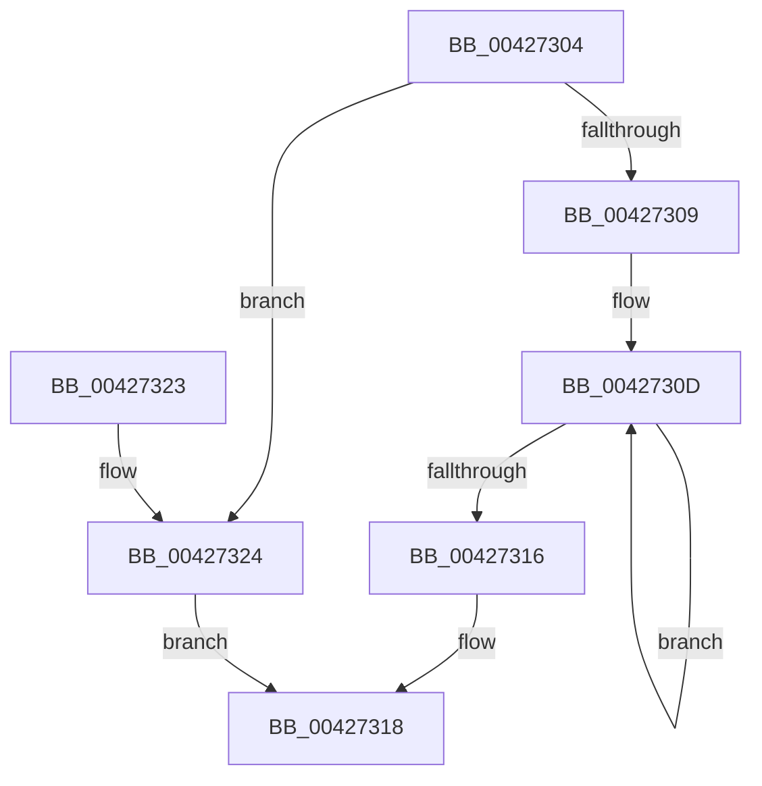

# tlgCreate1Sz_char

- RVA: `0x00427304`–`0x00427332` (길이 `46` bytes)
- VA: `0x0000000140427304`
- 실행 섹션: `.text`
- PDB 이름 있음: `예`; PDB Function 태그: `아니요`
- unwind 정보 RVA: `0x000DB714`
- 디코드: `15`개 명령, `46/46` bytes 표시
- 미해석 바이트: `0` (있으면 어셈블리에 `.byte`로 보존)

> 이 문서는 커널 이미지의 기계어와 PDB 기호를 분석해 생성했습니다. 4번과 5번은 함수 원형과 자료형을 바이너리 사용 방식에서 추정한 C 해석이며 원본 소스 복구 결과는 아닙니다.

## 1. Dependencies

- 직접 호출 지점: **0**; 고유 호출 대상: **0**
- 직접 호출자로 확인된 함수: **38**
- RIP 상대 이미지 참조: **1**

### Outgoing calls
- 직접 디코드된 call 명령이 없습니다.

### Direct callers
- [KiTraceLogHeteroRundown](KiTraceLogHeteroRundown_function_004269B4.md) at `0x00426C2C`
- [KiTraceLogHeteroRundown](KiTraceLogHeteroRundown_function_004269B4.md) at `0x00426C3D`
- [KiTraceLogHeteroRundown](KiTraceLogHeteroRundown_function_004269B4.md) at `0x00426C61`
- [CarEtwCrashEvent](../61/CarEtwCrashEvent_function_00617800.md) at `0x00617942`
- [CarEtwWriteBugCheckEvent](../61/CarEtwWriteBugCheckEvent_function_00617B68.md) at `0x00617C31`
- [CarEtwWriteLiveDumpEvent](../61/CarEtwWriteLiveDumpEvent_function_00617CD8.md) at `0x00617D72`
- [MiLogOutswappedProcessCommitReacquire](../66/MiLogOutswappedProcessCommitReacquire_function_0066F228.md) at `0x0066F291`
- [MiLogOutswappedProcessCommitReacquire](../66/MiLogOutswappedProcessCommitReacquire_function_0066F228.md) at `0x0066F2D2`
- [MiLogOutswappedProcessCommitReacquire](../66/MiLogOutswappedProcessCommitReacquire_function_0066F228.md) at `0x0066F306`
- [MiLogOutswappedProcessCommitRelease](../66/MiLogOutswappedProcessCommitRelease_function_0066F388.md) at `0x0066F3E0`
- [MiLogResetPagesCommitRelease](../66/MiLogResetPagesCommitRelease_function_0066F470.md) at `0x0066F4C8`
- [MiLogUpdateOldPagesInWs](../67/MiLogUpdateOldPagesInWs_function_0067EB40.md) at `0x0067EBE7`
- [MiLogUnlockVmTrim](../68/MiLogUnlockVmTrim_function_00689C7C.md) at `0x00689D26`
- [sub_006DB344](../6D/Unknown_function_006DB344.md) at `0x006DB366`
- [sub_006DBF86](../6D/Unknown_function_006DBF86.md) at `0x006DC02C`
- [sub_006DC222](../6D/Unknown_function_006DC222.md) at `0x006DC244`
- [sub_006E27CE](../6E/Unknown_function_006E27CE.md) at `0x006E280C`
- [sub_006F23BA](../6F/Unknown_function_006F23BA.md) at `0x006F2572`
- [sub_006F5DD8](../6F/Unknown_function_006F5DD8.md) at `0x006F5E81`
- [sub_006F5DD8](../6F/Unknown_function_006F5DD8.md) at `0x006F5EE8`
- [sub_006FC388](../6F/Unknown_function_006FC388.md) at `0x006FC3AB`
- [NtCreateIoRing](../../page/72/NtCreateIoRing_function_00720530.md) at `0x00720A81`
- [NtCreateIoRing](../../page/72/NtCreateIoRing_function_00720530.md) at `0x00720A91`
- [PopDiagTraceBatteryAlarmStatus](../../page/76/PopDiagTraceBatteryAlarmStatus_function_00760804.md) at `0x00760898`
- [PopDiagTraceBatteryAlarmStatus](../../page/76/PopDiagTraceBatteryAlarmStatus_function_00760804.md) at `0x00760A6C`
- [PopPowerAdapterAdd](../../page/76/PopPowerAdapterAdd_function_00767430.md) at `0x0076768B`
- [PopPowerAdapterAdd](../../page/76/PopPowerAdapterAdd_function_00767430.md) at `0x0076789A`
- [PopPowerAdapterPublishRecState](../../page/76/PopPowerAdapterPublishRecState_function_007679CC.md) at `0x00767B55`
- [PopPowerAdapterPublishRecState](../../page/76/PopPowerAdapterPublishRecState_function_007679CC.md) at `0x00767B73`
- [PopPowerAdapterPublishRecState](../../page/76/PopPowerAdapterPublishRecState_function_007679CC.md) at `0x00767B7F`
- [PopPowerAdapterReinitialize](../../page/76/PopPowerAdapterReinitialize_function_00767E48.md) at `0x00768051`
- [MiLogCreateImageFileMapFailure](../../page/7F/MiLogCreateImageFileMapFailure_function_007FCCDC.md) at `0x007FCD3A`
- [MiLogHotPatchOperation](../../page/80/MiLogHotPatchOperation_function_00804A04.md) at `0x00804ADE`
- [MiLogHotPatchOperation](../../page/80/MiLogHotPatchOperation_function_00804A04.md) at `0x00804C63`
- [MiLogHotPatchOperationStatus](../../page/80/MiLogHotPatchOperationStatus_function_00804E84.md) at `0x00804F8B`
- [MiLogHotPatchOperationStatus](../../page/80/MiLogHotPatchOperationStatus_function_00804E84.md) at `0x00805105`
- [MiLogHotPatchOperationStatus](../../page/80/MiLogHotPatchOperationStatus_function_00804E84.md) at `0x008052FD`
- [MiLogHotPatchOperationStatus](../../page/80/MiLogHotPatchOperationStatus_function_00804E84.md) at `0x00805403`
- [MiLogHotPatchRundown](../../page/80/MiLogHotPatchRundown_function_008057A4.md) at `0x00805EE7`
- [MiLogHotPatchRundown](../../page/80/MiLogHotPatchRundown_function_008057A4.md) at `0x0080611D`
- [CmLoadAppKey](../../page/87/CmLoadAppKey_function_00876FFC.md) at `0x008778AE`
- [TtmiLogError](../../page/98/TtmiLogError_function_0098B39C.md) at `0x0098B45E`
- [PopSetBatteryDischargingState](../../page/A8/PopSetBatteryDischargingState_function_00A8450C.md) at `0x00A84607`
- [PopSetBatteryDischargingState](../../page/A8/PopSetBatteryDischargingState_function_00A8450C.md) at `0x00A84627`
- [PopSetBatteryDischargingState](../../page/A8/PopSetBatteryDischargingState_function_00A8450C.md) at `0x00A84640`
- [PopSetBatteryDischargingState](../../page/A8/PopSetBatteryDischargingState_function_00A8450C.md) at `0x00A84659`
- [PopSetBatteryDischargingState](../../page/A8/PopSetBatteryDischargingState_function_00A8450C.md) at `0x00A84672`
- [PopSetBatteryDischargingState](../../page/A8/PopSetBatteryDischargingState_function_00A8450C.md) at `0x00A8468B`
- [PopSetBatteryDischargingState](../../page/A8/PopSetBatteryDischargingState_function_00A8450C.md) at `0x00A846A4`
- [PopSetBatteryDischargingState](../../page/A8/PopSetBatteryDischargingState_function_00A8450C.md) at `0x00A846BD`
- [PopSetBatteryDischargingState](../../page/A8/PopSetBatteryDischargingState_function_00A8450C.md) at `0x00A846D8`
- [PopSetBatteryDischargingState](../../page/A8/PopSetBatteryDischargingState_function_00A8450C.md) at `0x00A846F3`
- [PopSetBatteryDischargingState](../../page/A8/PopSetBatteryDischargingState_function_00A8450C.md) at `0x00A8484B`
- [PopSetBatteryDischargingState](../../page/A8/PopSetBatteryDischargingState_function_00A8450C.md) at `0x00A8486B`
- [PopSetBatteryDischargingState](../../page/A8/PopSetBatteryDischargingState_function_00A8450C.md) at `0x00A84884`
- [PopSetBatteryDischargingState](../../page/A8/PopSetBatteryDischargingState_function_00A8450C.md) at `0x00A8489D`
- [PopSetBatteryDischargingState](../../page/A8/PopSetBatteryDischargingState_function_00A8450C.md) at `0x00A848B6`
- [PopSetBatteryDischargingState](../../page/A8/PopSetBatteryDischargingState_function_00A8450C.md) at `0x00A848CF`
- [PopSetBatteryDischargingState](../../page/A8/PopSetBatteryDischargingState_function_00A8450C.md) at `0x00A848E8`
- [PopSetBatteryDischargingState](../../page/A8/PopSetBatteryDischargingState_function_00A8450C.md) at `0x00A84901`
- [PopSetBatteryDischargingState](../../page/A8/PopSetBatteryDischargingState_function_00A8450C.md) at `0x00A8491C`
- [PopDiagTraceExecutePowerAction](../../page/AB/PopDiagTraceExecutePowerAction_function_00AB173C.md) at `0x00AB1B0A`
- [MiLogStrongCodeDriverLoadFailure](../../page/AC/MiLogStrongCodeDriverLoadFailure_function_00AC2E6C.md) at `0x00AC2ED5`
- [PopAccountBatteryEnergyChange](../../page/AD/PopAccountBatteryEnergyChange_function_00ADFE50.md) at `0x00AE0024`
- [PopAccountBatteryEnergyChange](../../page/AD/PopAccountBatteryEnergyChange_function_00ADFE50.md) at `0x00AE0041`
- [PopAccountBatteryEnergyChange](../../page/AD/PopAccountBatteryEnergyChange_function_00ADFE50.md) at `0x00AE005E`
- [PopAccountBatteryEnergyChange](../../page/AD/PopAccountBatteryEnergyChange_function_00ADFE50.md) at `0x00AE007B`
- [PopAccountBatteryEnergyChange](../../page/AD/PopAccountBatteryEnergyChange_function_00ADFE50.md) at `0x00AE00FC`
- [PopAccountBatteryEnergyChange](../../page/AD/PopAccountBatteryEnergyChange_function_00ADFE50.md) at `0x00AE0119`
- [PopAccountBatteryEnergyChange](../../page/AD/PopAccountBatteryEnergyChange_function_00ADFE50.md) at `0x00AE0136`
- [PopAccountBatteryEnergyChange](../../page/AD/PopAccountBatteryEnergyChange_function_00ADFE50.md) at `0x00AE0156`
- [PopAccountBatteryEnergyChange](../../page/AD/PopAccountBatteryEnergyChange_function_00ADFE50.md) at `0x00AE0176`
- [PopAccountBatteryEnergyChange](../../page/AD/PopAccountBatteryEnergyChange_function_00ADFE50.md) at `0x00AE0196`
- [PopAccountBatteryEnergyChange](../../page/AD/PopAccountBatteryEnergyChange_function_00ADFE50.md) at `0x00AE01B6`
- [PopAccountBatteryEnergyChange](../../page/AD/PopAccountBatteryEnergyChange_function_00ADFE50.md) at `0x00AE01D6`
- [PopAccountBatteryEnergyChange](../../page/AD/PopAccountBatteryEnergyChange_function_00ADFE50.md) at `0x00AE01F4`
- [PopAccountBatteryEnergyChange](../../page/AD/PopAccountBatteryEnergyChange_function_00ADFE50.md) at `0x00AE0212`
- [PopAccountBatteryEnergyChange](../../page/AD/PopAccountBatteryEnergyChange_function_00ADFE50.md) at `0x00AE0366`
- [PopAccountBatteryEnergyChange](../../page/AD/PopAccountBatteryEnergyChange_function_00ADFE50.md) at `0x00AE0383`
- [PopAccountBatteryEnergyChange](../../page/AD/PopAccountBatteryEnergyChange_function_00ADFE50.md) at `0x00AE03A0`
- [PopAccountBatteryEnergyChange](../../page/AD/PopAccountBatteryEnergyChange_function_00ADFE50.md) at `0x00AE03BD`
- [PopAccountBatteryEnergyChange](../../page/AD/PopAccountBatteryEnergyChange_function_00ADFE50.md) at `0x00AE043E`
- [PopAccountBatteryEnergyChange](../../page/AD/PopAccountBatteryEnergyChange_function_00ADFE50.md) at `0x00AE045B`
- [PopAccountBatteryEnergyChange](../../page/AD/PopAccountBatteryEnergyChange_function_00ADFE50.md) at `0x00AE0478`
- [PopAccountBatteryEnergyChange](../../page/AD/PopAccountBatteryEnergyChange_function_00ADFE50.md) at `0x00AE0498`
- [PopAccountBatteryEnergyChange](../../page/AD/PopAccountBatteryEnergyChange_function_00ADFE50.md) at `0x00AE04B8`
- [PopAccountBatteryEnergyChange](../../page/AD/PopAccountBatteryEnergyChange_function_00ADFE50.md) at `0x00AE04D8`
- [PopAccountBatteryEnergyChange](../../page/AD/PopAccountBatteryEnergyChange_function_00ADFE50.md) at `0x00AE04F8`
- [PopAccountBatteryEnergyChange](../../page/AD/PopAccountBatteryEnergyChange_function_00ADFE50.md) at `0x00AE0518`
- [PopAccountBatteryEnergyChange](../../page/AD/PopAccountBatteryEnergyChange_function_00ADFE50.md) at `0x00AE0536`
- [PopAccountCbEnergyChange](../../page/AE/PopAccountCbEnergyChange_function_00AE0680.md) at `0x00AE0797`
- [PopAccountCbEnergyChange](../../page/AE/PopAccountCbEnergyChange_function_00AE0680.md) at `0x00AE07AF`
- [PopAccountCbEnergyChange](../../page/AE/PopAccountCbEnergyChange_function_00AE0680.md) at `0x00AE07CA`
- [PopAccountCbEnergyChange](../../page/AE/PopAccountCbEnergyChange_function_00AE0680.md) at `0x00AE07E1`
- [PopAccountCbEnergyChange](../../page/AE/PopAccountCbEnergyChange_function_00AE0680.md) at `0x00AE082F`
- [PopAccountCbEnergyChange](../../page/AE/PopAccountCbEnergyChange_function_00AE0680.md) at `0x00AE0847`
- [PopAccountCbEnergyChange](../../page/AE/PopAccountCbEnergyChange_function_00AE0680.md) at `0x00AE085E`
- [PopAccountCbEnergyChange](../../page/AE/PopAccountCbEnergyChange_function_00AE0680.md) at `0x00AE0875`
- [PopAccountCbEnergyChange](../../page/AE/PopAccountCbEnergyChange_function_00AE0680.md) at `0x00AE088D`
- [PopAccountCbEnergyChange](../../page/AE/PopAccountCbEnergyChange_function_00AE0680.md) at `0x00AE08A5`
- [PopAccountCbEnergyChange](../../page/AE/PopAccountCbEnergyChange_function_00AE0680.md) at `0x00AE08BD`
- [PopAccountCbEnergyChange](../../page/AE/PopAccountCbEnergyChange_function_00AE0680.md) at `0x00AE08D5`
- [PopAccountCbEnergyChange](../../page/AE/PopAccountCbEnergyChange_function_00AE0680.md) at `0x00AE08F2`
- [PopAccountCbEnergyChange](../../page/AE/PopAccountCbEnergyChange_function_00AE0680.md) at `0x00AE090F`
- [PopAccountCbEnergyChange](../../page/AE/PopAccountCbEnergyChange_function_00AE0680.md) at `0x00AE0A33`
- [PopAccountCbEnergyChange](../../page/AE/PopAccountCbEnergyChange_function_00AE0680.md) at `0x00AE0A4B`
- [PopAccountCbEnergyChange](../../page/AE/PopAccountCbEnergyChange_function_00AE0680.md) at `0x00AE0A66`
- [PopAccountCbEnergyChange](../../page/AE/PopAccountCbEnergyChange_function_00AE0680.md) at `0x00AE0A7D`
- [PopAccountCbEnergyChange](../../page/AE/PopAccountCbEnergyChange_function_00AE0680.md) at `0x00AE0ACB`
- [PopAccountCbEnergyChange](../../page/AE/PopAccountCbEnergyChange_function_00AE0680.md) at `0x00AE0AE3`
- [PopAccountCbEnergyChange](../../page/AE/PopAccountCbEnergyChange_function_00AE0680.md) at `0x00AE0AFA`
- [PopAccountCbEnergyChange](../../page/AE/PopAccountCbEnergyChange_function_00AE0680.md) at `0x00AE0B11`
- [PopAccountCbEnergyChange](../../page/AE/PopAccountCbEnergyChange_function_00AE0680.md) at `0x00AE0B29`
- [PopAccountCbEnergyChange](../../page/AE/PopAccountCbEnergyChange_function_00AE0680.md) at `0x00AE0B41`
- [PopAccountCbEnergyChange](../../page/AE/PopAccountCbEnergyChange_function_00AE0680.md) at `0x00AE0B59`
- [PopAccountCbEnergyChange](../../page/AE/PopAccountCbEnergyChange_function_00AE0680.md) at `0x00AE0B71`
- [PopAccountCbEnergyChange](../../page/AE/PopAccountCbEnergyChange_function_00AE0680.md) at `0x00AE0B8E`
- [PopBatteryApplyCompositeState](../../page/AE/PopBatteryApplyCompositeState_function_00AE0CD0.md) at `0x00AE1310`
- [PopBatteryWorker](../../page/AE/PopBatteryWorker_function_00AE1650.md) at `0x00AE21BC`
- [PopBatteryWorker](../../page/AE/PopBatteryWorker_function_00AE1650.md) at `0x00AE21D7`
- [PopBatteryWorker](../../page/AE/PopBatteryWorker_function_00AE1650.md) at `0x00AE21F2`
- [PopBatteryWorker](../../page/AE/PopBatteryWorker_function_00AE1650.md) at `0x00AE220D`
- [PopBatteryWorker](../../page/AE/PopBatteryWorker_function_00AE1650.md) at `0x00AE265D`
- [PopBatteryWorker](../../page/AE/PopBatteryWorker_function_00AE1650.md) at `0x00AE267F`
- [PopBatteryWorker](../../page/AE/PopBatteryWorker_function_00AE1650.md) at `0x00AE2699`
- [PopBatteryWorker](../../page/AE/PopBatteryWorker_function_00AE1650.md) at `0x00AE26B3`
- [PopBatteryWorker](../../page/AE/PopBatteryWorker_function_00AE1650.md) at `0x00AE26D2`
- [PopBatteryWorker](../../page/AE/PopBatteryWorker_function_00AE1650.md) at `0x00AE26ED`
- [PopBatteryWorker](../../page/AE/PopBatteryWorker_function_00AE1650.md) at `0x00AE2708`
- [PopBatteryWorker](../../page/AE/PopBatteryWorker_function_00AE1650.md) at `0x00AE2723`
- [PopBatteryWorker](../../page/AE/PopBatteryWorker_function_00AE1650.md) at `0x00AE2741`
- [PopBatteryWorker](../../page/AE/PopBatteryWorker_function_00AE1650.md) at `0x00AE288F`
- [PopBatteryWorker](../../page/AE/PopBatteryWorker_function_00AE1650.md) at `0x00AE2954`
- [PopBatteryWorker](../../page/AE/PopBatteryWorker_function_00AE1650.md) at `0x00AE2976`
- [PopBatteryWorker](../../page/AE/PopBatteryWorker_function_00AE1650.md) at `0x00AE2990`
- [PopBatteryWorker](../../page/AE/PopBatteryWorker_function_00AE1650.md) at `0x00AE29AA`
- [PopBatteryWorker](../../page/AE/PopBatteryWorker_function_00AE1650.md) at `0x00AE29C9`
- [PopBatteryWorker](../../page/AE/PopBatteryWorker_function_00AE1650.md) at `0x00AE29E4`
- [PopBatteryWorker](../../page/AE/PopBatteryWorker_function_00AE1650.md) at `0x00AE29FF`
- [PopBatteryWorker](../../page/AE/PopBatteryWorker_function_00AE1650.md) at `0x00AE2A1A`
- [PopBatteryWorker](../../page/AE/PopBatteryWorker_function_00AE1650.md) at `0x00AE2A38`
- [PopBatteryWorker](../../page/AE/PopBatteryWorker_function_00AE1650.md) at `0x00AE2A56`
- [PopBatteryWorker](../../page/AE/PopBatteryWorker_function_00AE1650.md) at `0x00AE2BA2`
- [sub_00B2A746](../../page/B2/Unknown_function_00B2A746.md) at `0x00B2A7F9`
- [sub_00B2A746](../../page/B2/Unknown_function_00B2A746.md) at `0x00B2A8E5`
- [sub_00B44136](../../page/B4/Unknown_function_00B44136.md) at `0x00B44168`
- [sub_00B484E6](../../page/B4/Unknown_function_00B484E6.md) at `0x00B48576`
- [MiFlushStrongCodeDriverLoadFailures](../../init/C6/MiFlushStrongCodeDriverLoadFailures_function_00C61680.md) at `0x00C61730`

### Static image references
- `0x00427324` → RVA `0x006C7800` (` ?? ::FNODOBFM::`string'`; read)

## 2. Other-region calls and transfers

- 다른 실행 섹션으로 향하는 call: **0**
- 별도 외부 분기/꼬리 이동을 확인하지 못했습니다.

## 3. Assembly (complete function range)

```asm
00427304  48 85 D2                        test rdx, rdx
00427307  74 1B                           je 0x140427324
00427309  48 83 C8 FF                     or rax, 0xffffffffffffffff
0042730D  48 FF C0                        inc rax
00427310  80 3C 02 00                     cmp byte ptr [rdx + rax], 0
00427314  75 F7                           jne 0x14042730d
00427316  FF C0                           inc eax
00427318  83 61 0C 00                     and dword ptr [rcx + 0xc], 0
0042731C  48 89 11                        mov qword ptr [rcx], rdx
0042731F  89 41 08                        mov dword ptr [rcx + 8], eax
00427322  C3                              ret
00427323  CC                              int3
00427324  48 8D 15 D5 04 2A 00            lea rdx, [rip + 0x2a04d5]
0042732B  B8 01 00 00 00                  mov eax, 1
00427330  EB E6                           jmp 0x140427318
```

## 4. C-style interpretation (structured pseudocode)

```c
__int64 __fastcall tlgCreate1Sz_char(__int64 a1, __int64 a2)
{
    __int64 result;

    if (a2 == 0) goto loc_00427324;
    result = (result) | (-1);
loc_0042730D:
    result = (result) + 1;
    if ((*(unsigned __int8 *)(a2 + result * 1)) != 0) goto loc_0042730D;
    result = (unsigned int)((result) + 1);
loc_00427318:
    *(unsigned __int64 *)(a1) = a2;
    *(unsigned int *)(a1 + 8) = (unsigned int)(result);
    return result;
loc_00427324:
    goto loc_00427318;
}
```

## 5. (Beta) C Style

```c
int64_t tlgCreate1Sz_char(void *Arg1, int64_t Arg2)
{
    uint8_t *arg1 = (uint8_t *)Arg1;

    int64_t result;

    if (Arg2 == 0) goto loc_00427324;
    result = (result) | (-1);
loc_0042730D:
    result = (result) + 1;
    if ((*(uint8_t *)(Arg2 + result * 1)) != 0) goto loc_0042730D;
    result = (uint32_t)((result) + 1);
loc_00427318:
    *(uint64_t *)(arg1) = Arg2;
    *(uint32_t *)(arg1 + 0x8) = (uint32_t)(result);
    return result;
loc_00427324:
    goto loc_00427318;
}
```

### 관측된 메모리 오프셋

구조체 형식이 확인되지 않은 접근은 인자 기준의 오프셋으로만 기록했습니다.

| 기준 인자 | 오프셋 표현 | 폭 (bit) | 접근 |
|---|---:|---:|---|
| `Arg1` | `+ 0x0` | `64` | `W` |
| `Arg1` | `+ 0x8` | `32` | `W` |
| `Arg1` | `+ 0xC` | `32` | `R/W` |

## 6. Execution-region graph

[열기: 2D/3D 그래프와 함수 탐색 컨트롤 패널](../../../control-panel.html?section=text&rva=0x00427304&view=graph)

- 2D 그래프는 위에서 아래로 흐르고, 3D 그래프는 빈 공간을 드래그해 회전합니다. Shift+드래그는 이동, 휠은 확대·축소, 함수 노드 선택은 대상 보고서 이동입니다.

### Static fallback


